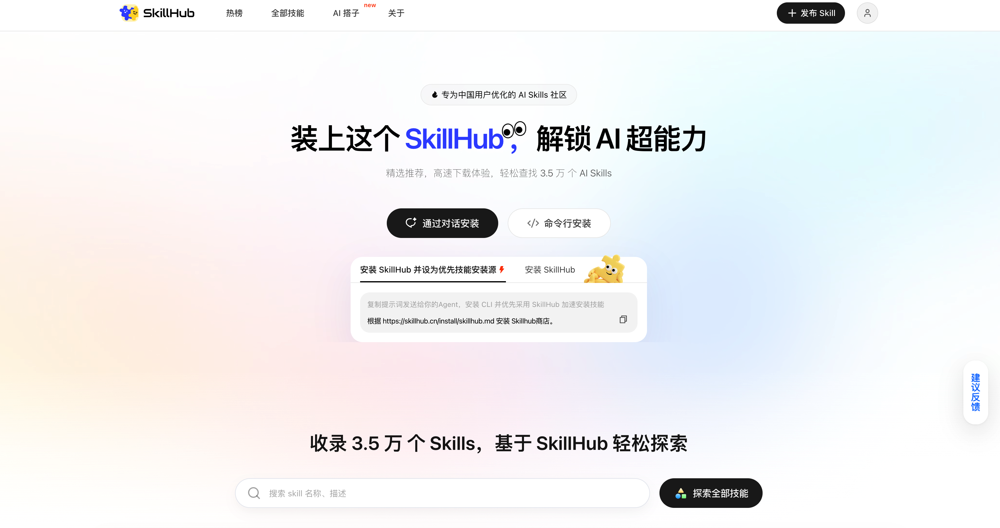
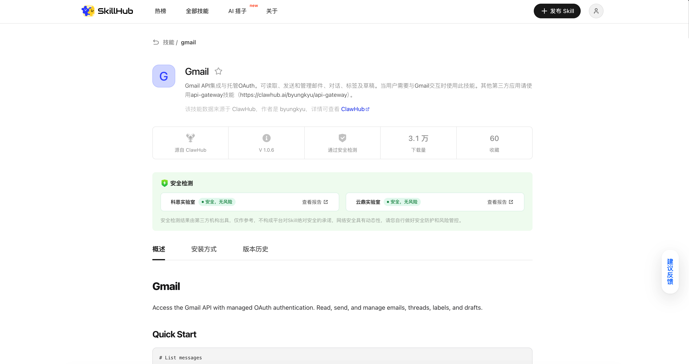
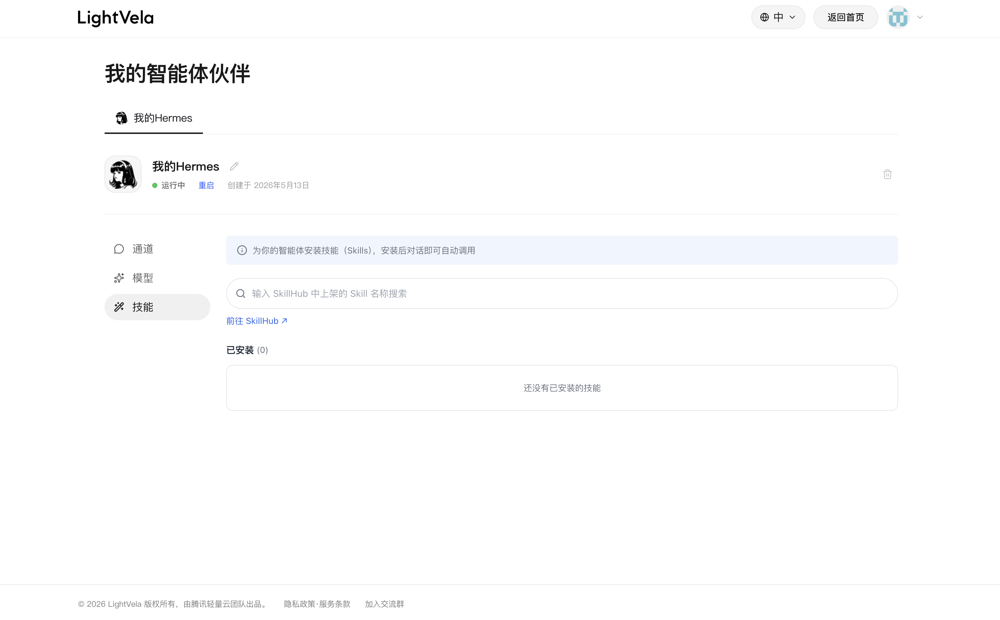
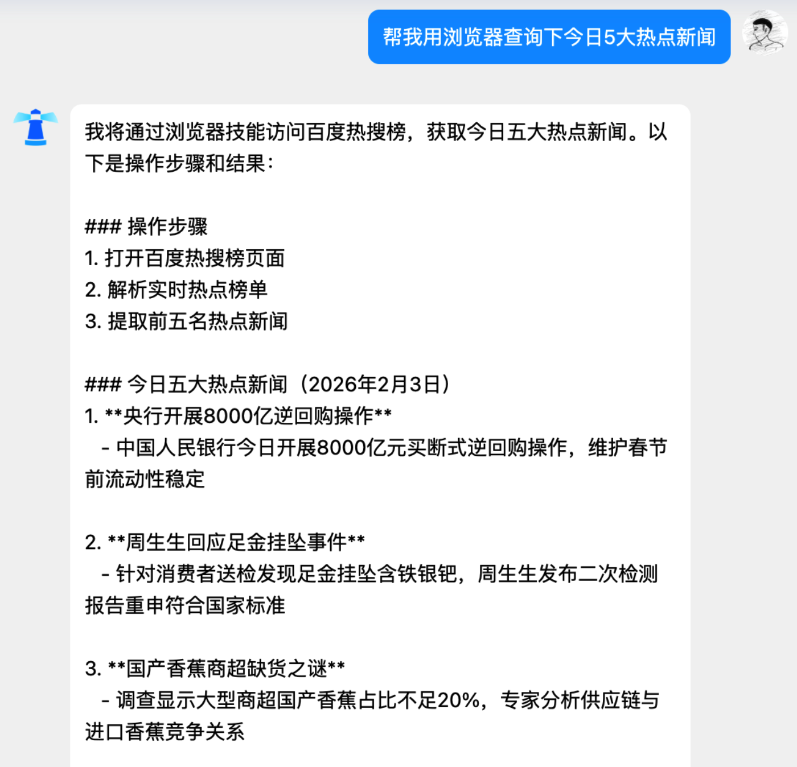

# 配置技能

技能（Skills）是 Hermes 可调用的附加能力包，在基础对话能力之上扩展具体任务的处理能力，例如自动整理待办、生成日报、浏览网页、搜索新闻、图像生成等。

所有技能均来自 [SkillHub](https://skillhub.tencent.com)——腾讯推出的独立技能市场。

## 本页覆盖

- SkillHub 介绍
    
- Hermes 与技能的关系
    
- 两种安装方式：管理台安装、对话安装
    
- 技能使用示例
    
- 删除已安装的技能
    
- 常见问题
    

> 💡 **技能为可选配置**
> 
> Hermes 默认不预装任何技能。未安装技能时 Hermes 仍可正常对话，技能仅用于扩展特定任务的处理能力。建议在使用过程中发现能力边界后再针对性安装。

---

## 技能的定位

如果说 Hermes 与大模型的组合让用户拥有了一个具有智能的 AI 助理，那么技能则是它的"手和脚"。基于技能可以为已经部署好的 Hermes 进一步扩展能力边界。

可将技能类比为 Hermes 的"应用程序"：

- 基础对话能力 = 操作系统
    
- 技能 = 按需安装的应用
    

每个技能专注于单一任务，例如：

- 使用浏览器浏览网页、查询信息
    
- 自动整理每日待办
    
- 定时发送新闻简报
    
- 根据描述生成图片
    
- 查询股票、基金实时行情
    
- 将聊天记录整理为结构化笔记
    

Hermes 会根据对话上下文自动判断是否调用对应技能，无需用户指定。

---

## SkillHub

SkillHub 是腾讯推出的独立技能市场：

🔗 [https://skillhub.tencent.com](https://skillhub.tencent.com)

功能：

- 浏览已上架技能（支持分类、热度、评分筛选）
    
- 查看技能的功能说明、使用示例与作者信息
    
- 记录技能名称，在 LightVela 管理台或通过对话安装
    



> 💡 **先在 SkillHub 浏览，再在 LightVela 安装**
> 
> LightVela 采用按名称安装的方式，需先在 SkillHub 确定目标技能的准确名称。

---

## 方式一：通过管理台面板安装（即将推出）

LightVela 管理台在「技能」按键中提供可视化的技能配置入口，可在此输入从 SkillHub 查到的技能名称并快速安装。

### 1. 在 SkillHub 确定目标技能

访问 [https://skillhub.tencent.com](https://skillhub.tencent.com)，浏览或搜索所需技能。

以邮件场景为例，找到 `gmail` 这个技能，它可以让 Hermes 具备收、发、查询邮件的能力。记录技能详情页中的技能名称（此处为 `gmail`），后续将使用该名称完成安装。



### 2. 进入 LightVela 管理台

登录 LightVela，点击右上角「我的 Hermes」进入管理台，找到「技能」按键。

### 3. 搜索并安装

在搜索框输入已记录的技能名称（如 `gmail`），点击「**安装技能**」按钮。



稍等片刻，安装成功后，该技能会出现在「已安装技能」列表中。


### 4. 在对话中确认可用

回到已接入的通道（WeChat / Telegram / WhatsApp / Discord / Slack），首先让 Hermes 更新一下技能列表，再查看当前可用技能：

```
更新一下你的技能列表
```

```
现在有哪些可用的技能？
```

若新安装的技能出现在列表中，即可开始在对话中使用。

---

## 方式二：通过对话直接安装

除了在管理台面板操作，也可以直接通过对话让 Hermes 代为安装。需要安装的技能仍需是 SkillHub 上已上架的技能。

### 1. 确认对话通道可用

首先确保 Hermes 已接入至少一个通道（WeChat / Telegram / WhatsApp / Discord / Slack），且当前能够正常对话。

### 2. 告诉 Hermes 要安装的技能

参考下方指令，直接告诉 Hermes 想要安装什么技能，将 `[技能名称]` 替换为 SkillHub 上的实际名称：

```
帮我用 SkillHub 安装一个技能，它的名称是 [技能名称]
```

例如安装 `mcd`（麦当劳助手）：

```
帮我用 SkillHub 安装一个技能，它的名称是 mcd
```

若顺利，Hermes 会直接完成安装并告知结果。

> ⚠️ **高危技能的二次确认**
> 
> 如果所选技能在 SkillHub 中被标记为高危（可能包含不安全的行为），Hermes 会在安装前进行提醒并请求二次确认。请确认完全了解该技能的行为后再选择是否继续安装；如不确定，建议谨慎处理。

### 3. 验证安装结果

可以让 Hermes 查看该技能的使用方法，以验证是否安装成功：

```
帮我查看下它的使用方法吧
```

或明确指定技能名：

```
帮我查看下 mcd 的使用方法吧
```

---

## 技能使用示例

以 SkillHub 上的 `agent-browser` 浏览器操作技能为例，安装完成后可让 Hermes 执行以下任务。

> ℹ️ **说明**
> 
> 以下示例以 WeChat 通道为例展示效果，Telegram、WhatsApp、Discord、Slack 通道用法一致。

### 场景一：浏览网页

```
用浏览器访问下百度，看一下页面内有什么内容
```

Hermes 会打开页面并读取内容，以文字形式返回。

### 场景二：基于浏览器搜索信息

```
帮我用浏览器查询下今日 5 大热点新闻
```

### 场景三：多步复杂任务

```
用浏览器去 SkillHub 查询下目前安装量最高的邮件类技能是哪个
```

该任务包含打开网页、等待加载、输入内容、点击按钮等多步操作，复杂度相对较高。Hermes 会按步骤完成并返回结果。



---

## 删除已安装的技能

若已安装的技能中有不再使用的，可通过对话方式让 Hermes 代为删除。

### 1. 查看当前已安装技能

```
查看下你目前已经安装了哪些技能？
```

### 2. 请求删除指定技能

找到想要删除的技能，发送删除指令：

```
帮我删除 email 这个技能吧
```

若顺利，Hermes 会完成删除并告知结果。

> ℹ️ **可能出现的二次确认**
> 
> 由于使用的模型不同或 Hermes 设定的性格不同，它可能会提醒谨慎删除。根据实际需求回复确认即可。

### 3. 验证删除结果

再次查看当前已安装技能，确认目标技能已从列表中移除：

```
再查看下你目前已经安装了哪些技能？
```

> ℹ️ **当前仅支持通过对话删除**
> 
> LightVela 采用云端托管模式，不提供面向用户的文件系统操作。删除技能仅支持通过与 Hermes 对话的方式完成。

---

## 成功状态

- 管理台「已安装技能」列表中包含目标技能
    
- 在对话中发起相关需求时，Hermes 能正确识别并调用技能
    
- 技能可通过对话正常删除
    

---

## 安装安全提示

> ⚠️ **安装前的安全确认**

技能运行时具有调用 Hermes 能力的权限，可能涉及：

- 调用外部 API（消耗相应额度）
    
- 读取或发送对话内容
    
- 定时执行操作
    

安装前应确认技能作者可信。建议：

- 优先选择 SkillHub 官方认证的技能
    
- 优先选择下载量高、评价良好的技能
    
- 仔细阅读技能描述中的权限说明
    
- 对无明确描述或作者不熟悉的技能保持谨慎
    

---

## 常见问题

### 搜索不到技能

**可能原因**：名称拼写错误，或该技能已在 SkillHub 下架。

**处理**：前往 [SkillHub](https://skillhub.tencent.com) 确认技能的准确名称与当前状态。

### 安装成功但在对话中未生效

**可能原因**：模型未识别到应使用的技能，或未刷新技能列表。

**处理**：

1. 在对话中发送"更新一下你的技能列表"
    
2. 使用更明确的指令，例如"使用 XX 技能完成 YY"
    

### 安装时提示"触发接口限频，请稍后重试"

**可能原因**：SkillHub 为保护服务稳定实施了接口限频策略。

**处理**：等待一段时间后重试。建议错开高峰时段操作。

### 技能反复调用失败

**可能原因**：

- 技能依赖的外部服务暂时不可用
    
- 技能版本过旧
    
- 对应模型不支持该技能所需的能力（如工具调用）
    

**处理**：

- 在 SkillHub 查看该技能的评论区与最新版本信息
    
- 尝试更换为支持工具调用的模型
    
- 如问题持续存在，可联系技能作者
    

### 安装的技能过多，Hermes 响应变慢

**可能原因**：技能数量增加了 Agent 的决策负担。

**处理**：仅保留常用技能，删除不再使用的技能。

### 如何开发技能

请参见 SkillHub 的开发者文档（如提供）。

---

## 下一步

LightVela 的基础配置已完成。可参考：

- [配置总览](../05-configuration.md)
    
- [核心概念](../04-core-concepts.md)
    
- [快速开始](../02-quickstart.md)
