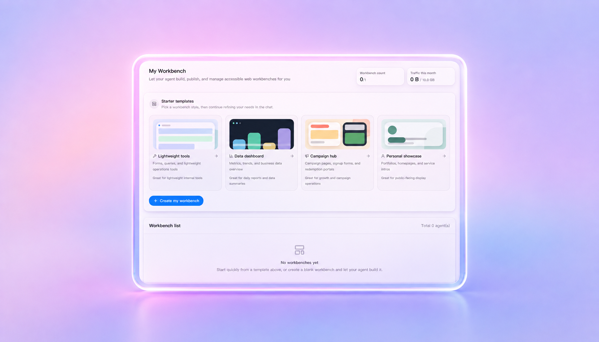
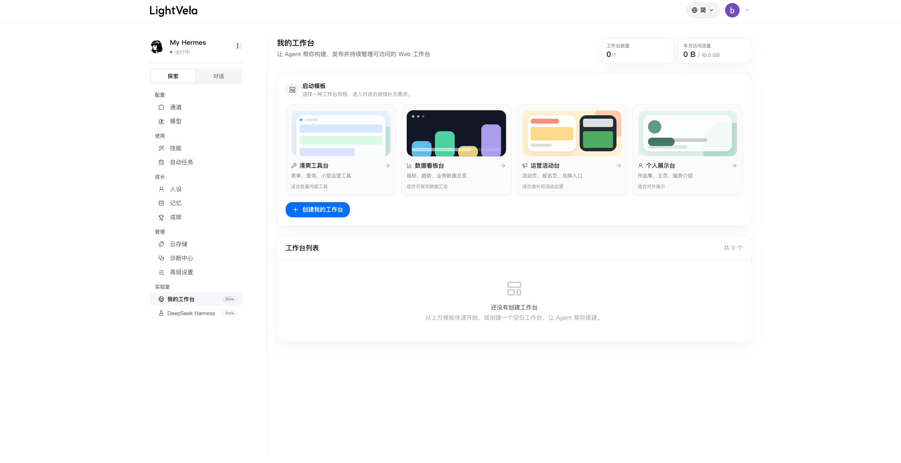
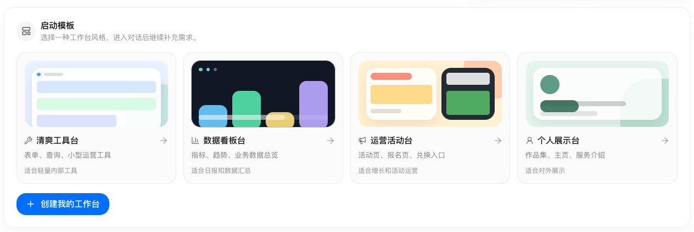
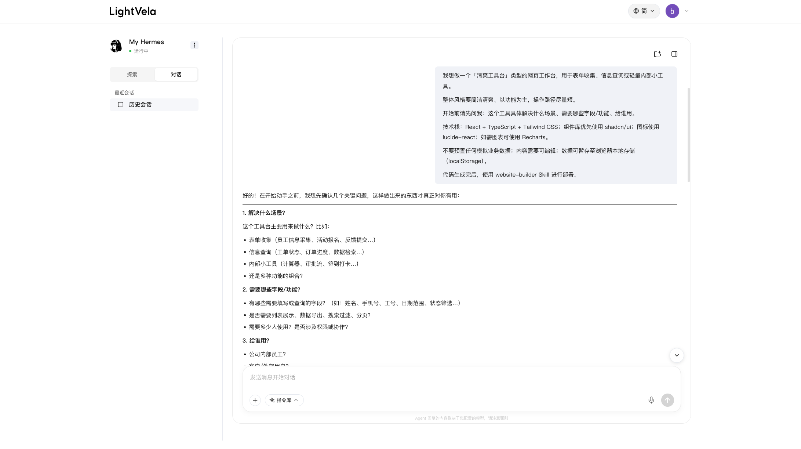
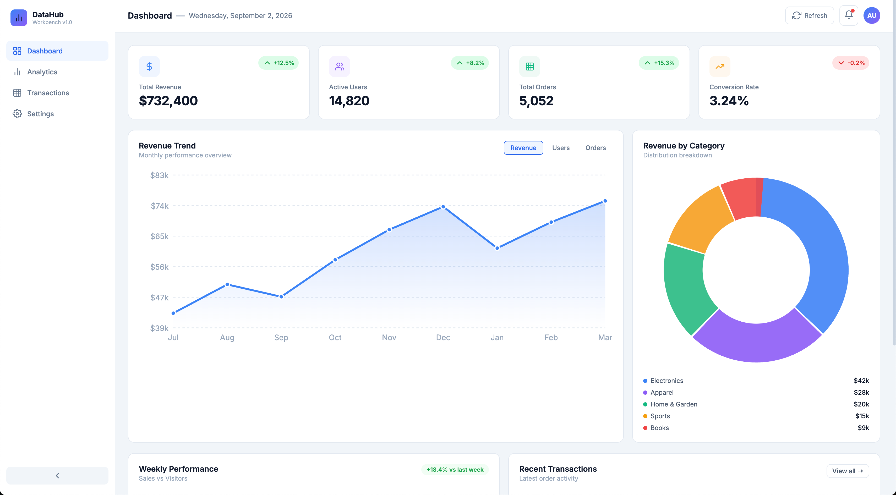

# 工作台

## 摘要

**我的工作台让你可以在 LightVela 中使用 AI Agent 创建、部署和管理静态网站。你可以选择起始模板，也可以从零描述网站需求，再与 Agent 一起持续调整并发布。**

部署后，你可以在同一个页面查看公网地址、当前状态和已有工作台。

提示：我的工作台目前处于 Beta 阶段，随着功能演进，生成和部署流程可能会调整。

## 我的工作台能做什么

我的工作台将 Agent 对话与托管静态网站流程连接起来。
你可以创建自己的工作台“工作站”，也可以选择提供的模板，然后与 Agent 交流、完善需求，并通过专属链接预览网站。

LightVela 负责托管流程，因此你不需要单独配置托管服务器或云账户。

## 打开我的工作台

1. 打开 [LightVela Agent 页面](/agents/)。
2. 在左侧导航中打开我的工作台。

工作台页面会显示当前用量、可用模板和已有工作台。

## 选择起始模板

起始模板可以帮助你快速确定网站方向。
你可以根据要创建的网站类型选择模板：

- 简洁工具仪表盘：适合表单、信息查询或轻量内部工具。
- 数据仪表盘：适合核心指标、趋势、业务概览或日报。
- 活动落地页：适合活动页面、报名页面或兑换入口。
- 个人展示页：适合作品集、个人主页或服务介绍。

选择模板后，系统会带着预先准备好的请求打开 Agent 对话。

你也可以选择空白选项，让 Agent 一步一步与你确认需求。

## 使用 Agent 对话创建工作台

1. 选择起始模板，或从空白工作台开始。
2. 描述网站的用途、受众、内容和视觉方向。
3. 回答 Agent 在确认需求时提出的问题。
4. 查看生成结果，并要求 Agent 进行修改。
5. 网站准备好后，请 Agent 发布最新版本。

当前流程使用 React、TypeScript、Tailwind CSS 和常见 UI 库生成网站。

Agent 还会被要求保持内容可编辑，避免预置虚构业务数据，并在适合临时保存本地数据时使用浏览器 localStorage。

## 查看工作台状态

每个工作台都有部署状态，用于判断网站是否可以访问。

| 状态 | 说明 |
| --- | --- |
| Building | 网站正在生成或准备中。 |
| Publishing | 最新版本正在发布。 |
| Online | 网站已经可以通过公网地址访问。 |
| Update failed | 最近一次生成或发布失败。 |
| Offline | 网站不可用或已经被移除。 |

工作台处于 Online 状态并显示公网地址后，选择访问即可打开网站。

如果工作台仍处于 Building 或 Publishing 状态，请等待处理完成，必要时刷新页面。

## 管理已有工作台

已有工作台列表会显示网站名称、公网地址、创建日期和当前状态。

如需更新工作台，请回到 Agent 对话并描述要修改的内容。
查看修改结果后，请 Agent 发布更新后的版本。

如需移除工作台：

1. 在列表中找到目标工作台。
2. 选择删除操作。
3. 确认删除。

删除工作台后，它会立即下线，相关文件也会被移除。
此操作无法撤销。

## 工作台配额和托管限制

工作台数量限制取决于你的套餐。

- Launch 套餐：可创建 1 个工作台。
- 更高等级套餐：最多可创建 5 个工作台。

如果达到数量上限，请先删除已有工作台，或升级套餐后再创建新的工作台。

## 常见问题

| 问题 | 可能原因 | 处理方式 |
| --- | --- | --- |
| 打开工作台页面后要求登录 | 当前会话已过期。 | 重新登录，然后再次打开我的工作台。 |
| 无法创建新的工作台 | 可能已达到套餐数量上限。 | 查看当前用量，或移除不再使用的工作台。 |
| 状态一直是 Building 或 Publishing | 部署仍在处理。 | 稍等片刻，然后刷新页面。 |
| 无法使用访问操作 | 工作台还没有上线。 | 等待状态变为 Online。 |
| 状态变为 Update failed | 最近一次生成或发布失败。 | 查看 Agent 回复，按要求修改后重试。 |
| 在另一个浏览器中看不到网站数据 | 数据保存在当前浏览器的 localStorage 中。 | 如果网站需要共享或持久化数据，请使用后端服务。 |
| 已删除的工作台仍出现在列表中 | 删除仍在处理中。 | 等待清理完成，然后刷新页面。 |

## 当前边界

我的工作台用于通过 Agent 对话创建和托管静态网站。
它不提供服务端存储、托管数据库、持久化表单处理、共享账号或任意后端服务。
工作台数量、流量、存储空间、软件包大小和文件数量取决于当前套餐。

## 常见问题解答

### 可以创建哪些类型的网站？

你可以创建仪表盘、内部工具、活动页面、作品集、落地页和其他静态前端网站。

### 需要编码经验吗？

不需要。
你可以用自然语言描述需求，让 Agent 引导你完成需求确认、生成和发布。

### 可以更新已有工作台吗？

可以。
回到 Agent 对话，描述要修改的内容，查看结果后请 Agent 发布更新版本。

### 网站可以保存数据吗？

静态网站可以使用当前浏览器的 localStorage 临时保存数据。
LightVela 不为工作台网站提供服务端持久化存储。

### 需要单独的托管账户吗？

不需要。
LightVela 会提供静态工作台的托管流程。

### 为什么我的工作台不能立即使用？

生成和发布需要一定时间。
请查看当前状态，等待状态变为 Online 后再打开公网地址。
