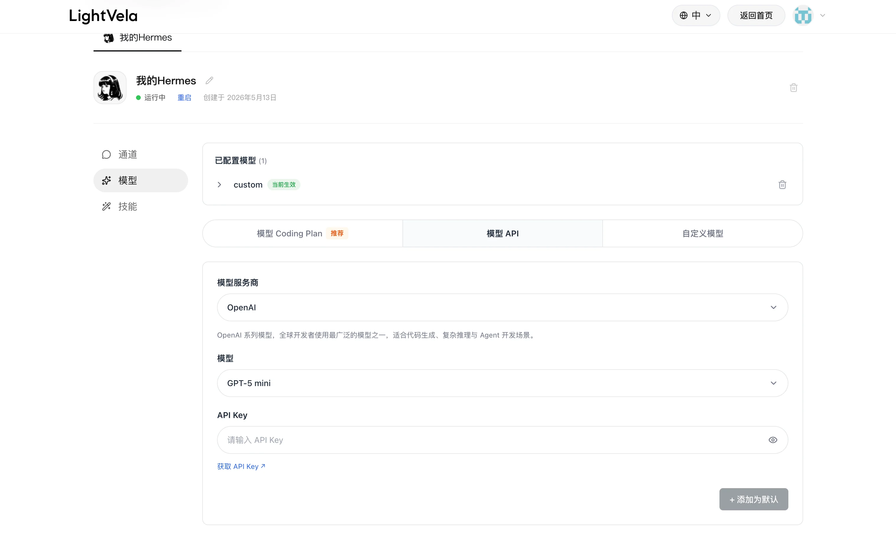

# What is LightVela

## Summary

**LightVela is a cloud-hosted agent platform from the Tencent Lighthouse team, and its current product is Hermes Agent — an AI agent built on large language models. LightVela takes care of deployment, operations, and 24/7 uptime in the cloud, so you never write config files or SSH into a server: you set everything up by pointing and clicking in a visual panel, then chat with your Bot directly in Daily → Chat or connect the messaging apps you already use. It remembers you across conversations, and you choose the model, tools, and persona. Current plans and introductory offers are listed on the [Subscribe page](/subscribe/).**

---

> A cloud-hosted Hermes Agent that understands you better over time.

LightVela is a cloud Agent hosting product from the Tencent Lighthouse team. It is designed to let everyone own an **AI companion that truly belongs to them**—not a tool that asks you to introduce yourself every time, but a long-term presence that **knows you, remembers you, and understands you better over time**.

Your Agent stays online 24/7, runs independently, and is always ready to chat. You decide its model, tools, and persona.

We lower the configuration barrier through a visual console: no config files, no server login, just select options on the web page to complete setup.

The current LightVela product is **Hermes Agent**, an AI Agent powered by large language models. More ready-to-use products may be added in the future. This documentation focuses on Hermes Agent.


***

## Who it is for

* Users who want to use an AI Agent but do not have technical knowledge of servers, containers, API authentication, and related infrastructure

* Users who prefer interacting with AI through everyday messaging platforms (Telegram / WhatsApp / Discord / Slack / WeChat) instead of a standalone app

* Users who want to choose from multiple large language model providers (including ChatGPT, Claude, Gemini, Deepseek, Qwen, Zhipu, Hunyuan, and more)

* Users who need persistent memory across conversations instead of starting from scratch every time

## Not suitable for

* Users who require fully local execution with no data leaving their device

* Users who need to train or fine-tune the underlying model

* Developers who need to integrate an Agent into their own website or application

***

## Product features

* **Fully managed deployment**: The cloud automatically handles environment setup and runtime management. No server operations, container images, or infrastructure knowledge required

* **Dedicated cloud environment**: Each Hermes Agent instance has its own cloud environment, resource isolation, 24/7 availability, and no dependency on local devices

* **Multi-model support**: Connect to mainstream Chinese large language models, provider Coding Plan subscriptions, or any OpenAI-compatible endpoint. See [Configure Models](./configuration/model.md)

* **Multi-channel access**: Chat with Hermes Agent through Telegram, WhatsApp, Discord, Slack, WeChat, QQ, WeCom, and Lark

* **Skill extensions**: Search and install Skills or Skill Packages from [Skills.sh](https://skills.sh/) and [ClawHub](https://clawhub.ai/) in the console

* **Ready to use**: The Launch plan includes trial credits, so you can start chatting after activation without configuring a model separately

* **Dedicated cloud storage**: Conversation and memory data are stored independently

***

## How it works

LightVela runs Hermes Agent in the cloud. You can send messages from Web Chat or connect an external messaging platform when needed.

```
User (sends a message in Web Chat or a connected messaging app)
      ↓
User-dedicated Hermes Agent instance in the LightVela cloud
      ↓
Calls the configured large language model (GPT / Claude / Gemin / ...)
      ↓
Response returns to the same conversation entry point
```

A conversation in Web Chat does not require an external channel:

1. **Model**: The large language model called by Hermes Agent. The Launch plan includes trial credits and can be used directly; you can also configure your own API Key

2. **Chat entry point**: Use Daily → Chat in My Agent to talk to the selected Bot. Configure a channel only when you want to use Telegram, WhatsApp, Discord, WeChat, or another messaging app

3. **Skill** (optional): Additional capabilities for Hermes Agent



***

## About plans

A plan provides one Hermes Agent cloud instance. The Launch series supports up to 5 Bots inside that instance; the Cruise series supports up to 10. Bots are separate profiles, not additional Hermes instances.

| Plan option | Model credits per month | Bots |
|---|---:|---:|
| Launch | 100 | 5 |
| Launch AI | 4,500 | 5 |
| Cruise | 200 | 10 |
| Cruise AI | 10,000 | 10 |

Prices, introductory offers, and availability change. Check the [Subscribe page](/subscribe) before ordering; active subscribers can also buy one-time [model credit packs](./credits.md).
***

## Relationship with Lighthouse (optional)

For users familiar with Tencent Cloud: LightVela can be understood as a ready-to-use packaging of Tencent Lighthouse cloud Agent deployment capabilities. LightVela removes concepts such as Tencent Cloud accounts, resource management, and cloud resource operations, leaving only two core actions: configuring an Agent and connecting it to a messaging platform.

If you are new to cloud Agents, you can skip this section.

***

## Next steps

* **[Quickstart](./02-quickstart.md)** — Complete your first conversation in 5 minutes

* **[Core Concepts](./04-core-concepts.md)** — Understand the five core concepts: Hermes Agent, Bots, models, channels, and skills

* **[Configuration Overview](./05-configuration.md)** — Console features and configuration flow
