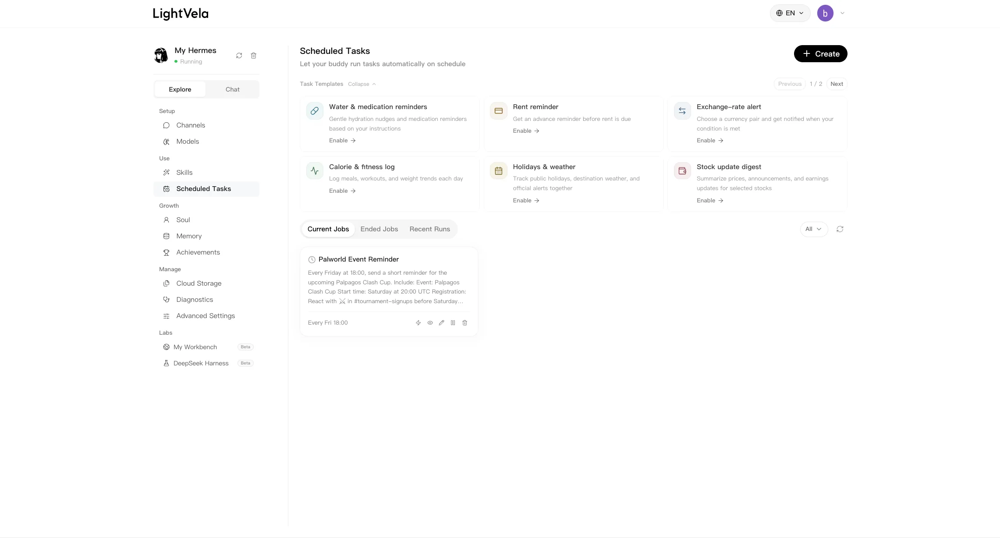
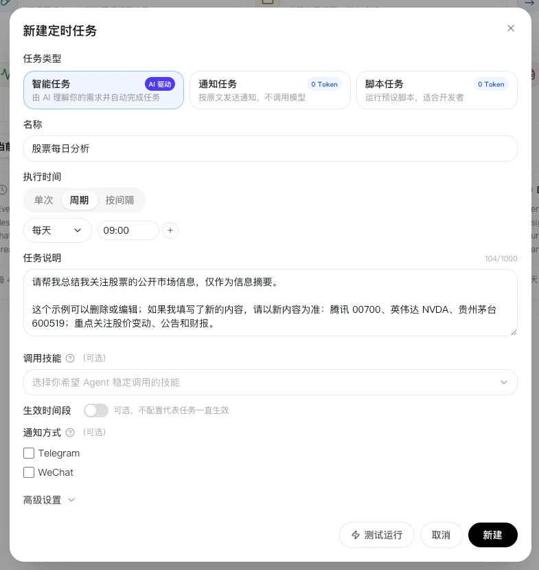

# Scheduled Tasks

## Summary

**Scheduled Tasks let Hermes Agent start work without a manual prompt. Choose an Agent Task when the work needs AI reasoning, a Notification Task when the same message should be sent as written, or a Script Task when a Bash or Python script should make a deterministic check. All three types use the same one-time, recurring, and interval schedules, effective window, and notification settings.**

## Choose a Task Type

Pick a task type based on what needs to happen when the schedule is reached.

| Task type | Best for | What you provide | What runs |
| --- | --- | --- | --- |
| **Agent Task** | Summaries, research, analysis, drafting, or other work that needs interpretation | Task instructions, and optionally a Skill or an upstream task | Hermes Agent starts a model-backed task. |
| **Notification Task** | Exact reminders, notices, and routine messages | The notification text | A LightVela-managed task sends your text as written, without calling a model. |
| **Script Task** | Developer workflows, checks, and deterministic automation | A Bash or Python script | The script runs without an Agent session or model call. Non-empty standard output can be delivered as the notification. |

Task type is separate from the schedule pattern.
Every type can run once, on a recurring daily, weekly, or monthly cadence, or at a fixed interval.

## Before You Create a Task

Make sure Hermes Agent is active, choose a notification channel if needed, and review any Script Task code before saving.

## Create an Agent Task

Choose **Agent Task** when Hermes Agent needs to understand your request and generate a result.
For example, an Agent Task can collect daily AI news, select the most relevant items, and write a concise briefing.

Set the following fields:

- **Name**: Give the task a recognizable name.
- **Schedule**: Choose a one-time run, a recurring cadence, or a fixed interval.
- **Task instructions**: Describe the goal, scope, source constraints, and expected output format.
- **Skill**: Optionally attach an available Skill when the task needs that capability.
- **Upstream task**: Optionally use the most recent completed output from another Agent Task as added context.
- **Effective window**: Optionally restrict when the task is allowed to run.
- **Notification**: Optionally choose where the completed result should be sent.

At the scheduled time, Hermes Agent creates an Agent task and calls the selected model.
The result can be delivered to the selected notification channels and is recorded in Recent Runs. With no channel selected, the task is created with local-only delivery; its result stays in this Bot's Recent Runs and is not sent to chat.

## Create a Notification Task

Choose **Notification Task** for a message that should arrive exactly as you write it.
For example, create a daily hydration reminder, a monthly rent reminder, or a short team notice.

Set the task name, schedule, notification content, effective window, and notification channels.
Notification content can contain normal punctuation, line breaks, emoji, and multilingual text.

At the scheduled time, LightVela sends the notification content as written.
It does not ask a model to draft, rewrite, summarize, translate, or explain the message.
That means model-token usage is 0 Token for the task.

A Notification Task requires at least one notification channel before it can be created or saved.
Notification-channel formatting may still affect how line breaks and characters appear to recipients.

## Create a Script Task

Choose **Script Task** when you need a deterministic Bash or Python workflow.
For example, a script can check disk usage, inspect a service response, or print an alert only when a threshold is reached.

Set the task name, schedule, script language, script content, effective window, and notification channels.
Before you create the task, acknowledge the script safety notice and confirm that you trust the code.

Script Tasks do not create an Agent session, call a model, use a prompt, or invoke Skills.
They have 0 Token model usage, but they do use cloud Agent runtime resources.

| Script result | Task outcome | Delivery behavior |
| --- | --- | --- |
| Exit code `0` with non-empty standard output | Successful | The standard output is delivered as written to the selected notification channels. |
| Exit code `0` with empty standard output | Silent success | No result notification is sent. |
| Non-zero exit code | Failed | The failure is recorded and follows the task's failure handling. |
| Timeout or startup failure | Failed | The failure type is recorded and follows the task's failure handling. |

Do not rely on a Script Task to repair, explain, or summarize a failure with AI.
It stays deterministic: an empty output remains silent, and a failing script does not trigger a model fallback.

## Link an Upstream Agent Task

Use an upstream task when one Agent Task should prepare context for another.
The downstream task receives the upstream task's latest completed output while keeping its own schedule, instructions, effective window, and notification settings.

Schedule dependent tasks with enough time between them, and explain in the downstream instructions how to use the upstream output.
Upstream context, model execution, and Skills apply only to Agent Tasks.

## Set the Shared Schedule and Delivery Rules

All three task types share the same scheduling and notification controls.

- **One-time**: Run once at the selected date and time.
- **Recurring**: Run daily, weekly, or monthly at the selected time.
- **Interval**: Run every selected number of minutes, hours, or days.
- **Effective window**: Restrict when recurring or interval tasks can run, or leave it empty to keep them active around the clock.
- **Notification**: Select the channels that should receive successful task output or notifications.

Changing a task type while creating a task keeps these shared settings.
After creation, task type cannot be changed, so create a new task if the execution model needs to change.

## Use Task Templates

If you are not sure how to start an Agent Task, use the Template Area on the Scheduled Tasks page.
Choose a card such as Water & medication reminders, Rent reminder, Exchange-rate alert, or Stock update digest, then review the generated schedule and instructions before creating the task.

Opening a template pre-fills the Create Job dialog.
The Stock update digest template, for example, fills in the task name, a daily schedule, and market-information instructions that you can refine before testing or creating it.

Create a custom Notification Task or Script Task from the Create dialog rather than changing a template task type.

## Manage Scheduled Tasks

After a task is created, use the Scheduled Tasks page to review Current Jobs, Ended Jobs, and Recent Runs.
The Current Jobs view can filter Agent Tasks, Notification Tasks, and Script Tasks.

In **Recent Runs**, open a run and choose **View result** to read its Markdown output or **Download Markdown** to save it. First switch to the Bot that owns the task: its result stays in that Bot’s run records and does not appear in another Bot’s chat or records.

Ended Jobs collects completed, failed, and expired tasks.
Ongoing tasks stay under Current Jobs.

From the task list, inspect details, edit allowed settings, pause a task, or delete it.
For an Agent Task with an upstream dependency, check whether another task still needs its latest completed output before deleting it.

## Validate a New Task

After creating or editing a task, do not stop at “saved successfully.”

1. Confirm that the task appears in the correct task-type filter and that its status matches expectations.
2. Check the schedule, effective window, and notification settings.
3. Run a test or wait for one real execution, then inspect Recent Runs.
4. For an Agent Task, check that the output follows the instructions and uses the selected upstream task output when configured.
5. For a Notification Task, check that the delivered text matches your content.
6. For a Script Task, check the exit result and whether standard output was delivered or correctly stayed silent.

## Common Failure Handling

| Symptom | Likely cause | Suggested handling |
| --- | --- | --- |
| The task did not run when expected | The schedule, effective window, or task state is not active | Check the schedule and effective window, confirm the task is enabled, then inspect Recent Runs. |
| An Agent Task output misses the point | The instructions are vague, a required Skill is unavailable, or upstream context is missing | State the goal, scope, output format, and source constraints clearly. Check the Skill and upstream task before the next run. |
| A Notification Task ran but no message arrived | No notification channel was selected, or the target channel is unavailable | Select and verify a notification channel, then test the task again. |
| A Script Task ran without a message | The script exited successfully without standard output | This is a silent success. Make the script print the exact text that should be delivered when the condition is met. |
| A Script Task failed | The script exited with an error, timed out, or could not start | Inspect the run record, correct the trusted script, and test it again. Do not expect AI to repair or explain the script automatically. |
