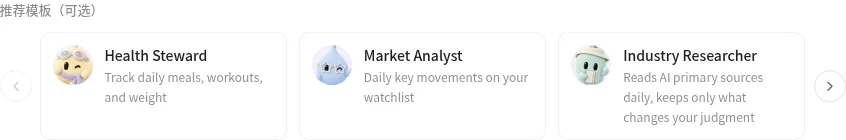
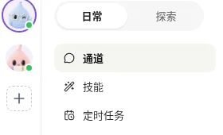

# Bots Switching

## Summary

**Bots Switching lets one LightVela cloud Agent contain multiple specialized Bots. You can create Bots for research, planning, coding, content, support, or recurring workflows, then switch between them from the Agent profile menu.**

**Each Bot has its own workspace context. Depending on whether you create a blank Bot or clone an existing Bot, LightVela applies different inheritance rules to model settings, memory, skills, personality, scheduled tasks, and channel connections.**

## Before you start

- Sign in to LightVela and open an active cloud Agent.
- To create an additional Bot, make sure your current plan allows another Bot and that no other Bot is still being created or deleted.
- If you plan to connect a channel, prepare the credentials or authorization method required by that channel.

## Creating your bot

After selecting **New Bot**, choose an avatar, enter a name and description, and choose whether to create a blank Bot or clone an existing Bot.

When another Bot already exists, the creation dialog can offer **Copy current**, **Copy main Bot**, or **Blank create**.

For example, to create a Financial Analyst Bot, you may enter:

> <strong>Name:</strong> Alpha Analyst
>
> <strong>Description:</strong> Alpha Analyst is specialized in analyzing company reports, market news, portfolio performance, valuation, and financial risks. Produces concise, evidence-based insights, clearly separates facts from assumptions, and avoids presenting analysis as guaranteed financial advice.

The creation screen may also show templates for specific roles, such as Health Manager, Market Watcher, or AI Study Buddy.

After entering the details, confirm the creation and wait for the new Bot to finish provisioning.

## Bot workspace and settings

After creation, the Bot opens its own settings workspace. From the Bot tab in the main Agent page, you can select that Bot and manage the settings available for it, including memory, skills, personality, scheduled tasks, and connected channels.

The creation mode determines what the new Bot inherits:

| Creation mode | Inherited | Starts separately |
| --- | --- | --- |
| Blank create | The primary model and its provider credentials, plus system-provided skills | Backup models, other configured models, personality, memory, skills installed later on the main Bot, channels, and scheduled tasks |
| Copy current or Copy main Bot | Models, personality, skills, user preferences, and long-term memory | Current conversation, previous chat history, scheduled tasks, runtime state, and channel connections |

Review the creation dialog before confirming if you need to keep settings separate. You can then manage each Bot's [memory](./memory.md), [skills](./skill.md), and [scheduled tasks](./automation.md) independently.

## Why build the Bots independently?

One Bot can handle many tasks, but its context becomes harder to manage as its responsibilities grow. A dedicated researcher, travel planner, financial analyst, or quality checker can keep a more focused set of memories, skills, personality settings, and scheduled tasks.

Independent Bots also make it easier to test a different working style without changing the Bot you already use for another task.

The result is a more organized LightVela workspace. To switch between Bots, click the active Bot profile in the upper-left area of the Agent workspace, then choose another Bot from the menu.

## How to use multiple Bots at once

You can connect multiple Bots to supported messaging channels. The available channel combinations depend on the LightVela region:

| LightVela version | Channels that support multiple Bot integration |
| --- | --- |
| China version | WeChat, QQ, WeCom, Lark, DingTalk |
| Global version | Telegram, Discord, WeChat, Slack, QQ, WeCom, Lark |

Different Bots on the same instance can connect separate WeChat accounts. Each Bot manages its own WeChat connection. WhatsApp remains limited to one connected Bot per instance; other Bots see an ownership notice and a link to manage that Bot.

## Verify a Bot switch or channel connection

After switching or connecting a Bot, check the following:

1. The active Bot name and avatar change to the Bot you selected.
2. The settings page shows the selected Bot's workspace and configuration.
3. A connected channel is listed under the Bot that owns the connection.
4. A short test message reaches the intended Bot and returns a reply.

For a group channel, send a test message with the permission level you configured. Confirm whether the Bot can only read the group context or can also reply.

## Common issues

| Issue | Likely cause | What to do |
| --- | --- | --- |
| **New Bot** is unavailable | Your plan has reached its Bot limit, or another Bot is still being created or deleted | Wait for the current operation to finish, delete an unused Bot, or upgrade to a plan with a higher limit |
| A clone option is unavailable | There is no valid current or main Bot to copy | Choose **Blank create**, or return to the intended Bot before opening the creation dialog |
| The Bot list is temporarily unavailable | The Agent instance is stopped or the Bot list request failed | Start or refresh the Agent, then reload the Bot settings page |
| A channel is already connected to another Bot | The channel has a single-Bot ownership restriction | Use the notice to open the owning Bot, or disconnect and reconnect the channel according to the channel configuration page |
| A group message receives no reply | The Bot's group permission or channel configuration is incomplete | Review the relevant [Telegram](./channel-telegram.md), [Discord](./channel-discord.md), or other channel configuration page, then send another test message |

## Chatting with your Bots in groups

You can invite multiple Bots into supported group chats. Depending on the permission level you set, a Bot may read the group context, reply to user enquiries, or do both.

Group behavior and setup steps vary by platform. Follow the relevant channel configuration page before inviting the Bot, and test the Bot with a direct mention or another platform-supported trigger where required.
