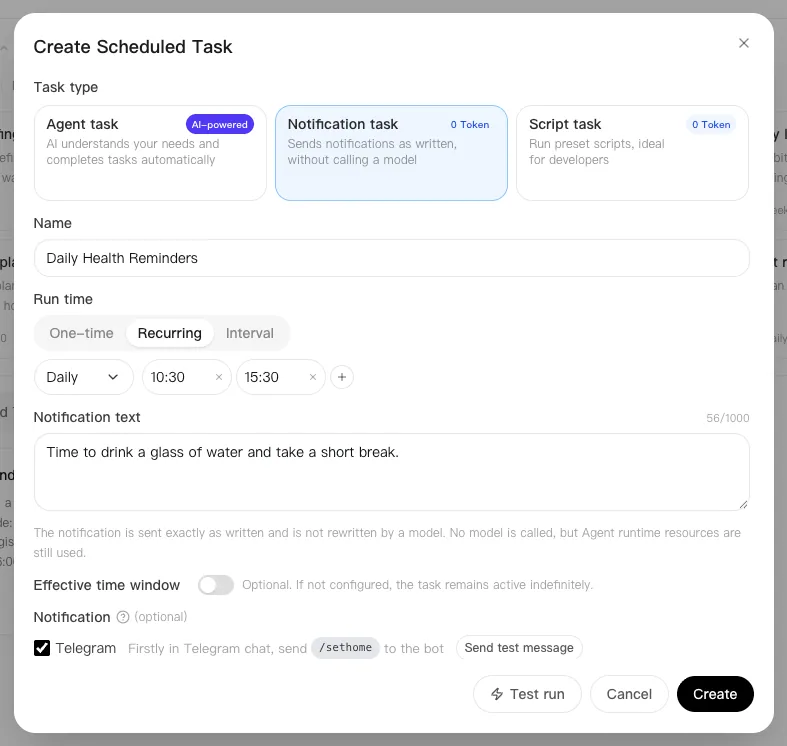
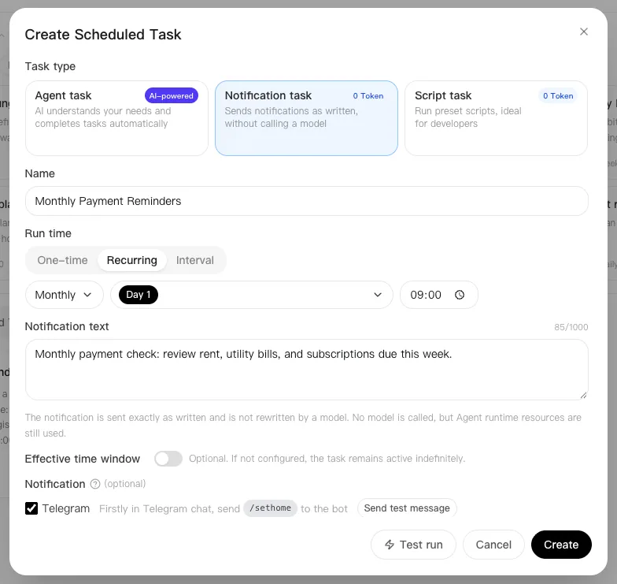
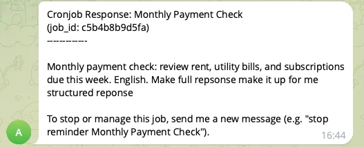
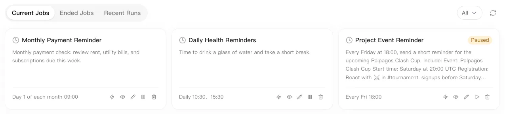

# Setting Notification Task in LightVela

## Summary

**Notification Tasks send your fixed message on a schedule without calling an AI model or using model credits.** Use them for reminders such as medication, bills, and subscription renewals; set the message, schedule, effective time window, and delivery channel.

Notification tasks are a simple application for cloud-hosted agents because they can send a fixed message on schedule without calling an AI model.
They can be used when you need a reminder to arrive at the right time, through the right channel, using the exact wording you provided.
Users have used them for water and medication reminders; some also created reminders for bills and subscription renewals.

## Common problems that notifications can solve

Most of us do not forget important tasks because we do not care.
Some small but necessary actions are simply easy to miss when work becomes busy.

- You forget to drink water during a long work session.
- Medication gets taken later than planned.
- A subscription renewal gets buried in your inbox.
- A bill is remembered only after its due date.

In LightVela, you can configure a Notification task with a message, schedule, effective time window, and delivery channel.
The message is sent exactly as written without calling a model, so it does not consume model tokens.
The [Scheduled Tasks documentation](https://lightvela.ai/docs/configuration/automation?from=social_x) explains the available scheduling and notification options.

## Case 1: Daily Health Reminders

Every day at 10:30 AM and 3:30 PM, a Notification task sends the same short reminder.

Message:

> Time to drink a glass of water and take a short break.

The key is to keep the message short and actionable.
Because it is not passed through a model, the notification will not be rewritten or given additional context.

## Case 2: Monthly Payment Reminders

On the first day of every month, a Notification task reminds you to review upcoming payments.

Message:

> Monthly payment check: review rent, utility bills, and subscriptions due this week.

The notification keeps each payment visible before its deadline.
If different bills have different due dates, create separate tasks so each reminder arrives when it is useful.

## Updating me directly in IMs

LightVela allows you to connect your agent to WhatsApp, Telegram, WeChat, Discord, and more.
You can connect to one or multiple channels at the same time.
In Scheduled Tasks, you can toggle each configured channel to decide where the notification should be delivered.

After toggling, Hermes will send the exact notification directly to your IM.
You do not need to open LightVela or another app to check the reminder.

## Managing multiple tasks

You can set as many scheduled tasks as you need.
After creating them, you can edit their content and schedules, pause them, and browse previous runs.
With LightVela, your personal Hermes agent can keep important routines on schedule while you focus on other work.

