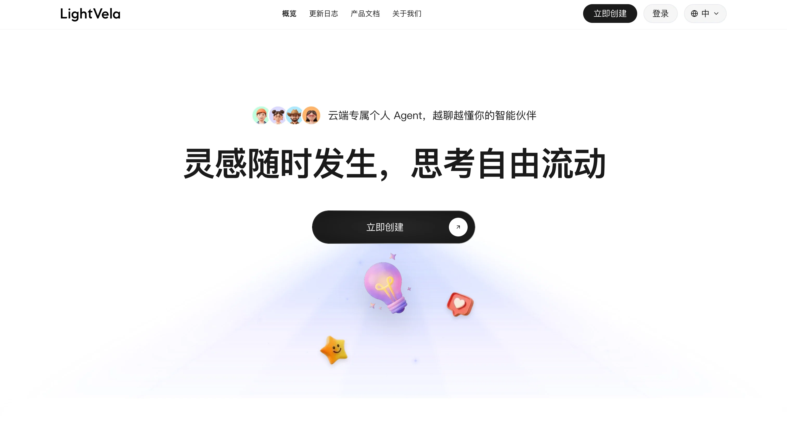

# ¿Qué es LightVela

## Resumen

**LightVela es una plataforma de Agents alojada en la nube del equipo de Tencent Lighthouse, y su producto actual es Hermes Agent — un Agent de IA construido sobre modelos de lenguaje grandes. LightVela se encarga de la implementación, la operación y la disponibilidad 24/7 en la nube, por lo que nunca tienes que escribir archivos de configuración ni conectarte por SSH a un servidor: todo lo configuras haciendo clic y arrastrar en un panel visual, y luego hablas con tu Agent a través de las aplicaciones de mensajería que ya utilizas. Se recuerda a través de las conversaciones, y tú eliges el modelo, las herramientas y la personalidad. Los planes y las ofertas para nuevos usuarios se muestran en la [página de suscripción](/subscribe/).**

---

> Un Hermes Agent alojado en la nube que te entiende mejor con el tiempo.

LightVela es un producto de alojamiento de Agents en la nube del equipo de Tencent Lighthouse. Está diseñado para permitir que todos posean un **compañero de IA que verdaderamente les pertenece** —no una herramienta que te pida que te presentes cada vez, sino una presencia a largo plazo que **te conoce, te recuerda y te entiende mejor con el tiempo**.

Tu Agent permanece en línea 24/7, se ejecuta de forma independiente y siempre está listo para chatear. Tú decides su modelo, sus herramientas y su personalidad.

Reducimos la barrera de configuración mediante una consola visual: sin archivos de configuración, sin inicio de sesión en el servidor, solo selecciona opciones en la página web para completar la configuración.

El producto actual de LightVela es **Hermes Agent**, un Agent de IA impulsado por modelos de lenguaje grandes. Es posible que se agreguen más productos listos para usar en el futuro. Esta documentación se centra en Hermes Agent.



***

## Para quién está destinado

* Usuarios que desean utilizar un Agent de IA pero no tienen conocimientos técnicos de servidores, contenedores, autenticación de API e infraestructura relacionada

* Usuarios que prefieren interactuar con la IA a través de plataformas de mensajería diarias (Telegram / WhatsApp / Discord / Slack / WeChat) en lugar de una aplicación independiente

* Usuarios que desean elegir entre múltiples proveedores de modelos de lenguaje grandes (incluyendo ChatGPT, Claude, Gemini, Deepseek, Qwen, Zhipu, Hunyuan y más)

* Usuarios que necesitan memoria persistente entre conversaciones en lugar de empezar desde cero cada vez

## No adecuado para

* Usuarios que requieren ejecución completamente local sin que los datos salgan de su dispositivo

* Usuarios que necesitan entrenar o ajustar el modelo subyacente

* Desarrolladores que necesitan integrar un Agent en su propio sitio web o aplicación

***

## Características del producto

* **Implementación totalmente gestionada**: La nube se encarga automáticamente de la configuración del entorno y la gestión del tiempo de ejecución. No se requieren operaciones de servidor, imágenes de contenedor ni conocimientos de infraestructura

* **Entorno de nube dedicado**: Cada instancia de Hermes Agent tiene su propio entorno de nube, aislamiento de recursos, disponibilidad 24/7 y no depende de dispositivos locales

* **Soporte multi-modelo**: Conéctate a modelos de lenguaje grandes chinos principales, suscripciones a planes de codificación de proveedores o cualquier punto de extremo compatible con OpenAI. Consulta [Configurar modelos](./configuration/model.md)

* **Acceso multi-canal**: Chatea con Hermes Agent a través de Telegram, WhatsApp, Discord, Slack, WeChat, QQ, WeCom y Lark

* **Extensiones de Skills**: Busca e instala Skills o paquetes de Skills de [Skills.sh](https://skills.sh/) y [ClawHub](https://clawhub.ai/) en la consola

* **Listo para usar**: El plan Launch incluye créditos de prueba, por lo que puedes comenzar a chatear después de la activación sin configurar un modelo por separado

* **Almacenamiento en la nube dedicado**: Los datos de conversación y memoria se almacenan de forma independiente

***

## Cómo funciona

LightVela ejecuta una instancia dedicada de Hermes Agent para cada usuario en la nube, y luego la conecta a la plataforma de mensajería seleccionada por el usuario a través de una capa de adaptador.

```
User (sends a message in Telegram / WhatsApp / Discord / Slack / WeChat)
      ↓
User-dedicated Hermes Agent instance in the LightVela cloud
      ↓
Calls the configured large language model (GPT / Claude / Gemin / ...)
      ↓
Response returns through the original channel
```

Un ciclo de conversación completo requiere tres configuraciones:

1. **Modelo**: El modelo de lenguaje grande llamado por Hermes Agent. El plan Launch incluye créditos de prueba y se puede utilizar directamente; también puedes configurar tu propia API Key

2. **Canal**: La plataforma de mensajería utilizada para chatear con Hermes Agent (Telegram / WhatsApp / Discord / Slack / WeChat)

3. **Skill** (opcional): Capacidades adicionales para Hermes Agent


***

## Sobre los planes

Cada plan proporciona una instancia en la nube de Hermes Agent. La serie Launch admite hasta 5 Bots dentro de esa instancia y la serie Cruise, hasta 10. Los Bots son perfiles independientes, no instancias adicionales de Hermes.

| Opción del plan | Créditos de modelo al mes | Bots |
|---|---:|---:|
| Launch | 100 | 5 |
| Launch AI | 4500 | 5 |
| Cruise | 200 | 10 |
| Cruise AI | 10 000 | 10 |

Los precios, las ofertas de bienvenida y la disponibilidad pueden cambiar. Consulta la [página de suscripción](/subscribe) antes de comprar. Si tienes un plan activo, también puedes adquirir [paquetes de créditos](./credits.md) de pago único.
***

## Relación con Lighthouse (opcional)

Para usuarios familiarizados con Tencent Cloud: LightVela puede entenderse como un paquete listo para usar de las capacidades de implementación de Agents en la nube de Tencent Lighthouse. LightVela elimina conceptos como cuentas de Tencent Cloud, gestión de recursos y operaciones de recursos en la nube, dejando solo dos acciones centrales: configurar un Agent y conectarlo a una plataforma de mensajería.

Si eres nuevo en los Agents en la nube, puedes omitir esta sección.

***

## Próximos pasos

* **[Inicio rápido](./02-quickstart.md)** — Completa tu primera conversación en 5 minutos

* **[Conceptos centrales](./04-core-concepts.md)** — Entiende los cinco conceptos centrales: Hermes Agent, Bots, modelos, canales y Skills

* **[Resumen de configuración](./05-configuration.md)** — Características de la consola y flujo de configuración
