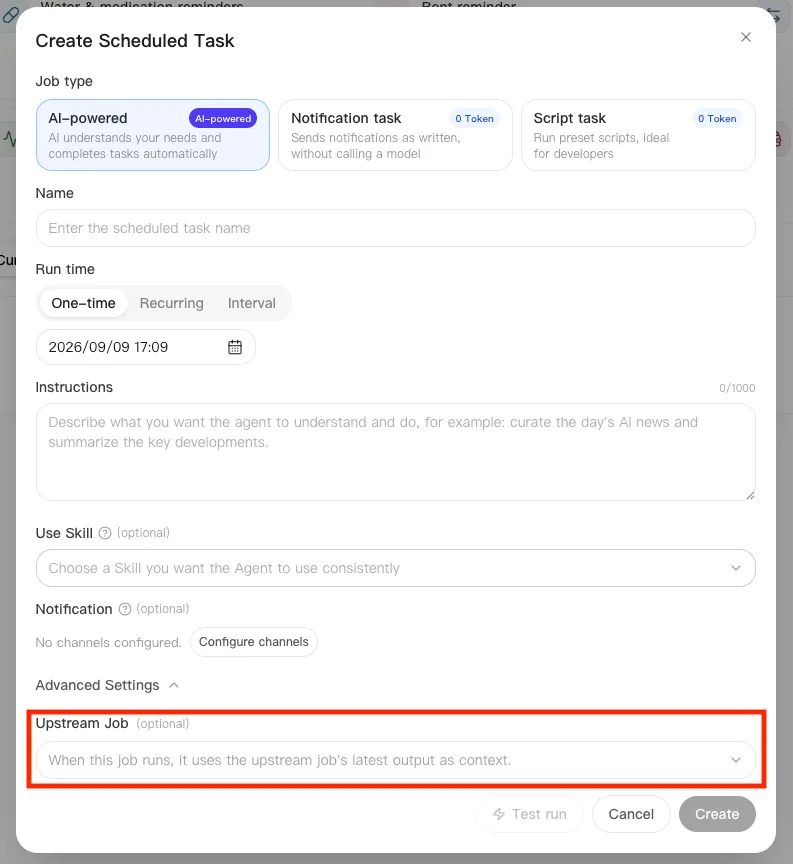

# Tareas programadas

## Resumen

**Las tareas programadas permiten que Hermes Agent empiece a trabajar sin un prompt manual. Elija una tarea de Agent cuando el trabajo necesite razonamiento de IA, una tarea de notificación cuando el mismo mensaje deba enviarse tal como está escrito, o una tarea de script cuando un script de Bash o Python deba realizar una comprobación determinista. Los tres tipos usan los mismos horarios de una sola vez, recurrentes y por intervalos, además de la ventana de validez y la configuración de notificaciones.**

## Elegir un tipo de tarea

Elija el tipo según lo que deba ocurrir cuando llegue la hora programada.

| Tipo de tarea | Adecuado para | Lo que debe proporcionar | Lo que se ejecuta |
| --- | --- | --- | --- |
| **Tarea de Agent** | Resúmenes, investigación, análisis, redacción u otros trabajos que requieren interpretación | Instrucciones de la tarea y, opcionalmente, un Skill o una tarea upstream | Hermes Agent inicia una tarea basada en un modelo. |
| **Tarea de notificación** | Recordatorios, avisos y mensajes rutinarios exactos | El texto de la notificación | Una tarea gestionada por LightVela envía el texto tal como está escrito, sin llamar a un modelo. |
| **Tarea de script** | Flujos de desarrollo, comprobaciones y automatización determinista | Un script de Bash o Python | El script se ejecuta sin una sesión de Agent ni una llamada al modelo. La salida estándar no vacía puede enviarse como notificación. |

El tipo de tarea es independiente del patrón de programación.
Todos los tipos pueden ejecutarse una vez, con una cadencia diaria, semanal o mensual, o en un intervalo fijo.

## Antes de crear una tarea

Asegúrese de que Hermes Agent esté activo, elija un canal de notificación si lo necesita y revise el código de cualquier tarea de script antes de guardarla.

## Crear una tarea de Agent

Elija **Tarea de Agent** cuando Hermes Agent deba entender su solicitud y generar un resultado.
Por ejemplo, una tarea puede recopilar noticias diarias sobre IA, seleccionar los elementos más relevantes y redactar un informe breve.

Configure los siguientes campos:

- **Nombre**: Asigne un nombre reconocible a la tarea.
- **Programación**: Elija una ejecución única, una cadencia recurrente o un intervalo fijo.
- **Instrucciones de la tarea**: Describa el objetivo, el alcance, las restricciones de las fuentes y el formato esperado.
- **Skill**: Adjunte opcionalmente un Skill disponible cuando la tarea necesite esa capacidad.
- **Tarea upstream**: Use opcionalmente la salida completada más reciente de otra tarea de Agent como contexto adicional.
- **Ventana de validez**: Restrinja opcionalmente cuándo se permite ejecutar la tarea.
- **Notificación**: Elija opcionalmente dónde enviar el resultado completado.

A la hora programada, Hermes Agent crea una tarea de Agent y llama al modelo seleccionado.
El resultado puede enviarse a los canales seleccionados y queda registrado en Ejecuciones recientes. Si no selecciona un canal, deberá confirmar que el resultado se guardará solo localmente antes de crear la tarea; no se enviará al chat.

## Crear una tarea de notificación

Elija **Tarea de notificación** para un mensaje que deba llegar exactamente como lo escribió.
Por ejemplo, puede crear un recordatorio diario para beber agua, un recordatorio mensual del alquiler o un aviso breve para un equipo.

Configure el nombre, la programación, el contenido de la notificación, la ventana de validez y los canales de notificación.
El contenido puede incluir puntuación normal, saltos de línea, emojis y texto multilingüe.

A la hora programada, LightVela envía el contenido tal como está escrito.
No pide a un modelo que redacte, reescriba, resuma, traduzca ni explique el mensaje.
Por eso, el uso de tokens del modelo para la tarea es de 0 Token.

Una tarea de notificación requiere al menos un canal antes de poder crearla o guardarla.
El formato de cada canal todavía puede afectar a los saltos de línea y a los caracteres que reciben los destinatarios.

## Crear una tarea de script

Elija **Tarea de script** cuando necesite un flujo determinista de Bash o Python.
Por ejemplo, un script puede comprobar el uso del disco, inspeccionar la respuesta de un servicio o imprimir una alerta solo cuando se alcance un umbral.

Configure el nombre, la programación, el lenguaje y el contenido del script, la ventana de validez y los canales de notificación.
Antes de crear la tarea, acepte el aviso de seguridad y confirme que confía en el código.

Las tareas de script no crean una sesión de Agent, no llaman a un modelo, no usan un prompt ni invocan Skills.
Usan 0 Token de modelo, pero siguen usando recursos de ejecución de Agent en la nube.

| Resultado del script | Resultado de la tarea | Comportamiento de entrega |
| --- | --- | --- |
| Código de salida `0` con salida estándar no vacía | Correcto | La salida estándar se envía tal como está escrita a los canales seleccionados. |
| Código de salida `0` con salida estándar vacía | Éxito silencioso | No se envía ninguna notificación de resultado. |
| Código de salida distinto de `0` | Fallido | El fallo queda registrado y sigue el tratamiento de errores de la tarea. |
| Tiempo de espera agotado o fallo de inicio | Fallido | Se registra el tipo de fallo y sigue el tratamiento de errores de la tarea. |

No use una tarea de script para reparar, explicar o resumir un fallo con IA.
La ejecución sigue siendo determinista: una salida vacía permanece silenciosa y un script fallido no activa un fallback de modelo.

## Vincular una tarea de Agent upstream

Use una tarea upstream cuando una tarea de Agent deba preparar el contexto para otra.
La tarea downstream recibe la salida completada más reciente de la tarea upstream y conserva su propia programación, instrucciones, ventana de validez y configuración de notificaciones.

Deje suficiente tiempo entre tareas dependientes y explique en las instrucciones downstream cómo usar la salida upstream.
El contexto upstream, la ejecución del modelo y los Skills solo se aplican a las tareas de Agent.

## Configurar las reglas compartidas de programación y entrega

Los tres tipos de tarea comparten los mismos controles de programación y notificación.

- **Una sola vez**: Ejecute una vez en la fecha y hora seleccionadas.
- **Recurrente**: Ejecute cada día, semana o mes a la hora seleccionada.
- **Intervalo**: Ejecute cada número seleccionado de minutos, horas o días.
- **Ventana de validez**: Restrinja cuándo pueden ejecutarse las tareas recurrentes o por intervalos, o déjela vacía para mantenerlas activas todo el tiempo.
- **Notificación**: Seleccione los canales que recibirán los resultados correctos o las notificaciones.

Cambiar el tipo mientras crea una tarea conserva estos ajustes compartidos.
Después de crearla, el tipo no se puede cambiar, por lo que debe crear otra tarea si necesita cambiar el modelo de ejecución.

## Usar plantillas de tareas

Si no sabe cómo empezar una tarea de Agent, use el área de plantillas de la página Tareas programadas.
Elija una tarjeta como Recordatorios de agua y medicación, Recordatorio del alquiler, Alerta de tipo de cambio o Resumen bursátil, y revise la programación y las instrucciones generadas antes de crear la tarea.

Al abrir una plantilla, el formulario Crear tarea se rellena previamente.
Por ejemplo, la plantilla Resumen bursátil incluye el nombre, una programación diaria y las instrucciones de información de mercado, que puede ajustar antes de probarla o crearla.

Cree una tarea de notificación o de script personalizada desde el diálogo Crear, en lugar de cambiar el tipo de una plantilla.

## Gestionar tareas programadas

Después de crear una tarea, use la página Tareas programadas para revisar Tareas actuales, Tareas finalizadas y Ejecuciones recientes.
La vista Tareas actuales puede filtrar las tareas de Agent, de notificación y de script.

En **Ejecuciones recientes**, abra los detalles de una ejecución y seleccione **Ver resultado** para leer el Markdown o **Descargar Markdown** para guardarlo. Primero cambie al Bot propietario de la tarea: el resultado permanece en sus registros de ejecución y no aparece en el chat ni en los registros de otro Bot. Si una tarea solo guarda el resultado localmente, seleccione un canal de notificación conectado para recibir futuras ejecuciones.

Tareas finalizadas reúne las tareas completadas, fallidas y vencidas.
Las tareas en curso permanecen en Tareas actuales.

Desde la lista puede revisar detalles, editar ajustes permitidos, pausar una tarea o eliminarla.
Antes de eliminar una tarea de Agent con una dependencia upstream, compruebe si otra tarea todavía necesita su última salida completada.

## Validar una tarea nueva

Después de crear o editar una tarea, no se detenga en el mensaje “guardado correctamente”.

1. Confirme que la tarea aparece en el filtro de tipo correcto y que su estado coincide con lo esperado.
2. Compruebe la programación, la ventana de validez y la configuración de notificaciones.
3. Ejecute una prueba o espere una ejecución real y revise las Ejecuciones recientes.
4. Para una tarea de Agent, compruebe que el resultado sigue las instrucciones y usa la salida upstream seleccionada cuando corresponde.
5. Para una tarea de notificación, compruebe que el texto recibido coincide con su contenido.
6. Para una tarea de script, compruebe el resultado de salida y si la salida estándar se entregó o permaneció silenciosa correctamente.

## Tratamiento de fallos comunes

| Síntoma | Causa probable | Tratamiento sugerido |
| --- | --- | --- |
| La tarea no se ejecutó cuando se esperaba | La programación, la ventana de validez o el estado de la tarea no está activo | Revise la programación y la ventana, confirme que la tarea esté habilitada y consulte las Ejecuciones recientes. |
| El resultado de una tarea de Agent no responde al objetivo | Las instrucciones son vagas, un Skill necesario no está disponible o falta el contexto upstream | Indique claramente el objetivo, el alcance, el formato y las restricciones de las fuentes. Compruebe el Skill y la tarea upstream antes de la siguiente ejecución. |
| Una tarea de notificación se ejecutó pero no llegó ningún mensaje | No se seleccionó un canal o el canal de destino no está disponible | Seleccione y verifique un canal, y vuelva a probar la tarea. |
| Una tarea de script se ejecutó sin mensaje | El script terminó correctamente sin salida estándar | Es un éxito silencioso. Haga que el script imprima el texto exacto que debe enviarse cuando se cumpla la condición. |
| Una tarea de script falló | El script terminó con error, agotó el tiempo o no pudo iniciarse | Revise el registro, corrija el script de confianza y vuelva a probarlo. No espere que la IA repare o explique el script automáticamente. |
