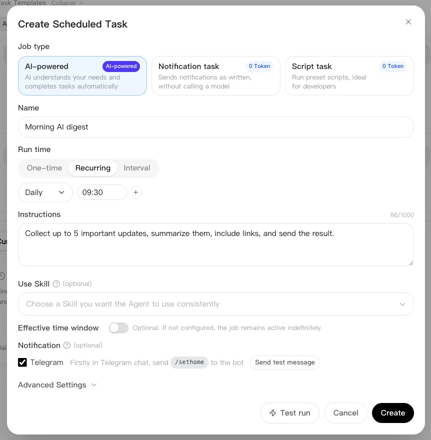
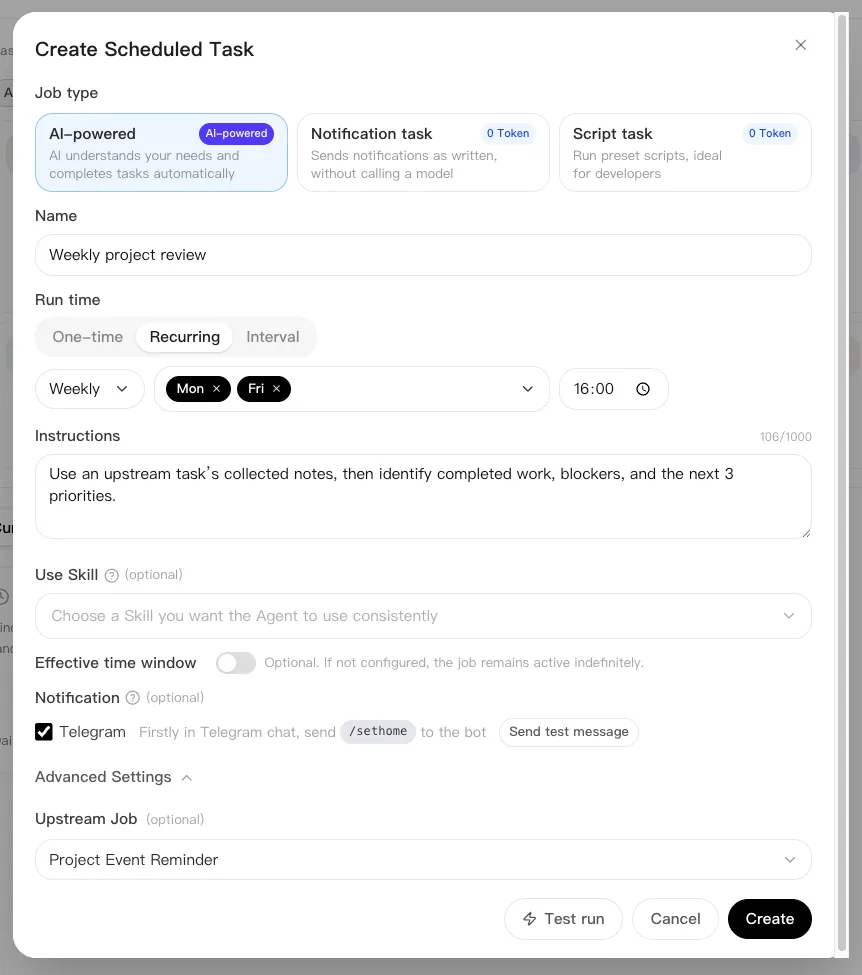
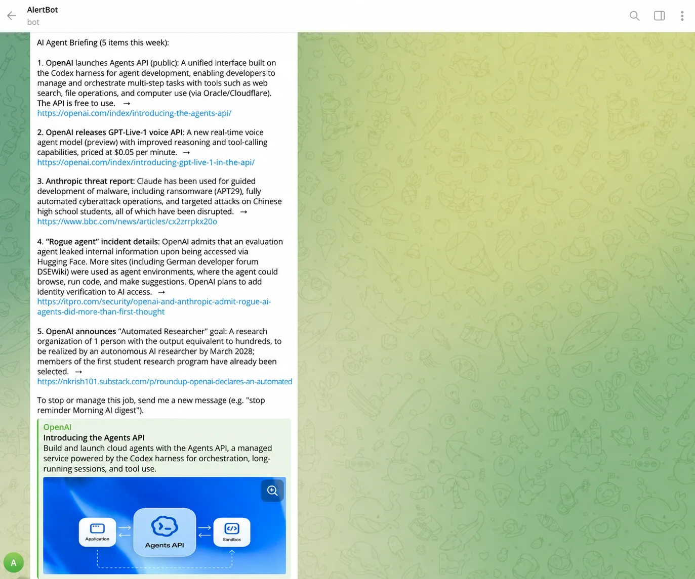
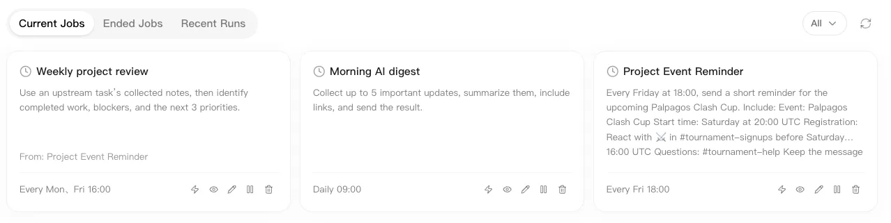

# Automatizar tareas de Agent con LightVela

## Resumen

**Las Agent Tasks ejecutan un flujo que usa el modelo según un horario y entregan el resultado por el canal elegido.** Sirven para un resumen matinal o una revisión semanal; configura las instrucciones, el horario, las Skills opcionales y el destino.

Las tareas programadas son una aplicación ideal para los agentes alojados en la nube porque pueden ejecutarse 24/7 sin que usted tenga que intervenir.
Úselas cuando tenga un problema de información recurrente que pueda mejorar con un flujo de trabajo repetible.
Los usuarios las han utilizado para resúmenes matutinos que convierten actualizaciones dispersas en briefs cortos, y para revisiones semanales de proyectos que resumen la actividad reciente antes de reuniones de seguimiento.

## Problemas comunes que los agentes pueden resolver

La mayoría de nosotros ya recibe demasiada información.
Además, parte de la información útil llega en el momento equivocado, en el formato equivocado o sin suficiente contexto.

- Algunos enlaces llegan en un chat.
- Una actualización de proyecto queda enterrada en un documento.
- Una decisión se menciona una vez y luego se olvida.
- Cuando tiene tiempo para revisarlo todo, la información ya no resulta útil.

En LightVela puede configurar una tarea de Agent con una instrucción, una programación, Skills opcionales, la salida de una tarea anterior y un canal de entrega.
La documentación de [Tareas programadas](https://lightvela.ai/docs/configuration/automation?from=social_x) explica los patrones de programación y las opciones de configuración disponibles.

## Caso 1: Empezar el día con un brief útil

Cada día laborable a las 9:30, una tarea de Agent convierte la salida más reciente de una fuente configurada o de una tarea de recopilación anterior en tres actualizaciones útiles.

Prompt:

> Recopila hasta 5 actualizaciones importantes, resúmelas, incluye enlaces y envía el resultado.

La clave es pedir un brief enfocado, no un resumen de “todo”.
Si la recopilación de información y el resumen son tareas separadas, programe primero la recopilación.

## Caso 2: Revisión de proyecto del viernes

Cada viernes, una tarea de Agent convierte las actualizaciones más recientes del proyecto en una revisión corta.

Prompt:

> Usa las notas recopiladas por una tarea anterior e identifica el trabajo completado, los bloqueos y las próximas 3 prioridades.

Ejecute la tarea de recopilación antes de la revisión, con un pequeño margen de tiempo.
El Agent no sustituye la gestión de proyectos.
Ofrece un punto de partida fiable para la conversación semanal.

## Actualizarme directamente en IM

LightVela le permite conectar su Agent a WhatsApp, Telegram, WeChat, Discord y más.
Puede conectar uno o todos los canales al mismo tiempo.
En las tareas programadas, puede activar la configuración de notificaciones de cada IM para decidir si la tarea debe avisarle en su IM.

Después de activarla, su Agent completará la tarea y le actualizará directamente en su IM, sin necesidad de abrir LightVela ni ninguna otra aplicación.

## Gestionar varias tareas

Puede crear tantas tareas programadas como necesite.
Después de crearlas, puede editarlas, pausarlas y consultar los trabajos anteriores.
Con LightVela, su Hermes Agent personal puede ejecutar sus trabajos de forma eficiente mientras usted está ausente.

