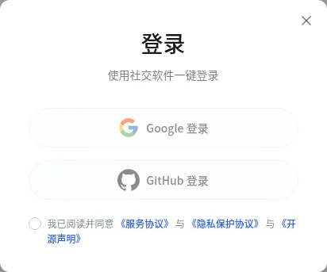

# 快速开始

## 摘要

**在 LightVela 跑通第一个网页对话的路径是：登录并开通套餐 → 等待 Bot 就绪 → 在「我的 AI 伙伴」的「日常 → 对话」发送消息并收到回复。无需先接入消息通道；有可用套餐模型积分时，也无需预先配置自有 API Key。若还想在 WeChat 中使用同一个 Bot，再按本页后半部分扫码接入 WeChat。**

---

本教程先在网页对话，再按需接入 WeChat 并在其中收到回复。

## 本页覆盖

- 登录 LightVela

- 开通启航套餐并创建 Hermes 实例

- 在网页「对话」中发送第一条消息

- 按需接入 WeChat 通道

- 在 WeChat 中发送消息并接收回复

> 💡 **准备工作**
>
> - 一个 Google 或 GitHub 账号
>
> 启航套餐预置 100 体验积分，无需预先申请大语言模型 API Key 即可开始对话。

---

## 1. 登录 LightVela

访问 [lightvela.ai](https://lightvela.ai)，点击右上角「登录」。在登录对话框中选择 Google 或 GitHub 账号，勾选协议后完成授权。



---

## 2. 开通启航套餐

打开[订阅页](/subscribe)，在启航系列选择 **100 积分的 Launch** 选项，并按套餐卡片完成开通。确认前先核对页面显示的价格和首购优惠。


> ⚠️ **新用户首购活动**
>
> 符合条件的新用户可体验启航版 1 个月；活动和价格以[订阅页](/subscribe/)展示为准。


---

## 3. 打开 Hermes Agent

套餐开通后进入 [Agent 管理台](/agents/overview/)。LightVela 会为套餐准备云端实例；如果管理台提示创建 Agent，就按页面提示操作，并等待状态变为**运行中**。侧边栏会显示 **Channels**、**Models**、**Skills** 和 **Scheduled Tasks**。使用套餐模型积分时，无需填写自己的 API Key。

---

## 4. 在网页中开始对话

Bot 就绪后，在侧栏「日常 → 对话」新建会话并发送「你好」。收到回复即完成第一次网页对话；会话操作见[对话](./configuration/agent-chat.md)。

## 5. 按需接入 WeChat 通道

在 Agent 侧边栏进入 **Channels**，找到 **WeChat** 卡片并点击 **+ Connect**，按页面指引获取二维码。用手机微信扫码并完成授权；发送消息前先确认管理台显示 WeChat 已接入。二维码过期或接入失败时参见[配置通道 - WeChat](./configuration/channel-wechat.md)。

---

## 6. 在 WeChat 中发送消息

在 WeChat 中找到已添加的机器人账号，发送测试消息：

```
你好
```


几秒内即可收到 Hermes 的回复，至此 Hermes 已可通过 WeChat 进行对话。

> 💡 **消息计费说明**
>
> 默认使用 Launch 选项包含的 100 模型积分。用尽后可购买符合条件的[积分包](./credits.md)，或在 **Models** 中配置自己的 API Key。

---

## 进阶：配置自有模型（可选）

如需指定服务商，在 Agent 侧边栏进入 **Models**，选择服务商与模型，填写 API Key 并设为主模型。详见[配置模型](./configuration/model.md)。

---

## 常见问题

| 问题 | 检查点 | 处理方式 |
|---|---|---|
| 无法开通 Launch | 当前可售状态、首购资格或结算结果 | 核对[订阅页](/subscribe)及最终结算提示，避免重复下单。 |
| Agent 准备时间较长 | 管理台仍在创建中还是出现错误 | 刷新 Agent 概览一次；状态未变化时查看[诊断中心](./configuration/diagnostics.md)或联系支持。 |
| WeChat 二维码过期 | 手机端是否完成授权 | 回到 **Channels** 重新发起连接。 |
| 发送消息后没有回复 | 通道状态、Agent 状态和模型积分 | 查看 **Channels** 与 **Diagnostics**；积分用尽时查看[积分补充方式](./credits.md)。 |
---

## 下一步

- [核心概念](./04-core-concepts.md) — Hermes Agent、Bot、模型、通道、技能五项核心概念说明

- [配置总览](./05-configuration.md) — 管理台整体结构

- [配置技能](./configuration/skill.md) — 安装 Skills.sh 或 ClawHub 的技能
