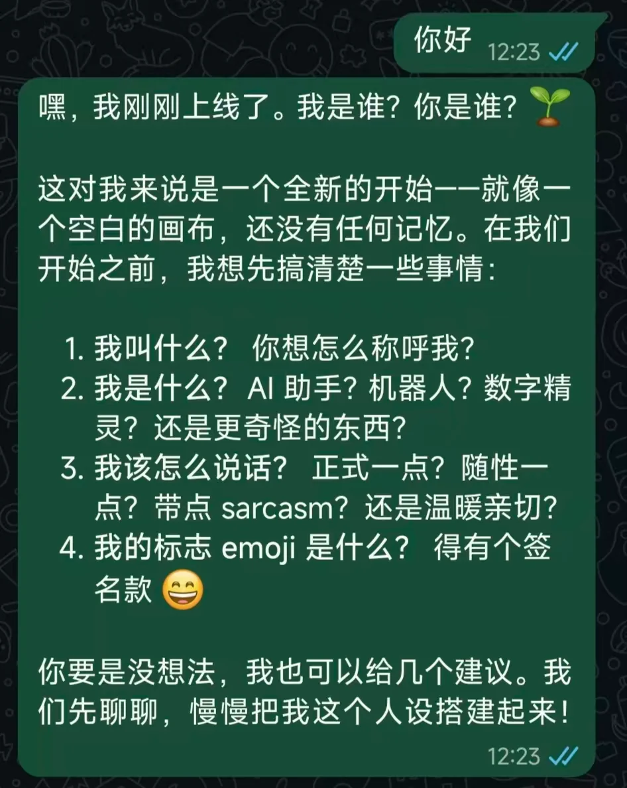

# 配置通道 - WhatsApp

## 摘要

**WhatsApp 通道采用扫码接入，配置方式接近 WeChat，适合快速把 Hermes Agent 接入 WhatsApp 对话场景：在管理台「通道」中选择 WhatsApp、生成二维码后用手机 WhatsApp 扫码完成授权即可对话。准备工作是一台装有 WhatsApp 的手机，以及完成模型配置（或直接使用套餐按月提供的模型积分）。同一个 Agent 可同时接入多个通道并共享同一份人格与长期记忆。**

---

WhatsApp 通道采用扫码接入方式，配置方式接近 WeChat，适合快速将 Hermes Agent 接入 WhatsApp 对话场景。

## 本页覆盖

- 使用手机 WhatsApp 扫码授权

- 在 WhatsApp 中与 Hermes Agent 进行对话


> 💡 **准备工作**
>
> -   一台装有 WhatsApp 的手机
>
> -   完成 [模型配置](./model.md)（或使用启航套餐预置的 100 体验积分）
>

---

## 操作步骤

### 1. 进入管理台

登录 LightVela，打开目标 Agent，在侧边栏进入 **Channels**。

### 2. 选择 WhatsApp 通道

找到 WhatsApp 模块，点击「+连接」。

同一 LightVela 实例内，WhatsApp 同时只能连接一个 Bot。如果已由其他 Bot 连接，请通过占用提示前往原 Bot 断开 WhatsApp，再在当前 Bot 连接。

### 3. 使用 WhatsApp 扫码

用手机 WhatsApp 扫描 LightVela 展示的二维码，并按 WhatsApp 内的提示授权关联会话。二维码过期时从 WhatsApp 卡片重新生成。返回 **Channels**，确认 WhatsApp 显示为已接入。

### 4. 在 WhatsApp 里查询你自己


与自我对话——这就是你的机器人。

进入该机器人的聊天界面，发送测试消息：

```
你好
```

几秒内收到 Hermes Agent 回复。



---

## 成功状态

- 管理台「已接入通道」列表中出现"WhatsApp"

- WhatsApp 联系人中可查找到对应机器人

- 发送消息后能收到 Hermes Agent 回复


---

## 支持的消息类型

接入成功后，WhatsApp 机器人除了能够接收、回复基础文本信息外，还支持更多消息类型，详情如下：

| WhatsApp 机器人支持的消息类型 | 是否支持 |
|---|---|
| 接收文本信息 | ✅ 已支持 |
| 接收图片、视频 | ✅ 已支持 |
| 接收文件 | ✅ 已支持 |
| 回复文本信息 | ✅ 已支持 |
| 回复图片、视频 | ✅ 已支持 |
| 回复文件 | ✅ 已支持 |
| 主动发送消息（如定时发送提醒） | ✅ 已支持 |

> ℹ️ **实际处理能力取决于模型**
>
> 上表仅代表 WhatsApp 机器人在消息通道层面支持接收、回复的类型。能否实际完成处理图片、文件等任务，还取决于 Hermes Agent 所接入的大语言模型是否具备对应的处理能力。

---

## 常见问题

| 问题 | 检查点 | 处理方式 |
|---|---|---|
| 二维码无法扫描或已过期 | 手机网络与当前二维码 | 在 WhatsApp 卡片生成新码，按 WhatsApp 当前提示操作。 |
| 管理台未显示接入成功 | 手机端是否完成授权 | 回到 **Channels** 刷新一次；仍未接入时重新连接。 |
| 发消息后没有回复 | Agent 状态、通道状态和模型积分 | 查看 **Channels** 与[诊断中心](./diagnostics.md)，必要时核对[积分补充方式](../credits.md)。 |
| 定时消息未送达 | 通道连接与任务运行结果 | 在[定时任务](./automation.md)查看最近运行记录及通知目的地。 |
| WhatsApp 已被其他 Bot 占用 | 同一实例只允许一个 Bot 接入 WhatsApp | 先在原 Bot 断开，再连接到目标 Bot。 |

---

## 通道说明

- **消息类型**：支持文本、图片、视频、文件、语音等多种类型，详见上方「支持的消息类型」

- **群聊支持**：当前不支持群聊，仅支持 1 对 1 对话

- **连接中断**：长时间无响应可能为授权被撤销，回管理台重新授权接入即可

---

## 下一步

- [配置通道 - Discord](./channel-discord.md) — 社群运营与开发者社区

- [配置通道 - Slack](./channel-slack.md) — 团队协作、工作区通知和频道任务流转

- [配置通道 - QQ](./channel-qq.md) — 手动创建机器人，AppID/AppSecret 接入

- [配置通道 - 企业微信](./channel-wecom.md) — 企业内部协作与办公场景

- [配置技能](./skill.md) — 扩展 Hermes Agent 能力
