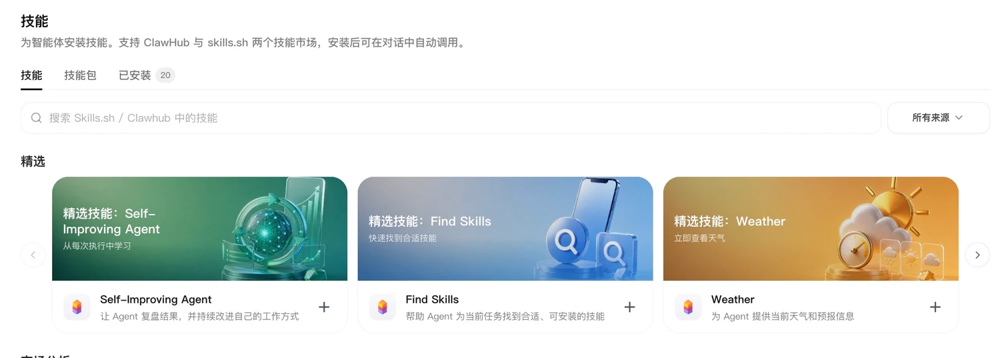

# 如何用 LightVela 搭建个人 AI 助手？

## 摘要

**用 LightVela 搭建个人 AI 助手的最小路径是：开通套餐并完成 Bot 创建，在网页「日常 → 对话」收到第一条回复，再按需要连接聊天通道。首次创建可以选择颜色、形状与配饰，填写名字和用途，完成配置后点击「开始旅程」；使用可用的套餐模型积分时，无需先准备自有 API Key。**

模型负责理解与生成，记忆保留稳定偏好，技能补充具体任务方法，定时任务负责按计划执行。先验证网页对话，再测试记忆是否跨会话生效，最后为一个已经有效的小任务设置周期执行，出现问题时也更容易定位。


## 适合谁与预期结果

如果你希望由一个助手协助日常规划、研究跟进、提醒，以及需要了解个人偏好的问题，这套方式很适合你。你不需要复杂的工作流；从一个 Bot 的网页对话开始即可；经常使用的聊天软件可随后接入。

当你不断重复说明自己的时区、偏好的总结格式、正在推进的项目，或每天早上希望获得哪类帮助时，可先让 Bot 保留这些稳定信息。预期结果是能持续对话、查到保留的偏好，并核对定时任务的实际输出；它不会仅凭一句记忆请求就自动创建通知任务。

## 前置条件

- 一个 LightVela 账号和正在运行的 Hermes Agent。若尚未创建，请先完成[快速上手](https://lightvela.ai/zh-sg/docs/quickstart)。

- 仅在需要聊天软件通知或对话时，才准备相应平台的账号与授权；网页对话不需要外部通道。

- 已配置可用模型，或仍有可用的试用额度。若 Hermes 还不能回复，可查看[配置模型](https://lightvela.ai/zh-sg/docs/configuration/model)。

- 一个最先想解决的小习惯，例如规划当天工作或收集待跟进事项。

## 操作步骤 / 核心说明

### 1. 创建并验证你的助手

首次进入管理台，在「创建你的 LightVela Bot」中依次选择颜色、形状和配饰，填写名字与可选描述，也可以选择推荐模板。点击**创建**后，等待配置完成，再点击**开始旅程**。

已有 Bot 时，通过「新建 Bot」或「管理 Bot → 复制 Bot」创建专用助手；外观和继承规则见[管理 Bots](../configuration/bots.md)。下图展示已有 Bot 后的再次创建表单，可在「高级」中选择空白创建或复制来源；首次创建不显示「高级」。


先在网页「日常 → 对话」发送「你好」，确认 Bot 在线并收到回复。会话操作可参见[网页对话](../configuration/agent-chat.md)。

确认网页对话正常后，再按日常习惯连接 Telegram、WhatsApp、Discord、Slack 或微信。在「日常 → 通道」中打开对应平台的配置教程并完成授权，然后从该平台发送测试消息。通道是可选的对话与通知入口，不是创建个人助手的必做步骤。


与其直接提出一个很宽泛的请求，不如先清楚介绍你希望它如何协助。例如：

```text
我想让你做我的个人规划助手。我使用新加坡时区。
每天的计划请保持简短，先标出截止时间；信息不明确时，先问我一个追问问题。
```

### 2. 让记忆承接反复出现的上下文

Hermes 会随着协作积累有用的上下文，因此你不必在每次对话里重复所有偏好。告诉它哪些事实和工作偏好值得长期保留：你的时区、希望简报如何组织、重要项目名称，或你喜欢在哪几天提前规划。

你也可以直接这样说：

```text
请记住：我希望在每个工作日早上 8:00 收到简洁简报，
其中包含会议、截止时间和最重要的三项下一步行动。
```

新建一个网页会话后询问「我的时区和简报格式是什么？」，核对是否保留了正确偏好。上面的 8:00 只是需要记住的偏好；真正按时执行还需要下一步的定时任务。

在[记忆管理](https://lightvela.ai/zh-sg/docs/configuration/memory)页面中，可以查看 Hermes 已积累的记忆和用户画像。记忆的目的应是减少重复，而不是保存每一个短暂出现的细节。

### 3. 只有在真实任务需要时再添加技能

Hermes 即使没有额外技能也可以正常对话。只有当你能明确说出某项实际工作需要什么能力时，再添加技能，例如查询信息、整理待办事项或准备周期性报告。这样能让助手更容易理解，也更容易建立信任。



先在 ClawHub 浏览适合的技能，再通过[配置技能](https://lightvela.ai/zh-sg/docs/configuration/skill)安装。安装前请阅读技能说明，并优先选择你信任的来源。

### 4. 把已经有用的对话变成重复执行的检查

当某个提示词已经稳定地产生有用结果时，再考虑是否应该按计划执行。一个简单的定时任务可以让 Hermes 在早晨生成计划、在一天结束时进行回顾，或每周帮你重置重点，而无需你记得每次都手动开启对话。

例如：

```text
每个工作日早上 8:00，请为我准备一份简洁的当天计划。
先列出截止时间和会议，再给出三项最需要专注的下一步行动。
```

在[定时任务](https://lightvela.ai/zh-sg/docs/configuration/automation)中设置执行时间和通知通道。第一个定时任务应保持简单；看过几次真实结果后，再逐步调整指令。


## 实用检查表

| 阶段 | 操作 | 通过标准 | 不通过时检查 |
| --- | --- | --- | --- |
| 创建与对话 | 完成创建、配置，点击「开始旅程」，在网页发送消息 | 正确 Bot 在线并收到回复 | 创建进度、模型积分或模型配置 |
| 稳定偏好 | 说明时区与格式，新建会话再询问 | 回复与原偏好一致，记忆页可核对 | 是否切换了 Bot、要求是否明确 |
| 外部通道（可选） | 连接一个平台并发送测试消息 | 该平台消息由目标 Bot 回复 | 连接状态、权限与单 Bot 占用限制 |
| 定时任务（可选） | 创建一个简单任务并核对时间、通知去向 | 到期后有执行结果，通知到达预期入口 | 任务计划、Bot 状态及通知通道 |

## 验证与边界

- **上下文按 Bot 区分**：同一 Bot 的已连接通道使用该 Bot 的人设与记忆；另一个 Bot 不会自动沿用之后新增的偏好。
- **记忆与计划不同**：让助手记住「早上 8:00」不会自动创建每日任务。需在定时任务中明确设置执行计划。
- **外部通知需实际验证**：配置完成后核对首个任务结果与通知去向，不把创建成功等同于消息已送达。
- **外观不决定能力**：换颜色、形状或配饰只改变展示；实际任务能力仍取决于模型、技能、授权和配置。

## 常见问题

### 必须先配置全部功能，Hermes 才能有用吗？

不需要。完成 Bot 创建、有可用模型，并能收到网页回复就足以开始；外部消息通道可稍后连接。随着你发现哪些重复任务值得保留，再逐步加入记忆、技能和定时任务。

### Hermes 会记住我发送的每一条消息吗？

不会。记忆用于保存跨对话仍然有价值的信息，例如偏好、重复性工作和稳定上下文。需要时，你可以要求 Hermes 记住或忘记某项信息，再通过记忆管理页面查看。

### 我可以从多个通道使用同一个助手吗？

可以。多个已连接通道可以指向同一个 Bot，延续该 Bot 的人设与记忆；接入前检查通道是否已被实例中的另一个 Bot 占用。

### 最适合先自动化什么？

选择一个你会在固定时间重复执行的任务。晨间规划、简短的每日回顾或每周优先级检查都是不错的起点，因为你能很快判断结果是否真的有帮助。
