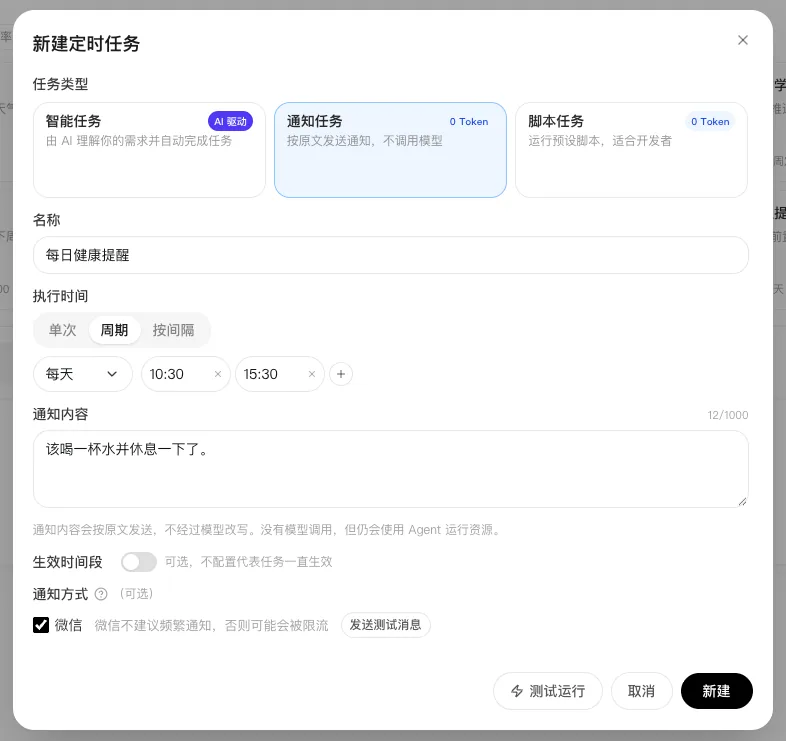
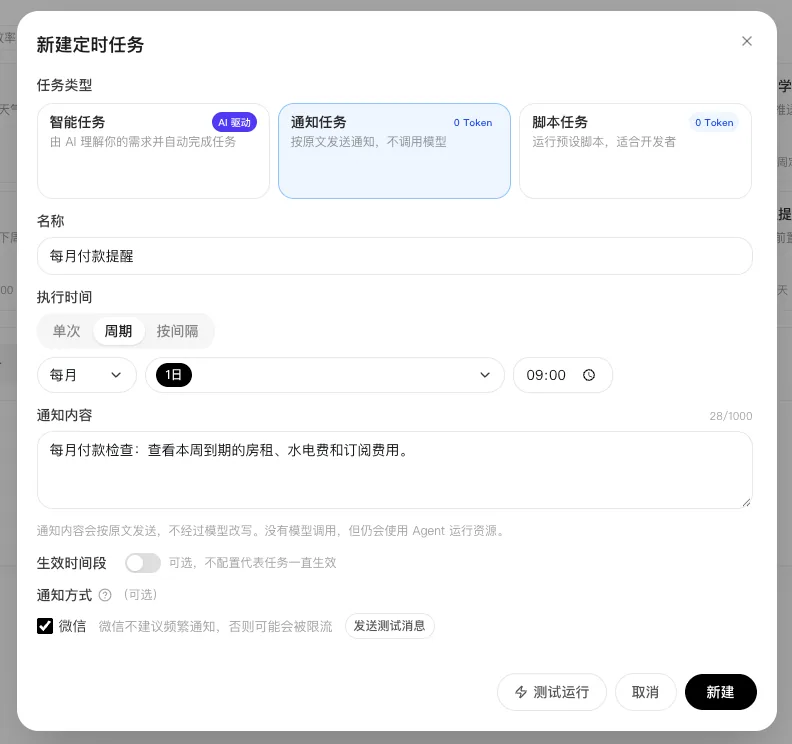
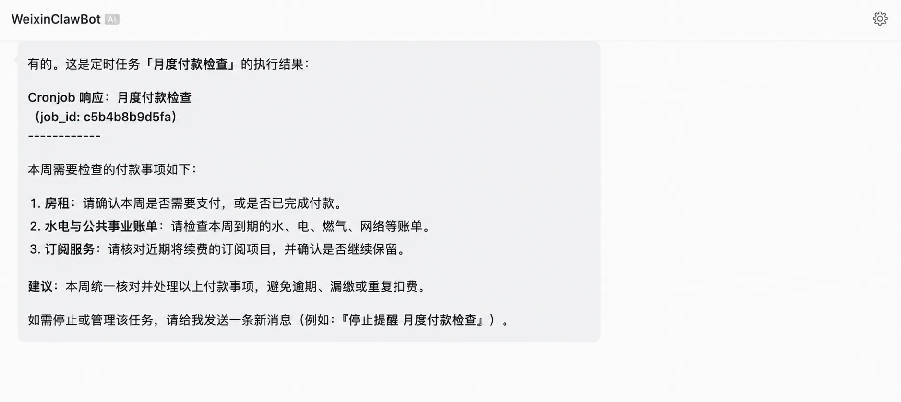
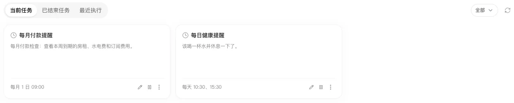

# 在 LightVela 中设置通知任务

## 摘要

**通知任务可以让云端 Agent 按计划发送固定消息，不调用 AI 模型，也不消耗模型 Token。** 本页用每日健康提醒和每月付款提醒说明如何配置消息、执行时间、生效时间段和交付通道。

通知任务非常适合云端 Agent，因为它可以按计划发送固定消息，不需要调用 AI 模型。
当你需要让提醒在正确的时间、通过正确的通道，以你提供的原文送达时，就可以使用它。
有人用它设置饮水和服药提醒；也有人用它提醒账单和订阅续费。

## 通知可以解决的常见问题

大多数人并不是不在意重要任务，所以才会忘记它们。
工作变忙时，一些小而必要的行动很容易被忽略。

- 长时间工作时忘记喝水。
- 服药时间晚于计划。
- 订阅续费提醒埋在收件箱里。
- 到了截止日期之后才想起账单。

在 LightVela 中，你可以为通知任务配置消息、执行时间、生效时间段和交付通道。
消息会按照原文发送，不会调用模型，因此不会消耗模型 Token。
[定时任务文档](https://lightvela.ai/zh-sg/docs/configuration/automation?from=social_x)介绍了可用的调度和通知选项。

## 案例 1：每日健康提醒

每天上午 10:30 和下午 3:30，通知任务会发送同一条简短提醒。

消息：

> 该喝一杯水并休息一下了。

关键是让消息保持简短并且可执行。
由于消息不会经过模型处理，通知不会被改写，也不会增加额外上下文。

## 案例 2：每月付款提醒

每月第一天，通知任务会提醒你查看即将到来的付款。

消息：

> 每月付款检查：查看本周到期的房租、水电费和订阅费用。

通知会让每笔付款在截止日期前保持可见。
如果不同账单的到期日期不同，请创建多个任务，让每条提醒在有用的时间送达。

## 直接在即时通信应用中更新我

LightVela 支持将 Agent 接入 WhatsApp、Telegram、WeChat、Discord 等平台。
你可以同时接入一个或多个通道。
在定时任务中，你可以切换每个已配置的通道，决定通知应该发送到哪里。

切换设置后，Hermes 会将完整通知直接发送到你的即时通信应用。
你不需要打开 LightVela 或其他应用查看提醒。

## 管理多个任务

你可以根据需要设置任意数量的定时任务。
创建后，你可以编辑任务内容和执行时间，暂停任务，并浏览历史运行记录。
使用 LightVela，让你的个人 Hermes Agent 在你专注于其他工作时继续按计划维护重要日常安排。

