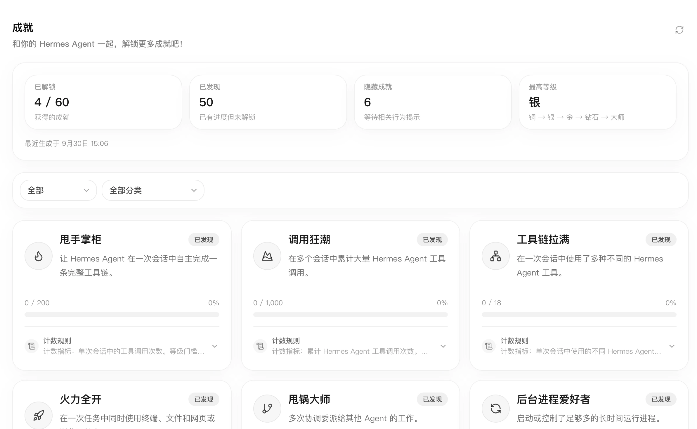

# Achievement

## Ringkasan

**Halaman Achievement menampilkan progres penggunaan Hermes Agent untuk Bot saat ini. Halaman ini merangkum achievement yang sudah terbuka, sudah ditemukan, masih tersembunyi, tier tertinggi, serta status, kategori, progres, aturan penghitungan, dan sesi sumber pada setiap kartu.** Gunakan halaman ini untuk memindai ulang riwayat Hermes Bot saat ini dan memeriksa apakah penggunaan tool, debugging, konfigurasi model, memori, Skill, dokumentasi, dan otomasi sudah dikenali.

---

Achievement tidak perlu dikonfigurasi secara manual. LightVela membuatnya dari riwayat perilaku Hermes Agent pada Bot saat ini. Halaman ini membantu Anda memahami kemampuan Agent mana yang sudah pernah digunakan dan apakah modul achievement sudah membaca riwayat terbaru.

Jika baru mulai menggunakan LightVela, coba alur dasar seperti [Chat Agent](./agent-chat.md), [Konfigurasi Skill](./skill.md), [Pengelolaan Memori](./memory.md), atau [Tugas Terjadwal](./automation.md), lalu kembali ke halaman Achievement untuk melihat progres.

## Sebelum memulai

1. Masuk ke LightVela dan pastikan setidaknya satu Hermes Agent sudah aktif.
2. Buka konsol untuk Bot yang ingin diperiksa.
3. Agar progres lebih bermakna, Bot tersebut sebaiknya sudah memiliki percakapan, panggilan tool, perubahan konfigurasi, atau aktivitas tugas terjadwal.

Achievement dibaca per Bot. Jika Anda berpindah ke Bot lain, snapshot dan progres yang terlihat juga dapat berbeda.

## Membuka halaman Achievement

1. Masuk ke LightVela.
2. Buka konsol My Hermes.
3. Pilih Achievement di navigasi pengaturan.
4. Tunggu hingga halaman membaca riwayat Hermes untuk Bot saat ini.

Setelah pemuatan selesai, halaman menampilkan kartu statistik, filter status dan kategori, serta daftar kartu achievement.

## Membaca kartu statistik

Bagian atas halaman berisi empat statistik:

| Statistik | Arti |
| --- | --- |
| Terbuka | Achievement yang persyaratannya sudah selesai dibandingkan dengan total yang terlihat saat ini. |
| Ditemukan | Achievement yang sudah memiliki progres tetapi belum terbuka. |
| Achievement tersembunyi | Achievement yang persyaratan tepatnya belum ditampilkan sampai perilaku terkait muncul. |
| Tier tertinggi | Tier tertinggi yang dicapai Bot saat ini. Urutannya adalah Copper, Silver, Gold, Diamond, dan Olympian. |

Jika halaman menampilkan pesan bahwa riwayat Hermes sedang dibaca, tunggu hingga pemindaian selesai sebelum menyimpulkan angka statistik.

## Memfilter achievement

Gunakan dua filter di bawah statistik:

1. **Filter status**: tampilkan semua, terbuka, ditemukan, atau tersembunyi.
2. **Filter kategori**: pilih kategori seperti Agent Autonomy, Debugging Chaos, Vibe Coding, Hermes Native, Research/Web, Tool Mastery, Model Lore, dan Lifestyle.

Jika halaman menampilkan tidak ada achievement yang cocok, kembalikan kedua filter ke semua. Jika daftar masih kosong, pindai ulang riwayat Bot saat ini.

## Membaca kartu achievement

Setiap kartu achievement dapat berisi informasi berikut:

| Bidang | Arti |
| --- | --- |
| Nama dan deskripsi | Perilaku Hermes Agent yang diwakili achievement tersebut. Achievement tersembunyi tetap ditampilkan sebagai tersembunyi sampai ditemukan. |
| Status | Terbuka, ditemukan, atau tersembunyi. |
| Tier | Achievement bertingkat yang sudah terbuka dapat menampilkan Copper, Silver, Gold, Diamond, atau Olympian. |
| Progres | Progres saat ini, ambang berikutnya, atau persentase. Achievement tersembunyi menampilkan persyaratan yang disembunyikan. |
| Aturan penghitungan | Buka aturan untuk melihat hal yang dihitung, seperti panggilan tool, pemeriksaan log, konfigurasi model, atau aktivitas dokumentasi. |
| Sesi sumber | Beberapa achievement menampilkan judul sesi yang menjadi bukti progres. |

Aturan penghitungan berasal dari riwayat Hermes Agent. Jika kartu mengatakan tidak ada aturan yang dikembalikan, itu hanya berarti halaman tidak memiliki teks aturan untuk ditampilkan pada kartu tersebut.

## Memindai ulang riwayat

Jika Anda baru menyelesaikan percakapan, panggilan tool, atau konfigurasi tetapi halaman belum berubah, pindai ulang riwayat:

1. Buka Achievement.
2. Klik tombol pindai ulang di kanan atas.
3. Tunggu hingga tombol berhenti berputar atau pesan pembacaan riwayat menghilang.
4. Periksa apakah kartu statistik dan kartu achievement terkait berubah.

Pemindaian ulang membaca riwayat Hermes pada Bot saat ini. Bot dengan riwayat panjang mungkin membutuhkan waktu lebih lama.

## Memastikan progres dikenali

Setelah melakukan tindakan nyata, gunakan pemeriksaan berikut:

1. Pada Bot saat ini, lakukan tindakan yang bisa dihitung, seperti memeriksa log, memakai tool, mengubah konfigurasi model, menjalankan tugas terjadwal, atau memperbarui dokumentasi.
2. Kembali ke Achievement dan pindai ulang.
3. Pilih Ditemukan atau Terbuka pada filter status.
4. Buka aturan penghitungan pada kartu terkait dan periksa apakah progres, persentase, atau sesi sumber berubah.

Jika tidak ada perubahan, pastikan tindakan tersebut terjadi pada Bot yang sama.

## FAQ

### Mengapa achievement belum langsung berubah setelah memakai fitur?

Halaman membaca snapshot riwayat untuk Bot saat ini. Setelah aktivitas terbaru, Anda mungkin perlu memindai ulang. Riwayat yang besar juga bisa membutuhkan waktu lebih lama.

### Mengapa ada achievement tersembunyi?

Persyaratan achievement tersembunyi akan muncul setelah Hermes Agent mendeteksi perilaku terkait. Terus gunakan Hermes Agent untuk debugging, tool, memori, Skill, plugin, konfigurasi model, dan otomasi.

### Mengapa achievement gagal dimuat?

Penyebab umum termasuk Hermes Agent sementara tidak tersedia, kegagalan parsing, atau kegagalan perintah achievement. Coba muat ulang atau ulangi. Jika masih gagal, gunakan [Diagnostik](./diagnostics.md) untuk memeriksa status layanan dan log.

### Mengapa achievement berubah setelah berpindah Bot?

Achievement dibaca dari riwayat Bot saat ini. Bot yang berbeda memiliki percakapan, panggilan tool, memori, Skill, dan konfigurasi model yang berbeda.

### Apakah achievement memengaruhi paket, kredit, atau izin?

Tidak. Achievement hanya menampilkan progres penggunaan. Achievement tidak mengubah paket, kredit AI, kuota Bot, atau izin. Untuk detail penagihan, buka [Paket](../plans.md) dan [Kredit](../credits.md).
