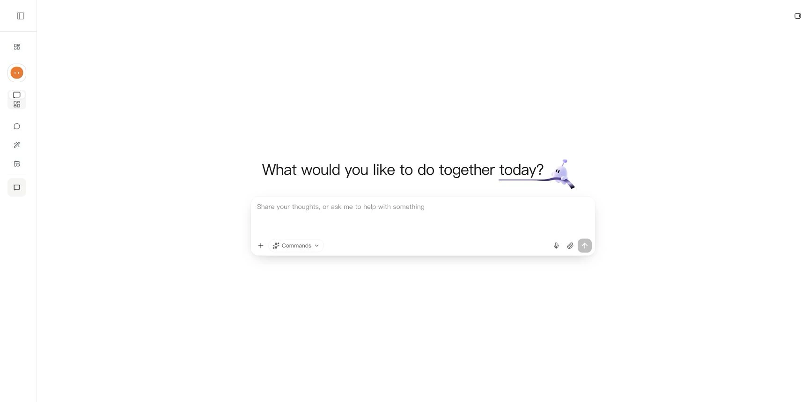

# Chat Agent

## Ringkasan

**Setelah masuk dan mengaktifkan paket LightVela, Anda dapat berbicara dengan Bot yang dipilih melalui Daily → Chat di My Agent tanpa menghubungkan kanal pesan terlebih dahulu. Daftar di sidebar menyimpan percakapan Bot tersebut, sehingga Anda dapat memulai percakapan baru atau kembali ke percakapan sebelumnya. Sebelum mengirim pesan, pastikan Bot online dan kredit model paket tersedia atau model sudah dikonfigurasi.**

## Memulai percakapan

1. Buka My Agent dan pilih Bot yang ingin digunakan di bagian atas sidebar.
2. Di Daily, buka Chat lalu pilih New conversation. Anda juga dapat memulai percakapan untuk Bot tertentu dari kartunya di halaman Overview.
3. Tulis pertanyaan atau tugas di kolom “Share your thoughts, or ask me to help with something”, lalu kirim.
4. Baca balasan di percakapan. Kolom pesan langsung muncul saat percakapan baru dibuka sehingga kamu bisa mulai menulis; tombol kirim aktif setelah koneksi siap. Saat membuka percakapan yang sudah ada, pesan “Teman AI-mu akan segera hadir” mungkin muncul sebentar.

Chat di web tidak memerlukan kanal pesan. Jika ingin menggunakan Bot yang sama di Telegram, WhatsApp, Discord, atau WeChat, hubungkan platform tersebut melalui Channels.

## Melanjutkan atau mengelola percakapan

Percakapan terbaru untuk Bot yang dipilih muncul di bawah Chat. Pilih judul untuk melanjutkan; gunakan Show more untuk menampilkan percakapan lama. Menu di samping percakapan memungkinkan Anda mengganti nama atau menghapusnya. Setelah berpindah Bot, sidebar menampilkan percakapan Bot yang dipilih.

Hermes menyimpan preferensi dan informasi proyek jangka panjang yang berguna bila sesuai. Lihat [Memory](./memory.md) untuk memeriksa memori jangka panjang Bot yang dipilih; memulai percakapan baru tidak menghapus memori tersebut.

## Memeriksa hasil dan mengatasi masalah

- **Hasil yang diharapkan:** Pesan muncul dalam percakapan, Bot membalas, dan percakapan dapat dibuka kembali dari sidebar setelah halaman dimuat ulang.
- **Pesan pemuatan tetap tampil:** Pastikan Bot online, lalu muat ulang halaman. Tunggu kolom pesan muncul sebelum menyimpulkan Chat tidak tersedia.
- **Tidak dapat mengirim atau menerima balasan:** Periksa kredit model paket atau [konfigurasi model](./model.md), dan pastikan Bot tidak dijeda. Kanal eksternal tidak diperlukan untuk Chat di web.
