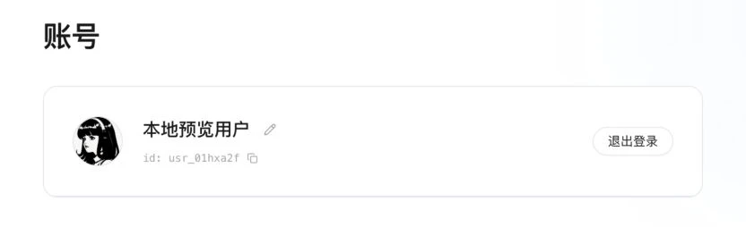
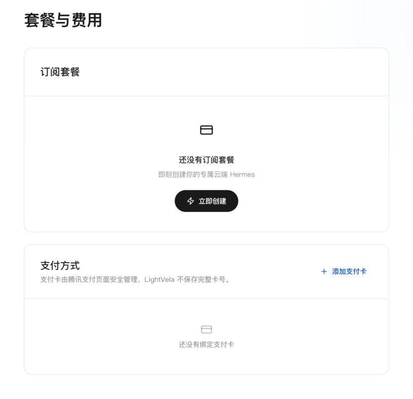

# Paket

## Ringkasan

**Menu avatar di bagian bawah sidebar kiri konsol Agent memiliki dua pilihan terpisah: Akun untuk profil dan ID pengguna, serta Paket & tagihan untuk langganan, penggunaan kredit, perpanjangan, dan metode pembayaran.**

**LightVela menyediakan dua paket, Launch dan Cruise, mencakup kebutuhan dari percobaan ringan hingga pemakaian utama harian. Paket adalah bundel sumber daya untuk mengaktifkan Hermes Agent: setelah aktif, platform mengalokasikan lingkungan cloud khusus (CPU, memori, dan penyimpanan tersendiri) tempat Agent Anda daring 24/7, tanpa perlu membeli server atau melakukan deployment lokal. Perbedaan antar paket hanya pada spesifikasi lingkungan, kapasitas penyimpanan, dan kredit model bulanan — Launch memberi 2 vCPU · 8 GB RAM, penyimpanan 50 GB, dan 100 kredit per bulan, sementara Cruise menawarkan 4 vCPU · 16 GB RAM dengan penyimpanan serta kuota bulanan lebih besar. Kemampuan inti Agent (evolusi mandiri, akses multi-kanal, skill, tugas otomatis, dan memori jangka panjang) sama di semua paket. Harga dan ketersediaan terkini mengacu pada [halaman Subscribe](/subscribe/).**

---

LightVela menyediakan dua tingkat paket, **Launch** dan **Cruise**, untuk kebutuhan mulai dari percobaan ringan sampai penggunaan Agent harian. Setiap paket menyediakan lingkungan cloud khusus untuk satu Hermes Agent dan alokasi kredit model bulanan. Halaman ini menjelaskan posisi, sumber daya, dan manfaat tiap paket agar Anda bisa memilih yang paling sesuai.

## Yang dibahas di halaman ini

- Untuk siapa tiap paket dirancang

- Spesifikasi lingkungan cloud khusus, penyimpanan, dan kredit model per tingkat

- Kemampuan inti Agent yang tersedia di semua paket

- Penawaran pengguna baru dan panduan memilih paket

---

## Apa itu paket?

### Akses akun dan tagihan

Masuk ke LightVela. Di konsol Agent, arahkan kursor ke avatar dan nama Anda di bagian bawah sidebar kiri untuk membuka menu:

- **Akun (Account)** membuka [halaman akun](/account/) untuk melihat profil, mengubah nama tampilan, menyalin ID pengguna, atau keluar.
- **Paket & tagihan (Plans & billing)** membuka [halaman paket dan tagihan](/account/billing/) untuk melihat langganan, masa berlaku, penggunaan kredit, metode pembayaran, dan memperpanjang paket.

Pada halaman **Paket & tagihan**, periksa status langganan. Jika paket dapat diperpanjang, pilih tombol perpanjangan dan ikuti petunjuk di layar. Jika belum berlangganan, gunakan tombol pembuatan untuk memilih paket di halaman Subscribe. Anda juga dapat menambahkan kartu di bagian metode pembayaran. Masukkan detail kartu di halaman penyedia pembayaran; LightVela tidak menyimpan nomor kartu lengkap.

Periksa judul halaman untuk memastikan Anda berada di tempat yang tepat. Jika paket yang telah dibeli tidak muncul, pastikan akun yang digunakan sama dengan saat pembelian, lalu muat ulang; jangan membuat pesanan ganda. Jika kartu belum muncul, selesaikan proses di penyedia pembayaran sebelum kembali dan memuat ulang halaman.

*Contoh antarmuka baru dengan data demo lokal, tanpa langganan aktif atau kartu tersimpan. Gambar menggunakan antarmuka bahasa Inggris.*

### Paket dan sumber daya

Paket adalah kumpulan sumber daya yang mengaktifkan Hermes Agent di LightVela. Setelah Anda mengaktifkan salah satu paket yang tersedia, LightVela memberi Anda **lingkungan cloud khusus** dengan CPU, memori, dan penyimpanan sendiri. Hermes Agent Anda dapat tetap online 24/7 tanpa perlu membeli server atau melakukan deployment lokal.

Perbedaan utama antar paket ada pada **sumber daya runtime, penyimpanan khusus, dan alokasi kredit model bulanan**. Kemampuan inti Agent, termasuk perilaku adaptif, multi-kanal, Skill, tugas terjadwal, dan memori jangka panjang, tetap tersedia di semua tingkat paket.

Periksa [halaman Subscribe](/subscribe/) untuk ketersediaan, harga, dan penawaran pengguna baru saat ini. Nilai di bawah menjelaskan struktur sumber daya dan kredit tiap paket.

---

> ℹ️ **Peningkatan spesifikasi lingkungan cloud**
>
> Mulai **23 September 2026**, spesifikasi lingkungan cloud untuk paket LightVela berubah sebagai berikut:
>
> - Launch dan Launch AI: dari **2 vCPU · 4 GB RAM** menjadi **2 vCPU · 8 GB RAM**
> - Cruise dan Cruise AI: dari **4 vCPU · 8 GB RAM** menjadi **4 vCPU · 16 GB RAM**
>
> Peningkatan ini hanya menyesuaikan alokasi memori. Harga paket, kapasitas penyimpanan, dan manfaat kredit AI tidak berubah. Periksa halaman Subscribe untuk spesifikasi paket dan ketersediaan pembelian terbaru.

## Dua paket yang tersedia

### Launch — Mulai ringan dan jalankan Agent Anda

Launch ditujukan untuk **pengguna yang baru mencoba Agent cloud** dan menyediakan sumber daya dasar yang diperlukan untuk merasakan pengalaman Agent secara lengkap.

| Item | Spesifikasi |
|---|---|
| Jumlah Agent | 1 |
| Lingkungan cloud khusus | 2 vCPU · 8 GB RAM |
| Penyimpanan cloud khusus | 50 GB |
| Kredit model | 100 kredit / bulan |
| Akses saat ini | Penawaran pengguna baru: lihat Subscribe |

Launch adalah cara praktis untuk mencoba produk secara penuh sebelum memutuskan tingkat sumber daya yang dibutuhkan.

### Cruise — Paket harian untuk penggunaan Agent rutin

Cruise ditujukan untuk pengguna yang menjadikan Agent sebagai **bagian rutin dari aktivitas harian** dan membutuhkan kapasitas runtime, penyimpanan, serta kredit bulanan yang lebih besar.

| Item | Spesifikasi |
|---|---|
| Jumlah Agent | 1 |
| Lingkungan cloud khusus | 4 vCPU · 16 GB RAM |
| Penyimpanan cloud khusus | 80 GB |
| Kredit model | 200 kredit / bulan |
| Status saat ini | Ketersediaan ditampilkan di halaman Subscribe |

## Kemampuan Agent yang termasuk di semua paket

Setiap Hermes Agent memiliki kemampuan inti yang sama; perbedaan paket hanya ada pada sumber daya runtime dan alokasi kredit:

- **Perilaku Agent yang adaptif** — Agent belajar dari penggunaan dan makin selaras dengan kebutuhan Anda

- **Tersedia 24/7** — Hosting cloud membuat Agent tetap online tanpa perangkat Anda harus terus menyala

- **Konsol konfigurasi sederhana** — Atur model, kanal, dan Skill dari web

- **Kanal chat yang didukung** — Hubungkan Telegram, WhatsApp, Discord, Slack, WeChat, QQ, WeCom, dan Lark

- **API model arus utama** — Pilih foundation model yang sesuai dengan kebutuhan

- **Skill dan paket Skill terkurasi** — Instal kemampuan siap pakai untuk Agent Anda

- **Persona kustom** — Tentukan peran dan gaya komunikasi Agent

- **Tugas Terjadwal** — Jalankan tugas sesuai jadwal dari konsol

- **Memori jangka panjang** — Simpan riwayat percakapan dan preferensi yang berguna

- **Diagnostik** — Telusuri status runtime dan error

---

## Ketersediaan dan pemilihan paket

- **Penawaran pengguna baru**: Launch gratis selama 1 bulan pada pesanan pertama dan Launch AI gratis selama 1 bulan pada pesanan pertama. Tingkat paket yang tersedia, sisa kuota, dan harga dapat berubah. Selalu periksa [halaman Subscribe](/subscribe) untuk informasi terbaru.

- **Opsi kredit**: Beberapa paket dapat menawarkan alokasi kredit berbeda. Opsi yang saat ini dapat dipilih dan manfaat yang termasuk di dalamnya ditampilkan di kartu paket.

- **Syarat aktivasi**: Masuk dengan Google atau GitHub dan pilih paket yang tersedia. Situs internasional tidak memerlukan verifikasi nama asli Tiongkok.

---

## FAQ

### Berapa harga tiap paket?

Harga standar Launch adalah $7,5 / bulan dan Cruise $15 / bulan. Periksa [halaman Subscribe](/subscribe/) untuk harga, penawaran pengguna baru, dan ketersediaan terbaru.

### Bisakah saya upgrade atau mengganti paket?

Paket aktif dapat di-upgrade jika memenuhi syarat. Lihat pilihan upgrade untuk paket Anda di konsol atau [halaman Subscribe](/subscribe); pilihan dapat mencakup paket dalam seri yang sama maupun lintas seri jika ditawarkan. Pilih paket tujuan yang tersedia, konfirmasi pesanan, lalu lanjutkan ke pembayaran. Jumlah yang harus dibayar dapat berbeda sesuai sisa masa berlaku dan paket tujuan; **harga aktual pada halaman pembayaran akhir yang berlaku**, bukan angka upgrade tetap.

### Berapa banyak Agent yang termasuk dalam satu paket?

Launch dan Cruise masing-masing mencakup satu Agent. Kuota Agent adalah jumlah instans Hermes yang dapat berjalan pada waktu yang sama.

### Apa yang terjadi jika kredit saya habis?

Kredit mengukur penggunaan model. Jika kredit habis, fitur yang memanggil model akan dibatasi. Langkah berikutnya yang tersedia mengikuti aturan platform terbaru.

---

## Langkah berikutnya

- [Aktifkan Instans Hermes Pertama Anda](./create-first-hermes.md) — Dari memilih paket sampai Agent berjalan

- [Panduan Cepat](./02-quickstart.md) — Ikuti alur onboarding lengkap
