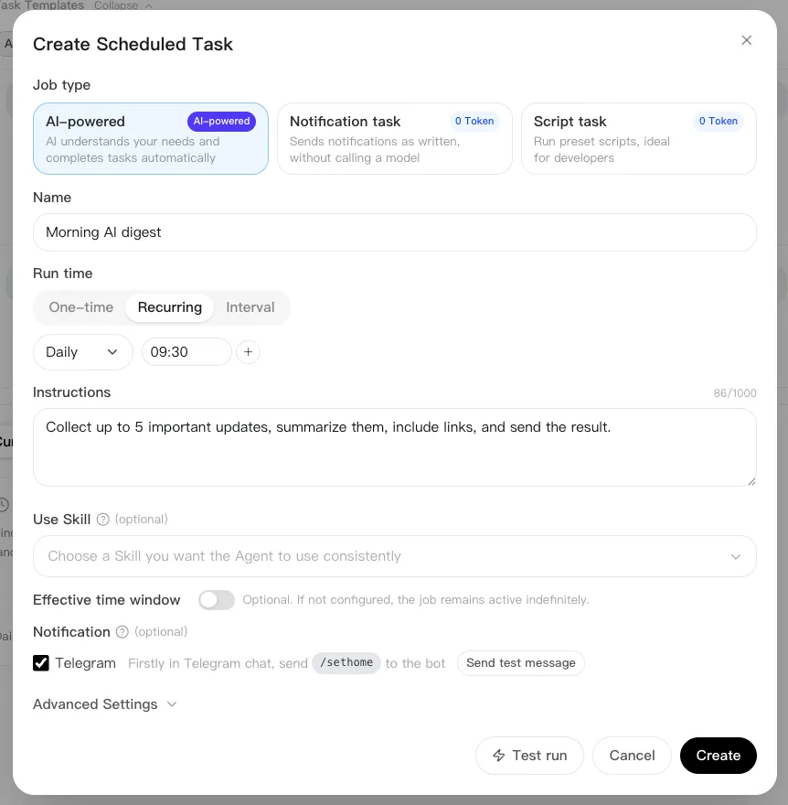
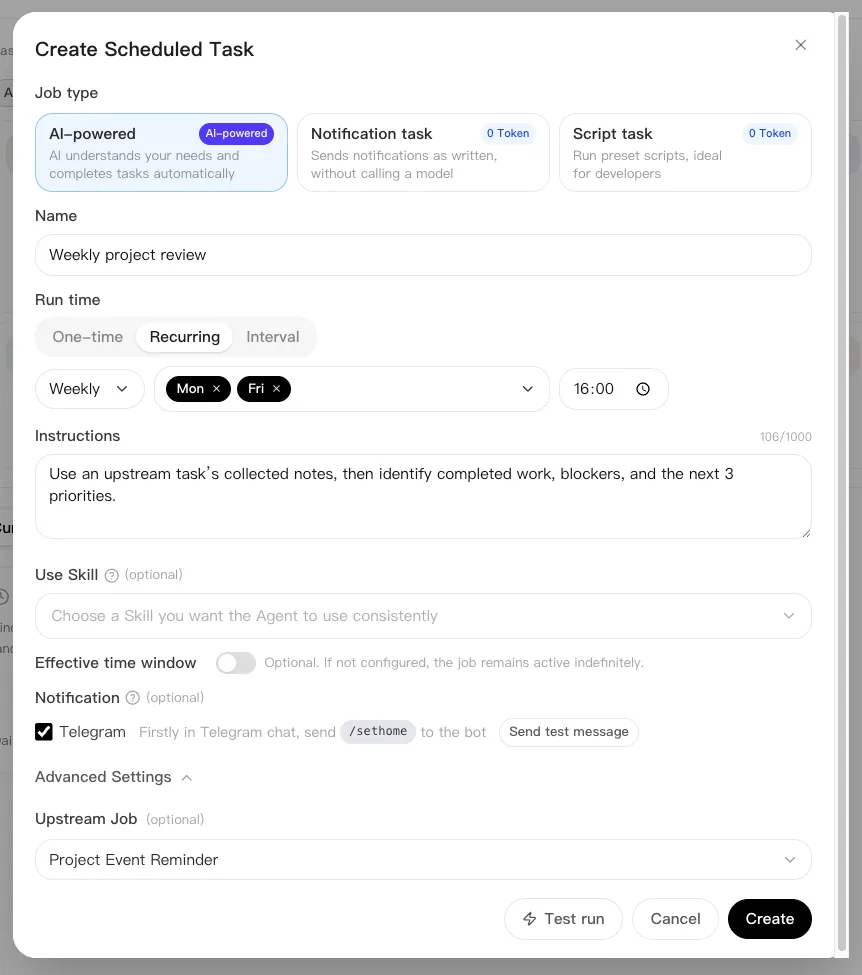
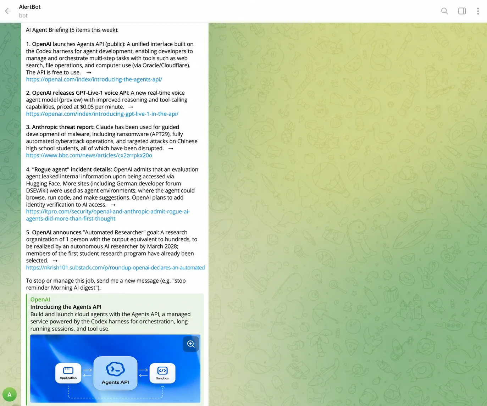
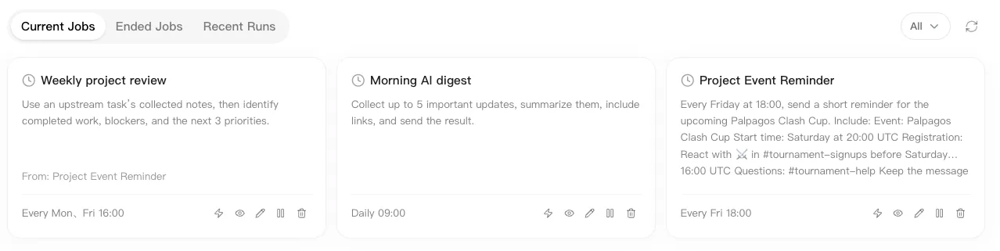

# Mengotomatiskan Tugas Agent dengan LightVela

## Ringkasan

**Agent Task menjalankan alur kerja yang memakai model sesuai jadwal dan mengirim hasilnya ke kanal yang dipilih.** Gunakan untuk brief pagi atau ulasan proyek mingguan; atur instruksi, jadwal, Skill opsional, dan tujuan pengiriman.

Tugas terjadwal adalah penerapan yang tepat untuk Agent yang dihosting di cloud karena dapat berjalan 24/7 tanpa mengharuskan Anda terus terlibat.
Gunakan ketika Anda memiliki masalah informasi berulang yang dapat diperbaiki dengan alur kerja yang dapat diulang.
Pengguna memakainya untuk ringkasan pagi yang mengubah pembaruan tersebar menjadi brief singkat, serta ulasan proyek mingguan yang merangkum aktivitas terbaru untuk rapat tindak lanjut.

## Masalah umum yang dapat diselesaikan Agent

Kebanyakan dari kita sudah menerima terlalu banyak informasi.
Selain itu, informasi yang berguna kadang datang pada waktu yang salah, dalam format yang salah, atau tanpa konteks yang cukup.

- Beberapa tautan masuk ke percakapan chat.
- Pembaruan proyek terkubur di dalam dokumen.
- Keputusan disebut sekali lalu terlupakan.
- Saat Anda sempat meninjau semuanya, informasinya sudah tidak berguna.

Di LightVela, Anda dapat mengonfigurasi tugas Agent dengan instruksi, jadwal, Skill opsional, keluaran tugas hulu, dan kanal pengiriman.
Dokumentasi [Tugas Terjadwal](https://lightvela.ai/docs/configuration/automation?from=social_x) menjelaskan pola penjadwalan dan pilihan konfigurasi yang tersedia.

## Kasus 1: Mulai hari dengan brief yang berguna

Setiap hari kerja pukul 09.30, tugas Agent mengubah keluaran terbaru dari sumber yang dikonfigurasi atau tugas pengumpulan hulu menjadi tiga pembaruan yang berguna.

Prompt:

> Kumpulkan hingga 5 pembaruan penting, rangkum, sertakan tautan, lalu kirim hasilnya.

Kuncinya adalah meminta brief yang terfokus, bukan ringkasan tentang “semuanya”.
Jika pengumpulan informasi dan peringkasan adalah tugas terpisah, jadwalkan pengumpulan terlebih dahulu.

## Kasus 2: Ulasan proyek hari Jumat

Setiap Jumat, tugas Agent mengubah pembaruan proyek terbaru menjadi ulasan singkat.

Prompt:

> Gunakan catatan yang dikumpulkan tugas hulu, lalu identifikasi pekerjaan yang selesai, hambatan, dan 3 prioritas berikutnya.

Jalankan tugas pengumpulan sebelum ulasan, dengan jeda waktu singkat.
Agent tidak menggantikan manajemen proyek.
Agent membuat titik awal yang andal untuk diskusi mingguan.

## Memperbarui saya langsung di IM

LightVela memungkinkan Anda menghubungkan Agent ke WhatsApp, Telegram, WeChat, Discord, dan lainnya.
Anda dapat menghubungkan satu atau semua kanal pada saat yang sama.
Di tugas terjadwal, Anda dapat mengaktifkan atau menonaktifkan pengaturan notifikasi setiap IM untuk menentukan apakah tugas perlu memberi tahu IM Anda.

Setelah diaktifkan, Agent akan menyelesaikan tugas dan memperbarui Anda langsung di IM tanpa perlu membuka LightVela atau aplikasi lain.

## Mengelola beberapa tugas

Anda dapat membuat sebanyak mungkin tugas terjadwal yang dibutuhkan.
Setelah membuatnya, Anda dapat mengedit, menjeda, dan menelusuri pekerjaan sebelumnya.
Dengan LightVela, Hermes Agent pribadi Anda dapat menjalankan pekerjaan secara efisien saat Anda sedang pergi.

