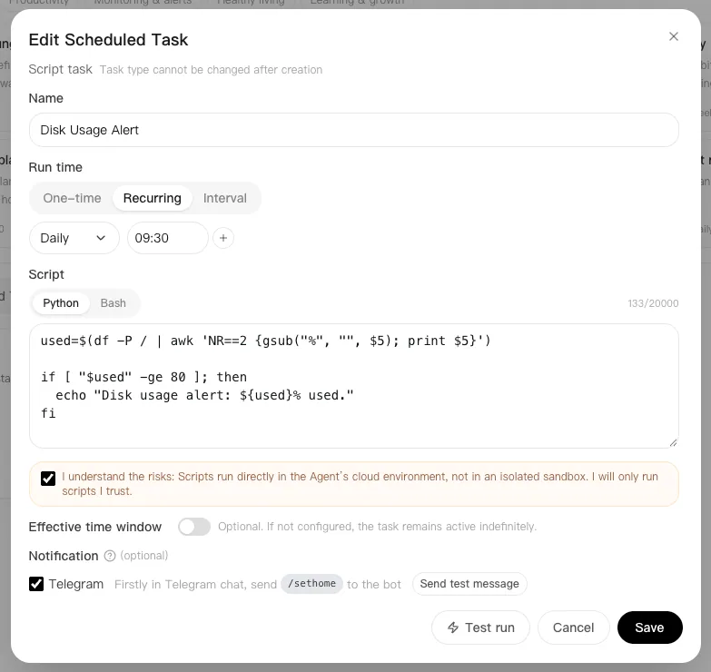
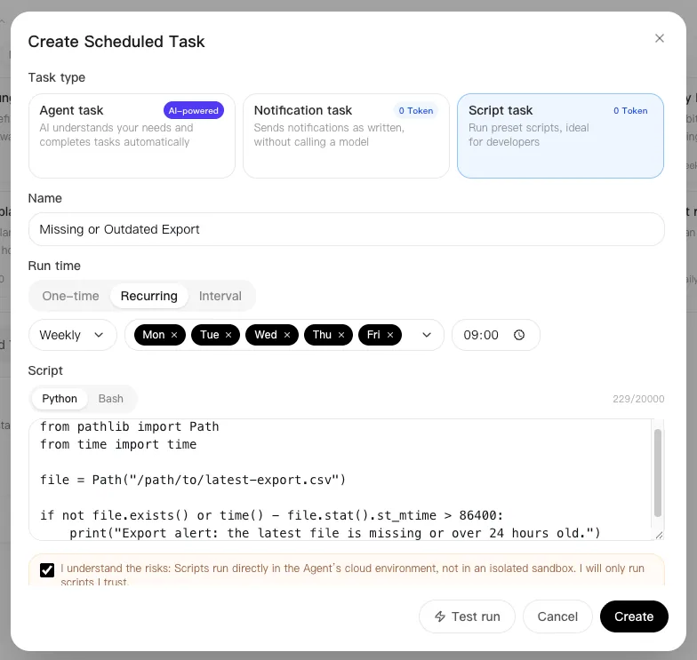
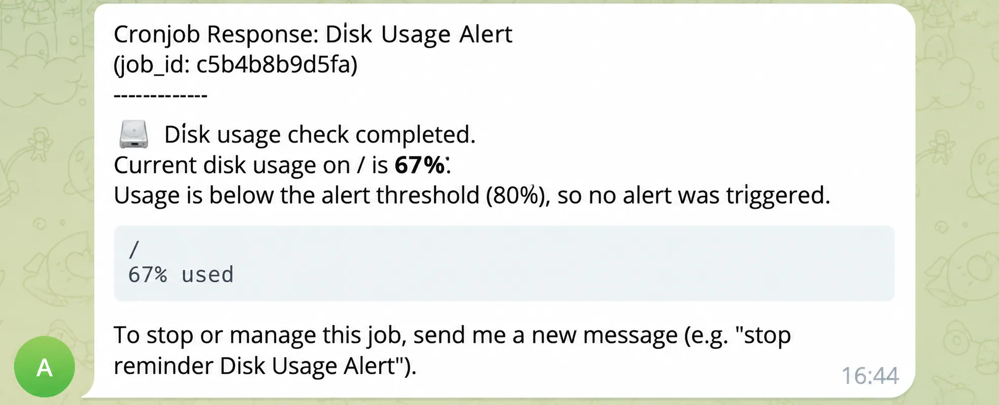
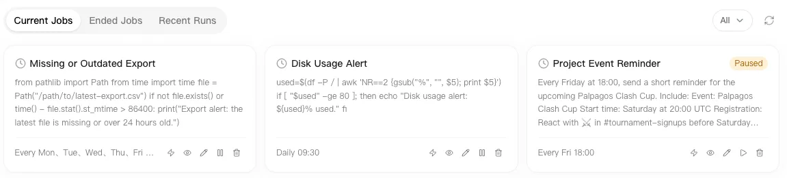

# Menjalankan Tugas Skrip di LightVela

## Ringkasan

**Script Task menjalankan Bash atau Python sesuai jadwal tanpa memanggil model AI atau memakai kredit model.** Gunakan untuk pemeriksaan disk atau file ekspor yang hilang; atur skrip, jadwal, rentang waktu aktif, dan kanal pengiriman.

Tugas Skrip adalah penerapan praktis untuk Agent yang dihosting di cloud karena dapat menjalankan skrip Bash atau Python sesuai jadwal tanpa memanggil model AI.
Gunakan ketika Anda memiliki pemeriksaan sistem berulang dengan aturan yang jelas dan dapat diprediksi.
Pengguna memakainya untuk peringatan penggunaan disk dan pemeriksaan yang mendeteksi file hilang atau kedaluwarsa.

## Masalah umum yang dapat diselesaikan skrip

Banyak masalah sistem kecil dapat dideteksi dengan pemeriksaan sederhana.
Namun, pemeriksaan ini sering terlupakan hingga sesuatu berhenti bekerja.

- Penggunaan disk meningkat tanpa disadari.
- Ekspor harian berhenti menghasilkan file baru.
- File cadangan menjadi kedaluwarsa.
- Masalah baru ditemukan setelah memengaruhi pekerjaan lain.

Di LightVela, Anda dapat mengonfigurasi tugas Skrip dengan kode Bash atau Python, jadwal, jendela waktu efektif, dan kanal pengiriman.
Tugas ini tidak memanggil model, sehingga tidak mengonsumsi token model.
Dokumentasi [Tugas Terjadwal](https://lightvela.ai/docs/configuration/automation?from=social_x) menjelaskan pilihan penjadwalan dan notifikasi yang tersedia.

## Kasus 1: Peringatan penggunaan disk

Setiap pagi, tugas Skrip Bash memeriksa ruang disk yang tersedia dan hanya melapor ketika penggunaan mencapai 80%.

Skrip:

```bash
used=$(df -P / | awk 'NR==2 {gsub("%", "", $5); print $5}')

if [ "$used" -ge 80 ]; then
  echo "Disk usage alert: ${used}% used."
fi
```



Jika penggunaan disk berada di bawah ambang batas, skrip tidak mencetak apa pun dan notifikasi tidak dikirim.
Ini membuat pemeriksaan rutin tetap senyap kecuali ada hal yang memerlukan perhatian.

## Kasus 2: Ekspor yang hilang atau kedaluwarsa

Setiap malam hari kerja, tugas Skrip Python memeriksa apakah file ekspor terbaru ada dan telah diperbarui dalam 24 jam terakhir.

Skrip:

```python
from pathlib import Path
from time import time

file = Path("/path/to/latest-export.csv")

if not file.exists() or time() - file.stat().st_mtime > 86400:
    print("Export alert: the latest file is missing or over 24 hours old.")
```



Ganti jalur contoh dengan lokasi ekspor sebenarnya.
Jika file ada dan masih baru, skrip selesai dengan tenang tanpa mengirim pesan yang tidak perlu.

## Memperbarui saya langsung di IM

LightVela memungkinkan Anda menghubungkan Agent ke WhatsApp, Telegram, WeChat, Discord, dan lainnya melalui [konfigurasi kanal](https://lightvela.ai/docs/configuration?from=social_x).
Anda dapat menghubungkan satu atau beberapa kanal pada saat yang sama.
Di Tugas Terjadwal, Anda dapat mengaktifkan setiap kanal yang dikonfigurasi untuk menentukan tempat pengiriman peringatan skrip.



Saat skrip menghasilkan keluaran standar yang tidak kosong, Hermes mengirim keluaran itu langsung ke IM Anda.
Jika skrip tidak mencetak apa pun, tugas selesai tanpa mengirim notifikasi.

## Mengelola beberapa tugas

Anda dapat membuat sebanyak mungkin tugas terjadwal yang dibutuhkan.
Setelah membuatnya, Anda dapat mengedit skrip dan jadwalnya, menjedakannya, serta menelusuri eksekusi sebelumnya.
Uji setiap skrip sebelum menjadwalkannya, terutama ketika skrip mengakses file penting.



Dengan LightVela, Hermes Agent pribadi Anda dapat terus menangani pemeriksaan yang dapat diprediksi saat Anda fokus pada pekerjaan lain.
