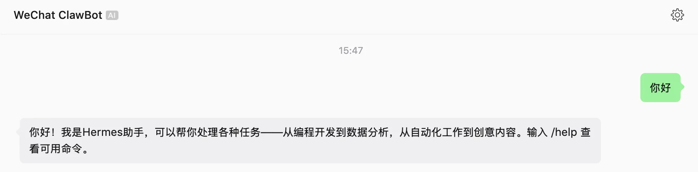

# クイックスタート

## 概要

**LightVelaで最初の会話を始めるには、サインインしてプランを有効化し、Botの準備ができたらMy Agentのチャットからメッセージを送信します。Webチャットにメッセージングチャネルは不要です。プランのモデルクレジットが利用可能なら、自分のAPIキーも先に設定する必要はありません。同じBotをWeChatでも使う場合は、このページ後半のQRコード接続手順に進んでください。**

---

この手順では、まずWebチャットで会話を始め、必要に応じてWeChatを接続します。プランの有効化とBotの準備には追加の時間を見込んでください。

## このページの内容

- LightVelaへのサインイン

- Launchプランの有効化とHermesインスタンスの作成

- Webチャットで最初のメッセージを送信

- 必要に応じてWeChatを接続

- WeChatでメッセージを送信して返信を受け取る

> 💡 **前提条件**
>
> - GoogleアカウントまたはGitHubアカウント
>
> Launchプランには100トライアルクレジットが含まれているため、大規模言語モデルのAPIキーを事前に準備しなくてもチャットを始めることができます。

---

## 1. LightVelaにサインインする

[lightvela.ai](https://lightvela.ai) を開き、右上の **ログイン** を選択します。ログイン画面で規約を読んで同意した後、**Google** または **GitHub** を選択して認証を完了してください。


---

## 2. Launch プランを有効化

[サブスクライブページ](/subscribe)でLaunchシリーズの**100クレジットのLaunch**を選び、プランカードに従って手続きします。確定前に表示価格と初回特典を確認してください。


> ⚠️ **新規ユーザー向け特典**
>
> 対象となる新規ユーザーはLaunchを1か月無料で試せます。現在の条件と提供状況は[サブスクライブページ](/subscribe/)で確認してください。


---

## 3. Hermes Agentを開く

Google または GitHub でログインし、利用可能なプランを有効にしたら、[Agent コンソール](/agents/overview/)を開きます。最初の Bot の設定では、必須の名前を入力し、必要に応じて説明を追加して外見を調整します。**作成**を選び、作成と初期設定の完了を待ちます。設定が完了したら **旅を始める** を選択し、その Bot の Web チャットを開きます。メッセージチャネルの接続は任意です。返信には利用可能なモデルクレジット、または設定済みのモデルが必要です。

---

## 4. Webチャットで会話を始める

Botの準備ができたら、日常のチャットで新しい会話を作成し、「こんにちは」と送信します。返信が届けばWebチャットを利用できます。会話の管理は[チャット](./configuration/agent-chat.md)を参照してください。

## 5. 必要に応じてWeChatを接続する

Agentのサイドバーで**Channels**を開き、**WeChat**カードの**+ Connect**からQRコードの案内に従います。スマートフォンのWeChatでスキャンして認証を完了し、メッセージを送る前に接続済みと表示されることを確認します。コードの期限切れや接続失敗時は[WeChatガイド](./configuration/channel-wechat.md)を参照してください。

---

## 6. WeChatでメッセージを送信する

追加されたボットアカウントをWeChatで見つけ、テストメッセージを送信してください:

```text
Hi
```



数秒以内にHermesから返信が届くはずです。Hermesは現在、WeChatを通じてチャットできます。

> 💡 **メッセージの課金**
>
> 通常、Launchオプションの100クレジットをモデル呼び出しに使います。不足した場合は対象の[クレジットパック](./credits.md)を購入するか、**Models**で自分のAPIキーを設定できます。

---

## 高度: 自分のモデルを設定（オプション）

特定のプロバイダーが必要な場合は、Agentのサイドバーで**Models**を開き、プロバイダーとモデルを選んでAPIキーを追加し、プライマリモデルに設定します。[モデルの設定](./configuration/model.md)を参照してください。

---

## FAQ

| 問題 | 確認すること | 対処 |
|---|---|---|
| Launchを有効化できない | 販売状況、対象条件、決済結果 | [サブスクライブページ](/subscribe)と決済画面の最終表示を確認し、完了済み注文を繰り返さないでください。 |
| Agentの準備が長い | コンソールで作成中かエラーか | Agentの概要を一度更新し、変わらない場合は[Diagnostics](./configuration/diagnostics.md)かサポートを利用してください。 |
| WeChatのQRコードが期限切れ | スマートフォンで認証を完了したか | **Channels**に戻り、新しい接続を開始してください。 |
| 返信がない | チャネル接続、Agentの状態、モデルクレジット | **Channels**と**Diagnostics**を確認し、クレジット不足なら[追加方法](./credits.md)を参照してください。 |
---

## 次のステップ

- [コアコンセプト](./04-core-concepts.md)— 5つのコア概念を理解する：Hermes Agent、Bot、モデル、チャンネル、スキル

- [設定の概要](./05-configuration.md)— コンソール全体の構造

- [スキルの設定](./configuration/skill.md) — Skills.shまたはClawHubのスキルを追加
