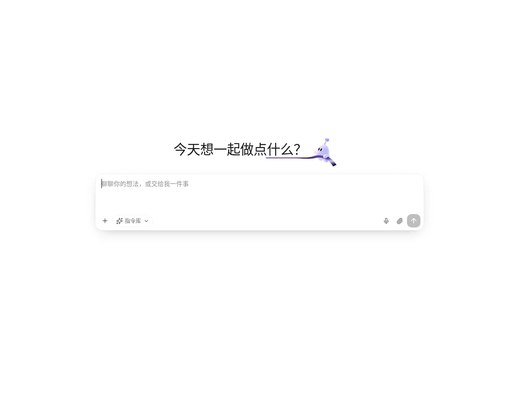

# LightVelaでパーソナルAIアシスタントを作る方法

## 概要

**個人 AI アシスタントは、まず Bot を一つ作成して選択し、利用可能なモデルクレジットまたは設定済みモデルで Web チャットの返信を確認します。メッセージアプリを使いたい場合にのみチャネルを接続します。次に、新しい会話でも安定した好みが記憶されるかを確認し、具体的な作業に必要なスキルを追加します。定期タスクは指示が機能することを確認してから設定してください。メモリ、スキル、チャネル、タスクは選択した Bot ごとに管理します。**



## 対象者

この設定は、日常の計画、調査のフォローアップ、リマインダー、あなたの好みを知ることで役立つ質問に対応する1つのアシスタントが欲しい場合にうまく機能します。複雑なワークフローは必要ありません。最初は単一のHermes Agentと、すでに定期的に確認しているチャンネル1つから始めてください。

特に、自分のタイムゾーン、要約の好みの形式、取り組んでいるプロジェクト、毎朝欲しい支援の種類など、繰り返し文脈を提供することが多い場合に役立ちます。

## 前提条件

- LightVelaアカウントと稼働中のHermes Agent。まだ作成していない場合は、まずこちらから始めてください。[クイックスタート](../02-quickstart.md)。

- Web チャットだけで始められます。メッセージアプリを使う場合は、以下の手順でチャネルを接続してください。

- 動作中のモデル構成または利用可能な試用クレジット。参照してください[モデルの設定](../configuration/model.md)もしHermesがまだ返信できない場合。

- 最初に助けが欲しいことの簡単なアイデア。1つのルーチン、例えば1日の計画やフォローアップの収集で十分です。

## 手順 / 主要な概念

### 1. Hermesをあなたの日課に組み込む

Bot バーで目的の Bot のアバターを選択します。画面が狭い場合は、先にナビゲーションパネルを開いてください。モデル、メモリ、スキル、チャネル、定期タスクを変更する前に名前を確認してください。Web チャットと会話一覧は選択した Bot に対応し、追加の Bot も Web チャットを利用できます。Web チャットにメッセージチャネルの接続は不要です。

Web チャットだけで始められます。メッセージアプリを使う場合は、以下の手順でチャネルを接続してください。

メッセージアプリを使う場合は、一つのチャネルを接続して返信を確認してください。接続手順は次のガイドを参照してください：[Telegram](../configuration/channel-telegram.md), [WhatsApp](../configuration/channel-whatsapp.md), [Discord](../configuration/channel-discord.md), [WeChat](../configuration/channel-wechat.md), [Slack](../configuration/channel-slack.md)。


広範なリクエストよりも、まず明確な紹介から始めてください。例えば：

```text
I want you to be my personal planning assistant. I am in Singapore time.
Keep daily plans short, call out deadlines first, and ask one follow-up question when something is unclear.
```

### 2. 繰り返される文脈はメモリに任せる

ヘルメスは時間をかけて有用なコンテキストを構築するため、毎回の会話ですべての好みを繰り返す必要はありません。役立つであろう事実や作業上の好みを伝えてください：あなたのタイムゾーン、ブリーフィングの構成方法、重要なプロジェクト名、または計画を立てたい日など。

要求を直接伝えることもできます：

```text
Remember that I prefer a concise weekday briefing at 8:00 AM,
with meetings, deadlines, and the three most important next actions.
```

次の[メモリ管理](../configuration/memory.md)ページで、Hermesが蓄積したメモリとユーザープロファイル情報を確認します。メモリは繰り返しを減らすためのものであり、あらゆる通過情報の捨て場になるべきではありません。

平日の午前8時に要約が欲しいという好みを記憶させても、定期タスクは作成されません。実行日時を別途設定し、初回の実行結果と選択した通知チャネルでの配信を確認してください。

### 3. 実際の作業で必要な場合にのみスキルを追加する

Hermesは追加のスキルがなくてもチャットできます。情報の検索、やることリストの整理、定期レポートの作成など、実際の仕事で役立つスキルが思いついたら追加してください。これにより、アシスタントは理解しやすく、信頼しやすくなります。


ClawHubで適切なオプションを閲覧し、その後で使用してください[スキルを設定する](https://lightvela.ai/docs/configuration/skill)でインストールします。何かをインストールする前に、その説明を読み、信頼できるソースを選んでください。

### 4. 役立つ会話を繰り返し使えるチェックインに変える

プロンプトが確実に役立つようになったら、それをスケジュールで実行するかどうかを決めてください。簡単なスケジュールタスクで、ヘルメスに朝の計画や一日の終わりのレビュー、週ごとのリセットを依頼でき、会話を始めることをあなたが思い出す必要はありません。

例えば：

```text
Every weekday at 8:00 AM, prepare a concise plan for today.
Start with deadlines and meetings, then suggest three focused next actions.
```

でスケジュールと通知チャネルを設定します。最初のスケジュールタスクは小さく保ち、実際の結果をいくつか確認した後で指示を改善できます。[スケジュールタスク](../configuration/automation.md)。


## 各要素を確認する

| 要素 | 確認方法 | 制約 |
| --- | --- | --- |
| Bot と Web チャット | 目的の Bot を選び、短いメッセージを送る | 返信にはオンラインの Bot と利用可能なクレジットまたはモデル設定が必要 |
| メモリ | 安定した好みを伝え、新しい会話で確認する | 新しい会話を始めても長期メモリは消えない |
| 定期タスク | 実行日時、通知チャネル、結果を確認する | Bot の作成やコピーでは定期タスクとチャネル接続はコピーされない |

## 結果を確認する

チャネルを接続する前に Web チャットの返信を確認してください。新しい会話で記憶した好みを試し、最初の定期タスクの結果を確認します。チャネルやタスクが失敗した場合は、機能を追加する前に選択した Bot、設定、状態を確認してください。

## FAQ

### ヘルメスが役立つようになる前に、すべての機能を設定する必要がありますか？

Web チャットだけで始められます。メッセージアプリを使う場合は、以下の手順でチャネルを接続してください。

### Hermesは私が送るすべてのメッセージを覚えますか？

いいえ。メモリは、会話を超えて有用な情報、例えば好みや繰り返し作業、安定したコンテキストなどを保持するために意図されています。必要に応じてHermesに情報を覚えさせたり忘れさせたりすることができ、その後メモリ管理で確認できます。

### 複数のチャンネルから同じアシスタントを使うことはできますか？

はい、各チャネルが同じ Bot に接続されている場合です。長期メモリと好みはその Bot に属します。別の Bot は独自のワークスペースを持ち、コピーで引き継ぐのは作成時点の内容です。その後の変更は同期されません。

### まず何をスケジュールタスクすべきですか？

既に予測可能な時間に繰り返しているタスクを選んでください。朝の計画、短い日次レビュー、または週次の優先事項確認は、出力が役立っているかをすぐに判断できるため、最初の候補として適しています。

## まとめ

最初のアシスタントは一つの日課に集中させます。選択した Bot でチャット、メモリ、最初の定期タスクが機能したら、役割を少しずつ広げてください。
