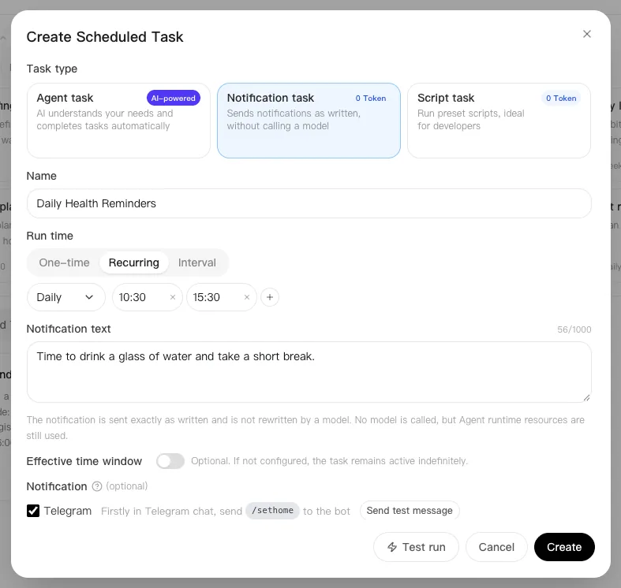
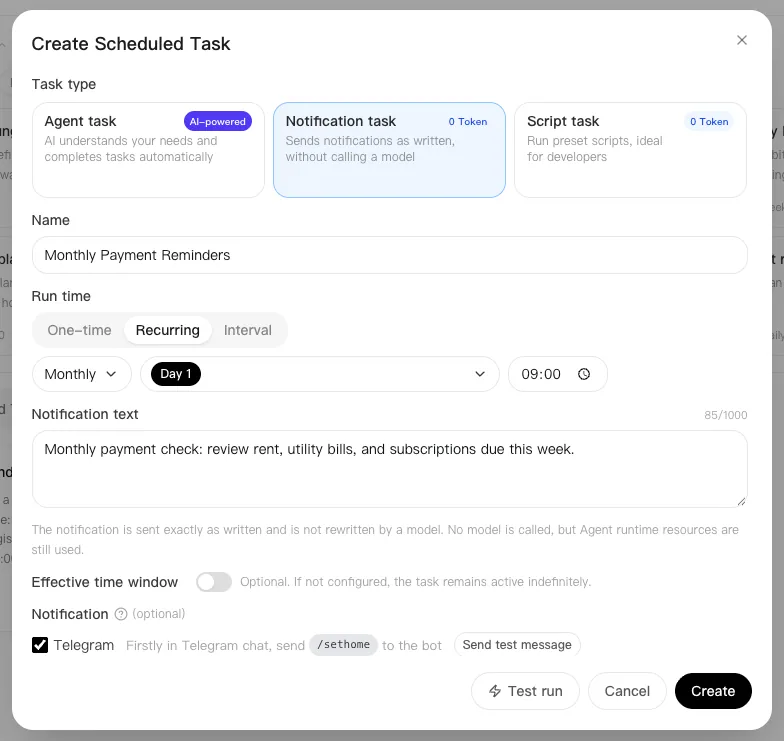
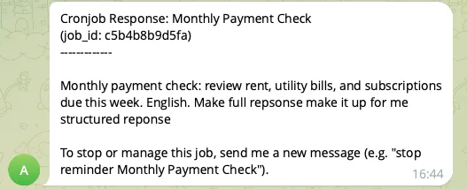
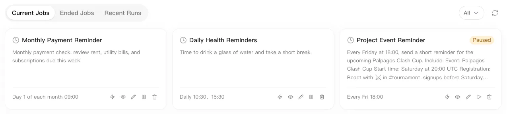

# LightVelaで通知タスクを設定する

## 概要

**Notification Task は、AI モデルを呼び出さず、モデルクレジットも使わずに定型メッセージを予定時刻に送信します。**服薬や請求書のリマインダーに適しています。文面、実行時刻、有効時間帯、配信チャネルを設定します。

通知タスクは、AIモデルを呼び出さずに固定メッセージをスケジュールどおりに送信できるため、クラウドでホストされるAgentのシンプルな活用方法です。
適切な時刻に、適切なチャンネルを通じて、指定した正確な文面でリマインダーを届けたいときに使用できます。
ユーザーは、水分補給や服薬のリマインダー、請求書やサブスクリプション更新のリマインダーに利用しています。

## 通知で解決できる一般的な問題

重要なタスクを忘れるのは、気にかけていないからではありません。
仕事が忙しくなると、小さいながらも必要な行動を見落としがちです。

- 長時間の作業中に水を飲むのを忘れる。
- 薬を予定より遅く服用する。
- サブスクリプション更新が受信トレイに埋もれる。
- 支払期限を過ぎてから請求書を思い出す。

LightVelaでは、通知タスクにメッセージ、スケジュール、有効時間枠、配信チャンネルを設定できます。
メッセージはモデルを呼び出さずに書かれたとおりに送信されるため、モデルトークンを消費しません。
[スケジュールタスクのドキュメント](https://lightvela.ai/docs/configuration/automation?from=social_x)で利用可能なスケジュールと通知のオプションを説明しています。

## ケース1: 毎日の健康リマインダー

毎日午前10時30分と午後3時30分に、通知タスクが同じ短いリマインダーを送信します。

メッセージ:

> コップ一杯の水を飲んで、少し休憩する時間です。

重要なのは、メッセージを短く実行しやすいものにすることです。
モデルには渡されないため、通知が書き換えられたり、追加のコンテキストが付与されたりすることはありません。

## ケース2: 毎月の支払いリマインダー

毎月1日に、通知タスクが今後の支払いを確認するよう通知します。

メッセージ:

> 毎月の支払い確認: 今週期限を迎える家賃、公共料金、サブスクリプションを確認してください。

通知は各支払いを期限前に見える状態に保ちます。
請求書ごとに期日が異なる場合は、各リマインダーが役立つ時期に届くように別々のタスクを作成してください。

## IMで直接更新を受け取る

LightVelaでは、AgentをWhatsApp、Telegram、WeChat、Discordなどに接続できます。
一つまたは複数のチャンネルを同時に接続できます。
スケジュールタスクでは、設定済みの各チャンネルを切り替え、通知をどこに配信するかを決められます。

切り替え後、Hermesは正確な通知をIMに直接送信します。
リマインダーを確認するためにLightVelaや別のアプリを開く必要はありません。

## 複数のタスクを管理する

必要な数だけスケジュールタスクを設定できます。
作成後は、内容とスケジュールを編集し、一時停止し、過去の実行を閲覧できます。
LightVelaを使うと、個人用Hermes Agentが他の作業に集中している間も重要なルーティンを予定どおりに保ちます。

