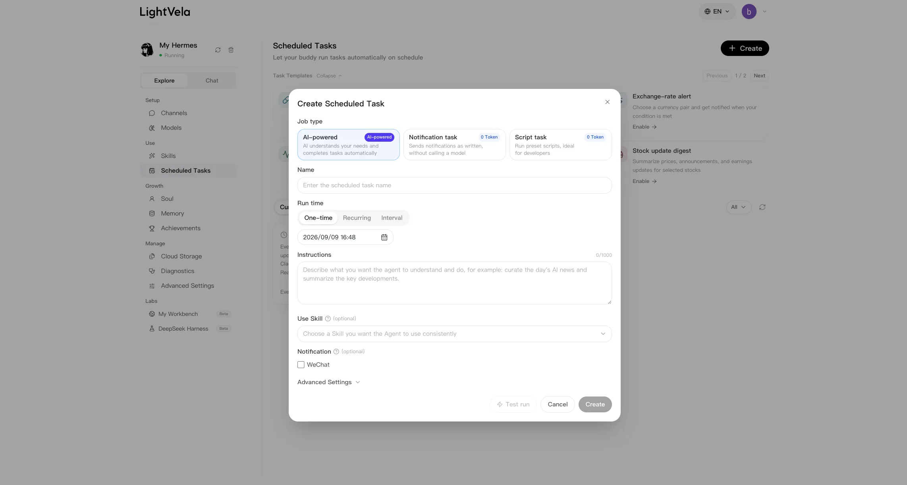

# 예약 작업

## 요약

**예약 작업을 사용하면 수동 프롬프트 없이 Hermes Agent가 작업을 시작할 수 있습니다. AI 추론이 필요한 작업에는 Agent 작업을, 같은 메시지를 그대로 보내야 할 때는 알림 작업을, Bash 또는 Python 스크립트로 결정적인 확인을 수행할 때는 스크립트 작업을 선택하세요. 세 유형은 모두 일회성, 반복, 간격 실행 일정과 유효 기간 및 알림 설정을 공유합니다.**

## 작업 유형 선택

예약 시간이 되었을 때 해야 하는 일에 따라 작업 유형을 선택하세요.

| 작업 유형 | 적합한 용도 | 입력할 내용 | 실행되는 내용 |
| --- | --- | --- | --- |
| **Agent 작업** | 해석이 필요한 요약, 조사, 분석, 작성 등의 작업 | 작업 지침과 선택적인 Skill 또는 업스트림 작업 | Hermes Agent가 모델 기반 작업을 시작합니다. |
| **알림 작업** | 정해진 알림과 반복 메시지 | 알림 텍스트 | LightVela가 모델을 호출하지 않고 입력한 텍스트를 그대로 보냅니다. |
| **스크립트 작업** | 개발자용 검사와 결정적 자동화 | Bash 또는 Python 스크립트 | Agent 세션이나 모델 호출 없이 스크립트를 실행합니다. 비어 있지 않은 표준 출력은 알림으로 보낼 수 있습니다. |

작업 유형과 일정 패턴은 별개의 설정입니다.
모든 유형은 한 번 실행하거나 매일, 매주, 매월 반복하거나 고정 간격으로 실행할 수 있습니다.

## 작업을 만들기 전에

Hermes Agent가 활성 상태인지 확인하고, 필요하면 알림 채널을 선택한 뒤 스크립트 작업 코드를 저장하기 전에 검토하세요.

## Agent 작업 만들기

Hermes Agent가 요청을 이해하고 결과를 생성해야 할 때 **Agent 작업**을 선택하세요.
예를 들어 매일 AI 뉴스를 수집하고 가장 중요한 항목을 골라 간단한 브리핑을 작성할 수 있습니다.

다음 항목을 설정하세요.

- **이름**: 알아보기 쉬운 이름을 지정합니다.
- **일정**: 한 번 실행, 반복 일정 또는 고정 간격을 선택합니다.
- **작업 지침**: 목표, 범위, 출처 제한, 예상 출력 형식을 설명합니다.
- **Skill**: 해당 기능이 필요하면 사용 가능한 Skill을 선택적으로 추가합니다.
- **업스트림 작업**: 선택 사항이며 다른 Agent 작업의 최근 완료 출력을 추가 컨텍스트로 사용합니다.
- **유효 기간**: 선택 사항이며 작업 실행이 허용되는 시간을 제한합니다.
- **알림**: 선택 사항이며 완료 결과를 받을 위치를 선택합니다.

예약 시간이 되면 Hermes Agent가 Agent 작업을 만들고 선택한 모델을 호출합니다.
결과는 선택한 알림 채널로 보낼 수 있으며 최근 실행에 기록됩니다. 채널을 선택하지 않으면 작업이 로컬 저장 방식으로 생성됩니다. 결과는 이 Bot의 최근 실행에 남고 채팅으로 전송되지 않습니다.

## 알림 작업 만들기

작성한 메시지를 그대로 전달해야 할 때 **알림 작업**을 선택하세요.
예를 들어 매일 물을 마시라는 알림, 매월 임대료 알림, 짧은 팀 공지를 만들 수 있습니다.

작업 이름, 일정, 알림 내용, 유효 기간, 알림 채널을 설정하세요.
알림 내용에는 일반 문장 부호, 줄바꿈, 이모지, 여러 언어의 텍스트를 포함할 수 있습니다.

예약 시간이 되면 LightVela가 알림 내용을 그대로 보냅니다.
모델에 메시지 작성, 재작성, 요약, 번역, 설명을 요청하지 않습니다.
따라서 이 작업의 모델 토큰 사용량은 0 Token입니다.

알림 작업을 만들거나 저장하려면 알림 채널을 하나 이상 선택해야 합니다.
줄바꿈과 문자의 표시 방식은 알림 채널의 텍스트 규칙에 따라 달라질 수 있습니다.

## 스크립트 작업 만들기

결정적인 Bash 또는 Python 워크플로가 필요할 때 **스크립트 작업**을 선택하세요.
예를 들어 디스크 사용량을 확인하거나 서비스 응답을 검사하거나 임계값을 넘었을 때만 알림을 출력할 수 있습니다.

작업 이름, 일정, 스크립트 언어, 스크립트 내용, 유효 기간, 알림 채널을 설정하세요.
만들기 전에 스크립트 안전 안내를 확인하고 코드를 신뢰할 수 있는지 확인하세요.

스크립트 작업은 Agent 세션을 만들거나 모델, 프롬프트, Skill을 호출하지 않습니다.
모델 토큰 사용량은 0 Token이지만 클라우드 Agent 실행 리소스는 사용합니다.

| 스크립트 결과 | 작업 결과 | 전달 방식 |
| --- | --- | --- |
| 종료 코드 `0`이며 표준 출력이 비어 있지 않음 | 성공 | 표준 출력을 선택한 알림 채널로 그대로 보냅니다. |
| 종료 코드 `0`이며 표준 출력이 비어 있음 | 조용한 성공 | 결과 알림을 보내지 않습니다. |
| 0이 아닌 종료 코드 | 실패 | 실패를 기록하고 작업 실패 처리에 따릅니다. |
| 시간 초과 또는 시작 실패 | 실패 | 실패 유형을 기록하고 작업 실패 처리에 따릅니다. |

스크립트 작업이 AI로 실패를 수정하거나 설명하거나 요약할 것이라고 기대하지 마세요.
빈 출력은 계속 조용히 처리되며 실패한 스크립트가 모델 대체 실행을 시작하지도 않습니다.

## 업스트림 Agent 작업 연결

한 Agent 작업이 다른 Agent 작업을 위한 컨텍스트를 준비해야 할 때 업스트림 작업을 연결하세요.
다운스트림 작업은 업스트림 작업의 최근 완료 출력을 받으면서 자체 일정, 지침, 유효 기간, 알림 설정을 유지합니다.

의존하는 작업 사이에 충분한 시간을 두고 다운스트림 지침에 업스트림 출력을 사용하는 방법을 설명하세요.
업스트림 컨텍스트, 모델 실행, Skill은 Agent 작업에만 적용됩니다.

## 공통 일정과 전달 규칙 설정

세 작업 유형은 동일한 일정 및 알림 제어 항목을 공유합니다.

- **한 번 실행**: 선택한 날짜와 시간에 한 번 실행합니다.
- **반복**: 선택한 시간에 매일, 매주 또는 매월 실행합니다.
- **간격**: 선택한 분, 시간 또는 일수마다 실행합니다.
- **유효 기간**: 반복 또는 간격 작업이 실행될 수 있는 시간을 제한합니다. 비워 두면 항상 활성 상태를 유지합니다.
- **알림**: 성공 결과나 작업 알림을 받을 채널을 선택합니다.

작업을 만드는 중 유형을 바꿔도 공통 설정은 유지됩니다.
생성 후에는 작업 유형을 바꿀 수 없으므로 실행 모델을 바꿔야 하면 새 작업을 만드세요.

## 작업 템플릿 사용

Agent 작업을 어떻게 시작할지 모르겠다면 예약 작업 페이지의 템플릿 영역을 사용하세요.
물과 약 복용 알림, 임대료 알림, 환율 알림, 주식 정보 요약 등의 카드를 선택하고 작업을 만들기 전에 생성된 일정과 지침을 검토하세요.

템플릿을 열면 작업 만들기 대화 상자에 내용이 미리 입력됩니다.
예를 들어 주식 정보 요약 템플릿은 작업 이름, 매일 실행되는 일정, 시장 정보 지침을 채우며 테스트하거나 만들기 전에 수정할 수 있습니다.

사용자 지정 알림 작업이나 스크립트 작업은 템플릿 유형을 바꾸지 말고 만들기 대화 상자에서 새로 만드세요.

## 예약 작업 관리

작업을 만든 뒤 예약 작업 페이지에서 현재 작업, 종료된 작업, 최근 실행을 확인하세요.
현재 작업 보기에서 Agent 작업, 알림 작업, 스크립트 작업으로 필터링할 수 있습니다.

**최근 실행**에서 실행 상세를 열고 **결과 보기**를 눌러 Markdown 결과를 읽거나 **Markdown 다운로드**로 저장할 수 있습니다. 먼저 해당 작업을 만든 Bot으로 전환하세요. 결과는 그 Bot의 실행 기록에 저장되며 다른 Bot의 채팅이나 기록에는 표시되지 않습니다.

종료된 작업에는 완료, 실패, 만료된 작업이 포함됩니다.
진행 중인 작업은 현재 작업에 남습니다.

작업 목록에서 세부 정보를 확인하고 허용된 설정을 편집하거나 작업을 일시 중지하거나 삭제할 수 있습니다.
업스트림 의존성이 있는 Agent 작업을 삭제하기 전에 다른 작업이 최근 완료 출력을 여전히 필요로 하는지 확인하세요.

## 새 작업 확인

작업을 만들거나 편집한 뒤 “저장 성공” 메시지만 확인하고 끝내지 마세요.

1. 올바른 작업 유형 필터에 표시되고 상태가 예상과 일치하는지 확인합니다.
2. 일정, 유효 기간, 알림 설정을 확인합니다.
3. 테스트를 실행하거나 실제 실행을 한 번 기다린 다음 최근 실행을 확인합니다.
4. Agent 작업은 결과가 지침을 따르고 설정된 경우 선택한 업스트림 출력을 사용하는지 확인합니다.
5. 알림 작업은 전달된 텍스트가 입력한 내용과 일치하는지 확인합니다.
6. 스크립트 작업은 종료 결과와 표준 출력이 올바르게 전달되었거나 조용히 처리되었는지 확인합니다.

## 일반적인 실패 처리

| 증상 | 가능한 원인 | 권장 처리 방법 |
| --- | --- | --- |
| 작업이 예상한 시간에 실행되지 않음 | 일정, 유효 기간 또는 작업 상태가 활성화되지 않음 | 일정과 유효 기간을 확인하고 작업이 활성화되어 있는지 확인한 뒤 최근 실행을 살펴봅니다. |
| Agent 작업 결과가 목표에서 벗어남 | 지침이 모호하거나 필요한 Skill을 사용할 수 없거나 업스트림 컨텍스트가 없음 | 목표, 범위, 출력 형식, 출처 제한을 명확히 작성하고 다음 실행 전에 Skill과 업스트림 작업을 확인합니다. |
| 알림 작업은 실행됐지만 메시지가 도착하지 않음 | 알림 채널을 선택하지 않았거나 대상 채널을 사용할 수 없음 | 알림 채널을 선택하고 확인한 뒤 작업을 다시 테스트합니다. |
| 스크립트 작업이 메시지 없이 실행됨 | 스크립트가 표준 출력 없이 정상 종료됨 | 조용한 성공입니다. 조건이 충족될 때 전달할 정확한 텍스트를 스크립트가 출력하도록 만드세요. |
| 스크립트 작업이 실패함 | 스크립트 오류, 시간 초과 또는 시작 실패 | 실행 기록을 확인하고 신뢰할 수 있는 스크립트를 수정한 뒤 다시 테스트합니다. AI가 스크립트를 자동으로 수정하거나 설명할 것이라고 기대하지 마세요. |
