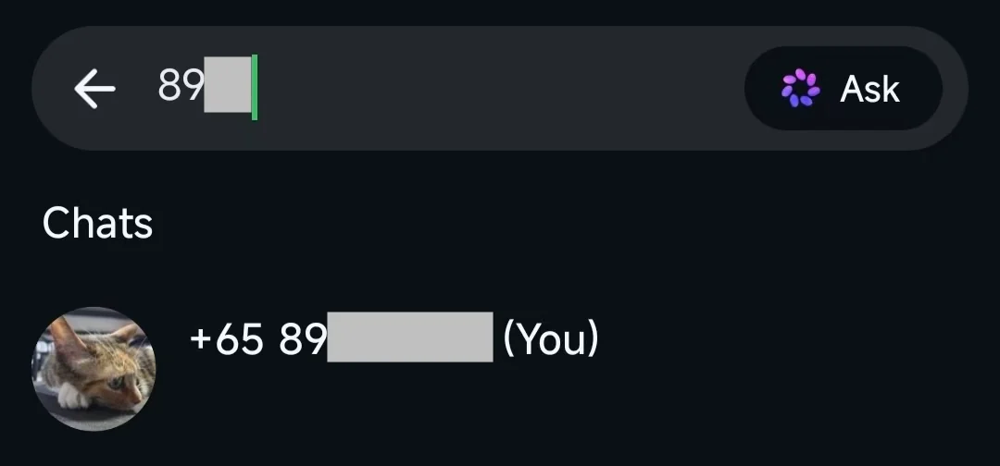

# 채널 - WhatsApp 구성

## 요약

**WhatsApp 채널은 WeChat과 마찬가지로 QR 코드로 연결하므로 Hermes Agent를 WhatsApp 대화에 빠르게 추가할 수 있습니다. 콘솔의 채널 섹션에서 WhatsApp을 선택해 QR 코드를 생성한 뒤 휴대폰의 WhatsApp으로 스캔하면 대화를 시작할 수 있습니다. WhatsApp이 설치된 휴대폰과 구성된 모델(또는 플랜에 포함된 월간 모델 크레딧)이 필요합니다. 하나의 에이전트를 여러 채널에 동시에 연결해 동일한 페르소나와 장기 메모리를 공유할 수 있습니다.**

---

WhatsApp 채널은 WeChat과 유사한 QR 코드 액세스를 사용하며 Hermes Agent를 WhatsApp 대화에 빠르게 연결하는 데 적합합니다.

## 이 페이지에서는 다음을 다루고 있습니다.

- 휴대폰에서 WhatsApp으로 QR 코드를 스캔하여 액세스 승인

- WhatsApp에서 Hermes Agent와 채팅 중


> 💡 **전제 조건**
>
> - WhatsApp이 설치된 전화기
>
> - [모델 구성](./model.md) 완료(또는 Launch 플랜에 포함된 100 체험 크레딧 사용)
>

---

## 단계

### 1. 콘솔에 들어가세요

LightVela에 로그인하고 대상 Agent를 연 뒤 사이드바에서 **Channels**를 선택하세요.

### 2. WhatsApp 채널을 선택합니다.

WhatsApp 카드를 찾아 "+ 연결"을 클릭하세요.

같은 LightVela 인스턴스에서는 WhatsApp을 한 번에 하나의 Bot에만 연결할 수 있습니다. 다른 Bot에 연결되어 있다면 안내에서 해당 Bot으로 이동해 WhatsApp 연결을 해제한 후 여기서 연결하세요.

### 3. WhatsApp에서 QR 코드 스캔

휴대폰의 WhatsApp으로 LightVela에 표시된 코드를 스캔하고 앱 안내에 따라 연결된 세션을 인증합니다. 코드가 만료되면 WhatsApp 카드에서 새 코드를 생성하세요. **Channels**로 돌아가 WhatsApp이 연결됨으로 표시되는지 확인합니다.

### 4. WhatsApp에서 자신을 찾으세요



자신과 채팅하세요. 그게 바로 여러분의 봇입니다.

봇과의 채팅을 열고 테스트 메시지를 보냅니다.

```
Hi
```

몇 초 내에 Hermes Agent 응답을 받게 됩니다.


---

## 성공 상태

- 콘솔의 "연결된 채널" 목록에 "WhatsApp"이 포함되어 있습니다.

- 해당 봇은 WhatsApp 연락처에서 찾을 수 있습니다.

- Hermes Agent는 메시지를 보낸 후 응답합니다.


---

## 지원되는 메시지 유형

액세스가 성공한 후 WhatsApp 봇은 기본 문자 메시지를 수신하고 응답할 수 있으며 다음과 같이 더 많은 메시지 유형을 지원합니다.

| WhatsApp 봇이 지원하는 메시지 유형 | 지원됨 |
|---|---|
| 문자 메시지 받기 | ✅ 지원됨 |
| 이미지 및 비디오 수신 | ✅ 지원됨 |
| 파일 받기 | ✅ 지원됨 |
| 문자 메시지로 답장하기 | ✅ 지원됨 |
| 이미지와 동영상으로 답장하기 | ✅ 지원됨 |
| 파일로 답장하기 | ✅ 지원됨 |
| 사전에 메시지 보내기(예: 예약된 알림) | ✅ 지원됨 |

> ℹ️ **실제 처리 능력은 모델에 따라 다릅니다**
>
> 위 표는 채널 레이어에서 WhatsApp 봇이 지원하는 메시지 유형만 나타냅니다. 이미지, 파일, 기타 작업을 실제로 처리할 수 있는지 여부도 Hermes Agent에 연결된 대형 언어 모델에 해당 기능이 있는지 여부에 따라 달라집니다.

---

## FAQ

| 문제 | 확인할 사항 | 다음 단계 |
|---|---|---|
| QR 코드를 스캔할 수 없거나 만료됨 | 휴대폰 연결 및 현재 코드 | WhatsApp 카드에서 새 코드를 만들고 앱의 최신 안내를 따르세요. |
| 연결이 표시되지 않음 | 휴대폰에서 인증을 완료했는지 | **Channels**로 돌아가 한 번 새로고침하고 여전히 연결되지 않으면 다시 연결하세요. |
| 메시지에 답이 없음 | Agent 및 채널 상태, 모델 크레딧 | **Channels**와 [Diagnostics](./diagnostics.md)를 확인하고 필요하면 [크레딧 옵션](../credits.md)을 보세요. |
| 예약 메시지가 도착하지 않음 | 채널 연결 및 작업 실행 결과 | [Scheduled Tasks](./automation.md)의 최근 실행과 알림 대상을 확인하세요. |
| 다른 Bot이 WhatsApp을 사용 중 | 인스턴스당 하나의 Bot만 WhatsApp에 연결 가능 | 기존 Bot에서 연결을 해제한 후 새 Bot에 연결하세요. |

---

## 채널 노트

- **메시지 유형**: 텍스트, 이미지, 동영상, 파일, 음성 메시지 등을 지원합니다. 위의 '지원되는 메시지 유형'을 참조하세요.

- **그룹 채팅 지원**: 그룹 채팅은 현재 지원되지 않습니다. 1:1 대화만 지원됩니다.

- **연결 중단**: 오랫동안 응답이 없으면 승인이 취소되었음을 의미할 수 있습니다. 콘솔로 돌아가서 액세스를 다시 승인하세요.

---

## 다음 단계

- [채널 구성 - Discord](./channel-discord.md) — 커뮤니티 운영 및 개발자 커뮤니티

- [채널 구성 - Slack](./channel-slack.md) — 팀 협업, 작업 공간 알림 및 채널 워크플로

- [채널 구성 - QQ](./channel-qq.md) — 봇이 수동으로 생성되고 AppID/AppSecret을 통해 통합됨

- [채널 구성 - WeCom](./channel-wecom.md) — 기업 내부 협업 및 업무 환경

- [스킬 구성](./skill.md) — Hermes Agent 기능 확장
