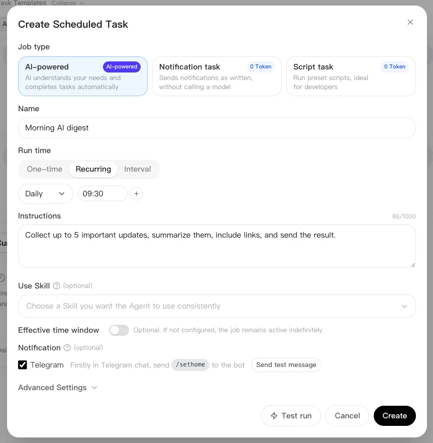
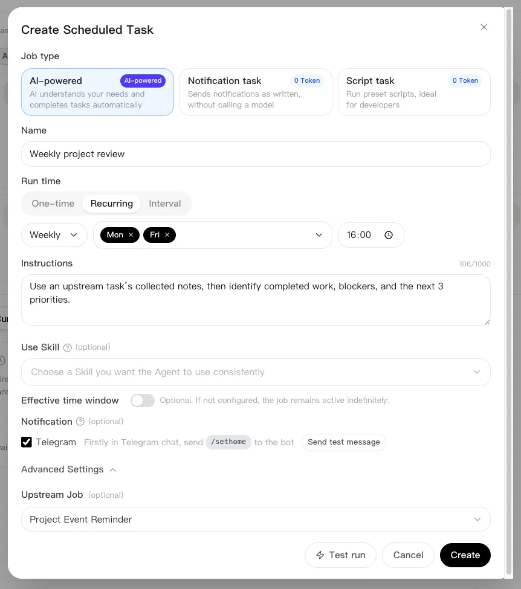
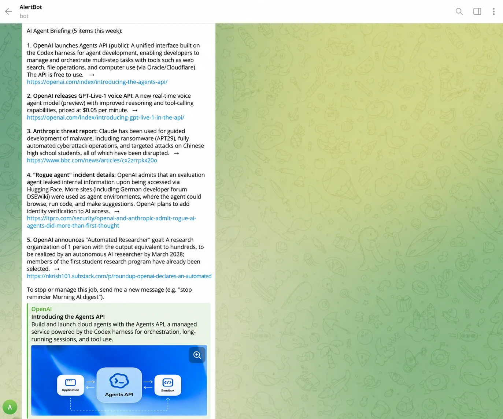
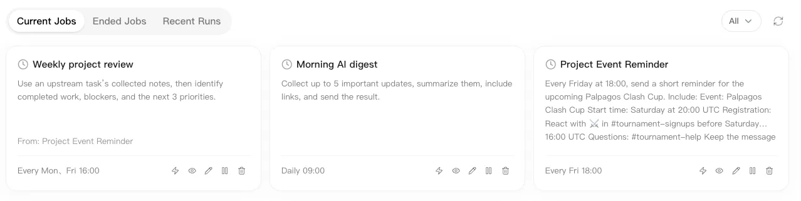

# LightVela로 Agent 작업 자동화하기

## 요약

**Agent Task는 일정에 따라 모델을 사용한 작업을 실행하고 선택한 채널로 결과를 전달합니다.** 아침 브리핑이나 주간 프로젝트 검토에 활용할 수 있습니다. 지침, 일정, 선택적 스킬, 전달 채널을 설정하세요.

예약 작업은 사용자가 계속 관여하지 않아도 24시간 내내 실행할 수 있으므로 클라우드 호스팅 Agent에 적합합니다.
반복 가능한 워크플로로 개선할 수 있는 반복적인 정보 문제가 있을 때 사용할 수 있습니다.
사용자는 흩어진 업데이트를 짧은 브리프로 바꾸는 아침 다이제스트와 후속 회의를 위한 최근 활동을 요약하는 주간 프로젝트 검토에 활용하고 있습니다.

## Agent가 해결할 수 있는 일반적인 문제

우리 대부분은 이미 너무 많은 정보를 받고 있습니다.
또한 유용한 정보가 잘못된 시점, 잘못된 형식 또는 충분하지 않은 맥락으로 도착하기도 합니다.

- 몇 개의 링크가 채팅에 도착합니다.
- 프로젝트 업데이트가 문서에 묻힙니다.
- 결정이 한 번 언급된 뒤 잊힙니다.
- 모든 내용을 검토할 시간이 생길 때쯤에는 정보가 더 이상 유용하지 않습니다.

LightVela에서는 Agent 작업에 지침, 일정, 선택적 Skill, 업스트림 작업 출력, 전달 채널을 구성할 수 있습니다.
[예약 작업 문서](https://lightvela.ai/docs/configuration/automation?from=social_x)에서 사용할 수 있는 일정 패턴과 구성 옵션을 설명합니다.

## 사례 1: 유용한 브리프로 하루 시작하기

매주 평일 오전 9시 30분에 Agent 작업은 구성된 소스 또는 업스트림 수집 작업의 최신 출력을 세 가지 유용한 업데이트로 정리합니다.

프롬프트:

> 중요한 업데이트를 최대 5개 수집하고, 요약과 링크를 포함한 뒤 결과를 보내세요.

핵심은 “모든 것”의 요약이 아니라 집중된 브리프를 요청하는 것입니다.
정보 수집과 요약이 별도 작업이라면 수집을 먼저 예약하세요.

## 사례 2: 금요일 프로젝트 검토

매주 금요일에 Agent 작업은 최신 프로젝트 업데이트를 짧은 검토로 정리합니다.

프롬프트:

> 업스트림 작업에서 수집한 메모를 사용하여 완료된 작업, 차단 요소, 다음 3가지 우선순위를 식별하세요.

검토 전에 수집 작업을 실행하고 작은 시간 여유를 두세요.
Agent는 프로젝트 관리를 대체하지 않습니다.
주간 논의를 위한 신뢰할 수 있는 출발점을 만듭니다.

## IM에서 직접 업데이트 받기

LightVela에서는 Agent를 WhatsApp, Telegram, WeChat, Discord 등에 연결할 수 있습니다.
하나 또는 모든 채널을 동시에 연결할 수 있습니다.
예약 작업에서 각 IM의 알림 설정을 전환하여 작업이 IM에 알릴지 결정할 수 있습니다.

전환한 뒤 Agent는 작업을 완료하고 LightVela나 다른 앱을 열 필요 없이 IM으로 직접 업데이트합니다.

## 여러 작업 관리하기

필요한 만큼 예약 작업을 설정할 수 있습니다.
생성한 뒤에는 편집, 일시 중지, 이전 작업 탐색이 가능합니다.
LightVela를 사용하면 개인 Hermes Agent가 자리를 비운 동안에도 작업을 효율적으로 실행합니다.

