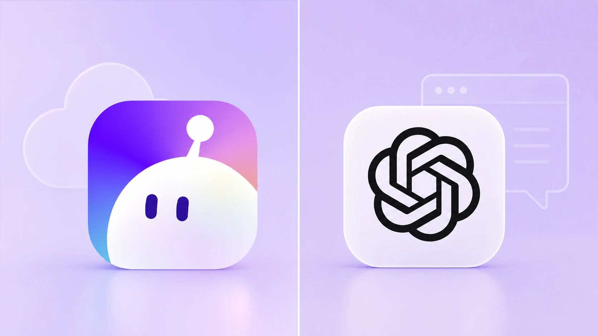

# LightVela vs ChatGPT: Manakah yang terbaik untuk membina pembantu AI peribadi anda?

## Ringkasan

**Jika matlamat anda adalah untuk mengehoskan Ejen AI peribadi yang kekal tersedia dan tergolong dalam aliran kerja anda sendiri, LightVela adalah lebih sesuai secara langsung.** ChatGPT adalah lebih baik jika anda mahukan ruang kerja AI yang luas dan digilap untuk perbualan, fail, penyelidikan, penulisan dan pelbagai jenis tugasan. Mereka bertindih dalam perkara yang mereka boleh bantu anda lakukan, tetapi mereka bukanlah produk yang sama di bawahnya.

## Sekali imbas

| Apa yang penting | LightVela | SembangGPT |
| - | - | - |
| **Pekerjaan utama** | Anjurkan Hermes Agent berdedikasi | Ruang kerja AI tujuan am |
| **Waktu Jalan** | Agen awan khusus tersedia 24/7 | Akaun ChatGPT, sembang, Projek dan GPT |
| **Pemperibadian** | Model, alatan, persona, Kemahiran, Saluran | Memori, arahan, Projek, GPT tersuai |
| **Interaksi** | Saluran pemesejan seperti Telegram, WhatsApp, Discord, Slack dan WeChat | ChatGPT web, mudah alih, desktop, suara, fail dan Kanvas |
| **Paling sesuai** | Ejen berterusan yang anda konfigurasikan dan kembali ke | Pembantu yang fleksibel untuk pelbagai tugasan |

## Perbezaan penting: ruang kerja atau Ejen?

LightVela bermula dari soalan yang berbeza:

> **Bagaimana jika saya mahukan satu Ejen sebenar yang saya konfigurasikan sekali, kekal dalam talian, sambung ke apl pemesejan biasa saya dan bina tabiat?**

LightVela menjadi tuan rumah Hermes Agent khusus dalam awan, dengan kawalan ke atas model, alatan, persona, Kemahiran dan Saluran yang disambungkan. Ejen direka bentuk untuk kekal dalam talian secara bebas daripada peranti tempatan anda.

Itu menjadikan LightVela kurang luas, tetapi lebih fokus.

ChatGPT sangat bagus untuk menjadi tempat anda bertanya hampir semua perkara.

OpenAI [Gambaran keseluruhan keupayaan ChatGPT](https://help.openai.com/en/articles/9260256) menyenaraikan carian web, analisis data, suara, Kanvas, memori, Projek, tugas berjadual dan GPT tersuai antara keupayaan tersedia ChatGPT, bergantung pada pelan dan tetapan anda. ChatGPT direka sebagai pembantu perbualan yang luas dengan banyak alat di sekelilingnya.

Projek menjadikan ChatGPT amat berguna untuk kerja yang berterusan. Anda boleh mengumpulkan sembang, memuat naik fail, menambah arahan tersuai dan memastikan projek fokus dari semasa ke semasa. OpenAI menerangkan [Projek](https://help.openai.com/en/articles/10169521-projects-in-chatgpt) sebagai ruang kerja pintar untuk usaha jangka panjang.

Itu hebat—tetapi ia masih merupakan ruang kerja di dalam ChatGPT.

## Di mana LightVela lebih langsung

LightVela adalah lebih baik apabila Agen itu sendiri adalah produk yang anda ingin simpan.

Anda bukan sahaja membuka ruang kerja AI untuk tugasan. Anda sedang menyediakan Hermes Agent dengan identiti tertentu, konfigurasi model, Kemahiran dan saluran komunikasi.

Perbezaannya menjadi lebih jelas apabila anda berfikir dalam rutin dan bukannya gesaan.

Dengan ChatGPT, anda mungkin membuka Projek dan memintanya untuk membantu anda merancang bulan tersebut.

Dengan LightVela, anda mungkin menyambungkan Hermes ke Telegram, memberikannya aliran kerja berulang dan mengharapkan ia kekal tersedia esok, minggu depan dan bulan depan—tanpa memerlukan komputer riba anda dibuka.

LightVela juga mendedahkan konfigurasi Ejen secara lebih langsung. Anda boleh memilih [model](https://lightvela.ai/docs/configuration/model), sambungkan [Saluran](https://lightvela.ai/docs/configuration), dan lanjutkan Hermes melalui [Kemahiran](https://lightvela.ai/docs/configuration/skill) dalam konsol konfigurasi.

Jika Ejen perlu melakukan jenis kerja yang sama berulang kali, LightVela [tugas berjadual](https://lightvela.ai/docs/configuration/automation) menjadikan corak itu sebahagian daripada rutin operasi Ejen dan bukannya sesuatu yang anda mulakan semula secara manual setiap kali.

## Di mana ChatGPT adalah pilihan yang lebih baik

ChatGPT adalah lebih sesuai apabila anda mahukan ruang kerja AI yang luas tanpa memikirkan tentang persediaan Ejen. Ia boleh bergerak antara dokumen, penyelidikan, imej, kod dan tugasan sekali sahaja yang lain apabila kerja anda berubah.

Untuk kerja khusus yang berterusan, [GPT](https://help.openai.com/en/articles/8554397-create-a-gpt) membenarkan anda membuat versi ChatGPT yang disesuaikan dengan arahan dan pengetahuan mereka sendiri. Pilihnya apabila keluasan lebih penting daripada mengekalkan satu identiti Ejen yang berterusan.

## Perbezaan penggunaan harian

> **LightVela berasa lebih seperti Ejen peribadi yang anda simpan. ChatGPT terasa seperti tempat yang sangat berkemampuan yang anda pergi.**

Itu tidak bermakna ChatGPT tidak dapat mengingati sesuatu. ChatGPT mempunyai memori, memori Projek, arahan tersuai dan GPT tersuai. Perbezaannya ialah LightVela tertumpu pada satu Hermes Agent yang dihoskan dan bukannya koleksi perbualan, ruang kerja dan pembantu yang luas.

Bagi sesetengah orang, fleksibiliti ChatGPT adalah seperti yang mereka mahukan. Mereka tidak mahu satu identiti pembantu tetap. Mereka mahukan alat terbaik untuk apa sahaja yang ada di hadapan mereka.

Bagi yang lain, fleksibiliti itu boleh dirasakan seperti sentiasa membina semula perhubungan: sembang baharu, Projek baharu, blok arahan baharu atau tetingkap konteks baharu.
