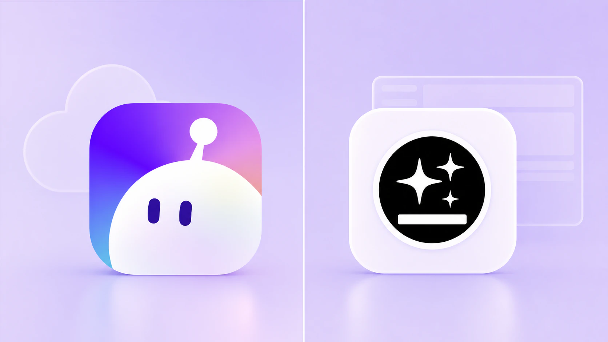

# LightVela vs Genspark: Manakah yang terbaik untuk menjadi hos Ejen AI anda?

## Ringkasan

**Jika anda ingin menjadi hos Ejen AI peribadi berdedikasi yang kekal tersedia dan mengikut satu persediaan yang konsisten, LightVela adalah lebih sesuai secara langsung.** Jika anda mahukan ruang kerja AI semua-dalam-satu yang boleh menyelidik, menulis, mereka bentuk, membina slaid, menganalisis data dan menghasilkan penghantaran siap, Genspark mungkin merupakan pilihan yang lebih kukuh. Mereka berdua bergerak di luar model chatbot, tetapi mereka menyelesaikan masalah yang berbeza.

## Sekali imbas

| Apa yang penting | LightVela | Genspark |
| - | - | - |
| **Pekerjaan utama** | Anjurkan Hermes Agent berdedikasi | Jalankan kerja melalui ruang kerja AI semua-dalam-satu |
| **Model ejen** | Satu Ejen berterusan yang anda konfigurasikan | Super Agent penyelaras model, alatan dan ejen khusus |
| **Memori** | Memori perbualan ejen dan storan awan khusus | Konteks SecondBrain merentas e-mel, mesyuarat, sembang, dokumen, apl dan projek |
| **Permukaan kerja** | Saluran pemesejan dan konfigurasi Ejen | Dokumen, Slaid, Helaian, Reka Bentuk, Kod, E-mel, penyelidikan, media dan banyak lagi |
| **Paling sesuai** | Ejen peribadi yang anda simpan dan bina tabiat di sekeliling | Kerja siap dihasilkan dari satu ruang kerja yang luas |

## Perbezaan sebenar: Hos ejen berbanding platform kerja

LightVela bermula dengan Ejen.

[LightVela gambaran keseluruhan](https://lightvela.ai/docs/overview) menerangkan cara ia mengekalkan Hermes Agent yang berdedikasi dalam talian 24/7 sambil membenarkan anda mengawal model, persona, alatan, Kemahiran dan Salurannya. Ejen adalah pusat produk. Semua yang lain menyokong hubungan itu.

Genspark bermula dengan kerja.

[Kemas kini AI Workspace 6.0](https://www.genspark.ai/blog/genspark-ai-workspace-6) menerangkan empat lapisan: SecondBrain sebagai lapisan memori, Super Agent sebagai enjin perisikan, satu set penciptaan dan suite produktiviti dan GenTeam sebagai lapisan kerjasama.

Itulah perbezaan yang bermakna dalam falsafah produk:

> **LightVela bertanya, “Bagaimanakah Ejen saya harus berfungsi?” Genspark bertanya, “Apakah kerja yang anda mahu selesaikan?”**

## Di mana LightVela adalah lebih sesuai

LightVela lebih fokus dan fokus itu penting jika perkara yang anda mahukan ialah Ejen dan bukannya ruang kerja AI.

Dengan LightVela, anda mencipta Hermes Agent dan memutuskan cara ia harus berkelakuan. Anda memilih [model](https://lightvela.ai/docs/configuration/model), sambungkan [saluran](https://lightvela.ai/docs/configuration) pemesejan yang sebenarnya anda gunakan dan lanjutkan keupayaannya dengan [Kemahiran](https://lightvela.ai/docs/configuration/skill).

Persediaan itu kurang mengenai menjana satu penghantaran yang mengagumkan dan lebih banyak tentang mencipta lapisan pengendalian berterusan untuk rutin peribadi anda.

Anda boleh menggunakan Hermes untuk:

- Simpan ingatan berterusan tentang pilihan anda dan kerja berterusan.
- Hantar peringatan dan kemas kini berulang.
- Jejaki maklumat dari semasa ke semasa.
- Jawab soalan daripada Telegram, WhatsApp, Discord, Slack, atau WeChat.
- Gunakan Kemahiran untuk melanjutkan perkara yang boleh dilakukannya.
- Jalankan [tugas berjadual](https://lightvela.ai/docs/configuration/automation) mengikut jadual.

Halaman tugas yang dijadualkan adalah sangat relevan di sini. Maksudnya bukan sahaja untuk meminta Hermes untuk laporan hari ini. Ia adalah untuk meminta Ejen terus mengendalikan kelas kerja yang sama esok.

Itu adalah jenis kegunaan yang berbeza daripada model "satu segera, kerja siap" Genspark.

## Di mana Genspark adalah lebih sesuai

Genspark adalah yang paling sesuai apabila keluasan paling penting. [Ejen Super](https://www.genspark.ai/helpcenter?doc=general_What_is_Super_Agent)nya menyelaraskan model, alatan dan ejen khusus di sekitar hasil.

- **Penyelidikan dan analisis:** Tukar bahan sumber kepada laporan dan penemuan berstruktur.
- **Penciptaan:** Hasilkan pembentangan, dokumen, visual atau kod dalam satu ruang kerja.
- **Penyelarasan kerja:** Gabungkan e-mel, mesyuarat dan konteks kerja lain apabila menghasilkan penghantaran.

Pilihnya apabila anda lebih suka menerangkan hasil selesai daripada menguruskan Ejen yang berterusan.

## Memori bukanlah perkara yang sama dalam kedua-dua produk

Ingatan LightVela ialah ingatan Ejen. Ia adalah milik Hermes Agent yang anda terus bercakap, mengkonfigurasi dan membentuk dari semasa ke semasa.

SecondBrain Genspark ialah memori ruang kerja. Ia cuba menyatukan maklumat yang mengelilingi kerja anda supaya Ejen Super boleh menggunakannya merentas tugas.

Tiada pendekatan secara automatik lebih baik.

LightVela lebih masuk akal jika anda mahukan seorang Ejen peribadi yang konsisten yang mengingati cara anda bekerja dan kekal boleh dihubungi melalui saluran pilihan anda.

Genspark lebih masuk akal jika pengetahuan anda tersebar merentasi banyak alatan kerja dan anda mahukan sistem AI untuk menggabungkan segala-galanya.

> **Satu lebih dekat dengan sistem pengendalian kerja pintar. Yang lain lebih dekat dengan teman peribadi yang dihoskan.**

## Perbezaan penggunaan harian

LightVela terasa seperti menghantar mesej kepada seseorang yang sudah mengetahui bentuk rutin anda.

Anda tidak semestinya perlu membuka suite tertentu. Anda menghantar mesej melalui saluran yang telah anda gunakan, dan Hermes membalas dari persekitaran Ejen yang sama.

Genspark terasa seperti membuka studio.

Anda tiba dengan matlamat, dan sistem memberikan anda satu set alat dan ejen khusus untuk menukar matlamat tersebut menjadi sesuatu yang boleh digunakan: dek, dokumen, helaian, tapak web, laporan, e-mel atau aset visual.

Itu menjadikan Genspark lebih mengagumkan untuk output berasaskan projek. Ia menjadikan LightVela lebih semula jadi untuk aliran kerja peribadi yang berulang.

## Mana yang patut anda pilih?

Pilih LightVela jika anda:

- **Mahukan hos yang berdedikasi:** Anda ingin menjadi hos Hermes Agent peribadi.
- **Mahukan kesinambungan:** Anda mahu Ejen kekal tersedia 24/7.
- **Pilih pemesejan:** Anda ingin menghubungi Ejen anda melalui saluran harian.
- **Mahu kawalan langsung:** Anda mahu mengurus model, persona, Kemahiran dan tugasan yang dijadualkan.
- **Mahukan hubungan jangka panjang:** Anda mengambil berat tentang membina tabiat di sekitar satu Ejen yang konsisten.

Pilih Genspark jika anda:

- **Mahukan satu ruang kerja yang luas:** Anda memerlukan alat penyelidikan, penciptaan dan produktiviti di satu tempat.
- **Mengambil berat tentang hasil:** Kerja yang telah selesai lebih penting daripada mengekalkan satu identiti Ejen.
- **Pilih permintaan yang diutamakan hasil:** Anda mahu ruang kerja menyelaraskan alatan.

Pandangan saya: **LightVela ialah hos Ejen berdedikasi yang lebih baik. Genspark ialah ruang kerja AI yang lebih baik.**

Jika soalan anda ialah "Alat yang manakah boleh menjadikan saya pembentangan, laporan penyelidikan dan hamparan terpantas?", Genspark mungkin jawapan yang lebih jelas.

Jika anda membandingkan hos Ejen peribadi dengan kerja AI yang diwakilkan, [LightVela vs Grok Bot](./lightvela-vs-grok-bot.md) menerangkan perbezaan antara satu Ejen boleh dikonfigurasikan dan Bot awan berterusan.

Jika soalan anda ialah "Di manakah saya harus menjadi hos Ejen AI yang saya terus gunakan setiap hari?", LightVela adalah lebih sesuai.
