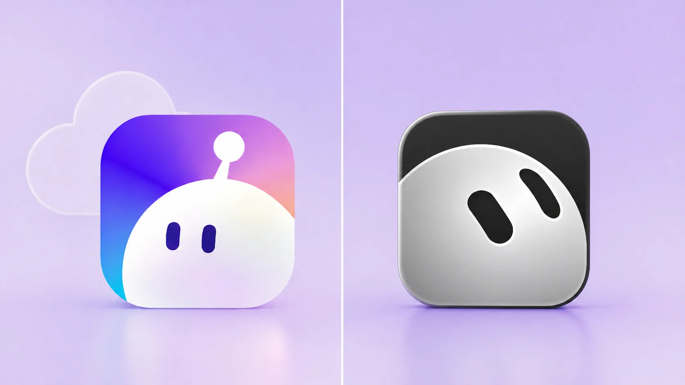

# LightVela vs Grok Bot: Mana yang terbaik untuk menjalankan Ejen AI peribadi anda?

## Ringkasan

**Pilih LightVela jika anda mahukan satu Hermes Agent peribadi yang boleh anda konfigurasikan mengikut rutin anda, lengkapkan dengan Kemahiran boleh guna semula dan terus bekerja melalui Tugasan Berjadual dan saluran yang anda pilih.** Pilih Grok Bot jika anda mahukan rakan sepasukan AI berasaskan awan yang berterusan yang boleh bekerja merentas apl, menggunakan komputer awan dan menjalankan tugas yang diwakilkan secara selari. Kedua-dua produk melangkaui chatbot biasa, tetapi mereka mengatur keupayaan itu di sekitar pekerjaan yang berbeza.

## Sekali imbas

| Apa yang penting | LightVela | Grok Bot |
| - | - | - |
| **Terbaik untuk** | Ejen AI peribadi yang telah lama beroperasi | Kerja yang ditugaskan merentas apl dan tapak web |
| **Perasaan teras** | Agen anda yang dikonfigurasikan, tersedia apabila anda memerlukannya | Bot yang gigih anda boleh layan seperti rakan sepasukan |
| **Fokus persediaan** | Kemahiran, Tugas Berjadual, ingatan, persona, model dan Saluran | Bot, komputer awan, penyambung, rutin dan kelulusan |
| **Akses setiap hari** | Saluran Pemesejan dan ruang kerja Ejen yang berterusan | Pengalaman desktop dan iOS Grok Bot |
| **Kes penggunaan terkuat** | Aliran kerja peribadi yang sepatutnya terus menjadi lebih baik untuk anda | Kerja berbilang langkah yang memerlukan interaksi penyemak imbas dan aplikasi |

## Apa yang berubah dalam penggunaan harian

Perbezaannya adalah kurang mengenai sistem yang lebih pintar dalam satu gesaan. Ia adalah mengenai tempat tinggal Ejen pada zaman anda, dan sama ada anda ingin membentuk seorang pembantu yang gigih atau mewakilkan kerja kepada Bot bernama.

Dengan LightVela, anda mengkonfigurasi Hermes Agent yang dihoskan tentang cara anda bekerja, kemudian terus bercakap dengan Ejen yang sama apabila keperluan anda berkembang. Anda boleh memasang [Kemahiran](../configuration/skill.md) boleh diguna semula, mencipta [Tugas Berjadual](../configuration/automation.md), pilih [model](../configuration/model.md), dan sambungkan Saluran yang sebenarnya anda gunakan. Itu menjadikan interaksi sekali sahaja yang berguna kepada aliran kerja yang boleh terus berfungsi untuk anda.

Anda mungkin meminta taklimat harian, senarai pantauan berulang, draf kandungan atau peringatan tanpa membina semula aliran kerja setiap kali. LightVela direka bentuk mengikut kesinambungan itu: satu Ejen, satu persediaan yang sedang berkembang dan satu tempat untuk memperhalusi cara ia harus membantu.

Grok Bot menyasarkan tempat yang lebih beroperasi. [Gambaran keseluruhan Grok Bot xAI](https://docs.x.ai/grok-bot/overview) menerangkan Bot sebagai rakan sepasukan AI yang gigih, bernama AI yang boleh menggunakan penyemak imbas, sistem fail dan terminal pada komputer awan yang berterusan. Ia boleh berfungsi merentas apl dan tapak web, mengekalkan konteks dari semasa ke semasa dan kembali apabila memerlukan kelulusan anda. Berbilang Bot boleh berkongsi satu komputer skop pengguna, menghantar konteks antara satu sama lain dan berjalan secara selari.

Itu hebat apabila kerja itu luas, tidak kemas dan melibatkan beberapa apl web. Ia adalah kurang menarik jika apa yang anda mahukan ialah satu Ejen peribadi yang secara beransur-ansur menjadi lebih berguna di sekeliling tabiat anda sendiri. Perbezaannya adalah serupa dengan yang terdapat dalam [LightVela vs Genspark](./lightvela-vs-genspark.md), tetapi Grok Bot meneruskan model kerja yang diwakilkan dengan komputer yang berterusan dan penyerahan Bot-ke-Bot.

## Di mana LightVela adalah lebih sesuai

LightVela adalah lebih sesuai jika anda mahu Ejen AI anda berasa seperti bahagian yang konsisten dalam sistem pengendalian anda sendiri. Anda tidak cuba mengawasi beberapa rakan sekerja digital dan anda tidak mencari komputer awan yang berasingan untuk setiap tugas.

Anda mungkin mahu Ejen yang menyemak maklumat setiap pagi, menonton pesaing, menukar kemas kini produk kepada siaran sosial atau meringkaskan topik penyelidikan setiap minggu. Bahagian yang berguna bukanlah satu jawapan yang sempurna. Ia mampu mengubah interaksi yang berguna menjadi sesuatu yang terus berfungsi.

Di situlah Kemahiran dan Tugas Berjadual membuat perbezaan. Kemahiran memberikan Ejen anda keupayaan boleh guna semula, manakala Tugasan Berjadual membenarkan kerja rutin berlaku mengikut jadual dan bukannya bergantung kepada anda untuk mengingati gesaan pada masa yang tepat. Anda boleh mulakan dengan taklimat pagi, menambah Kemahiran penyelidikan dan menghantar hasilnya melalui Saluran yang paling mungkin anda lihat.

LightVela juga merupakan pilihan yang lebih langsung jika anda mengambil berat tentang mengkonfigurasi peranan Ejen daripada menerima pengalaman produk tetap. Anda memilih model, tingkah laku yang anda ingin galakkan, keupayaan yang anda ingin tambahkan dan Saluran yang harus ditunjukkan oleh Ejen. [LightVela gambaran keseluruhan](../01-overview.md) menerangkan cara kepingan itu sesuai bersama.

Pertukaran adalah fokus. LightVela dibina di sekitar satu Hermes Agent dihoskan dan hubungannya yang berterusan dengan anda. Jika anda memerlukan meja kerja desktop yang luas yang boleh log masuk ke tapak yang tidak dikenali dan meletakkan kerja siap di dalam alatan tersebut, Grok Bot mungkin lebih sesuai.

## Di mana Grok Bot adalah lebih sesuai

Grok Bot ialah pilihan yang lebih kuat apabila anda memerlukan Ejen untuk melakukan kerja merentas timbunan aplikasi, terutamanya apabila kerja itu memerlukan interaksi gaya penyemak imbas atau lebih daripada satu Bot berfungsi serentak. [Pengumuman rasmi xAI](https://x.ai/news/introducing-grok-bot) mengatakan Bot boleh melog masuk ke apl dan tapak web, menggunakan komputer awan berterusan mereka sendiri dan menyelesaikan pekerjaan hujung ke hujung sebelum kembali untuk mendapatkan kelulusan apabila perlu.

Produk ini juga menyokong pembelajaran aliran kerja. Anda boleh menunjukkan proses berbilang langkah, biarkan Bot menyimpannya sebagai rutin dan menjalankan rutin itu semula atas permintaan atau mengikut jadual. [Produk Automasi](https://x.ai/news/grok-automations) berasingan Grok menyokong kerja berjadual dan pencetus e-mel, dengan penyambung dan Kemahiran dilampirkan pada setiap larian.

Itu menjadikan Grok Bot menarik jika anda mempunyai kerja operasi untuk diwakilkan: menyelidik akaun, mengemas kini CRM, menyediakan peti masuk, memeriksa tapak web atau menyelaraskan beberapa pakar. Komputer awan ialah pembeza yang bermakna kerana kerja boleh berlaku dalam penyemak imbas atau aplikasi sebenar dan bukannya berhenti pada draf sembang.

Sempadan adalah sama penting. Setiap Bot pengguna berkongsi satu komputer awan yang berterusan, termasuk fail, sesi penyemak imbas dan log masuk aplnya. Model komputer kongsi itu membolehkan penyerahan, tetapi ini juga bermakna Bot yang berasingan bukanlah sempadan keselamatan yang berasingan. Jika matlamat anda ialah Ejen peribadi tunggal dengan peranan berbentuk berhati-hati, Kemahiran, ingatan dan akses pemesejan, LightVela kekal sebagai persediaan yang lebih fokus.

## Mana yang patut anda pilih?

Pilih LightVela jika anda:

- **Mahukan satu Ejen peribadi:** Anda mahukan Hermes Agent yang dihoskan yang menjadi lebih berguna apabila anda memperhalusinya.
- **Mahukan kesinambungan:** Anda mahu Ejen yang sama kekal tersedia dan mengekalkan persediaan anda dari semasa ke semasa.
- **Lebih suka rutin boleh dikonfigurasikan:** Anda mahu Kemahiran boleh guna semula dan Tugasan Berjadual berulang mengikut tabiat anda sendiri.
- **Memilih akses pemesejan:** Anda ingin menghubungi Ejen anda melalui Saluran yang telah anda gunakan.
- **Mahu kawalan langsung:** Anda mahu mengurus model, persona, keupayaan dan bentuk aliran kerja.

Pilih Grok Bot jika anda:

- **Mahu pelaksanaan yang diwakilkan:** Anda mahu Bot menjalankan tugas berbilang langkah melalui apl dan tapak web sebenar.
- **Memerlukan komputer awan:** Penyemak imbas, sistem fail dan akses terminal adalah sebahagian daripada kerja.
- **Mahukan rakan sepasukan yang selari:** Beberapa Bot yang gigih boleh bekerjasama dan menyerahkan kerja.
- **Lebih suka rutin berasaskan tunjuk cara:** Anda mahu menunjukkan aliran kerja sekali dan menjalankannya semula kemudian.
- **Memerlukan pusat pemeriksaan kelulusan:** Anda mahu Bot berfungsi secara bebas dan kembali apabila keputusan diperlukan.

Pandangan saya: **LightVela adalah lebih sesuai untuk satu Ejen AI peribadi yang berkembang mengikut rutin anda. Grok Bot adalah lebih sesuai untuk tugasan yang diwakilkan, merentas aplikasi yang dilakukan oleh rakan sepasukan awan yang berterusan.**

Jika soalan anda ialah "Sistem yang manakah boleh berfungsi di dalam penyemak imbas, apl dan peti masuk saya semasa saya pergi?", Grok Bot mungkin jawapan yang lebih jelas.

Jika soalan anda ialah "Di manakah saya harus menjalankan Ejen AI yang saya terus gunakan setiap hari?", LightVela adalah lebih sesuai.

Jika anda membandingkan Ejen peribadi boleh dikonfigurasikan dengan Telegram-pembantu pertama, lihat [LightVela lwn Mira](./lightvela-vs-mira.md).
