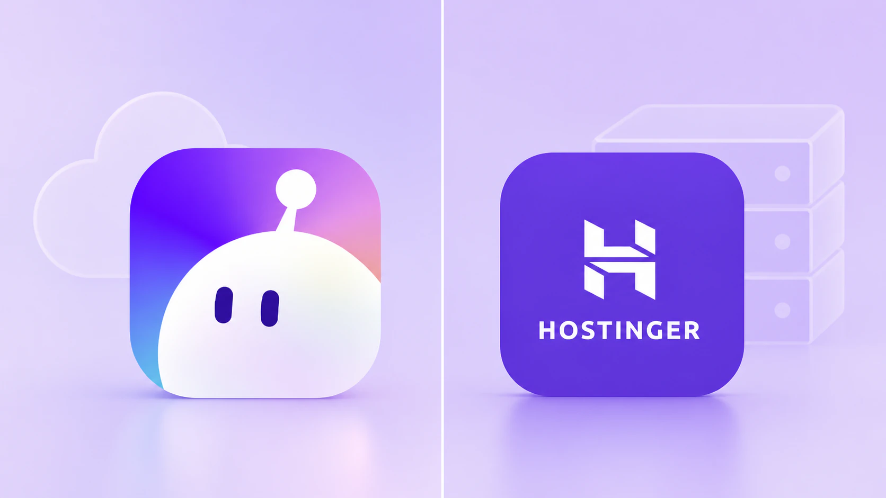

# LightVela vs Hostinger: Manakah VPS terbaik untuk pengehosan ejen?

## Ringkasan

**Jika anda ingin menjalankan Hermes Agent tanpa menjadikan penyelenggaraan VPS sebagai hobi, LightVela adalah lebih sesuai.** Jika anda mahukan akses root, persekitaran pelayan anda sendiri dan kebebasan untuk membentuk setiap lapisan sekitar Hermes, VPS Hostinger ialah laluan yang lebih fleksibel. Ini bukan sekadar perbandingan produk-berbanding-produk: LightVela memberikan anda Hermes Agent yang dihoskan, manakala Hostinger memberi anda VPS yang anda boleh menjalankannya.

## Sekali imbas

| Apa yang penting | LightVela | Hostinger VPS |
| - | - | - |
| **Apa yang anda mulakan dengan** | Hermes Agent dihoskan awan | Pelayan maya KVM yang anda konfigurasikan |
| **Hermes persediaan** | Masa jalan Ejen dihoskan untuk anda | Anda menggunakan, mengkonfigurasi dan mengendalikan Hermes |
| **Pemilikan harian** | Model, saluran dan kemahiran dalam konsol produk | Linux, akses, kemas kini, rahsia, sandaran dan masa jalan Hermes |
| **Kawalan** | Fokus pada menggunakan dan mengkonfigurasi Agen | Akses root penuh dan kawalan peringkat pelayan |
| **Terbaik untuk** | Orang yang mahukan Ejen sentiasa aktif tanpa kerja pelayan | Pembina yang secara khusus ingin memiliki tindanan pelayan |

## Perbezaan sebenar: produk Ejen berbanding pelayan

Hostinger ialah laluan yang sah untuk Hermes. Tawaran VPSnya termasuk akses root penuh, pengurusan tembok api, sandaran mingguan, terminal web dan katalog aplikasi yang menyenaraikan Hermes Agent. Itu menjadikannya titik permulaan yang lebih mesra daripada menyewa pelayan kosong di suatu tempat dan memikirkan yang lain sahaja. [Halaman VPS Hosting](https://www.hostinger.com/vps-hosting) jelas tentang perjanjian asas: anda mendapat persekitaran maya terpencil dan kebebasan untuk mengkonfigurasi sistem pengendalian dan perisiannya.

Hermes itu sendiri dibina untuk jenis fleksibiliti tersebut. Projek rasmi menyokong bahagian belakang tempatan, Docker, SSH dan berorientasikan awan; ia boleh berjalan pada VPS dan menyambung ke saluran pemesejan melalui gerbangnya. [Hermes Projek ejen](https://github.com/NousResearch/hermes-agent) malah membentangkan VPS sebagai salah satu tempat yang boleh didiami oleh Ejen.

> **Tetapi VPS tetap VPS.**

Apabila Hermes dijalankan di sana, seseorang perlu memutuskan cara ia bermula, cara ia terus berjalan, cara ia dikemas kini, cara bukti kelayakan disimpan dan cara akses jauh dilindungi. Hermes’ [dokumentasi bahagian belakang jauh](https://hermes-agent.nousresearch.com/docs/user-guide/desktop) membezakan akses rangkaian dipercayai daripada persediaan yang boleh dicapai secara umum yang memerlukan pengesahan yang lebih kukuh.

"Seseorang" itu sememangnya boleh menjadi anda. **Ia sepatutnya menjadi pilihan.**

## Di mana LightVela adalah lebih sesuai

LightVela adalah untuk orang yang mahukan hasil berjalan Hermes, tanpa terlebih dahulu menjadi pengendali pelayan Hermes.

LightVela menjalankan contoh Hermes Agent khusus dalam awan, dengan masa jalan terpencil yang direka untuk kekal dalam talian secara bebas daripada peranti tempatan anda. Anda mengurus pilihan yang berguna—[model](https://lightvela.ai/docs/configuration/model), [saluran](https://lightvela.ai/docs/configuration) dan [kemahiran](https://lightvela.ai/docs/configuration/skill)—melalui produk dan bukannya memasang sendiri persekitaran asas. [LightVela gambaran keseluruhan](https://lightvela.ai/docs/overview) menerangkan model yang dihoskan dan persediaan berbilang salurannya.

Itu mengubah beban mental.

Daripada memutuskan cara untuk mendedahkan atau melindungi perkhidmatan jauh, anda boleh meluangkan masa anda untuk memutuskan perkara yang perlu dilakukan oleh Ejen anda. Daripada memperuntukkan pelayan sebelum menyambungkan saluran, anda boleh mengkonfigurasi Ejen daripada konsol dan menumpukan pada aliran kerja sebenar. [LightVela gambaran keseluruhan konfigurasi](https://lightvela.ai/docs/configuration) merangkumi pilihan teras tersebut.

> **LightVela bukan “lebih baik” untuk setiap pengguna teknikal. Lebih baik apabila infrastruktur bukan perkara utama.**

## Di mana Hostinger adalah lebih sesuai

Pilih Hostinger apabila memiliki pelayan adalah sebahagian daripada matlamat: anda mahukan akses root dan mahu Hermes di sebelah Linux anda sendiri, Docker, atau perkhidmatan tersuai. [Penawaran VPS](https://www.hostinger.com/vps-hosting) menyediakan kawalan infrastruktur untuk persediaan itu.

Tukar ganti ialah pemilikan: kemas kini, bukti kelayakan, rangkaian dan masa beroperasi menjadi sebahagian daripada timbunan anda untuk beroperasi.

## Mana yang patut anda pilih?

Pilih LightVela jika:

- **Anda mahukan Ejen, bukan VPS:** Anda mahu Hermes tersedia tanpa mengendalikan pelayan.
- **Anda mengambil berat tentang penggunaan harian:** Model, saluran, kemahiran dan aliran kerja lebih penting kepada anda berbanding pentadbiran pelayan.
- **Anda mahukan lebih sedikit keputusan infrastruktur:** Anda mahu beralih daripada "Saya perlukan Ejen" kepada "Ejen saya sedang bekerja" dengan lebih langsung.
- **Anda mahukan pemisahan:** Anda mahu masa jalan awan dikendalikan secara berasingan daripada komputer dan susunan peribadi anda sendiri.

Pilih Hostinger VPS jika:

- **Anda mahukan kawalan:** Anda mahukan akses root penuh dan kawalan peringkat pelayan.
- **Anda boleh mengendalikan tindanan:** Anda selesa mengendalikan Linux, perkhidmatan, kemas kini, bukti kelayakan dan rangkaian.
- **Ada lebih banyak untuk dijalankan:** Anda mahu Hermes di sebelah bekas atau infrastruktur anda sendiri.

Jawapan jujur terpendek ialah ini: **LightVela ialah tempat yang baik untuk melangkau membina persediaan pengehosan Hermes dan mula menggunakan Hermes. Hostinger ialah tempat yang baik untuk membina persediaan itu sendiri.**

## Sumber

- [Penghosan VPS pengehos](https://www.hostinger.com/vps-hosting)
- [Hermes Agent pada GitHub](https://github.com/NousResearch/hermes-agent)
- [Hermes dokumentasi hujung belakang jauh](https://hermes-agent.nousresearch.com/docs/user-guide/desktop)
