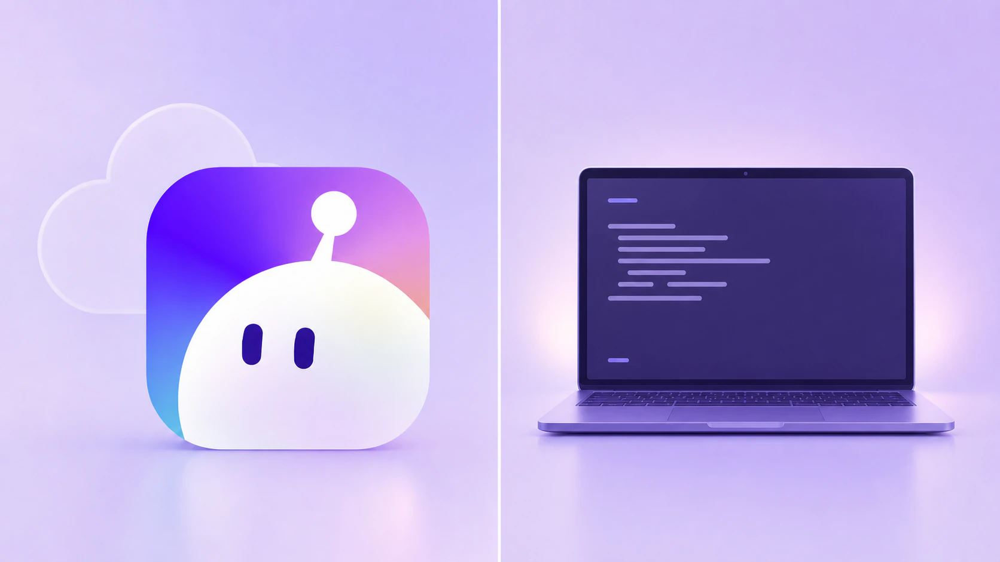

# LightVela vs Ejen Selfhost: Mana yang terbaik?

## Ringkasan

**LightVela adalah lebih sesuai apabila anda mahukan Hermes Agent sentiasa hidup tanpa menyelenggara komputer di bawahnya.** Menjalankan Hermes pada komputer anda sendiri ialah pilihan yang lebih baik apabila anda mahukan kawalan langsung ke atas masa jalan, alatan, kemas kini dan persekitaran setempat. Jawapan yang betul bergantung pada sama ada anda mahu mengendalikan persediaan atau hanya menggunakan ejen.

Hermes boleh dijalankan secara setempat pada macOS, Windows, Linux, WSL2 dan banyak lagi. Pemasang rasminya menyediakan masa jalan dan kemudian membenarkan anda memilih pembekal model, alatan dan get laluan pemesejan sendiri. [Hermes panduan pemasangan](https://hermes-agent.nousresearch.com/docs/getting-started/installation) menjadikan laluan itu agak mudah didekati.

> **Boleh didekati tidak sama dengan tidak kelihatan.** Ejen tempatan memberi anda kawalan, tetapi ia juga memberi anda tanggungjawab untuk memastikan persekitaran sentiasa bersedia.

## Sekali imbas

| Apa yang penting bagi anda | Jalankan Hermes di komputer anda | Gunakan LightVela |
| - | - | - |
| **Di mana Hermes berjalan** | Mesin anda sendiri | Persekitaran awan khusus |
| **Kawalan harian** | Anda memilih tetapan dan persekitaran tempatan | Anda mengurus ejen melalui konsol hos |
| **Ketersediaan** | Anda memastikan komputer dan proses sentiasa tersedia | Direka untuk kekal dalam talian secara bebas daripada peranti tempatan anda |
| **Tanggungjawab penyediaan** | Anda mengkonfigurasi runtime, model, alat, dan saluran | Persekitaran ejen teras dihoskan untuk anda |
| **Padanan terbaik** | Pembina yang suka memiliki keseluruhan sistem | Orang yang ingin menggunakan Hermes tanpa mengurus sistem |

## Apa yang berubah dalam penggunaan harian

Laluan tempatan memuaskan apabila anda suka mengetahui dengan tepat tempat tinggal.

Anda memasang Hermes, pilih pembekal model, dayakan alatan dan tambah get laluan apabila anda mahukan akses pemesejan. Hermes’ permulaan pantas sendiri mengesyorkan agar satu perbualan bersih berfungsi sebelum melapis pada get laluan, kemahiran, suara atau penghalaan—yang merupakan nasihat yang wajar untuk sebarang persediaan yang diurus sendiri. [Hermes quickstart](https://hermes-agent.nousresearch.com/docs/getting-started/quickstart/) juga menunjukkan bahawa pemasangan setempat boleh berkembang menjadi bot atau aliran kerja sentiasa hidup.

Fleksibiliti itu adalah perkara utama. Anda boleh bereksperimen dengan persekitaran anda sendiri, memilih cara kemas kini berlaku dan membina mesin yang anda sudah gunakan.

Pertukaran itu muncul kemudian, dalam momen biasa:

- **Ketersediaan:** Komputer anda perlu kekal tersedia untuk ejen kekal tersedia.
- **Penyelenggaraan:** Anda ialah orang yang perasan apabila tetapan model, alatan, get laluan atau kemas kini memerlukan perhatian.
- **Skop:** "Hanya satu perkara lagi" perlahan-lahan boleh menukar persediaan peribadi menjadi sesuatu yang anda uruskan.

Itu bukan sebab untuk mengelakkan pengehosan sendiri. Ia hanyalah pekerjaan yang anda terima.

## Di mana LightVela adalah lebih sesuai

LightVela lebih masuk akal apabila matlamat anda adalah untuk mempunyai Hermes Agent bekerja untuk anda, bukan untuk mengendalikan mesin di bawahnya.

LightVela menjalankan contoh Hermes ejen khusus dalam awan. Ejen kekal dalam talian secara bebas daripada peranti tempatan anda, semasa anda menguruskan bahagian praktikal—[model](https://lightvela.ai/docs/configuration/model), [saluran](https://lightvela.ai/docs/configuration) dan [kemahiran](https://lightvela.ai/docs/configuration/skill)—daripada konsol. [LightVela gambaran keseluruhan](https://lightvela.ai/docs/overview) menerangkan model yang dihoskan, termasuk masa jalan terpencil dan akses berbilang saluran.

Itu mengubah perasaan menggunakan Hermes. Anda boleh menyambungkan ejen kepada saluran yang anda sudah bercakap—seperti [Telegram](https://lightvela.ai/docs/configuration/channel-telegram), [WhatsApp](https://lightvela.ai/docs/configuration/channel-whatsapp), [Discord](https://lightvela.ai/docs/configuration/channel-discord), atau [Slack](https://lightvela.ai/docs/configuration/channel-slack)—kemudian teruskan menggunakannya walaupun semasa komputer riba anda ditutup. Anda masih membuat pilihan yang bermakna, tetapi anda tidak perlu menukar komputer peribadi anda ke tempat di mana ketersediaan dikekalkan.

Bagi kebanyakan orang, perbezaan yang berguna adalah mudah:

> **LightVela memberikan anda kurang persediaan untuk dikawal. Pengehosan sendiri memberi anda lebih kawalan ke atas persediaan.**

Jika anda terutamanya ingin mengkonfigurasi ejen anda dan kembali ke tempat kerja anda, konsol yang dihoskan biasanya merupakan titik permulaan yang lebih selesa. Anda masih boleh mengkonfigurasi model, saluran dan kemahiran di satu tempat melalui [LightVela gambaran keseluruhan konfigurasi](https://lightvela.ai/docs/configuration).

## Di mana berjalan Hermes pada komputer anda sendiri adalah lebih sesuai

Pilih persediaan setempat apabila membina dan mengawal masa jalan adalah sebahagian daripada projek—mungkin untuk aliran kerja desktop, makmal rumah atau eksperimen model langsung.

Anda akan memiliki kemas kini, kelayakan dan ketersediaan. "Pada komputer saya" juga tidak menjadikan setiap model, alat penyemak imbas atau perkhidmatan yang disambungkan sebagai setempat, jadi kena tepat tentang perkara yang anda kawal.

## Mana yang patut anda pilih?

Pilih LightVela jika:

- **Anda mahukan ketersediaan:** Anda mahu Hermes bersedia tanpa meninggalkan komputer anda bertanggungjawab untuknya.
- **Anda lebih suka konfigurasi:** Anda lebih suka mengkonfigurasi ejen daripada mengekalkan masa jalannya.
- **Anda mahukan satu konsol:** Anda mahukan tempat yang jelas untuk mengurus model, saluran dan kemahiran.
- **Anda sudah menggunakan apl pemesejan:** Anda mahu ejen sentiasa aktif yang sesuai dengan saluran yang telah anda gunakan.

Pilih Hermes pada komputer anda sendiri jika:

- **Anda seronok membina:** Anda suka persediaan terminal pertama dan percubaan langsung.
- **Anda mahukan pemilikan:** Anda mahu menyesuaikan masa jalan di sekitar persekitaran peribadi anda.
- **Anda menerima penyelenggaraan:** Anda selesa mengendalikan konfigurasi model, kemas kini, alatan dan ketersediaan.

Tidak perlu berpura-pura satu jawapan lebih baik secara universal. Mulakan dengan soalan di bawah soalan: **adakah saya mahu menjalankan infrastruktur atau adakah saya mahu ejen yang bersedia apabila saya memerlukannya?**
