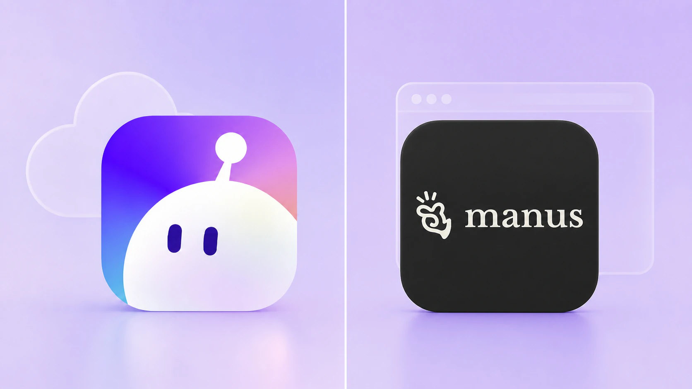

# LightVela vs Manus: Manakah yang terbaik untuk menjadi hos Ejen AI anda?

## Ringkasan

**Pilih LightVela jika anda mahu Hermes Agent peribadi yang kekal dalam talian, mengingati persediaan anda dan tinggal dalam saluran pemesejan yang telah anda gunakan.** Pilih Manus jika anda ingin menyerahkan tugas yang ditetapkan—penyelidikan, kerja penyemak imbas, laporan atau aliran kerja—dan minta Ejen bekerja ke arah penghantaran. Mereka bertindih dalam perkataan "Ejen," tetapi dalam penggunaan sehari-hari mereka bermula dari tempat yang sangat berbeza.

## Sekali imbas

| Apa yang penting | LightVela | Manus |
| - | - | - |
| **Titik permulaan** | Hermes Agent anda yang sedang dihoskan oleh awan | Matlamat atau tugas yang anda mahu Ejen selesaikan |
| **Permukaan setiap hari** | Saluran pemesejan dan konsol konfigurasi | Komputer maya dan ruang kerja pelayar |
| **Waktu Jalan** | Dedikasi Hermes Agent yang kekal dalam talian | Kotak pasir tugas secara lalai; Komputer Awan berterusan pilihan |
| **Kawalan utama** | Pilih model, saluran, persona dan kemahiran | Huraikan hasilnya; masuk apabila diperlukan |
| **Paling sesuai** | Ejen peribadi yang anda kembalikan setiap hari | Penyelidikan autonomi dan pelaksanaan pelbagai langkah |

## Dua titik permulaan yang berbeza

LightVela mengambil laluan yang lebih peribadi. Ia menjadi tuan rumah Hermes Agent khusus dalam awan, memastikan ia tersedia 24/7, dan membolehkan anda bercakap dengannya melalui saluran yang dikonfigurasikan seperti Telegram, WhatsApp, Discord, Slack dan WeChat. [LightVela gambaran keseluruhan](https://lightvela.ai/docs/overview) menerangkan model yang dihoskan ini dan cara Ejen kekal berhubung dengan alatan harian anda.

Manus menggambarkan dirinya sebagai Ejen AI am autonomi dengan komputer mayanya sendiri: anda memberikannya hasil, dan ia merancang, melaksanakan dan mengembalikan kerja. [Pelayar Awan](https://manus.im/docs/features/cloud-browser)nya boleh menavigasi tapak, mengisi borang, mengekstrak maklumat dan melengkapkan aliran kerja penyemak imbas berbilang langkah.

> **LightVela bermula dengan Ejen yang anda simpan. Manus bermula dengan tugas.**

## Apa yang berubah dalam penggunaan harian

Perbezaannya paling mudah dirasai pada hari Selasa biasa.

Dengan LightVela, interaksi adalah lebih seperti: "Perhatikan topik ini," "ingatkan saya esok," "bantu saya memastikan projek ini bergerak," atau hanya "apa yang kami putuskan kali terakhir?" Intinya bukan satu penghantaran yang digilap. Ia mempunyai Hermes Agent yang sama sepanjang masa, dengan konteks dan persediaan yang anda pilih.

Dengan Manus, anda mungkin berkata: "Selidik 30 pesaing, tarik harga mereka dan ubahnya menjadi ringkasan pasaran yang singkat." Ejen boleh bekerja melalui penyemak imbas, mengumpul maklumat dan membungkus hasil. Itu adalah bentuk yang bagus untuk karya yang dibatasi: ia mempunyai garisan penamat yang jelas.

Ini bermakna soalan persediaan juga berbeza. Dalam LightVela, anda memutuskan [model](https://lightvela.ai/docs/configuration/model) yang mana untuk digunakan, sambungkan [saluran](https://lightvela.ai/docs/configuration) yang anda mahu dan tambahkan [kemahiran](https://lightvela.ai/docs/configuration/skill) yang sesuai dengan rutin anda melalui konsol. Di Manus, kualiti hasil selalunya bermula dengan sejauh mana anda menerangkan tugas dengan jelas, kekangannya dan apa yang sepatutnya kelihatan seperti "selesai".

## Di mana LightVela adalah lebih sesuai

LightVela lebih masuk akal apabila Ejen itu sendiri—bukan sekadar tugas—adalah sesuatu yang anda mahu simpan.

Hermes Agent yang dihoskan berguna apabila anda mahukan tempat biasa untuk kembali ke: model yang dikonfigurasikan yang sama, saluran yang disambungkan yang sama, kemahiran yang sama dan konteks perbualan berterusan yang sama. Anda tidak perlu memastikan komputer riba terjaga atau menguruskan pelayan hanya untuk menyediakan Ejen.

Itu adalah jenis kemudahan yang berbeza daripada "selesaikan tugas ini untuk saya." Ia lebih hampir kepada mempunyai pembantu yang gigih yang anda boleh menghantar mesej apabila pemikiran muncul.

LightVela juga lebih sesuai jika anda mengambil berat tentang membentuk Ejen mengikut tabiat anda sendiri: mengkonfigurasi model, memilih tempat perbualan berlaku dan melanjutkan Hermes dengan kemahiran. Jika kerja berulang adalah sebahagian daripada gambar, anda juga boleh menyediakan [tugas berjadual](https://lightvela.ai/docs/configuration/automation) daripada menganggap setiap permintaan sebagai projek baharu.

## Di mana Manus lebih sesuai

Manus adalah lebih sesuai untuk tugas penyemak imbas terhad dengan output yang jelas. [Pelayar Awan](https://manus.im/docs/features/cloud-browser)nya boleh berfungsi merentas tapak web dan sesi yang dibenarkan; langkah pengesahan seperti CAPTCHA atau SMS masih memerlukan bantuan anda.

- **Penyelidikan atau pelaporan:** Tukar ringkasan yang ditakrifkan kepada perbandingan atau laporan.
- **Operasi penyemak imbas:** Lengkapkan aliran kerja konkrit merentas apl web.
- **Pelaksanaan berterusan:** Gunakan Cloud Computer untuk proses yang mesti terus berjalan; lihat [artikel bantuan](https://help.manus.im/en/articles/15392111-what-is-the-cloud-computer).

## Mana yang patut anda pilih?

Pilih LightVela jika anda:

- **Mahukan kesinambungan:** Anda inginkan Hermes Agent yang kekal tersedia melangkaui satu tugas.
- **Pilih pemesejan:** Anda ingin menghubungi Ejen anda melalui saluran harian.
- **Ingin membentuk perhubungan:** Anda mahu mengawal model, saluran, kemahiran dan personalitinya dari semasa ke semasa.
- **Mahukan kurang infrastruktur:** Anda mahu Ejen sentiasa aktif tanpa persediaan pelayan atau penyelenggaraan peranti tempatan.

Pilih Manus jika anda:

- **Mahukan hasil yang telah selesai:** Anda mahu Ejen menjalankan tugas berbilang langkah yang ditetapkan dan mengembalikan output.
- **Kerja dalam penyemak imbas:** Anda menghabiskan banyak masa dalam alatan berasaskan penyemak imbas dan aliran kerja penyelidikan.
- **Memilih ringkasan tugas:** Anda lebih suka menerangkan pekerjaan daripada mengekalkan Ejen peribadi yang berterusan.

Dan secara jujur, mereka boleh saling melengkapi. **LightVela boleh menjadi Hermes Agent yang anda sentiasa rapat—yang anda hantar mesej, konfigurasikan dan bina tabiat di sekeliling anda. Manus boleh menjadi pekerja fokus yang anda hantar untuk tugasan penyemak imbas yang besar.**
