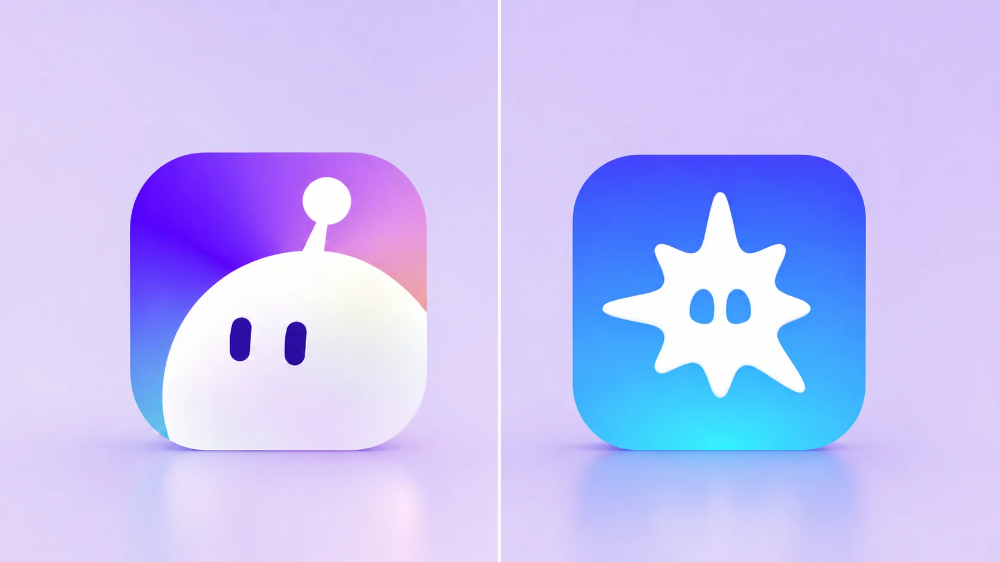

# LightVela vs Mira: Mana yang terbaik untuk menjalankan Ejen AI peribadi anda?

## Ringkasan

**Pilih LightVela jika anda mahukan satu Hermes peribadi yang dibentuk mengikut rutin anda, Kemahiran boleh guna semula, Tugasan Berjadual dan Saluran pemesejan yang anda pilih.** Pilih Mira jika Telegram ialah tempat kerja dan komuniti anda sudah tinggal dan anda mahu menukar perbualan menjadi susulan, ringkasan, peringatan dan tindakan.

Kedua-dua produk melangkaui tetingkap sembang, tetapi ia bermula dari pusat graviti yang berbeza: Mira ialah pembantu Telegram-pertama, manakala LightVela ialah Ejen peribadi boleh dikonfigurasikan yang boleh berkembang menjadi sistem aliran kerja yang lebih luas.

## Sekali imbas

| Apa yang penting | LightVela | Mira |
| - | - | - |
| **Terbaik untuk** | Ejen AI peribadi yang telah lama beroperasi | Pembantu peribadi atau pasukan di dalam Telegram |
| **Pengalaman teras** | Konfigurasikan satu Ejen di sekitar rutin dan pilihan anda | Minta Ejen memahami sembang dan bertindak daripada perbualan |
| **Fokus persediaan** | Kemahiran, Tugas Berjadual, ingatan, persona, model dan Saluran | Telegram sembang, konteks kumpulan, alatan bersambung dan tindakan berulang |
| **Nilai setiap hari** | Ejen yang konsisten yang terus bekerja melebihi satu perbualan | Kurangkan penukaran konteks antara sembang, tugasan dan alatan bersambung |
| **Kes penggunaan terkuat** | Aliran kerja peribadi yang harus terus bertambah baik dari semasa ke semasa | Susulan berasaskan sembang, taklimat, kandungan dan penyelarasan pasukan |

## Apa yang berubah dalam penggunaan harian

Perbezaan praktikal bukanlah produk mana yang memberikan jawapan yang lebih baik kepada satu gesaan.
Ia adalah tempat tinggal Ejen pada zaman anda dan berapa banyak model operasinya yang anda ingin bentuk.

Dengan LightVela, anda mengkonfigurasi Hermes Agent yang dihoskan tentang cara anda bekerja, kemudian terus bercakap dengan Ejen yang sama apabila keperluan anda berkembang.
Anda boleh memasang [Kemahiran](../configuration/skill.md) boleh diguna semula, mencipta [Tugas Berjadual](../configuration/automation.md), pilih [model](../configuration/model.md) dan sambungkan Saluran yang sebenarnya anda gunakan.
Itu menjadikan interaksi sekali sahaja yang berguna kepada aliran kerja yang boleh terus berfungsi untuk anda.

Anda mungkin meminta taklimat harian, senarai pantauan berulang, draf kandungan atau peringatan tanpa membina semula proses setiap kali.
LightVela direka bentuk mengikut kesinambungan itu: satu Ejen, satu persediaan yang sedang berkembang dan satu tempat untuk memperhalusi cara ia harus membantu.

[Mira](https://mira.tg/) bermula dari premis yang berbeza.
Ia dibina secara asli di dalam Telegram, di mana anda boleh menggunakannya dalam sembang peribadi, sembang kumpulan dan saluran tanpa membuka aplikasi berasingan.
Mira menampilkan dirinya sebagai Ejen yang boleh mengingati konteks, meringkaskan perbualan, menjejaki keputusan, menyambungkan alat luaran dan menukar mesej menjadi tindakan sebenar.

Itu menjadikan Mira lebih semula jadi apabila sumber kerja itu sudah menjadi perbualan.
Pasukan boleh menambahkan Mira pada kumpulan, bertanya apa yang telah diputuskan, menukar perjanjian menjadi tugas susulan atau meminta taklimat tanpa meninggalkan Telegram.
Pengalaman ini lebih hampir kepada mewakilkan kerja dalam sembang kongsi daripada mengkonfigurasi ruang kerja peribadi yang berasingan.

## Di mana LightVela adalah lebih sesuai

LightVela adalah lebih sesuai jika anda mahu Ejen AI anda menjadi sebahagian daripada sistem pengendalian peribadi anda yang konsisten.
Anda bukan sahaja meminta pembantu untuk bertindak balas terhadap mesej terkini.
Anda sedang membentuk cara Ejen harus berkelakuan, perkara yang perlu diketahui, keupayaan yang boleh digunakan dan bila ia harus bertindak.

Anda mungkin mahu Ejen yang menyemak maklumat setiap pagi, menonton pesaing, menukar kemas kini produk kepada draf sosial atau meringkaskan topik penyelidikan setiap minggu.
Bahagian yang berguna bukanlah satu jawapan yang sempurna.
Ia mampu mengubah interaksi yang berguna menjadi sesuatu yang terus berfungsi.

Di situlah pentingnya Kemahiran dan Tugasan Berjadual.
Kemahiran memberikan Ejen anda keupayaan boleh guna semula, manakala Tugasan Berjadual membenarkan kerja rutin berlaku mengikut jadual dan bukannya bergantung kepada anda untuk mengingati gesaan pada masa yang tepat.
Anda boleh mulakan dengan taklimat pagi, menambah Kemahiran penyelidikan dan menghantar hasilnya melalui Saluran yang paling mungkin anda lihat.

LightVela juga merupakan pilihan yang lebih langsung jika anda mengambil berat tentang mengkonfigurasi peranan Ejen daripada menerima pengalaman produk tetap.
Anda memilih model, tingkah laku yang anda ingin galakkan, keupayaan yang anda ingin tambahkan dan Saluran yang harus ditunjukkan oleh Ejen.
[LightVela gambaran keseluruhan](../01-overview.md) menerangkan cara kepingan itu sesuai bersama.

Pertukarannya ialah LightVela sengaja tertumpu pada satu Ejen peribadi yang sedang berkembang.
Jika keperluan utama anda adalah memahami dan bertindak atas perbualan Telegram yang sibuk, Mira mungkin berasa lebih segera.

## Di mana Mira lebih sesuai

Mira adalah pilihan yang lebih kuat apabila Telegram sudah menjadi tempat kerja, komuniti dan keputusan anda berlaku.
Tapak rasminya menerangkan pembantu asli Telegram yang boleh membantu dengan kandungan, peti masuk, pemantauan kripto, membeli-belah, perancangan perjalanan, peringatan dan alatan yang disambungkan.
Kelebihan utama ialah konteks sudah ada dalam sembang di mana permintaan bermula.

Mira juga sesuai untuk pasukan dan komuniti.
Ia boleh mengikuti siapa yang mengatakan apa, meringkaskan perbincangan kumpulan yang panjang, membuat keputusan terbuka dan membantu mengubah perbualan menjadi tindakan susulan yang ditetapkan.
Itu berguna untuk pasukan produk, pengasas, pencipta dan pengendali komuniti yang menghabiskan lebih banyak masa dalam Telegram berbanding dalam sistem tugas khusus.

Model Telegram-first yang sama boleh menyokong taklimat harian dan aliran kerja berulang.
Anda boleh meminta ringkasan pada masa yang sesuai, mewakilkan tugas penyelidikan atau menyambungkan perkhidmatan seperti GitHub, Notion dan Google Pandu dari pengalaman sembang.
Dokumentasi rasmi Mira juga menyerlahkan alat yang luas dan lapisan integrasi, jadi pembantu boleh beralih daripada jawapan kepada tindakan tanpa meminta anda menukar konteks.

Sempadan adalah fokus.
Mira dioptimumkan di sekitar antara muka Telegram dan konteks sosial di dalamnya.
Jika anda ingin mereka bentuk persona, model, Kemahiran, Tugas Berjadual dan Saluran seseorang Ejen sebagai sistem peribadi jangka panjang, LightVela memberi anda permukaan kawalan yang lebih jelas.

## Mana yang patut anda pilih?

Pilih LightVela jika anda:

- **Mahukan satu Ejen peribadi:** Anda mahukan Hermes Agent yang dihoskan yang menjadi lebih berguna apabila anda memperhalusinya.
- **Mahukan kesinambungan:** Anda mahu Ejen yang sama kekal tersedia dan mengekalkan persediaan anda dari semasa ke semasa.
- **Lebih suka rutin boleh dikonfigurasikan:** Anda mahu Kemahiran boleh guna semula dan Tugasan Berjadual berulang mengikut tabiat anda sendiri.
- **Mahukan akses fleksibel:** Anda ingin menghubungi Ejen anda melalui Saluran yang sesuai dengan aliran kerja anda.
- **Mahu kawalan langsung:** Anda mahu mengurus model, persona, keupayaan dan bentuk aliran kerja.

Pilih Mira jika anda:

- **Langsung di Telegram:** Kerja peribadi anda, keputusan pasukan atau aktiviti komuniti sudah berlaku dalam sembang.
- **Memerlukan ingatan perbualan:** Anda mahu Ejen memahami perkara yang orang katakan dan perkara yang masih perlu berlaku.
- **Mahu delegasi pantas:** Anda ingin menukar mesej menjadi peringatan, tugasan, ringkasan, draf atau tindakan alat bersambung.
- **Memerlukan kerjasama kumpulan:** Anda mahukan seorang pembantu kongsi yang boleh mengambil bahagian dalam perbualan peribadi dan kumpulan.
- **Memilih persediaan minimum:** Anda mahu mula bersembang dengan Ejen tanpa mengkonfigurasi ruang kerja yang berasingan terlebih dahulu.

Pandangan saya: **LightVela adalah lebih sesuai untuk satu Ejen AI peribadi yang berkembang mengikut rutin anda. Mira lebih sesuai apabila Telegram ialah permukaan operasi untuk perbualan, kerja dan tindakan susulan anda.**

Jika anda ingin membandingkan Mira dengan pembantu lain yang dibina di sekeliling model pelaksanaan yang berbeza, lihat [LightVela vs Grok Bot](./lightvela-vs-grok-bot.md).

Jika soalan anda ialah “Ejen mana yang patut tinggal dalam perbualan Telegram saya?”, Mira mungkin jawapan yang lebih jelas.

Jika soalan anda ialah "Di manakah saya harus menjalankan Ejen AI yang saya terus bentuk dan gunakan setiap hari?", LightVela adalah lebih sesuai.
