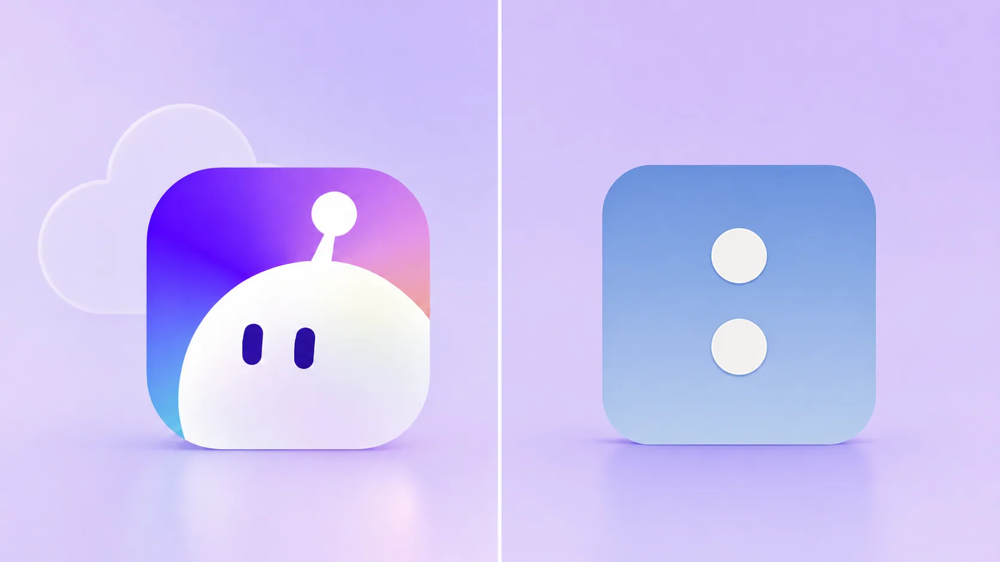

# LightVela vs Today.AI: Manakah yang terbaik untuk pembantu AI peribadi sentiasa aktif?

## Ringkasan

**Pilih LightVela jika anda mahukan Ejen AI peribadi yang praktikal dan sentiasa dalam talian yang boleh anda capai melalui apl pemesejan, konfigurasikan dengan model yang berbeza, lanjutkan dengan Kemahiran dan jadualkan dengan Tugasan Berjadual.** Pilih Today.AI jika anda mahukan sistem pengendalian peribadi yang lebih tertumpu kepada aplikasi yang dibina berdasarkan data harian anda dan cadangan proaktif.

Model produk yang didokumenkan LightVela tertumpu pada Hermes Agent dihoskan awan, manakala kedudukan awam Today.AI menekankan konteks peribadi, bantuan proaktif dan bantuan merentas peranti.
LightVela ialah pilihan yang lebih mudah difahami untuk pengehosan Agen yang berterusan dan kawalan eksplisit.
Today.AI mewakili visi yang lebih eksperimen: pembantu yang membina gambaran hidup anda dan bertindak sebelum anda bertanya.

## Sekali imbas

Ini ialah perbandingan bentuk produk dan pemilikan harian, bukan penanda aras atau keputusan harga.
Maklumat awam yang tersedia untuk Today.AI masih lebih terhad daripada dokumentasi produk LightVela yang diterbitkan.

| Apa yang penting | LightVela | Hari ini.AI |
| - | - | - |
| **Bentuk produk** | Awan Hermes Agent | Pembantu AI peribadi dan penglihatan OS asli AI |
| **Model akses utama** | Saluran Pemesejan serta konsol web | Apl asli dan pengalaman merentas peranti |
| **Memori** | Memori Ejen yang berterusan merentas perbualan | Memori hidup yang dibina daripada konteks peribadi |
| **Kerja proaktif** | Tugas Berjadual Eksplisit dan kerja berjadual | Direka untuk bertindak sebelum pengguna bertanya |
| **Kebolehlanjutan** | Model, Saluran, Kemahiran dan Tugasan Berjadual | Butiran model dan ekosistem masih membangun |
| **Paling sesuai** | Pengguna yang mahukan Ejen sentiasa aktif yang boleh digunakan sekarang | Pengguna awal yang mencari OS peribadi proaktif |

## Apa yang berubah dalam penggunaan harian

Perbezaan paling mudah ialah tempat tinggal pembantu.
LightVela meletakkan Hermes Agent dalam awan, kemudian membolehkan anda menghubungi Ejen yang sama melalui Saluran seperti Telegram, WhatsApp, Discord, Slack atau WeChat.
Today.AI dipersembahkan lebih seperti lapisan pengendalian peribadi: ia mengumpul konteks daripada peranti dan perkhidmatan anda, mengatur perkara yang penting dan mengubah konteks itu menjadi cadangan yang tepat pada masanya.

Bayangkan pagi Isnin.
[halaman pendaratan](https://today.ai/landing) awam Today.AI menunjukkan pengalaman yang dimaksudkan dibina berdasarkan ringkasan pagi yang menghubungkan jadual anda, isyarat kesihatan, projek, perhubungan dan matlamat yang belum selesai.
Ia juga mempersembahkan memori hidup, cadangan proaktif, penyambung apl, komputer awan dan kawalan merentas peranti sebagai sebahagian daripada pengalaman pembantu yang sama.

Dengan LightVela, anda mentakrifkan persekitaran kerja pembantu dengan lebih jelas.
Anda menyambungkan model, memilih Saluran, memasang [Kemahiran](../configuration/skill.md) yang berguna dan mencipta kerja berjadual seperti peringatan, ringkasan atau penyelidikan berulang melalui [Tugas Terjadual](../configuration/automation.md).
Hasilnya terasa kurang seperti sistem pengendalian yang memerhati sepanjang hari anda dan lebih seperti Ejen yang boleh dipercayai yang anda sengaja bentuk.

Perbezaan itu menjejaskan kepercayaan dan kebolehramalan.
LightVela meminta anda memutuskan keupayaan dan jadual yang harus wujud.
Janji Today.AI ialah konteks yang lebih luas membolehkan ia melihat perkara yang mungkin penting seterusnya dan campur tangan pada masa yang tepat.
Satu pendekatan memberi anda permukaan kawalan yang jelas.
Yang lain bertujuan untuk pembantu yang lebih ambien yang menjadi berguna dengan memahami lebih banyak kehidupan anda.

## Di mana LightVela adalah lebih sesuai

Kelebihan terkuat LightVela ialah kejelasan operasi.
Ia direka bentuk untuk mengalih keluar kerja infrastruktur di sebalik Ejen yang berterusan: tiada persediaan pelayan, penyelenggaraan kontena atau komputer tempatan yang mesti kekal terjaga.
Gambaran keseluruhan [LightVela](../01-overview.md) mendokumenkan Hermes Agent dihoskan awan yang kekal tersedia secara bebas daripada peranti peribadi anda.

Itu penting kerana ingatan dan kerja proaktif hanya menjadi berguna apabila Ejen kekal tersedia.
Pembantu berasaskan komputer riba mungkin berkuasa semasa sesi aktif, tetapi ia menjadi tidak tersedia apabila mesin tidur, menukar rangkaian atau diganti.
LightVela memastikan Ejen berjalan secara bebas, jadi tugas yang dijadualkan dan perbualan akan datang tidak bergantung pada sama ada peranti peribadi anda dalam talian.

LightVela juga lebih jelas tentang sempadan konfigurasi.
Modelnya memisahkan blok binaan utama kepada Hermes Agent, model, Saluran, Kemahiran dan Tugasan Berjadual.
Berbilang Saluran boleh menyambung kepada Ejen yang sama dan berkongsi ingatan serta tingkah lakunya, manakala Kemahiran menambah keupayaan boleh guna semula untuk aliran kerja tertentu.

Ini memberi anda jenis kawalan yang berguna.
Anda boleh menukar model tanpa membina semula Ejen, menambah Saluran tanpa mencipta personaliti kedua dan memasang Kemahiran apabila anda memerlukan aliran kerja berulang.
Tugas Berjadual kemudian menyediakan lapisan penjadualan untuk peringatan, ringkasan, pemberitahuan dan tugas berulang lain.

LightVela amat menarik jika AI anda sudah termasuk dalam alat komunikasi anda.
Daripada membuka papan pemuka kendiri lain, anda boleh bertanya kepada Ejen yang sama soalan dalam Telegram, teruskan pada Saluran lain yang disambungkan dan pastikan perbualan dilampirkan pada satu identiti dan ingatan yang berterusan.

## Di mana Today.AI adalah lebih sesuai

Hari ini.Kes terkuat AI ialah cita-cita produknya.
Kedudukan awamnya menerangkan pembantu yang berpusat pada individu, dengan ingatan hidup, bantuan proaktif, ekosistem penyambung yang semakin berkembang, komputer awan, kawalan merentas peranti dan Kemahiran komuniti.

Itu adalah titik permulaan yang berbeza daripada LightVela.
Today.AI cuba membuat pembantu memahami bentuk hari anda sebelum anda merumuskan permintaan.
Pengalaman itu mungkin menarik jika anda mahu konteks peribadi menghubungkan jadual, projek, isyarat kesihatan, perhubungan dan matlamat yang belum selesai anda ke dalam satu aliran maklumat harian.

Today.AI juga menarik untuk orang yang lebih suka aplikasi asli dan bantuan merentas peranti.
Bahan awamnya menerangkan pengalaman yang boleh berfungsi merentas peranti yang telah anda gunakan, manakala komputer awan mengendalikan penyemak imbas, fail dan kod apabila tugas memerlukan lebih daripada cadangan.
Kemahiran Komuniti dipersembahkan sebagai cara lain untuk membawa aliran kerja boleh guna semula ke dalam pembantu.

Kelayakan penting ialah kematangan dan keterlihatan.
Halaman utama awam Today.AI pada masa ini mengarahkan pelawat ke senarai tunggu, dan Syaratnya menggambarkan perkhidmatan itu sebagai beta akses awal yang cirinya mungkin berubah.
Oleh itu, model khusus dan butiran ekosistemnya masih dalam pembangunan.
Ini adalah produk yang sedang berkembang dan bukannya platform yang telus sepenuhnya dan tersedia secara meluas.

Itu menjadikan Today.AI pilihan semula jadi untuk pengguna awal yang ingin meneroka idea lapisan pengendalian peribadi.
Ini adalah pilihan yang kurang jelas jika anda memerlukan laluan persediaan yang didokumenkan, sempadan konfigurasi yang boleh diramal dan Ejen dihoskan awan yang berfungsi yang boleh anda mulakan sekarang.

## Mana yang patut anda pilih?

Pilih LightVela jika anda:

- **Mahukan Ejen sentiasa aktif:** Anda mahu Ejen AI yang tidak bergantung pada komputer riba atau telefon anda sentiasa berjaga.
- **Lebih suka akses biasa:** Anda mahu menggunakan Saluran pemesejan dan bukannya bergantung pada satu apl kendiri baharu.
- **Mahukan kawalan eksplisit:** Anda ingin mengkonfigurasi model, Kemahiran, Saluran, memori dan Tugas Berjadual yang dijadualkan.
- **Persediaan didokumenkan nilai:** Anda mahu laluan konfigurasi yang anda boleh fahami, ulangi dan laraskan.
- **Ingin bermula sekarang:** Anda lebih suka Hermes Agent dihoskan awan yang berfungsi semasa produk berkembang bersama anda.

Pilih Today.AI jika anda:

- **Mahukan konteks peribadi yang lebih luas:** Anda mahu pembantu membina gambaran hidup daripada data, peranti dan perkhidmatan anda.
- **Pilih apl asli:** Anda mahukan pengalaman berorientasikan Mac, iOS atau Android merentas peranti.
- **Mahukan cadangan proaktif:** Anda teruja dengan aliran maklumat harian dan bantuan yang tiba sebelum anda bertanya.
- **Terima akses data yang lebih luas:** Anda selesa membenarkan konteks peribadi sebagai sebahagian daripada pengalaman pembantu.
- **Nikmati akses awal:** Anda bersedia untuk menyertai produk yang sedang berkembang sementara model dan ekosistemnya menjadi lebih jelas.

Pandangan saya: **LightVela lebih sesuai untuk orang yang mahukan Ejen peribadi yang berterusan yang boleh mereka konfigurasi dan gunakan hari ini. Today.AI lebih sesuai untuk pengguna awal yang ingin meneroka perkara yang berlaku apabila pembantu AI menjadi lapisan pengendalian peribadi.**

Kedua-dua produk tidak perlu diketepikan.
Mereka sedang menyelesaikan masalah bersebelahan: LightVela menjadikan Ejen yang berkebolehan boleh dipercayai, boleh dihubungi dan diperluaskan, manakala Today.AI sedang meneroka sejauh mana seorang pembantu boleh memahami dan menjangkakan rentak kehidupan seseorang.
