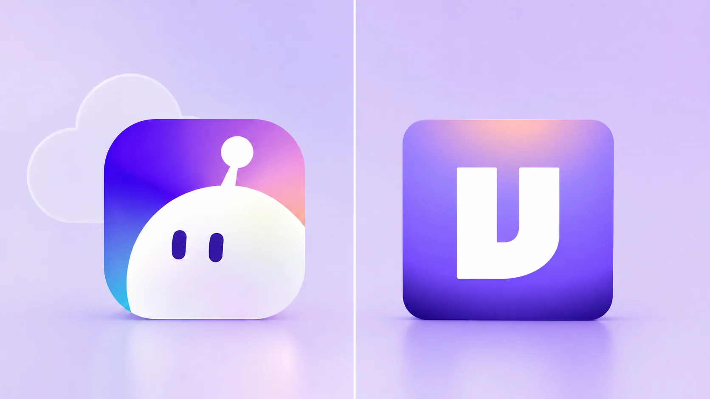

# LightVela vs Viktor.com: Mana yang terbaik untuk menjalankan Ejen AI peribadi anda?

## Ringkasan

**Pilih LightVela jika anda mahukan rakan AI peribadi yang sentiasa tersedia dengan ingatan jangka panjang, konfigurasi model fleksibel, Saluran pemesejan, Kemahiran dan tugas berjadual.** Pilih Viktor.com jika anda mahukan rakan sekerja AI yang dikongsi yang bekerja di dalam ruang kerja pasukan dan beroperasi merentas alatan perniagaan seperti Slack, GitHub, Notion, Stripe, Salesforce dan Google Iklan.

Perbezaannya bukan sekadar AI mana yang lebih bijak.
Ia adalah tempat tinggal Ejen, milik siapa, dan jenis kerja yang direka untuk dimiliki.

## Sekali imbas

| Apa yang penting | LightVela | Viktor.com |
| - | - | - |
| **Peranan utama** | Ejen AI awan peribadi | Rakan sekerja AI yang dikongsi untuk pasukan |
| **Antara muka utama** | Konsol web dan Saluran pemesejan | Slack, Microsoft Teams, apl web dan Discord |
| **Model memori** | Memori Ejen Peribadi merentas perbualan dan Saluran | Konteks dan memori ruang kerja kongsi |
| **Integrasi** | Saluran Pemesejan, Kemahiran, Tugas Berjadual dan pembekal model | 3,200+ penyepaduan alatan perniagaan |
| **Model persediaan** | Agen awan terurus tanpa penyelenggaraan pelayan | Sambungkan Viktor, izinkan alatan dan wakilkan kerja |
| **Paling sesuai** | Bantuan peribadi dan kerjasama jangka panjang | Operasi perniagaan alat silang |

## Perbezaan sebenar ialah pemilikan

LightVela dibina berdasarkan idea untuk memiliki Ejen peribadi yang berumur panjang.
Hermes Agent anda berjalan di awan, kekal tersedia apabila peranti anda di luar talian dan boleh dihubungi melalui Saluran pemesejan yang disokong.
Ingatan, personaliti, model, Kemahiran dan Tugasan Berjadualnya dikonfigurasikan di sekitar satu perhubungan yang berterusan.
[LightVela gambaran keseluruhan](../01-overview.md) menerangkan cara bahagian tersebut berfungsi bersama.

Viktor.com mengambil pendekatan yang berbeza.
Viktor menggambarkan dirinya sebagai rakan sekerja AI yang tinggal di Slack dan Microsoft Teams, di mana seluruh pasukan boleh menghantar mesej, menjemputnya ke Saluran dan berkongsi konteks ruang kerjanya.
Bahan produk semasanya juga mendokumentasikan sembang web dan akses Discord, tetapi idea utama kekal sebagai persekitaran kerja dikongsi dan bukannya teman peribadi peribadi.

Perbezaan itu penting.
Jika soalannya ialah "Bolehkah Ejen ini mengingati cara saya bekerja dan kekal bersama saya dari semasa ke semasa?", LightVela adalah lebih jelas.
Jika soalannya ialah "Bolehkah AI ini beroperasi merentasi alatan syarikat kami untuk semua orang?", Viktor direka untuk kerja itu.

Sempadan yang sama muncul dalam [LightVela vs Mira](./lightvela-vs-mira.md), tetapi perbandingannya berbeza.
Mira bermula dari Telegram perbualan, manakala Viktor bermula dari ruang kerja perniagaan kongsi dan operasi bersambung.

## Di mana LightVela adalah lebih sesuai

LightVela sangat sesuai apabila Ejen anda perlu tersedia di seluruh tempat di mana anda sudah berkomunikasi.
Anda boleh menyambungkan Saluran, mengkonfigurasi model, memasang [Kemahiran](../configuration/skill.md), dan mencipta [Tugas Berjadual](../configuration/automation.md) berulang daripada persekitaran LightVela.
Ejen yang sama boleh menyokong peringatan, penyelidikan, organisasi maklumat, kerja kandungan dan perbualan harian tanpa memerlukan anda menyelenggara pelayan.

Model ini juga sengaja fleksibel.
Anda boleh mengkonfigurasi pembekal model yang disokong melalui LightVela dan menukar lapisan model tanpa membina semula perhubungan Ejen.
Kemahiran memanjangkan apa yang Hermes boleh lakukan, manakala Tugasan Berjadual menentukan bila ia harus menjalankan kerja secara proaktif.

LightVela juga memberi anda ruang untuk meneroka lebih daripada satu masa jalan Ejen daripada persekitaran yang dihoskan awan yang sama.
[DeepSeek Harness](../configuration/deepseek-harness.md) berjalan bersama Hermes Agent sebagai perkhidmatan yang diurus secara berasingan, dengan WebUI sendiri, konfigurasi pembekal dan profil didayakan pemalam.
Itu berguna jika anda ingin bereksperimen dengan persekitaran yang mengutamakan pemalam tanpa menggantikan Ejen peribadi utama anda.

Ini menjadikan LightVela sesuai untuk seseorang yang mahukan satu Ejen peribadi dengan pelbagai cara untuk bekerja:

- Tanya soalan daripada Saluran pemesejan.
- Berikan Ejen tugasan berulang.
- Pasang Kemahiran untuk aliran kerja khusus.
- Tukar model tanpa kehilangan konteks Ejen yang lebih luas.
- Eksperimen dengan masa jalan Ejen lain tanpa menggantikan Hermes.

Pertukarannya ialah LightVela berpusat pada satu perhubungan peribadi.
Jika keperluan utama anda ialah pengendali seluruh pasukan yang boleh menulis ke dalam banyak sistem perniagaan, Viktor mungkin pilihan yang lebih langsung.

## Di mana Viktor.com adalah lebih sesuai

Kelebihan terkuat Viktor ialah keluasan merentas perisian perniagaan.
Bahan rasminya menerangkan lebih daripada 3,200 penyepaduan meliputi CRM, analitik, pengiklanan, kejuruteraan, kewangan dan alatan produktiviti.
[Direktori integrasi Viktor](https://viktor.com/integrations) menunjukkan cara sambungan tersebut boleh menyokong kerja merentas timbunan sedia ada syarikat.

Ini mengubah jenis permintaan yang boleh anda buat.
Daripada meminta Ejen untuk membantu anda memikirkan aliran kerja, anda boleh meminta Viktor untuk menyelaraskan Stripe dan HubSpot, mengemas kini papan pemuka Notion, mencuba isu Linear atau menyediakan laporan merentas beberapa sistem yang disambungkan.

Viktor juga menyokong kerja berulang secara langsung daripada perbualan.
Anda boleh menerangkan tugasan dalam Slack atau Pasukan, nyatakan jadual, sahkannya dan biarkan Viktor menjalankannya berulang kali.
[dokumentasi tugas berjadual](https://viktor.com/docs/scheduled-tasks)nya menerangkan aliran kerja ini untuk operasi perniagaan berulang.

Untuk pasukan teknikal, Viktor menawarkan akses awam API, pelayan MCP dan OpenAI- dan Anthropic akses yang serasi.
Permukaan pembangunnya direka bentuk untuk urutan tak segerak, larian, artifak, penemuan penyepaduan, data penggunaan dan keadaan kelulusan.
Itu menjadikan Viktor lebih sesuai apabila Ejen itu sendiri perlu menjadi sebahagian daripada aliran kerja perniagaan terprogram.

Model keselamatan Viktor juga direka bentuk berdasarkan tindakan perniagaan yang diwakilkan.
[dokumentasi keselamatan](https://viktor.com/security)nya menerangkan OAuth atau sambungan API selamat, akses berskop, kelulusan sebelum tindakan sensitif, kebolehauditan dan bukti kelayakan disuntik pada masa pelaksanaan dan bukannya terdedah kepada model.

Pertukaran itu ialah pemilikan bersama.
Viktor direka untuk ruang kerja di mana berbilang orang dan alatan perniagaan mengambil bahagian dalam konteks operasi yang sama.
Itu berharga untuk pelaksanaan pasukan, tetapi ia adalah perhubungan yang berbeza daripada Ejen peribadi yang ingatan, persona dan rutin hariannya adalah milik anda.

## Mana yang patut anda pilih?

Pilih LightVela jika anda:

- **Mahu Ejen peribadi:** Anda mahukan rakan AI yang kekal tersedia dan menjadi lebih berguna dalam rutin anda.
- **Kesinambungan nilai:** Memori jangka panjang dan satu perhubungan Ejen yang berterusan lebih penting daripada konteks seluruh pasukan.
- **Memilih akses pemesejan:** Anda ingin menghubungi Ejen melalui Saluran yang telah anda gunakan.
- **Mahukan kawalan konfigurasi:** Anda mahu mengurus model, Kemahiran, Tugas Berjadual dan gelagat Ejen di sekitar aliran kerja anda sendiri.
- **Mahukan fleksibiliti masa jalan:** Anda ingin meneroka Hermes dan masa jalan Ejen tambahan daripada satu persekitaran yang dihoskan awan.

Pilih Viktor.com jika anda:

- **Kerja di ruang kerja kongsi:** Kerja anda sudah berlaku di Slack, Microsoft Teams atau Discord.
- **Memerlukan seorang rakan sekerja AI untuk ramai orang:** Anda mahukan Ejen kongsi yang boleh dihantar dan dijemput oleh seluruh pasukan ke Saluran.
- **Bergantung pada keluasan alat perniagaan:** Nilai anda diperoleh daripada menghubungkan CRM, analitik, kewangan, pengurusan projek dan alatan kejuruteraan.
- **Mahu pelaksanaan silang alat:** Anda mahu Ejen melaksanakan operasi perniagaan dan bukannya hanya menyediakan respons.
- **Memerlukan akses pembangun:** Awam API, MCP atau akses serasi SDK adalah sebahagian daripada aliran kerja anda.

Pandangan saya: **LightVela adalah lebih sesuai untuk hubungan Ejen peribadi dan berterusan. Viktor.com adalah lebih sesuai untuk pasukan yang mahukan pengendali AI disambungkan ke timbunan perniagaannya.**

Jika soalan anda ialah "Ejen mana yang harus ingat cara saya bekerja dan tinggal bersama saya setiap hari?", LightVela adalah lebih sesuai.

Jika soalan anda ialah "Rakan sekerja AI yang manakah boleh pasukan kami menyambung ke alatan perniagaan dan mewakilkan kerja?", Viktor.com mungkin jawapan yang lebih jelas.
