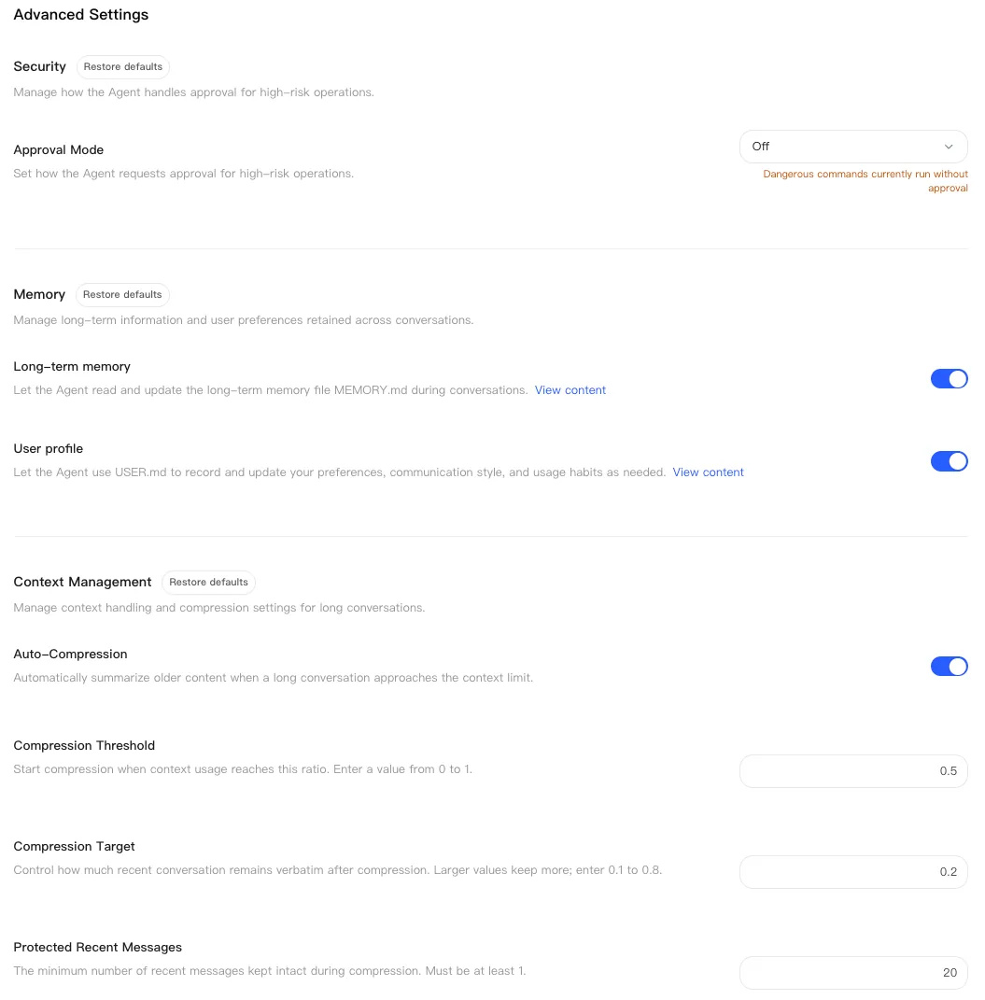

# Tetapan Lanjutan

## Ringkasan

**Tetapan Lanjutan membolehkan anda mengawal cara Hermes Agent anda mengurus keselamatan, ingatan dan konteks perbualan.**
Anda boleh memilih cara Ejen meminta kelulusan untuk operasi berisiko tinggi, mengurus memori yang berterusan, profil pengguna dan pemampatan automatik untuk perbualan yang panjang, kemudian pilih apabila pemampatan bermula, jumlah kandungan terbaharu yang disimpan dan bilangan mesej terkini yang sentiasa kekal utuh.
Selepas Mod Kelulusan disimpan, LightVela membaca semula konfigurasi untuk mengesahkan nilai baharu.
Selepas tetapan Pengurusan Memori atau Konteks disimpan, LightVela memulakan semula perkhidmatan yang berkaitan dan membaca semula konfigurasi untuk mengesahkan nilai baharu.

## Halaman ini meliputi

- Menguruskan cara Ejen meminta kelulusan untuk operasi berisiko tinggi.
- Menguruskan memori dan profil pengguna yang berterusan.
- Menguruskan pemampatan automatik untuk perbualan yang panjang.
- Menetapkan ambang mampatan, nisbah kandungan tertahan dan kiraan mesej terbaharu yang dilindungi.
- Memulihkan lalai untuk kumpulan Keselamatan, Memori atau Pengurusan Konteks.

## Sebelum anda bermula

1. Sahkan bahawa Ejen sasaran sedang berjalan.
2. Buka **Agents** dan pilih Ejen yang ingin anda konfigurasikan.
3. Buka **Tetapan Lanjutan**.

Apabila Ejen tidak berjalan, anda boleh melihat nilai semasanya tetapi tidak boleh mengubahnya.

## Tetapan tersedia

| Kumpulan | Tetapan | Apa yang dilakukannya |
| --- | --- | --- |
| Keselamatan | Mod Kelulusan | Pilih Pintar, Sentiasa Tanya atau Mati untuk mengawal cara Ejen meminta kelulusan untuk operasi berisiko tinggi. |
| Memori | Ingatan Berterusan | Membenarkan Ejen membaca dan mengemas kini ingatan jangka panjangnya dalam perbualan kemudian. |
| Memori | Profil Pengguna | Membenarkan Ejen merekod dan menggunakan pilihan, gaya komunikasi dan tabiat anda. |
| Pengurusan Konteks | Mampatan Automatik | Meringkaskan kandungan lama apabila perbualan yang panjang menghampiri had konteks. |
| Pengurusan Konteks | Ambang Mampatan | Menetapkan nisbah penggunaan konteks yang memulakan pemampatan, dari 0 hingga 1. |
| Pengurusan Konteks | Nisbah Pengekalan Mampatan | Menetapkan jumlah teks perbualan terbaharu yang dikekalkan selepas pemampatan, daripada 0.1 hingga 0.8. |
| Pengurusan Konteks | Mesej Terkini Dilindungi | Menetapkan bilangan mesej terbaharu yang kekal utuh semasa pemampatan, dengan sekurang-kurangnya 1. |

## Tukar tetapan

### Mod Kelulusan

1. Dalam senarai **Mod Kelulusan**, pilih Pintar, Sentiasa Tanya atau Mati.
2. Jika anda memilih Mati, baca amaran risiko dan sahkan bahawa anda ingin mematikan kelulusan.
3. Tunggu halaman membaca semula konfigurasi dan sahkan bahawa ia menunjukkan mod yang anda pilih.

Apabila kelulusan Dimatikan, Ejen tidak lagi meminta kelulusan anda untuk operasi berisiko tinggi dan halaman itu terus menunjukkan amaran risiko.
Gunakan Mati hanya dalam persekitaran yang dipercayai.

### Tukar tetapan

1. Pilih suis di sebelah Memori Berterusan, Profil Pengguna atau Pemampatan Automatik.
2. Baca mesej pengesahan dan sahkan perubahan.
3. Tunggu sehingga simpanan selesai.

Mematikan Memori Berterusan atau Profil Pengguna tidak memadamkan kandungan sedia ada.
Mematikan Pemampatan Automatik mengekalkan nilai pemampatan sedia ada, tetapi menghentikan ringkasan automatik kandungan perbualan lama.

### Tetapan nombor

1. Pilih butang edit di sebelah nilai yang ingin anda ubah.
2. Masukkan nilai dalam julat yang dibenarkan.
3. Pilih Simpan atau tekan Enter untuk menyimpan nilai.
4. Pilih Batal atau tekan Escape untuk membuang suntingan.

Anda boleh menukar ambang mampatan, nisbah pengekalan dan kiraan mesej dilindungi hanya semasa Mampatan Automatik dihidupkan.

## Pulihkan lalai

Tetapan Lanjutan menyediakan **Pulihkan lalai** secara berasingan untuk kumpulan **Keselamatan**, **Memori** dan **Pengurusan Konteks**.

1. Dalam kumpulan yang anda ingin tetapkan semula, pilih **Pulihkan lalai**.
2. Baca mesej pengesahan.
3. Sahkan pemulihan.

Memulihkan lalai mengalih keluar nilai tersuai hanya daripada kumpulan yang dipilih dan mengembalikan kumpulan itu kepada lalai Hermes Agent.
Memulihkan kumpulan Keselamatan mengembalikan Mod Kelulusan kepada **Pintar**.
Ia tidak menjejaskan kumpulan lain atau memadamkan memori Ejen sedia ada.

## Sahkan perubahan

Selepas menyimpan atau memulihkan berjaya, halaman menunjukkan nilai yang dibaca semula daripada Ejen.
Menyimpan Mod Kelulusan tidak memulakan semula perkhidmatan yang berkaitan, dan halaman membaca nilai kembali secara langsung.
Menyimpan atau memulihkan tetapan Pengurusan Memori dan Konteks memulakan semula perkhidmatan yang berkaitan dan membaca semula konfigurasi.
Selepas menukar pemampatan automatik, teruskan perbualan yang lebih panjang untuk mengesahkan bahawa Ejen mematuhi peraturan pengurusan konteks baharu.
Selepas menukar tetapan memori, amati perbualan kemudian untuk mengesahkan bahawa Ejen menggunakan memori dan keutamaan seperti yang diharapkan.

## Soalan Lazim

### Mengapa saya tidak boleh menukar tetapan?

Mula-mula sahkan bahawa Ejen sedang berjalan.
Kawalan juga tidak tersedia buat sementara waktu semasa LightVela membaca konfigurasi, menyimpan perubahan atau memulihkan lalai.

### Mengapakah tetapan mengatakan bahawa versi Ejen saya tidak menyokongnya?

Versi yang sedang berjalan pada Ejen itu tidak menyokong tetapan ini.
Gunakan tetapan yang tersedia, atau semak halaman ini sekali lagi selepas Ejen dikemas kini.

### Mengapa saya tidak boleh menyimpan nombor yang saya masukkan?

Ambang mampatan mestilah dari 0 hingga 1.
Nisbah pengekalan mampatan mestilah dari 0.1 hingga 0.8.
Kiraan mesej terbaharu yang dilindungi mestilah integer sekurang-kurangnya 1.

### Mengapa saya tidak boleh mengedit tetapan mampatan lain selepas mematikan Mampatan Automatik?

Nilai tersebut hanya digunakan semasa Pemampatan Automatik dihidupkan.
Hidupkan semula sebelum menukarnya.

### Bilakah saya harus mematikan kelulusan?

Apabila kelulusan Dimatikan, operasi berisiko tinggi tidak lagi meminta kelulusan anda.
Melainkan anda melakukan tugas berjadual yang disengajakan dalam persekitaran yang dipercayai, pastikan Pintar dipilih atau pilih Sentiasa Tanya.

### Apakah yang perlu saya lakukan jika menyimpan laporan memulakan semula atau kegagalan pengesahan?

Jika anda menukar tetapan Pengurusan Memori atau Konteks, konfigurasi mungkin sudah ditulis, tetapi perkhidmatan yang berkaitan dimulakan semula atau baca balik konfigurasi tidak selesai.
Jika anda menukar Mod Kelulusan, konfigurasi mungkin sudah ditulis, tetapi halaman mungkin belum selesai mengesahkan nilai baca balik.
Muat semula halaman untuk menyemak nilai yang dipaparkan, kemudian tentukan sama ada untuk mencuba lagi.
