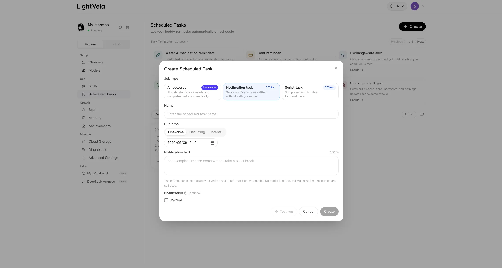
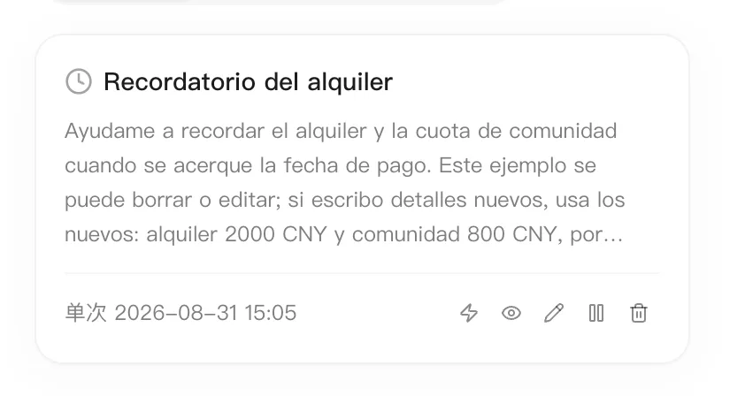

# Tugas Berjadual

## Ringkasan

**Tugas Berjadual membenarkan Hermes Agent mula berfungsi tanpa gesaan manual. Pilih Tugas Ejen apabila kerja memerlukan penaakulan AI, Tugas Pemberitahuan apabila mesej yang sama harus dihantar seperti yang ditulis, atau Tugas Skrip apabila skrip Bash atau Python harus membuat semakan deterministik. Ketiga-tiga jenis menggunakan jadual satu masa, berulang dan selang waktu, tetingkap berkesan dan tetapan pemberitahuan yang sama.**

## Pilih Jenis Tugasan

Pilih jenis tugas berdasarkan perkara yang perlu berlaku apabila jadual dicapai.

| Jenis tugas | Terbaik untuk | Perkara yang anda sediakan | Apa yang dijalankan |
| --- | --- | --- | --- |
| **Tugas Ejen** | Ringkasan, penyelidikan, analisis, penggubalan atau kerja lain yang memerlukan tafsiran | Arahan tugas, dan secara pilihan Kemahiran atau tugasan huluan | Hermes Agent memulakan tugas yang disokong model. |
| **Tugas Pemberitahuan** | Peringatan, notis dan mesej rutin yang tepat | Teks pemberitahuan | Tugas LightVela-terurus menghantar teks anda seperti yang ditulis, tanpa memanggil model. |
| **Tugas Skrip** | Aliran kerja pembangun, semakan dan automasi penentu | Skrip Bash atau Python | Skrip berjalan tanpa sesi Ejen atau panggilan model. Output standard yang tidak kosong boleh dihantar sebagai pemberitahuan. |

Jenis tugasan adalah berasingan daripada corak jadual.
Setiap jenis boleh dijalankan sekali, pada irama harian, mingguan atau bulanan yang berulang, atau pada selang masa yang tetap.

## Sebelum Anda Membuat Tugasan

Pastikan Hermes Agent aktif, pilih saluran pemberitahuan jika perlu dan semak sebarang kod Tugas Skrip sebelum menyimpan.

## Buat Tugas Ejen

Pilih **Tugas Ejen** apabila Hermes Agent perlu memahami permintaan anda dan menjana hasil.
Sebagai contoh, Tugas Ejen boleh mengumpul berita AI harian, memilih item yang paling berkaitan dan menulis taklimat ringkas.

Tetapkan medan berikut:

- **Nama**: Berikan tugas itu nama yang boleh dikenali.
- **Jadual**: Pilih larian sekali, irama berulang atau selang masa tetap.
- **Arahan tugas**: Terangkan matlamat, skop, kekangan sumber dan format output yang dijangkakan.
- **Kemahiran**: Lampirkan Kemahiran yang tersedia secara pilihan apabila tugas memerlukan keupayaan itu.
- **Tugas huluan**: Secara pilihan, gunakan output terbaharu yang lengkap daripada Tugas Ejen lain sebagai konteks tambahan.
- **Tetingkap berkesan**: Hadkan secara pilihan apabila tugasan dibenarkan dijalankan.
- **Pemberitahuan**: Secara pilihan, pilih di mana hasil yang lengkap harus dihantar.

Pada masa yang dijadualkan, Hermes Agent mencipta tugas Ejen dan memanggil model yang dipilih.
Hasilnya boleh dihantar ke saluran pemberitahuan yang dipilih dan direkodkan dalam Larian Terkini.

## Buat Tugas Pemberitahuan

Pilih **Tugas Pemberitahuan** untuk mesej yang sepatutnya tiba tepat semasa anda menulisnya.
Contohnya, buat peringatan penghidratan harian, peringatan sewa bulanan atau notis pasukan pendek.

Tetapkan nama tugas, jadual, kandungan pemberitahuan, tetingkap berkesan dan saluran pemberitahuan.
Kandungan pemberitahuan boleh mengandungi tanda baca biasa, pemisah baris, emoji dan teks berbilang bahasa.

Pada masa yang dijadualkan, LightVela menghantar kandungan pemberitahuan seperti yang ditulis.
Ia tidak meminta model untuk mendraf, menulis semula, meringkaskan, menterjemah atau menerangkan mesej.
Ini bermakna penggunaan token model ialah 0 Token untuk tugas itu.

Jika anda tidak memilih saluran pemberitahuan, tugasan berjalan di latar belakang dan menulis rekod dan bukannya menghantar mesej.
Pemformatan saluran pemberitahuan mungkin masih mempengaruhi cara pemisah baris dan aksara kelihatan kepada penerima.

## Buat Tugasan Skrip

Pilih **Tugas Skrip** apabila anda memerlukan aliran kerja Bash atau Python yang menentukan.
Contohnya, skrip boleh menyemak penggunaan cakera, memeriksa respons perkhidmatan atau mencetak makluman hanya apabila ambang dicapai.

Tetapkan nama tugas, jadual, bahasa skrip, kandungan skrip, tetingkap berkesan dan saluran pemberitahuan.
Sebelum anda membuat tugasan, akui notis keselamatan skrip dan sahkan bahawa anda mempercayai kod tersebut.

Tugasan Skrip tidak membuat sesi Ejen, memanggil model, menggunakan gesaan atau menggunakan Kemahiran.
Mereka mempunyai 0 penggunaan model Token, tetapi mereka menggunakan sumber masa jalan Ejen awan.

| Hasil skrip | Hasil tugasan | Tingkah laku penghantaran |
| --- | --- | --- |
| Keluar kod `0` dengan keluaran standard tidak kosong | Berjaya | Output standard dihantar seperti yang ditulis ke saluran pemberitahuan yang dipilih. |
| Keluar kod `0` dengan output standard kosong | Kejayaan senyap | Tiada pemberitahuan keputusan dihantar. |
| Kod keluar bukan sifar | Gagal | Kegagalan direkodkan dan mengikut pengendalian kegagalan tugas. |
| Tamat masa atau kegagalan permulaan | Gagal | Jenis kegagalan direkodkan dan mengikut pengendalian kegagalan tugas. |

Jangan bergantung pada Tugasan Skrip untuk membaiki, menerangkan atau meringkaskan kegagalan dengan AI.
Ia kekal deterministik: output kosong kekal senyap, dan skrip yang gagal tidak mencetuskan sandaran model.

## Pautkan Tugas Ejen Huluan

Gunakan tugasan huluan apabila satu Tugas Ejen harus menyediakan konteks untuk yang lain.
Tugasan hiliran menerima output terbaharu tugasan huluan yang lengkap sambil mengekalkan tetapan jadual, arahan, tetingkap berkesan dan tetapan pemberitahuannya sendiri.

Jadualkan tugas bergantung dengan masa yang cukup di antara mereka, dan terangkan dalam arahan hiliran cara menggunakan output huluan.
Konteks huluan, pelaksanaan model dan Kemahiran hanya digunakan untuk Tugas Ejen.

## Tetapkan Jadual Dikongsi dan Peraturan Penghantaran

Ketiga-tiga jenis tugasan berkongsi penjadualan dan kawalan pemberitahuan yang sama.

- **Sekali**: Jalankan sekali pada tarikh dan masa yang dipilih.
- **Berulang**: Jalankan setiap hari, mingguan atau bulanan pada masa yang dipilih.
- **Selang**: Jalankan setiap bilangan minit, jam atau hari yang dipilih.
- **Tetingkap berkesan**: Hadkan apabila tugasan berulang atau selang masa boleh dijalankan, atau biarkan ia kosong untuk memastikannya aktif sepanjang masa.
- **Pemberitahuan**: Pilih saluran yang sepatutnya menerima output atau pemberitahuan tugas yang berjaya.

Menukar jenis tugasan semasa membuat tugasan mengekalkan tetapan kongsi ini.
Selepas penciptaan, jenis tugasan tidak boleh diubah, jadi buat tugasan baharu jika model pelaksanaan perlu diubah.

## Gunakan Templat Tugas

Jika anda tidak pasti cara memulakan Tugas Ejen, gunakan Kawasan Templat pada halaman Tugas Berjadual.
Pilih kad seperti peringatan Air & ubat, Peringatan sewa, Makluman kadar pertukaran atau Ringkasan kemas kini stok, kemudian semak jadual dan arahan yang dijana sebelum membuat tugasan.

Membuka templat praisi dialog Cipta Kerja.
Templat ringkasan kemas kini saham, contohnya, mengisi nama tugas, jadual harian dan arahan maklumat pasaran yang boleh anda perhalusi sebelum menguji atau menciptanya.

Cipta Tugas Pemberitahuan atau Tugasan Skrip tersuai daripada dialog Cipta dan bukannya menukar jenis tugas templat.

## Urus Tugas Berjadual

Selepas tugasan dibuat, gunakan halaman Tugasan Berjadual untuk menyemak Kerja Semasa, Pekerjaan Berakhir dan Larian Terkini.
Paparan Kerja Semasa boleh menapis Tugas Ejen, Tugas Pemberitahuan dan Tugasan Skrip.

Dalam **Larian Terkini**, buka satu larian dan pilih **Lihat hasil** untuk membaca output Markdownnya atau **Muat turun hasil** untuk menyimpannya. Mula-mula beralih ke Bot yang memiliki tugas: hasilnya kekal dalam rekod larian Bot itu dan tidak muncul dalam perbualan atau rekod Bot lain.

Ended Jobs mengumpul tugasan yang telah selesai, gagal dan tamat tempoh.
Tugasan yang sedang dijalankan kekal di bawah Pekerjaan Semasa.

Daripada senarai tugasan, periksa butiran, edit tetapan yang dibenarkan, jeda tugasan atau padamkannya.
Untuk Tugas Ejen dengan kebergantungan huluan, semak sama ada tugasan lain masih memerlukan output terbaharunya yang lengkap sebelum memadamkannya.

## Sahkan Tugasan Baharu

Selepas mencipta atau mengedit tugasan, jangan berhenti di "berjaya disimpan."

1. Sahkan bahawa tugasan muncul dalam penapis jenis tugas yang betul dan statusnya sepadan dengan jangkaan.
2. Semak jadual, tetingkap berkesan dan tetapan pemberitahuan.
3. Jalankan ujian atau tunggu satu pelaksanaan sebenar, kemudian periksa Larian Terkini.
4. Untuk Tugas Ejen, pastikan output mengikut arahan dan menggunakan output tugas huluan yang dipilih apabila dikonfigurasikan.
5. Untuk Tugas Pemberitahuan, pastikan teks yang dihantar sepadan dengan kandungan anda.
6. Untuk Tugasan Skrip, semak hasil keluar dan sama ada output standard telah dihantar atau diam dengan betul.

## Pengendalian Kegagalan Biasa

| Gejala | Berkemungkinan menyebabkan | Cadangan pengendalian |
| --- | --- | --- |
| Tugasan tidak berjalan apabila dijangka | Jadual, tetingkap berkesan atau keadaan tugas tidak aktif | Semak jadual dan tetingkap berkesan, sahkan tugas didayakan, kemudian periksa Larian Terkini. |
| Output Tugas Ejen terlepas titik | Arahannya tidak jelas, Kemahiran yang diperlukan tidak tersedia atau konteks huluan tiada | Nyatakan matlamat, skop, format output dan kekangan sumber dengan jelas. Semak tugas Kemahiran dan huluan sebelum larian seterusnya. |
| Tugas Pemberitahuan berjalan tetapi tiada mesej tiba | Tiada saluran pemberitahuan dipilih atau saluran sasaran tidak tersedia | Pilih dan sahkan saluran pemberitahuan, kemudian uji tugas itu sekali lagi. |
| Tugas Skrip dijalankan tanpa mesej | Skrip berjaya keluar tanpa output standard | Ini adalah kejayaan senyap. Jadikan skrip mencetak teks yang tepat yang harus dihantar apabila syarat dipenuhi. |
| Tugasan Skrip gagal | Skrip keluar dengan ralat, tamat masa atau tidak dapat memulakan | Periksa rekod larian, betulkan skrip yang dipercayai dan uji sekali lagi. Jangan mengharapkan AI untuk membaiki atau menerangkan skrip secara automatik. |
