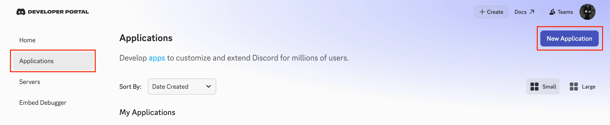
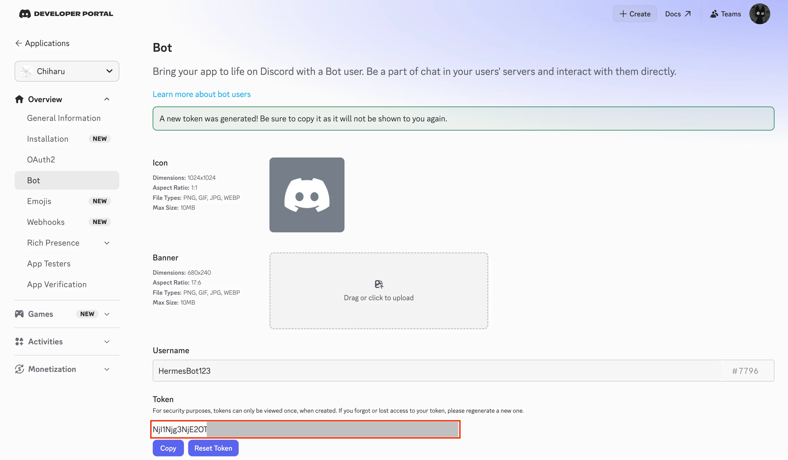
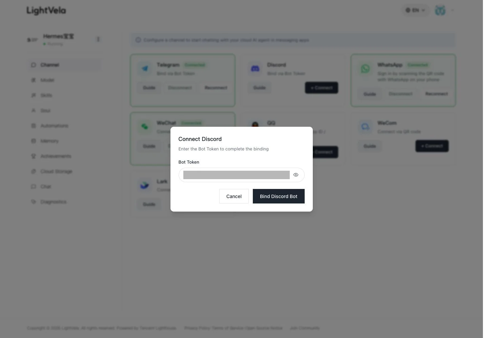
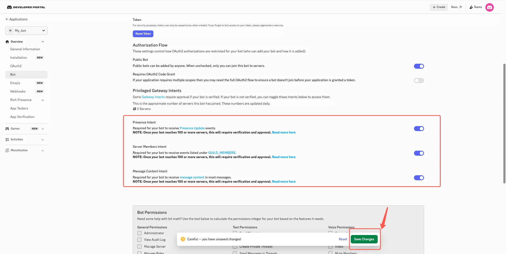
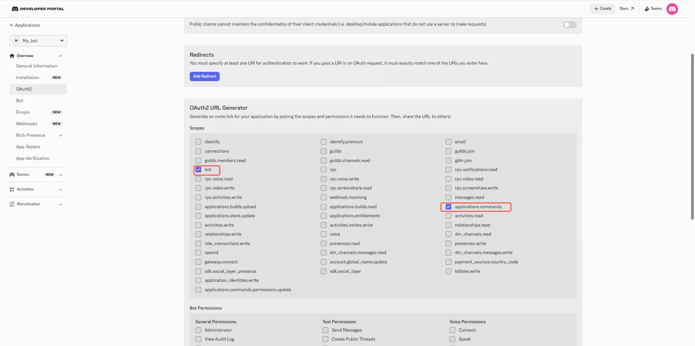
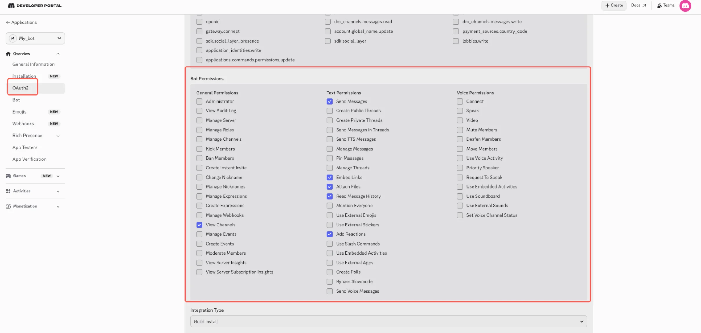
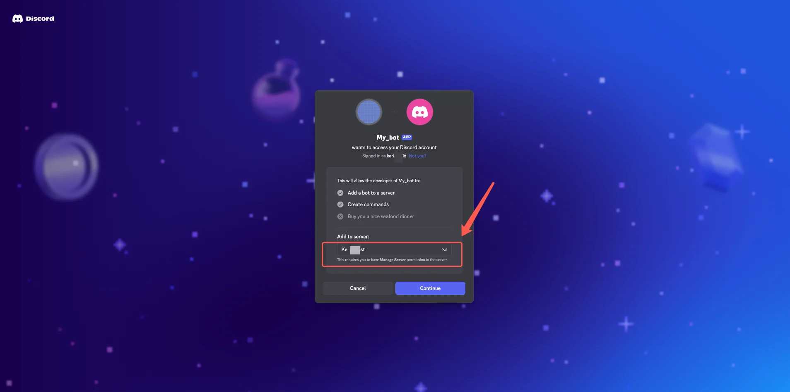
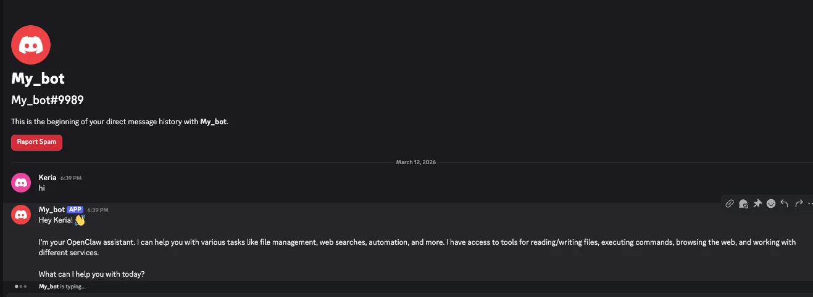

# Konfigurasi Saluran - Discord

## Ringkasan

**Saluran Discord bersambung melalui kebenaran bot, yang sesuai membawa Hermes Agent anda ke dalam pelayan Discord untuk menjawab soalan, membantu atau mendorong interaksi komuniti: buat aplikasi dan bot dalam portal pembangun Discord, dapatkan bukti kelayakan, tampalkannya ke bahagian Saluran pada LightVela anda untuk menyasarkan pelayan bot. Anda memerlukan pelayan Discord di mana anda mempunyai hak pentadbir dan model yang dikonfigurasikan (atau hanya kredit model bulanan yang disertakan dengan pelan anda). Setelah disambungkan, ejen dalam Discord berkongsi persona dan ingatan jangka panjang yang sama seperti saluran anda yang lain.**

---

Saluran Discord menggunakan akses kebenaran Bot dan sesuai untuk menyambungkan Hermes Agent kepada pelayan Discord, menyediakan Soal Jawab, pembantu atau keupayaan interaksi komuniti dalam saluran.

## Halaman ini meliputi

- Membuka pautan jemputan dalam Discord dan melengkapkan kebenaran

- Berbual dengan Hermes Agent dalam pelayan atau saluran Discord


> 💡 **Prasyarat**
>
> - Akaun Discord yang boleh log masuk
>
> - Pelayan Discord tempat anda boleh menambah bot
>
> - Lengkapkan [konfigurasi model](./model.md) (atau gunakan 100 kredit percubaan yang disertakan dalam pelan Pelancaran)
>

---

## Langkah

### 1. Masukkan konsol

Log masuk ke LightVela, klik "Saya Hermes" di penjuru kanan sebelah atas untuk memasuki konsol dan cari butang "Saluran".

### 2. Pilih saluran Discord

Cari kad Discord dan klik "+ Sambung".

### 3. Buka Discord dan pergi ke Portal Pembangun

Pilih pelayan yang anda ingin tambahkan bot, kemudian pergi ke [Portal Pembangun](https://discord.com/developers/home):

1. Klik Aplikasi



2. Klik Aplikasi Baharu di penjuru kanan sebelah atas

3. Beri nama Permohonan anda

4. Tambahkan bot pada aplikasi anda dan jana token bot. Token digunakan untuk mengesahkan sambungan antara Hermes Agent dan pelayan Discord anda.



5. Tampalkan token ke dalam kad Discord.



### 4. Pergi ke halaman Bot dalam Portal Pembangun

Pada halaman Bot, tatal ke bawah ke Privileged Gateway Intents dan dayakan:

- **Niat Kandungan Mesej**: diperlukan, digunakan untuk membaca kandungan mesej

- **Niat Ahli Pelayan**: disyorkan, digunakan untuk senarai peranan dan nama yang sepadan dengan ID

- **Niat Kehadiran**: pilihan, hanya digunakan untuk kemas kini status



Selepas mendayakannya, klik Simpan Perubahan di bahagian bawah.

### 5. Pergi ke halaman OAuth2 dalam Portal Pembangun

Konfigurasikan kebenaran bot: klik OAuth2 di bar sisi kiri, kemudian pilih Penjana URL OAuth2. Konfigurasikan Skop dahulu; mengikut prinsip keistimewaan paling rendah, pilih `bot` dan `applications.commands`.



Teruskan menatal ke bawah untuk mengkonfigurasi Kebenaran Bot, dan pilih:

- Lihat Saluran

- Hantar Mesej

- Baca Sejarah Mesej

- Benamkan Pautan

- Lampirkan Fail

- Tambah Reaksi (pilihan)



### 6. Salin dan buka pautan jemputan

Salin Pautan Jemput yang dijana, bukanya dalam penyemak imbas anda dan jemput bot ke pelayan Discord anda (kebenaran pentadbir pelayan diperlukan). Selepas mengklik Teruskan dan membenarkan, bot akan dijemput ke pelayan.



### 7. Berbual dengan bot baharu dalam Discord

Anda kini boleh mula berinteraksi dengan bot. Buka sembang dengan bot dan hantar mesej ujian:

```
Hi
```



Anda akan menerima Hermes balasan ejen dalam masa beberapa saat.

---

## Keadaan kejayaan

- Senarai "Saluran yang disambungkan" dalam konsol mengandungi "Discord"

- Bot yang sepadan boleh didapati dalam Discord kenalan

- Hermes Agent membalas selepas anda menghantar mesej


---

## Jenis mesej yang disokong

Selepas akses berjaya, bot Discord boleh menerima dan membalas mesej teks asas dan menyokong lebih banyak jenis mesej seperti berikut:

| Jenis mesej disokong oleh Discord bot | Disokong |
|---|---|
| Terima mesej teks | ✅ Disokong |
| Terima imej dan video | ✅ Disokong |
| Terima fail | ✅ Disokong |
| Balas dengan mesej teks | ✅ Disokong |
| Balas dengan imej dan video | ✅ Disokong |
| Balas dengan fail | ✅ Disokong |
| Hantar mesej secara proaktif (seperti peringatan berjadual) | ✅ Disokong |

> ℹ️ **Keupayaan pemprosesan sebenar bergantung pada model**
>
> Jadual di atas hanya menunjukkan jenis mesej yang disokong oleh bot Discord pada lapisan saluran. Sama ada imej, fail dan tugas lain sebenarnya boleh diproses juga bergantung pada sama ada model bahasa besar yang disambungkan kepada Hermes Agent mempunyai keupayaan yang sepadan.

---

## Soalan Lazim

| Isu | Kemungkinan punca | Penyelesaian |
|---|---|---|
| Tidak boleh mencipta Discord Bot | Tidak memasuki Discord Portal Pembangun, atau aliran penciptaan aplikasi tidak selesai | Masukkan Discord Portal Pembangun, buat Aplikasi, kemudian tambah Bot |
| Tidak dapat mencari Token Bot | Token tidak dijana atau tidak disalin sepenuhnya | Pada halaman Bot, klik Set Semula Token / Salin Token, kemudian tampal token penuh ke dalam medan token |
| Token ditunjukkan sebagai tidak sah selepas menampal | Token tidak lengkap atau mengandungi ruang tambahan / pemisah baris | Salin semula Token Bot penuh dan sahkan tiada ruang tambahan |
| Tidak boleh menjemput bot ke pelayan | URL OAuth2 salah konfigurasi, atau akaun anda tidak mempunyai kebenaran pentadbir pelayan | Dalam Penjana URL OAuth2, pilih skop `bot` dan sahkan anda mempunyai hak pentadbir pada pelayan |
| Bot tidak muncul dalam pelayan selepas jemputan | Jemputan tidak diselesaikan atau bot tidak dalam talian | Buka semula pautan jemputan untuk mengesahkan kebenaran berjaya; muat semula senarai ahli pelayan Discord |
| Tiada balasan selepas menghantar mesej | Model tidak dikonfigurasikan, kredit percubaan telah habis, atau saluran Discord tidak berjaya disambungkan | Semak status "Model semasa" dalam kad "1. Model" dan sahkan saluran Discord menunjukkan sebagai disambungkan |
| Bot tidak boleh membaca kandungan mesej | Niat Kandungan Mesej tidak didayakan | Dayakan Niat Kandungan Mesej dalam tetapan Bot Discord Portal Pembangun |
| Bot tidak mempunyai kebenaran untuk membalas dalam saluran | Kebenaran saluran tidak mencukupi | Sahkan bot mempunyai Lihat Saluran, Hantar Mesej, Baca Sejarah Mesej dan kebenaran lain yang diperlukan |
| Bot tidak boleh menerima mesej langsung | Kebenaran DM atau sekatan tetapan privasi pengguna | Sahkan bot membenarkan DM dan semak tetapan privasi Discord pengguna |
| Bagaimana untuk menyahpaut | — | Padamkan rekod Discord yang sepadan dalam senarai "Saluran yang disambungkan" |
| Bolehkah Discord Bot yang sama menyambung ke berbilang Hermes kejadian ejen | Tidak disyorkan; satu Token Bot hendaklah terikat kepada satu Hermes Agent | Jika anda memerlukan beberapa contoh Hermes Agent, cipta Discord Bot berasingan |

---

## Nota saluran

- **Jenis mesej**: Menyokong teks, imej, video, fail, mesej suara dan banyak lagi. Lihat "Jenis mesej yang disokong" di atas

- **Sokongan sembang kumpulan**: Sembang kumpulan tidak disokong pada masa ini; hanya 1-ke-1 perbualan disokong

- **Gangguan sambungan**: Tempoh lama tiada respons mungkin menunjukkan kebenaran telah dibatalkan. Kembali ke konsol dan benarkan akses sekali lagi

---

## Langkah seterusnya

- [Konfigurasikan Saluran - Slack](./channel-slack.md) — Kerjasama pasukan, pemberitahuan ruang kerja dan aliran kerja saluran

- [Konfigurasikan Saluran - QQ](./channel-qq.md) — Bot dibuat secara manual, disepadukan melalui AppID/AppSecret

- [Konfigurasikan Saluran - WeCom](./channel-wecom.md) — Kerjasama dalaman perusahaan dan senario pejabat

- [Konfigurasikan Saluran - Lark](./channel-feishu.md) — Senario pejabat dengan teks kaya dan sembang kumpulan

- [Konfigurasikan Kemahiran](./skill.md) — Lanjutkan Hermes keupayaan ejen
