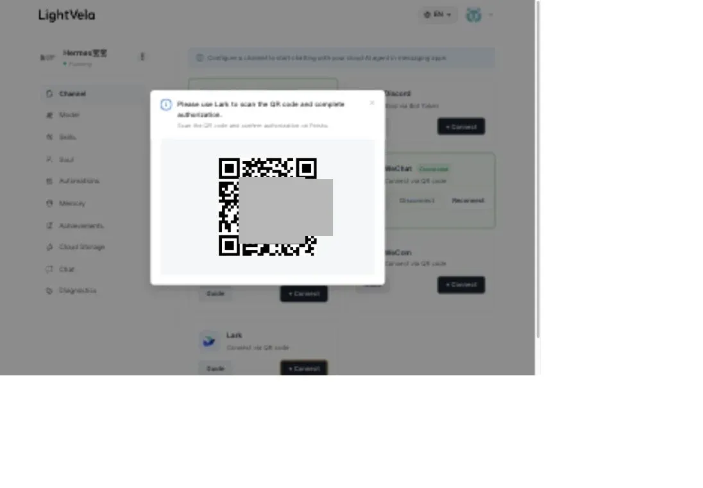
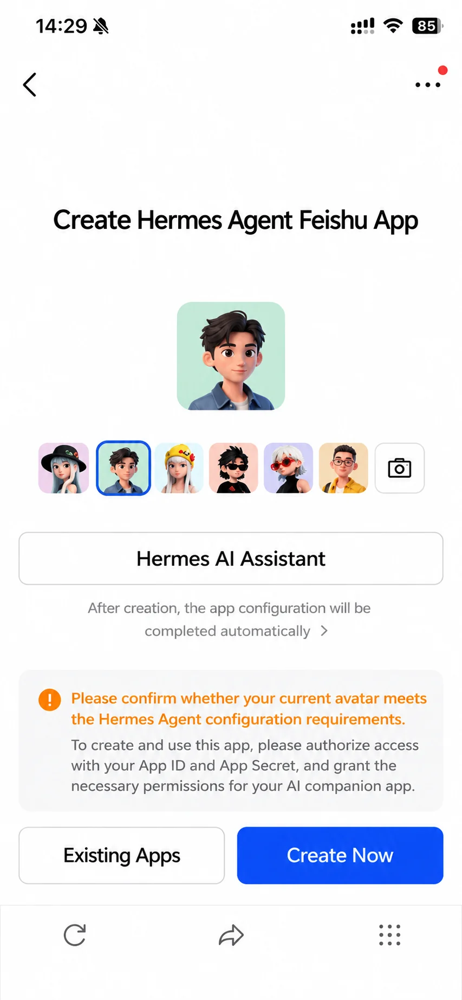
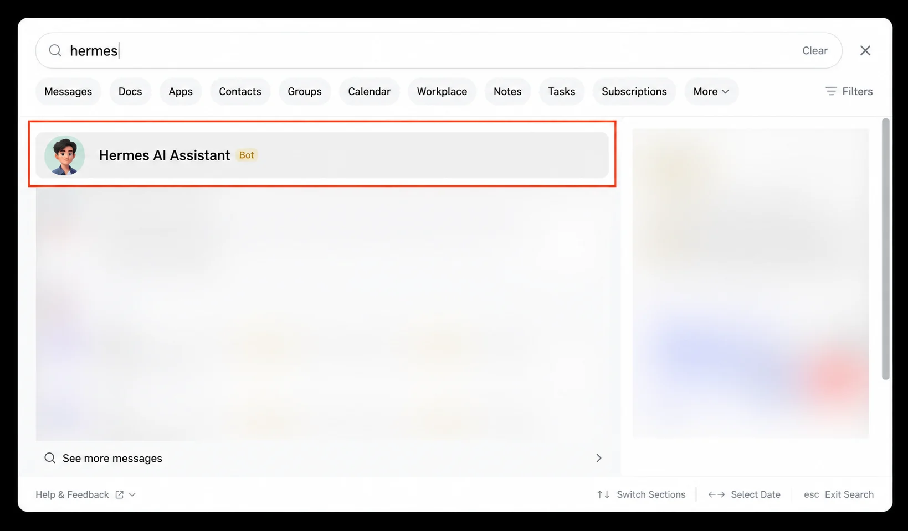
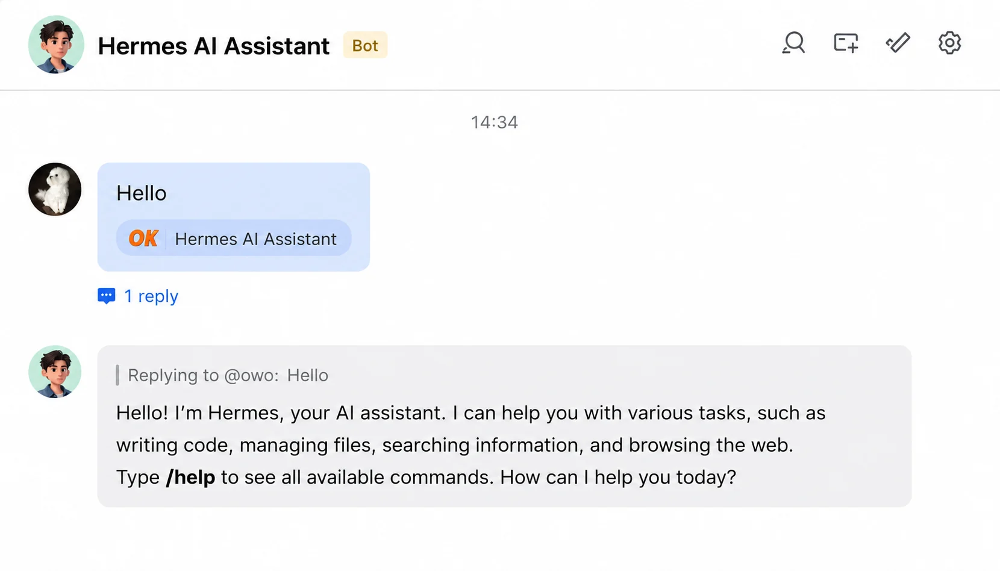

# Konfigurasi Saluran - Lark

## Ringkasan

**Saluran Lark sesuai dengan penggunaan di tempat kerja, menyokong mesej teks kaya dan @menyebut bot dalam sembang kumpulan, dan menyambung dengan cara yang sama seperti WeChat: pilih Lark dalam bahagian Saluran konsol, klik untuk membenarkan dan menjana kod QR, kemudian imbasnya dengan Lark untuk mula bercakap. Anda memerlukan Lark pada telefon anda (atau log masuk pada desktop) dan model yang dikonfigurasikan (atau hanya kredit model bulanan yang disertakan dengan pelan anda). Seorang ejen boleh disambungkan ke beberapa saluran sekaligus, berkongsi persona dan ingatan jangka panjang yang sama.**

---

Saluran Lark sesuai untuk senario pejabat. Ia menyokong mesej teks kaya dan @sebutan bot dalam sembang kumpulan. Penyepaduan menggunakan keizinan kod QR, serupa dengan WeChat.

## Halaman ini meliputi

- Menjana Lark akses kod QR dalam LightVela

- Mengimbas kod QR dengan Lark untuk memberi kebenaran

- Berbual dengan Hermes Agent dalam Lark


> 💡 **Prasyarat**
>
> - Telefon dengan Lark dipasang (atau desktop Lark sudah dilog masuk)
>
> - Lengkapkan [konfigurasi model](./model.md) (atau gunakan 100 kredit percubaan yang disertakan dalam pelan Pelancaran)
>

---

## Langkah

### 1. Masukkan konsol

Log masuk ke LightVela, klik "Saya Hermes" di penjuru kanan sebelah atas untuk memasuki konsol dan cari butang "Saluran".

### 2. Pilih saluran Lark

Klik menu lungsur dan pilih "Lark". Pengenalan saluran Lark dipaparkan di bawah.

### 3. Klik "Izinkan Akses"

Kod QR muncul pada halaman.



### 4. Imbas dengan Lark

**Pada mudah alih:**

1. Buka Lark

2. Ketik "+" di penjuru kanan sebelah atas → "Imbas"

3. Imbas kod QR pada skrin komputer anda

4. Ikut gesaan untuk melengkapkan kebenaran




### 5. Cari Hermes Agent di Lark

Selepas imbasan berjaya:

- Entri "Lark" muncul dalam senarai "Saluran Bersambung" konsol

- Lark menambah bot secara automatik pada kenalan anda


Cari Lark untuk nama aplikasi yang anda buat.



Buka tetingkap sembang bot dan hantar mesej ujian:

```
Hello
```



## Keadaan kejayaan

- Entri "Lark" muncul dalam senarai "Saluran Bersambung" konsol

- Bot boleh didapati melalui carian Lark

- Menghantar mesej menerima Hermes balasan ejen


---

## Jenis mesej yang disokong

Selepas penyepaduan, bot Lark menyokong lebih daripada teks asas. Senarai penuh:

| Lark bot — jenis dan ciri mesej yang disokong | Disokong |
| --- | --- |
| Terima mesej teks | ✅ Ya |
| Terima imej | ✅ Ya |
| Terima fail | ✅ Ya |
| Terima audio / video | ✅ Ya |
| Balas dengan mesej teks | ✅ Ya |
| Balas dengan imej | ✅ Ya |
| Balas dengan fail | ✅ Ya |
| Balas dengan audio | ✅ Ya |
| Kandungan balasan menyokong Markdown | ✅ Ya |
| Hantar mesej secara proaktif (cth. peringatan berjadual) | ✅ Ya |
| Kendalikan Lark Dokumen, Wiki, Drive | ✅ Ya |

> ℹ️ **Keupayaan sebenar bergantung pada model**
>
> Jadual di atas hanya menggambarkan perkara yang boleh diterima dan dibalas oleh bot Lark pada lapisan saluran. Sama ada tugas seperti pemprosesan imej / fail benar-benar berfungsi bergantung pada sama ada LLM asas yang disambungkan ke Hermes Agent menyokong keupayaan tersebut.

---

## Soalan Lazim

| Gejala | Kemungkinan punca | Resolusi |
| --- | --- | --- |
| Imbasan menunjukkan "Aplikasi tidak dibenarkan" | Pentadbir penyewa mengehadkan apl pihak ketiga | Minta pentadbir penyewa anda membenarkan apl atau bertukar kepada penyewa peribadi |
| Kenalan bot tidak ditemui | Lark meruntuhkan bot secara lalai | Cari Hermes nama aplikasi ejen dari atas Lark |
| Bagaimana untuk menambah bot pada kumpulan | — | Dalam tetapan kumpulan, "Tambah Ahli", cari bot dan tambahkannya |
| Kod QR tamat tempoh | Tidak diimbas dalam tetingkap kesahan | Tutup dialog dan klik "Izinkan Akses" sekali lagi |
| Tiada balasan selepas menghantar mesej | Model tidak dikonfigurasikan atau kredit percubaan habis | Semak status "Model Semasa" |
| Isu pemaparan teks kaya | Lark tidak menyokong beberapa sintaks Markdown | Perbualan teks biasa tidak terjejas |

---

## Nota saluran

- **Jenis mesej**: Teks, teks kaya, imej, fail, audio, video dan banyak lagi — lihat "Jenis mesej yang disokong" di atas

- **Sokongan sembang kumpulan**: Bot boleh ditambahkan pada sembang kumpulan dan akan bertindak balas apabila @disebut

- **Sekatan penyewa**: Sama ada penyewa Lark perusahaan membenarkan bot pihak ketiga bergantung pada dasar pentadbir penyewa


---

## Langkah seterusnya

- [Konfigurasikan Kemahiran](./skill.md) — Lanjutkan Hermes keupayaan ejen
