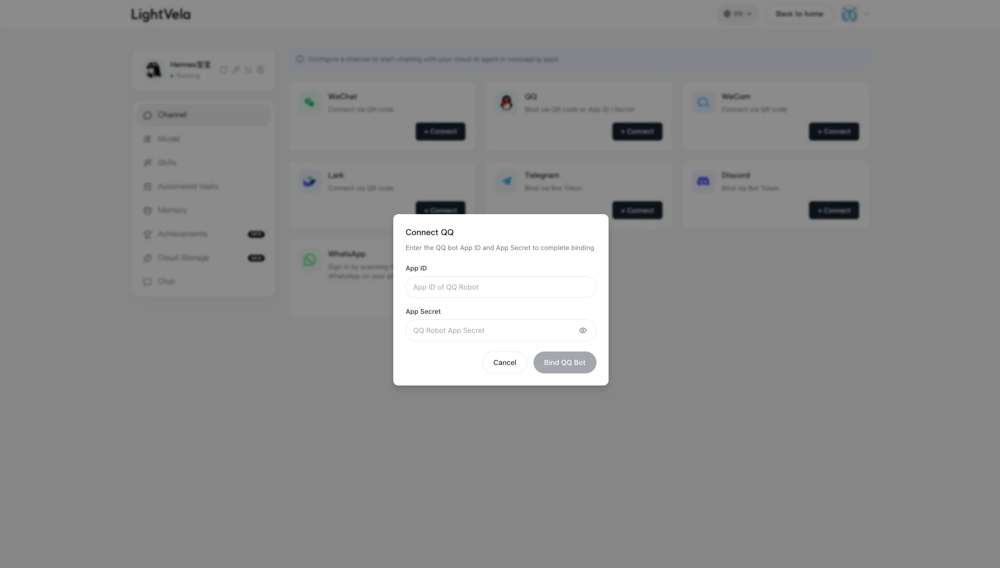
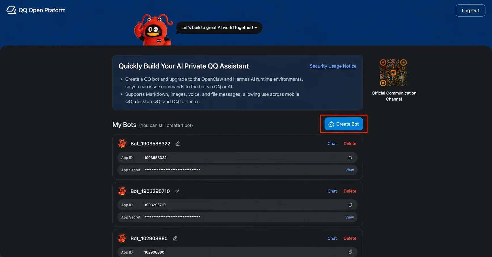
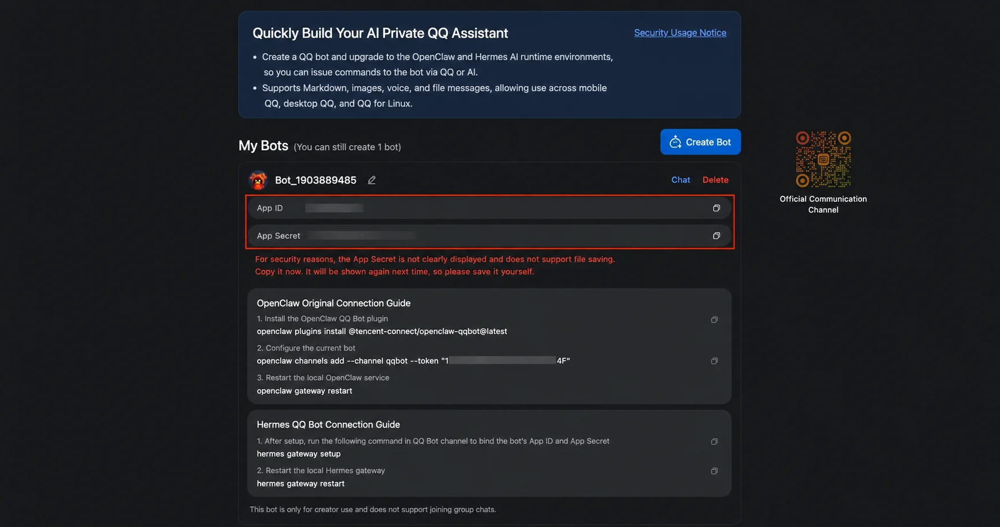
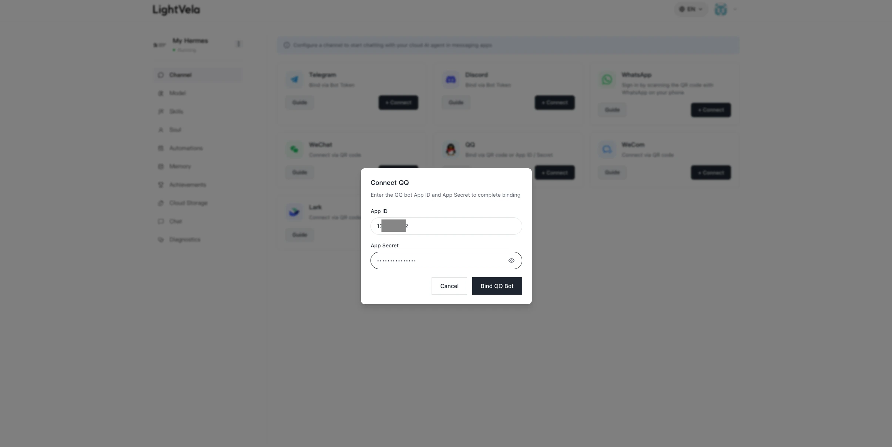
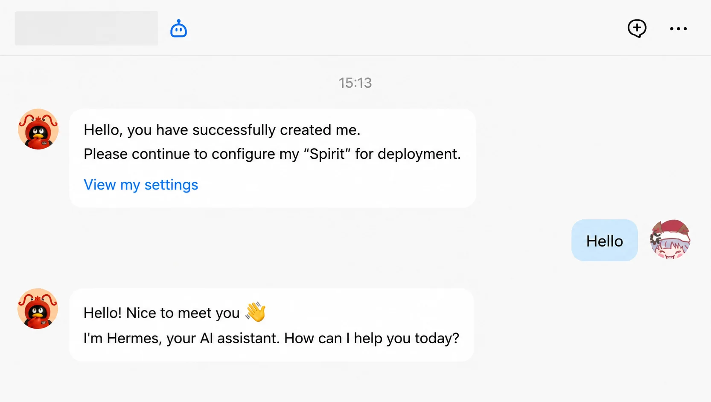

# Konfigurasi Saluran - QQ

## Ringkasan

**Saluran QQ ialah saluran yang memerlukan parameter dimasukkan dengan tangan: buat bot pada Platform Terbuka QQ, dapatkan AppID dan AppSecretnya, kemudian tampalkannya ke bahagian Saluran pada konsol LightVela. Semuanya mengambil masa kira-kira 5-10 minit. Anda memerlukan akaun QQ untuk bertindak sebagai pentadbir bot dan model yang dikonfigurasikan (atau hanya kredit model bulanan yang disertakan dengan pelan anda). Sebagai perbandingan, WeChat, WeCom, dan Lark semuanya bersambung dengan mengimbas kod QR. Setelah disambungkan, ejen dalam QQ berkongsi persona dan ingatan jangka panjang yang sama seperti saluran anda yang lain.**

---

Saluran QQ memerlukan mencipta bot pada Platform Terbuka QQ, kemudian mengisi **AppID** dan **AppSecret** yang terhasil ke dalam LightVela. Seluruh proses mengambil masa kira-kira 5-10 minit.

## Halaman ini meliputi

- Mendaftar dan mencipta bot pada Platform Terbuka QQ

- Mendapatkan AppID dan AppSecret

- Mengisi kelayakan ke dalam LightVela untuk melengkapkan penyepaduan

- Berbual dengan Hermes Agent dalam QQ


> 💡 **Prasyarat**
>
> - Akaun QQ (untuk bertindak sebagai pentadbir bot)
>
> - Lengkapkan [konfigurasi model](./model.md) (atau gunakan 100 kredit percubaan yang disertakan dalam pelan Pelancaran)
>

---

## Langkah

### 1. Masukkan konsol

Log masuk ke LightVela, klik "Saya Hermes" di penjuru kanan sebelah atas untuk memasuki konsol dan cari butang "Saluran".

### 2. Pilih saluran QQ

Klik menu lungsur dan pilih "QQ". Pengenalan saluran QQ dipaparkan di bawah.



### 3. Daftar di Platform Terbuka QQ

Lawati [QQ Open Platform](https://q.qq.com/qqbot/openclaw/) dan imbas kod QR pada halaman dengan apl mudah alih QQ untuk mendaftar / log masuk. Pada lawatan pertama, imbasan akan mendaftar secara automatik dan mengikat akaun QQ semasa ke akaun Open Platform.

Selepas mengimbas pada apl mudah alih QQ dan memilih **Setuju**, pendaftaran selesai dan anda akan memasuki halaman konfigurasi bot QQ.

### 4. Buat bot QQ

Pada halaman bot Platform Terbuka QQ, klik "Buat Bot" untuk mencipta bot QQ baharu.



### 5. Dapatkan AppID dan AppSecret

Selepas bot dibuat, cari **AppID** dan **AppSecret** pada halaman. Klik butang "Salin" di sebelah setiap satu dan simpannya ke dalam fail nota setempat.



> ⚠️ **AppSecret ialah bukti kelayakan yang sensitif**
>
> - Atas sebab keselamatan, **AppSecret tidak boleh dilihat semula dalam plaintext — melihat sekali lagi memaksa set semula**. Simpannya serta-merta apabila mula-mula dibuat.
>
> - Jangan tampalkannya ke dalam kumpulan sembang, halaman web awam atau masukkannya ke repositori Git.
>
> - Jika bocor, segera tetapkannya pada Platform Terbuka QQ di bawah "Tetapkan Semula Rahsia", kemudian isi semula kelayakan baharu ke dalam LightVela.
>

Selepas penciptaan, QQ secara automatik menambah bot ke senarai mesej anda dan menghantar mesej alu-aluan. Pada ketika ini, bot belum terikat kepada LightVela; menghantar mesej akan kembali "Bot ini telah pergi ke Marikh, cuba lagi nanti" — ini perkara biasa, teruskan ke langkah seterusnya.

### 6. Isikan kelayakan dalam LightVela

Kembali dalam kad "Saluran" konsol, pilih "QQ" daripada menu lungsur dan tampal bukti kelayakan yang baru anda salin:

1. **AppID**: tampal AppID yang disalin

2. **AppSecret**: tampal AppSecret yang disalin




### 7. Klik "Tambah dan Gunakan"

LightVela menggunakan bukti kelayakan di atas untuk menyambungkan bot pada Platform Terbuka QQ. Selepas beberapa dozen saat, halaman menunjukkan "Berjaya disimpan", dan entri "QQ" muncul dalam senarai "Saluran Bersambung".

### 8. Cari Hermes Agent dalam QQ

Buka QQ, cari bot yang baru anda buat dan hantar mesej ujian:

```
Hello
```

Anda akan menerima Hermes balasan ejen dalam beberapa saat.



> ✅ **Sebutan kumpulan QQ disokong**
>
> Selepas pengikatan QQ berjaya, LightVela mendayakan Hermes' dasar sembang kumpulan QQ secara lalai. Tambahkan bot pada kumpulan QQ, kemudian sebutkannya untuk memulakan perbualan. Dasar lalai ialah `open`, yang bermaksud ahli kumpulan QQ yang mengandungi bot boleh menyebutnya untuk bersembang. Mesej kumpulan biasa tanpa disebut tidak mencetuskan perbualan.

## Keadaan kejayaan

- Bot telah dicipta pada Platform Terbuka QQ

- Entri "QQ" muncul dalam senarai "Saluran Bersambung" konsol

- Bot dalam QQ membalas dengan betul menggunakan AI

- Bot membalas dalam kumpulan QQ apabila disebut


---

## Jenis mesej yang disokong

Selepas penyepaduan, bot QQ menyokong lebih daripada teks asas. Senarai penuh:

| Bot QQ — jenis dan ciri mesej yang disokong | Disokong |
| --- | --- |
| Terima mesej teks | ✅ Ya |
| Terima imej | ✅ Ya |
| Terima fail | ✅ Ya |
| Terima mesej suara | ✅ Ya |
| Balas dengan mesej teks | ✅ Ya |
| Balas dengan imej | ✅ Ya |
| Balas dengan fail | ✅ Ya |
| Kandungan balasan menyokong Markdown | ✅ Ya |
| Hantar mesej secara proaktif (cth. peringatan berjadual) | ✅ Ya |
| Petikan mesej sejarah | ❌ Belum |

> ℹ️ **Keupayaan sebenar bergantung pada model**
>
> Jadual di atas hanya menggambarkan perkara yang boleh diterima dan dibalas oleh bot QQ pada lapisan saluran. Sama ada tugas seperti pemprosesan imej / fail benar-benar berfungsi bergantung pada sama ada LLM asas yang disambungkan ke Hermes Agent menyokong keupayaan tersebut.

---

## Soalan Lazim

| Gejala | Kemungkinan punca | Resolusi |
| --- | --- | --- |
| Bot membalas "'Jiwa' saya di luar talian, sila semak penggunaan perkhidmatan hos anda" | AppID / AppSecret tidak dikonfigurasikan dalam LightVela, atau bukti kelayakan adalah salah | Salin semula parameter daripada Platform Terbuka QQ, pastikan tiada ruang hadapan / belakang, kemudian isi semula LightVela |
| Bot membalas "Bot ini telah pergi ke Marikh, cuba lagi nanti" | Bot QQ dibuat tetapi belum terikat kepada LightVela | Ikuti halaman ini untuk mengisi AppID / AppSecret |
| Bot masih tidak membalas selepas semua konfigurasi | Model tidak dikonfigurasikan atau kredit percubaan habis | Semak status "Model Semasa" pada kad "1. Model" |
| Tidak dapat mencari AppSecret | AppSecret hanya kelihatan pada masa penciptaan | Klik "Tetapkan Semula Rahsia" pada Platform Terbuka QQ untuk menjana nilai baharu, kemudian isi semula LightVela |
| AppSecret bocor | — | Pergi ke Platform Terbuka QQ "Set Semula Rahsia", dan isi semula AppSecret baharu dalam LightVela |
| Kod QR tamat tempoh | Tidak diimbas dalam tetingkap kesahan | Tutup dialog dan klik "Izinkan Akses" sekali lagi |

---

## Nota saluran

- **Jenis mesej**: Teks, imej, fail, suara dan banyak lagi — lihat "Jenis mesej yang disokong" di atas

- **Sokongan sembang kumpulan**: Sebutan kumpulan didayakan secara lalai selepas diikat. Konsol menggunakan dasar `open`, membenarkan ahli kumpulan QQ yang mengandungi bot menyebutnya untuk bersembang. Untuk mengehadkan akses kepada kumpulan terpilih, tukar konfigurasi tika Hermes kepada `allowlist` dan kekalkan senarai yang dibenarkan di sana; kad saluran tidak mendedahkan suis ini lagi

- **Pengurusan bukti kelayakan**: AppSecret hanya boleh dilihat dalam teks biasa pada masa penciptaan; jika hilang atau bocor, ia mesti ditetapkan semula


---

## Langkah seterusnya

- [Konfigurasikan Saluran - WeCom](./channel-wecom.md) — Kerjasama dalaman perusahaan dan senario pejabat

- [Konfigurasikan Saluran - Lark](./channel-feishu.md) — Senario pejabat dengan teks kaya dan sembang kumpulan

- [Konfigurasikan Kemahiran](./skill.md) — Lanjutkan Hermes keupayaan ejen
