# Konfigurasi Saluran - Slack

## Ringkasan

**Saluran Slack bersambung dengan token bot dan token apl, yang sesuai membawa Hermes Agent anda ke dalam saluran pasukan, mesej langsung dan pemberitahuan tugas berjadual: buat apl dalam konsol pengurusan apl Slack, konfigurasikan kebenarannya, dapatkan kedua-dua token dan tampalkannya ke bahagian LightVela konsol. Anda memerlukan Slack ruang kerja tempat anda boleh memasang apl dan model yang dikonfigurasikan (atau hanya kredit model bulanan yang disertakan dengan pelan anda). Kedua-dua token adalah bukti kelayakan yang sensitif — jangan sekali-kali berkongsinya secara terbuka. Setelah disambungkan, ejen dalam Slack berkongsi persona dan ingatan jangka panjang yang sama seperti saluran anda yang lain.**

---

Slack menggunakan Token Bot dan Token Apl untuk menyambungkan Hermes Agent kepada saluran pasukan, mesej langsung dan pemberitahuan tugas yang dijadualkan.

## Halaman ini meliputi

- Mencipta apl Slack dan mengkonfigurasi Mod Soket, kebenaran dan acara

- Mengikat Slack Token Bot dan Token Apl dalam LightVela

- Berbual dengan Hermes Agent melalui saluran Slack dan mesej langsung

> 💡 **Sebelum anda bermula**
>
> - Anda mempunyai Hermes Agent dengan model yang berfungsi dikonfigurasikan dalam [Konfigurasi Model](./model.md)
>
> - Anda mempunyai Slack ruang kerja dan kebenaran untuk membuat dan memasang apl
>
> - Jika pemasangan apl memerlukan kelulusan pentadbir, hubungi pentadbir ruang kerja anda
>
> - Sediakan tempat yang selamat untuk menyimpan sementara kedua-dua token
>
> Token Bot dan Token Apl ialah bukti kelayakan yang sensitif. Jika token terdedah, batalkannya dalam Slack dan jana pengganti.

---

## Langkah

### 1. Buka tetapan saluran Slack dalam LightVela

Log masuk ke LightVela tapak antarabangsa, buka **My Hermes → Channel**, cari kad **Slack** dan klik **+ Connect**. Anda akan kembali dengan dua bukti kelayakan:

- **Slack Token Bot**: bermula dengan `xoxb-`.
- **Slack Token Apl**: bermula dengan `xapp-`.

### 2. Cipta apl Slack

1. Buka [Slack API Apl](https://api.slack.com/apps) dan log masuk.
2. Klik **Buat Apl Baharu**.

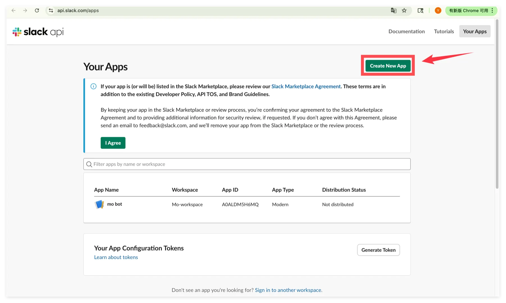

3. Pilih **Dari awal**.

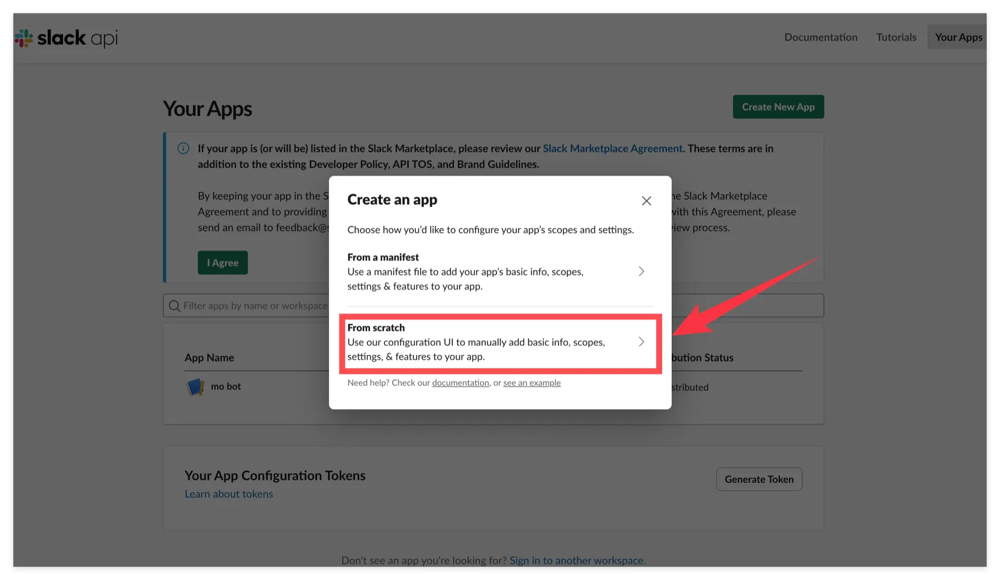

4. Masukkan nama apl seperti `Hermes Agent`.
5. Pilih ruang kerja di mana Hermes Agent harus dijalankan, kemudian klik **Buat Apl**.

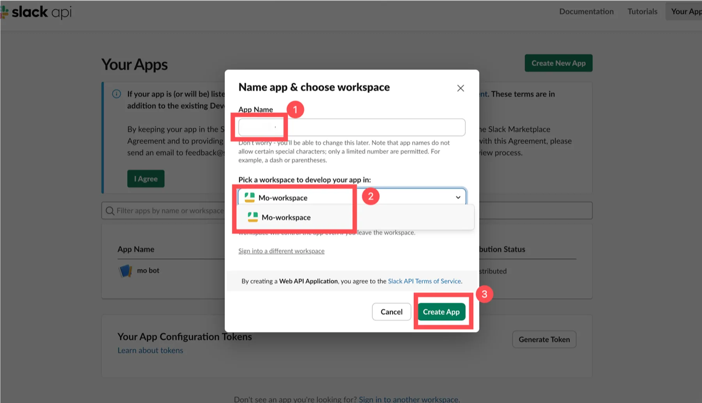

Jika ruang kerja tiada, sahkan bahawa akaun Slack semasa adalah miliknya dan boleh membuat apl.

### 3. Cipta Token Apl

Token Apl mewujudkan sambungan WebSocket Mod Soket. Ia mesti termasuk skop `connections:write`.

1. Dalam bar sisi aplikasi Slack, buka **Tetapan → Maklumat Asas**.

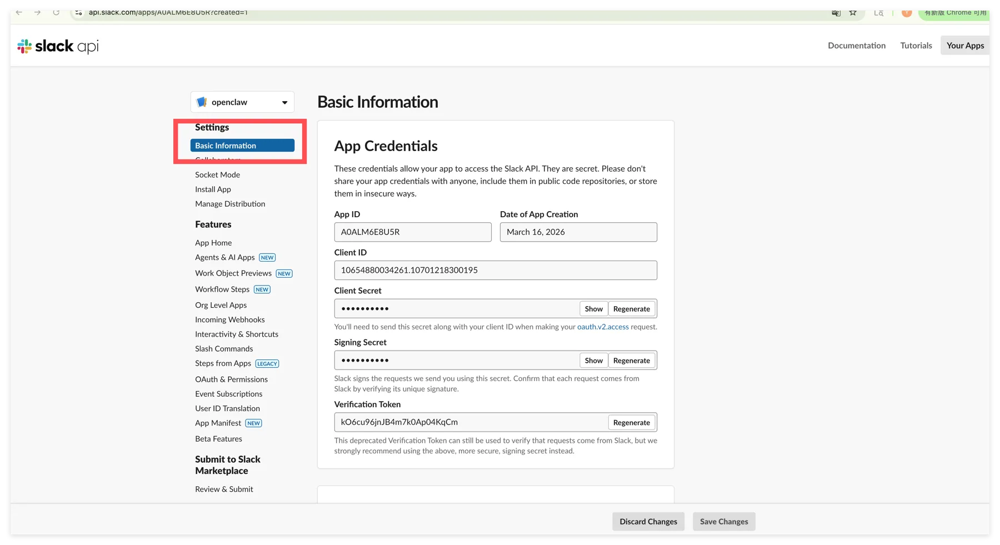

2. Tatal ke **Token Tahap Apl** dan klik **Jana Token dan Skop**.

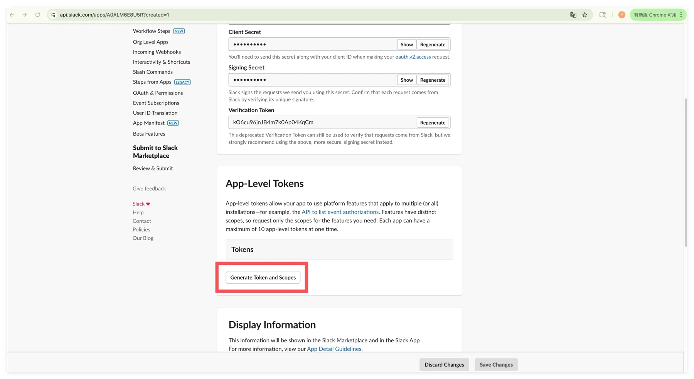

3. Masukkan nama token yang boleh dikenali, seperti `HermesSocket`.
4. Klik **Tambah Skop**.

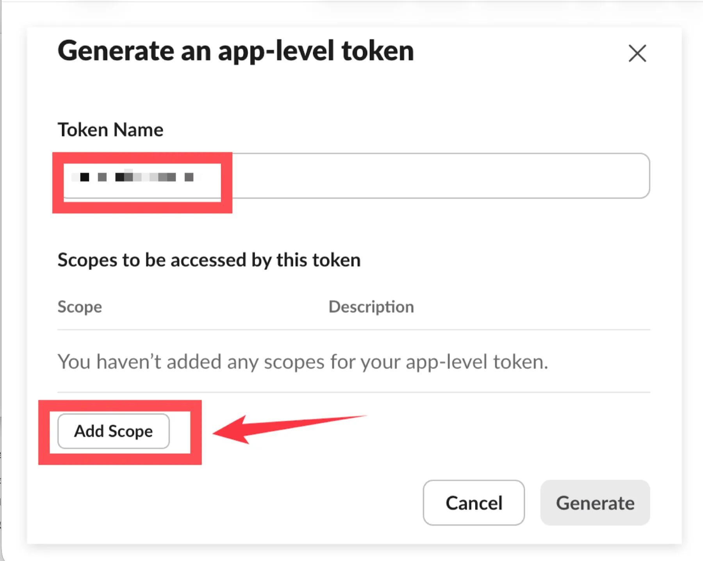

5. Cari dan pilih `connections:write`.

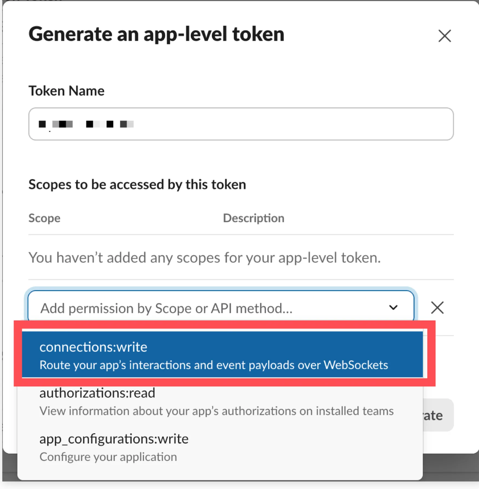

6. Sahkan skop disenaraikan, kemudian klik **Jana**.

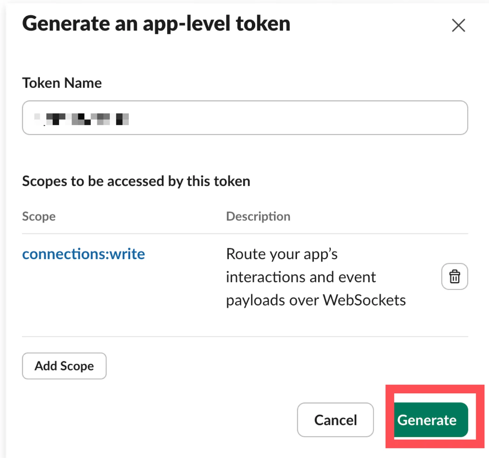

7. Salin token `xapp-...` yang dihasilkan dan simpan dengan selamat. Klik **Selesai** selepas menyalinnya.

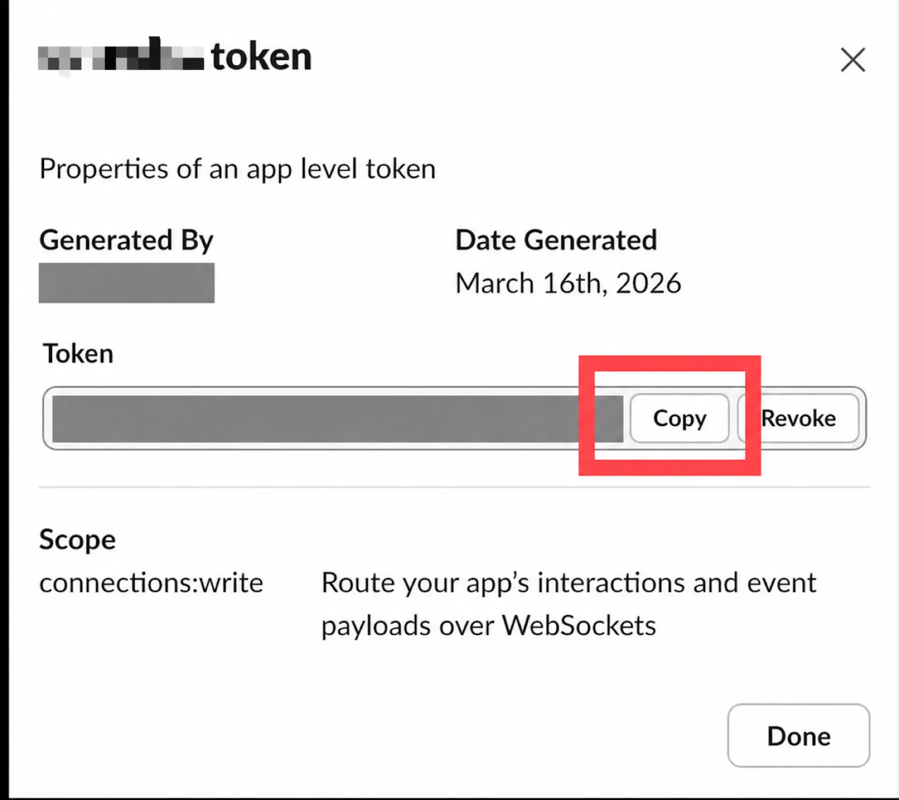

Jangan tampal Token Apl ke dalam medan Token Bot. Rahsia Pelanggan atau Rahsia Menandatangani bukanlah pengganti untuk token ini.

### 4. Konfigurasikan Mod Soket, kebenaran dan acara

#### 4.1 Dayakan Mod Soket

1. Buka **Tetapan → Mod Soket**.
2. Hidupkan **Dayakan Mod Soket**.

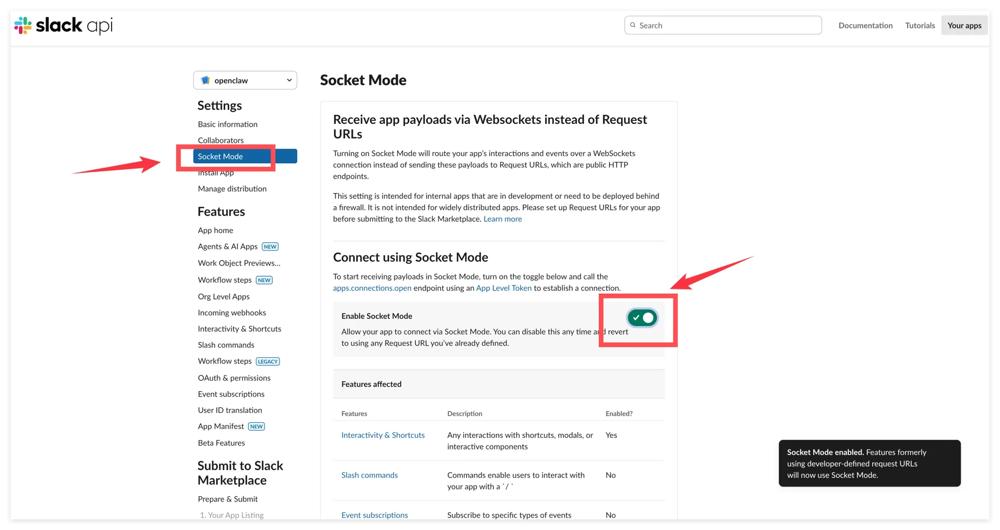

Mod Soket menghantar Slack acara kepada Hermes Agent melalui WebSocket. Persediaan ini tidak memerlukan URL Permintaan Langganan Acara atau URL Ubah Hala OAuth.

#### 4.2 Tambah Skop Token Bot

1. Buka **Ciri → OAuth & Kebenaran**.
2. Tatal ke **Skop → Skop Token Bot**.
3. Klik **Tambah Skop OAuth**.

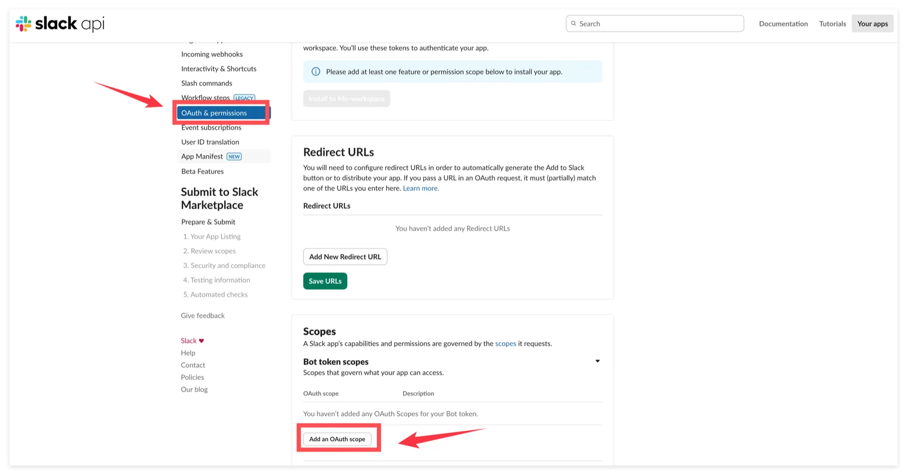

Tambahkan skop untuk mod interaksi yang anda perlukan:

| Skop | Diperlukan untuk | Tujuan |
|---|---|---|
| `app_mentions:read` | Penggunaan saluran | Terima mesej yang menyebut bot |
| `channels:read` | Saluran awam | Baca maklumat asas saluran awam |
| `channels:history` | Saluran awam | Baca mesej dalam saluran awam yang bot telah sertai |
| `chat:write` | Semua balasan | Hantar mesej sebagai bot |
| `im:read` | Mesej langsung | Baca maklumat perbualan mesej langsung |
| `im:history` | Mesej langsung | Baca mesej langsung yang dihantar ke bot |
| `im:write` | Mesej langsung | Buka atau urus perbualan mesej langsung |
| `groups:read` | Saluran peribadi pilihan | Baca maklumat saluran peribadi |
| `groups:history` | Saluran peribadi pilihan | Baca mesej dalam saluran peribadi yang bot telah sertai |

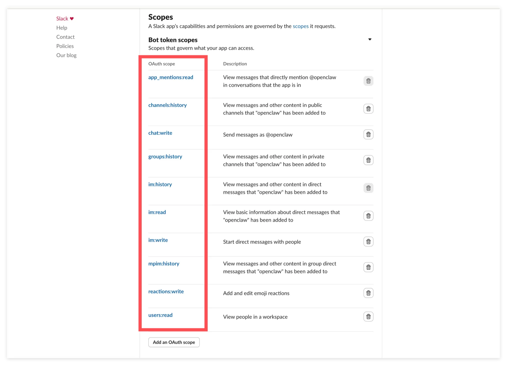

Hanya tambahkan dua skop `groups:*` apabila akses saluran peribadi diperlukan. Apl itu masih mesti dijemput ke setiap saluran sasaran.

#### 4.3 Dayakan mesej langsung dalam App Home

Jika pengguna boleh menghantar mesej terus kepada Hermes Agent:

1. Buka **Ciri → Laman Utama Apl**.
2. Tatal ke **Tunjukkan Tab**.
3. Dayakan **Tab Mesej**.
4. Dayakan pilihan yang membenarkan pengguna menghantar mesej daripada tab Mesej.

Jika anda hanya menggunakan sebutan saluran, anda boleh melangkau bahagian ini dan meninggalkan acara `im:*` skop dan `message.im`.

#### 4.4 Langgan acara bot

1. Buka **Ciri → Langganan Acara**.
2. Hidupkan **Dayakan Acara**.
3. Di bawah **Langgan acara bot**, klik **Tambah Acara Pengguna Bot**.
4. Tambahkan `app_mention` untuk sebutan saluran.
5. Tambahkan `message.im` jika mesej langsung didayakan.
6. Klik **Simpan Perubahan**.

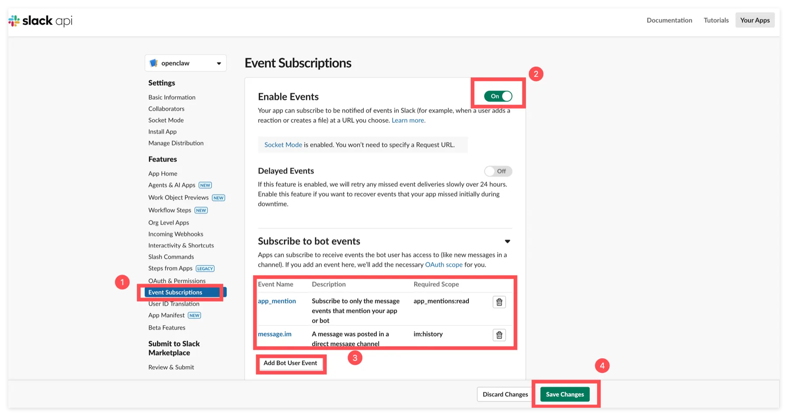

> Jika anda menukar skop atau acara selepas pemasangan, kembali ke **OAuth & Permissions** dan klik **Reinstall to Workspace**. Kebenaran baharu tidak berkuat kuasa sehingga apl dipasang semula.

### 5. Pasang apl dan salin Token Bot

1. Kembali ke **Ciri → OAuth & Kebenaran**.
2. Klik **Pasang ke Ruang Kerja**. Jika apl sudah dipasang, klik **Pasang Semula ke Ruang Kerja**.

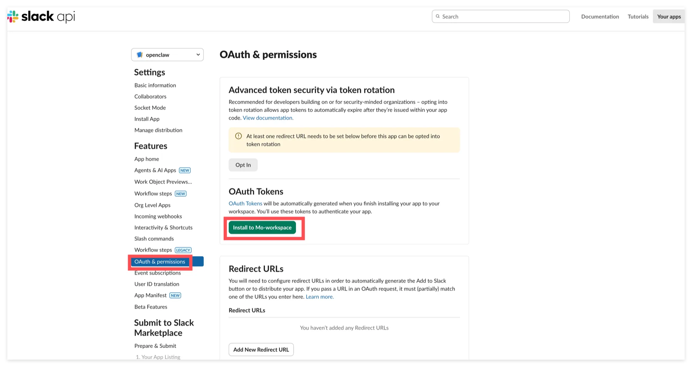

3. Semak kebenaran yang diminta dan klik **Benarkan**.

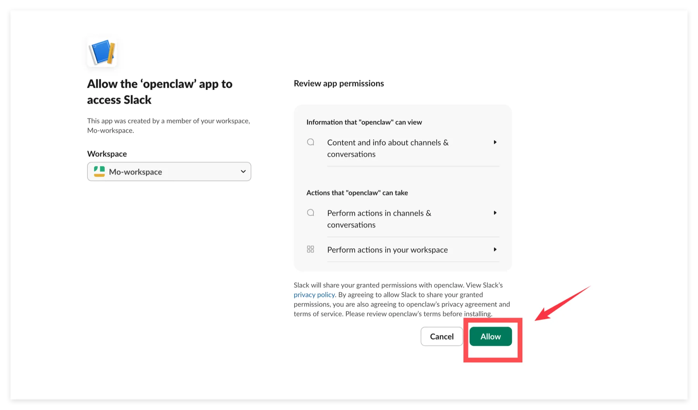

4. Selepas Slack kembali ke **OAuth & Permissions**, cari **Token OAuth untuk Ruang Kerja Anda**.
5. Salin **Token OAuth Pengguna Bot** yang bermula dengan `xoxb-`.

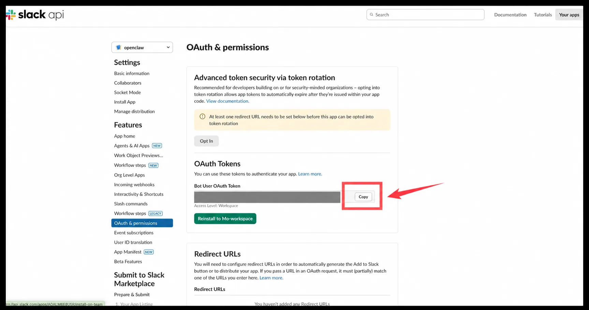

Jangan gunakan Rahsia Tandatangan, Rahsia Pelanggan, Token Pengesahan atau `xoxp-...` Token OAuth Pengguna. LightVela memerlukan satu `xapp-...` Token Apl dan satu `xoxb-...` Token Bot.

### 6. Ikat Slack dalam LightVela

1. Kembali ke **Saya Hermes → Saluran → Slack**.
2. Tampalkan token `xoxb-...` ke dalam **Slack Token Bot**.
3. Tampalkan token `xapp-...` ke dalam **Slack Token Aplikasi**.
4. Sahkan bahawa token berada dalam medan yang betul, kemudian serahkan sambungan.
5. Tunggu sehingga kad Slack ditunjukkan sebagai disambungkan.

### 7. Ujian Hermes Agent dalam Slack

#### 7.1 Uji sebutan saluran

1. Buka saluran Slack di mana anda ingin menggunakan Hermes Agent.
2. Jemput apl:

```text
/invite @Hermes Agent
```

3. Hantar mesej yang menyebut bot:

```text
@Hermes Agent Summarize the key points discussed in this channel today.
```

Bot hanya menerima mesej saluran selepas ia menyertai saluran itu.

#### 7.2 Uji mesej langsung

1. Buka apl baharu daripada bahagian **Apl** dalam Slack.
2. Pilih tab **Mesej**.
3. Hantar mesej ringkas seperti `Hello`.

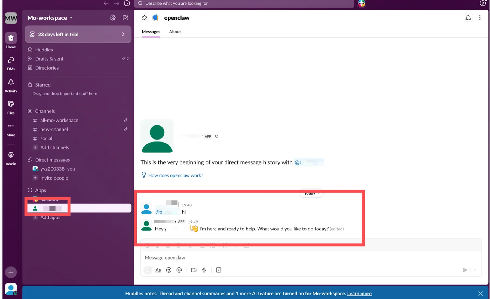

---

## Keadaan kejayaan

Persediaan selesai apabila semua semakan yang berkenaan lulus:

- Kad Slack dalam LightVela menunjukkan sebagai disambungkan.
- Apl Slack dipasang dalam ruang kerja sasaran.
- Hermes Agent membalas sebutan dalam saluran yang telah disertai oleh apl.
- Apabila kebenaran App Home dan IM didayakan, Hermes Agent membalas mesej langsung.

---

## Jenis mesej yang disokong

Selepas Slack disambungkan, saluran menyokong senario pemesejan ini:

| Slack jenis mesej | Disokong |
|---|---|
| Terima sebutan teks dalam saluran | ✅ Disokong |
| Terima teks mesej terus dalam App Home | ✅ Disokong |
| Balas dengan teks dalam saluran dan mesej langsung | ✅ Disokong |
| Hantar mesej proaktif, seperti pemberitahuan tugas berjadual | ✅ Disokong |

> ℹ️ **Pengendalian tugas sebenar bergantung pada model**
>
> Jadual ini menerangkan Slack sokongan pemesejan peringkat saluran. Ringkasan, terjemahan dan tugasan lain masih bergantung pada model yang dikonfigurasikan dan kemahiran yang dipasang.

---

## Soalan Lazim

| Isu | Kemungkinan punca | Resolusi |
|---|---|---|
| Token Apl ditolak | Jenis token yang salah atau tiada `connections:write` | Jana token `xapp-...` baharu di bawah **Maklumat Asas → Token Tahap Apl** |
| Token Bot ditolak | Token OAuth Pengguna atau bukti kelayakan lain telah disalin | Salin `xoxb-...` Token OAuth Pengguna Bot daripada **OAuth & Permissions** |
| Langganan Acara meminta URL Permintaan | Mod Soket dilumpuhkan | Dayakan **Tetapan → Mod Soket**, kemudian kembali ke Langganan Acara |
| Sebutan saluran tidak diterima | Apl tiada dalam saluran, skop tiada atau `app_mention` tiada | Jemput apl, tambahkan skop saluran dan `app_mention`, kemudian pasang semula apl |
| Mesej langsung tidak diterima | Tab Messages dilumpuhkan, skop IM tiada atau `message.im` tiada | Dayakan Tab Mesej, tambah `im:*` dan `message.im`, kemudian pasang semula apl |
| Keizinan baharu tidak berfungsi | Apl tidak dipasang semula selepas perubahan | Klik **Pasang Semula ke Ruang Kerja** di bawah **OAuth & Kebenaran** |
| Saluran disambungkan tetapi tiada balasan | Model tidak tersedia, kredit tidak mencukupi atau isu status Ejen | Semak [Konfigurasikan Model](./model.md), status contoh dan kredit tersedia |

---

## Langkah seterusnya

- [Konfigurasikan Saluran - Telegram](./channel-telegram.md) — Perbualan peribadi dan pemberitahuan kumpulan

- [Konfigurasikan Saluran - WhatsApp](./channel-whatsapp.md) — Komunikasi pengguna antarabangsa dan perkhidmatan pelanggan

- [Konfigurasikan Saluran - Discord](./channel-discord.md) — Operasi komuniti dan komuniti pembangun

- [Konfigurasikan Tugasan Berjadual](./automation.md) — Hantar peringatan berjadual dan hasil tugasan ke Slack

- [Konfigurasikan Kemahiran](./skill.md) — Lanjutkan Hermes keupayaan ejen
