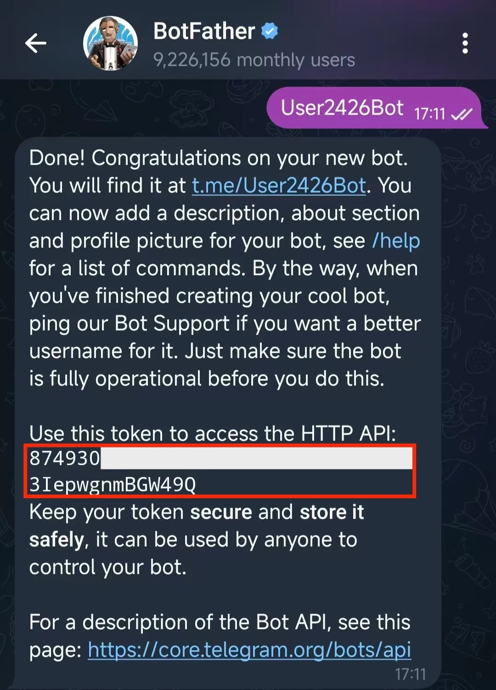
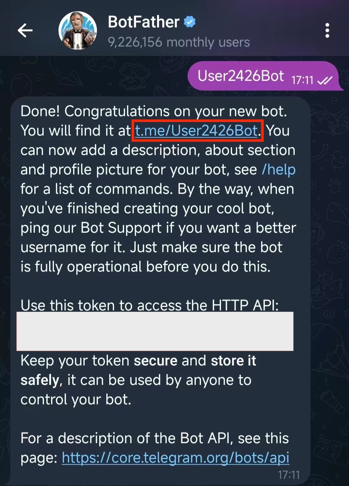

# Konfigurasi Saluran - Telegram

## Ringkasan

**Saluran Telegram bersambung dengan token bot, menjadikannya cara pantas untuk membawa Hermes Agent anda ke dalam Telegram mesej atau kumpulan langsung: buat bot melalui BotFather dalam Telegram, salin token botnya dan tampalkannya ke bahagian Saluran pada konsol LightVela. Anda memerlukan akaun Telegram dan model yang dikonfigurasikan (atau hanya kredit model bulanan yang disertakan dengan pelan anda). Token bot ialah bukti kelayakan yang sensitif — jangan sekali-kali berkongsinya secara terbuka. Setelah disambungkan, ejen dalam Telegram berkongsi persona dan ingatan jangka panjang yang sama seperti saluran anda yang lain.**

---

Saluran Telegram menggunakan akses Token Bot dan sesuai untuk menyambungkan Hermes Agent ke Telegram sembang atau kumpulan peribadi dengan cepat.

## Halaman ini meliputi

- Membenarkan akses dengan mengimbas kod atau membuka pautan dalam Telegram pada telefon anda

- Berbual dengan Hermes Agent di Telegram


> 💡 **Prasyarat**
>
> - Telefon dengan Telegram dipasang
>
> - Lengkapkan [konfigurasi model](./model.md) (atau gunakan 100 kredit percubaan yang disertakan dalam pelan Pelancaran)
>

---

## Langkah

### 1. Masukkan konsol

Log masuk ke LightVela, klik "Saya Hermes" di penjuru kanan sebelah atas untuk memasuki konsol dan cari butang "Saluran".

### 2. Pilih saluran Telegram

Cari kad Telegram dan klik "+ Sambung".

### 3. Buka Telegram

1. Buka apl Telegram pada telefon anda

2. Cari @BotFather dan buka sembang


3. Hantar `/start`

4. Hantar `/newbot`

5. Masukkan nama untuk ejen anda: nama pengguna mestilah unik dan berakhir dengan "bot"

6. Salin token HTTP API:




### 4. Tampalkan token HTTP API ke dalam Telegram

Tampalkan token HTTP API ke dalam medan token.


> ⚠️ **Pastikan token anda selamat**
>
> Simpan token dengan selamat. Sesiapa sahaja yang memperoleh token boleh mengawal bot anda!

### 5. Berbual dengan bot baharu dalam Telegram

Klik pautan yang disediakan oleh BotFather dan mula berinteraksi dengan bot.



Buka sembang dengan bot dan hantar mesej ujian:

```
Hi
```

Anda akan menerima Hermes balasan ejen dalam masa beberapa saat.


### 6. Pilihan: Dayakan mesej kumpulan dalam BotFather

Hanya lengkapkan langkah 6 dan 7 jika anda ingin menggunakan bot dalam kumpulan.
Mesej langsung sudah tersedia selepas langkah 5.

1. Buka `@BotFather` dalam Telegram.
2. Hantar `/mybots`.
3. Pilih Bot yang disambungkan ke Hermes Agent anda.
4. Buka "Tetapan Bot".
5. Pilih "Privasi Kumpulan".
6. Pilih "Matikan" atau "Lumpuhkan mod privasi".

### 7. Pilihan: Tambah dan uji Bot dalam kumpulan

1. Buka kumpulan Telegram yang anda mahu gunakan.
2. Pilih "Tambah Ahli" atau tindakan pengurusan kumpulan yang setara.
3. Cari Bot dengan nama penggunanya dan tambahkannya pada kumpulan.
4. Sebut dengan `@bot_username` dan hantar mesej ujian.

Selepas Privasi Kumpulan dilumpuhkan, bot boleh menerima dan membalas mesej kumpulan yang menyebutnya.

---

## Keadaan kejayaan

- Senarai "Saluran yang disambungkan" dalam konsol mengandungi "Telegram"

- Bot yang sepadan boleh didapati dalam Telegram kenalan

- Hermes Agent membalas selepas anda menghantar mesej

- Hermes Agent membalas selepas anda menyebut bot dan menghantar mesej dalam kumpulan yang telah ditambahkan


---

## Jenis mesej yang disokong

Selepas akses berjaya, bot Telegram boleh menerima dan membalas mesej teks asas dan menyokong lebih banyak jenis mesej seperti berikut:

| Jenis mesej disokong oleh Telegram bot | Disokong |
|---|---|
| Terima mesej teks | ✅ Disokong |
| Terima imej dan video | ✅ Disokong |
| Terima fail | ✅ Disokong |
| Balas dengan mesej teks | ✅ Disokong |
| Balas dengan imej dan video | ✅ Disokong |
| Balas dengan fail | ✅ Disokong |
| Hantar mesej secara proaktif (seperti peringatan berjadual) | ✅ Disokong |

> ℹ️ **Keupayaan pemprosesan sebenar bergantung pada model**
>
> Jadual di atas hanya menunjukkan jenis mesej yang disokong oleh bot Telegram pada lapisan saluran. Sama ada imej, fail dan tugas lain sebenarnya boleh diproses juga bergantung pada sama ada model bahasa besar yang disambungkan kepada Hermes Agent mempunyai keupayaan yang sepadan.

---

## Soalan Lazim

| Isu | Kemungkinan punca | Penyelesaian |
|---|---|---|
| BotFather tidak boleh mencipta bot | Nama bot atau nama pengguna tidak memenuhi keperluan Telegram | Nama paparan boleh apa-apa sahaja, tetapi nama pengguna mesti berakhir dengan `bot`, mis. `my_hermes_bot` |
| BotFather tidak mengembalikan token HTTP API | Aliran penciptaan tidak selesai | Kembali ke sembang BotFather, jalankan `/newbot` sekali lagi, dan ikut gesaan untuk menetapkan nama dan nama pengguna |
| Token ditunjukkan sebagai tidak sah selepas menampal | Token tidak lengkap atau mengandungi ruang tambahan / pemisah baris | Salin semula token HTTP penuh API daripada BotFather dan tampalkannya ke dalam medan token |
| Tiada jawapan selepas mengklik akses | Kelewatan rangkaian atau kebenaran tidak selesai | Muat semula konsol untuk mengesahkan status; jika akses tidak berjaya, cuba lagi |
| Tidak dapat mencari bot dalam Telegram | Anda tidak mengklik pautan yang disediakan oleh BotFather, atau tidak memulakan sembang | Klik pautan yang disediakan oleh BotFather, kemudian klik Mula pada halaman bot |
| Tiada balasan selepas menghantar mesej | Model tidak dikonfigurasikan, kredit percubaan telah habis, atau bot tidak berjaya disambungkan | Semak status "Model semasa" dalam kad "1. Model" dan sahkan saluran Telegram menunjukkan sebagai disambungkan |
| Bot tidak boleh menerima mesej kumpulan | Privasi Kumpulan masih didayakan, bot belum ditambahkan pada kumpulan atau mesej tidak menyebutnya | Dalam BotFather, hantar `/mybots`, pilih bot, kemudian buka "Tetapan Bot" → "Privasi Kumpulan" dan matikan mod privasi. Tambahkan bot pada kumpulan dan hantar mesej ujian dengan `@bot_username` |
| Bagaimana untuk menyahpaut | — | Padamkan rekod Telegram yang sepadan dalam senarai "Saluran yang disambungkan" |
| Bolehkah bot Telegram yang sama menyambung kepada berbilang Hermes contoh ejen | Tidak disyorkan; satu Token Bot hendaklah terikat kepada satu Hermes Agent | Jika anda memerlukan berbilang Hermes contoh ejen, cipta bot Telegram berasingan |

---

## Nota saluran

- **Jenis mesej**: Menyokong teks, imej, video, fail, mesej suara dan banyak lagi. Lihat "Jenis mesej yang disokong" di atas

- **Sokongan sembang kumpulan**: Mesej kumpulan disokong selepas anda melumpuhkan Privasi Kumpulan dalam BotFather, tambah bot pada kumpulan dan mulakan perbualan dengan `@bot_username`

- **Gangguan sambungan**: Tempoh lama tiada respons mungkin menunjukkan kebenaran telah dibatalkan. Kembali ke konsol dan benarkan akses sekali lagi

---

## Langkah seterusnya

- [Konfigurasikan Saluran - WhatsApp](./channel-whatsapp.md) — Komunikasi pengguna antarabangsa dan perkhidmatan pelanggan

- [Konfigurasikan Saluran - Discord](./channel-discord.md) — Operasi komuniti dan komuniti pembangun

- [Konfigurasikan Saluran - Slack](./channel-slack.md) — Kerjasama pasukan, pemberitahuan ruang kerja dan aliran kerja saluran

- [Konfigurasikan Saluran - QQ](./channel-qq.md) — Bot dibuat secara manual, disepadukan melalui AppID/AppSecret

- [Konfigurasikan Kemahiran](./skill.md) — Lanjutkan Hermes keupayaan ejen
