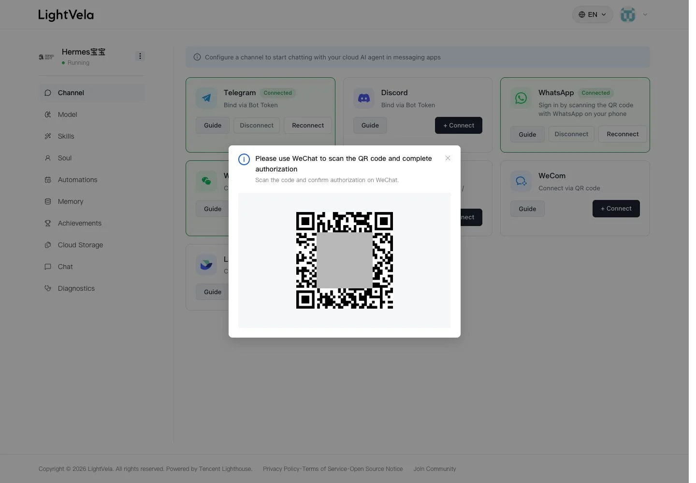

# Konfigurasikan Saluran - WeChat

## Ringkasan

**Saluran WeChat bersambung melalui kod QR dan merupakan saluran yang paling mudah untuk disediakan: pilih WeChat dalam bahagian Saluran konsol, klik untuk membenarkan dan menjana kod QR, kemudian imbasnya dengan WeChat pada telefon anda untuk mula bercakap. Anda hanya memerlukan dua perkara — telefon dengan WeChat dipasang dan model yang dikonfigurasikan (atau hanya kredit model bulanan yang disertakan dengan pelan anda). Seorang ejen boleh disambungkan ke beberapa saluran sekaligus, dan mereka semua berkongsi persona dan ingatan jangka panjang yang sama.**

---

Saluran WeChat menggunakan akses kod QR dan merupakan saluran paling mudah untuk dikonfigurasikan.

## Halaman ini meliputi

- Menjana WeChat akses kod QR dalam LightVela
    
- Mengimbas kod QR dengan WeChat pada telefon anda
    
- Berbual dengan Hermes Agent dalam WeChat
    

> 💡 **Prasyarat**
> 
> - Telefon dengan WeChat dipasang
>     
> - Lengkapkan [konfigurasi model](./model.md) (atau gunakan 100 kredit percubaan yang disertakan dalam pelan Pelancaran)
>

---

## Langkah

### 1. Masukkan konsol

Log masuk ke LightVela, klik "Saya Hermes" di penjuru kanan sebelah atas untuk memasuki konsol dan cari butang "Saluran".

### 2. Pilih saluran WeChat

Klik menu lungsur dan pilih "WeChat". Pengenalan saluran WeChat dan pautan "Lihat Butiran" muncul di bawah.

### 3. Klik "Izinkan Akses"

Kod QR muncul pada halaman.



> ⚠️ **Tamat tempoh kod QR**
> 
> Kod QR tamat tempoh selepas beberapa minit. Jika ia tamat tempoh, tutup dialog dan klik "Izinkan Akses" sekali lagi untuk menjana kod QR baharu.

### 4. Imbas dengan WeChat pada telefon anda

1. Buka WeChat pada telefon anda
    
2. Ketik "+" di penjuru kanan sebelah atas → "Imbas"
    
3. Imbas kod QR pada skrin komputer anda
    
4. Ikut gesaan pada telefon anda untuk melengkapkan kebenaran
    

### 5. Cari Hermes Agent di WeChat

Selepas imbasan berjaya:

- Dialog ditutup secara automatik, dan rekod "WeChat" ditambahkan pada senarai "Saluran yang disambungkan" dalam konsol
    
- WeChat menambah akaun bot secara automatik
    

Buka sembang dengan bot itu dan hantar mesej ujian:

```
Hi
```

Anda akan menerima Hermes balasan ejen dalam masa beberapa saat.


---

## Keadaan kejayaan

- Senarai "Saluran yang disambungkan" dalam konsol mengandungi "WeChat"
    
- Bot yang sepadan boleh didapati dalam WeChat kenalan
    
- Hermes Agent membalas selepas anda menghantar mesej
    

---

## Jenis mesej yang disokong

Selepas akses berjaya, bot WeChat boleh menerima dan membalas mesej teks asas dan menyokong lebih banyak jenis mesej seperti berikut:

| Jenis mesej disokong oleh WeChat bot | Disokong |
|---|---|
| Terima mesej teks | ✅ Disokong |
| Terima imej dan video | ✅ Disokong |
| Terima fail | ✅ Disokong |
| Terima mesej suara | ✅ Disokong |
| Balas dengan mesej teks | ✅ Disokong |
| Balas dengan imej dan video | ✅ Disokong |
| Balas dengan fail | ✅ Disokong |
| Hantar mesej secara proaktif (seperti peringatan berjadual) | ✅ Disokong |

> ℹ️ **Keupayaan pemprosesan sebenar bergantung pada model**
> 
> Jadual di atas hanya menunjukkan jenis mesej yang disokong oleh bot WeChat pada lapisan saluran. Sama ada imej, fail dan tugas lain sebenarnya boleh diproses juga bergantung pada sama ada model bahasa besar yang disambungkan kepada Hermes Agent mempunyai keupayaan yang sepadan.

---

## Soalan Lazim

| Isu | Kemungkinan punca | Penyelesaian |
|---|---|---|
| WeChat menunjukkan "kod QR tidak sah" selepas mengimbas | Kod QR telah tamat tempoh | Tutup dialog dan klik "Izinkan Akses" sekali lagi |
| Tiada respons pada komputer selepas mengimbas | Kelewatan rangkaian atau kebenaran tidak selesai | Muat semula konsol untuk mengesahkan status; jika akses tidak berjaya, cuba lagi |
| Tidak dapat mencari kenalan bot dalam WeChat | Mesej dilipat menjadi "Pemberitahuan Perkhidmatan" | Cari "LightVela" atau Hermes nama ejen di bahagian atas WeChat |
| Tiada balasan selepas menghantar mesej | Model tidak dikonfigurasikan atau kredit percubaan telah habis | Semak status "Model semasa" dalam kad "1. Model" |
| Bagaimana untuk menyahpaut | — | Padamkan rekod yang sepadan dalam senarai "Saluran yang disambungkan" |
| Bolehkah akaun WeChat yang sama disambungkan kepada berbilang Hermes contoh ejen | Had pelan pelancaran ialah 1 Hermes Agent | Tidak berkenaan |

---

## Nota saluran

- **Jenis mesej**: Menyokong teks, imej, video, fail, mesej suara dan banyak lagi. Lihat "Jenis mesej yang disokong" di atas
    
- **Sokongan sembang kumpulan**: Sembang kumpulan tidak disokong pada masa ini; hanya 1-ke-1 perbualan disokong
    
- **Gangguan sambungan**: Tempoh lama tiada respons mungkin menunjukkan kebenaran telah dibatalkan. Kembali ke konsol dan benarkan akses sekali lagi
    

---

## Langkah seterusnya

- [Konfigurasikan Saluran - Telegram](./channel-telegram.md) — Pemberitahuan ringan dan komunikasi merentas platform

- [Konfigurasikan Saluran - WhatsApp](./channel-whatsapp.md) — Komunikasi pengguna antarabangsa dan perkhidmatan pelanggan

- [Konfigurasikan Saluran - Discord](./channel-discord.md) — Operasi komuniti dan komuniti pembangun

- [Konfigurasikan Saluran - Slack](./channel-slack.md) — Kerjasama pasukan, pemberitahuan ruang kerja dan aliran kerja saluran

- [Konfigurasikan Kemahiran](./skill.md) — Lanjutkan Hermes keupayaan ejen
