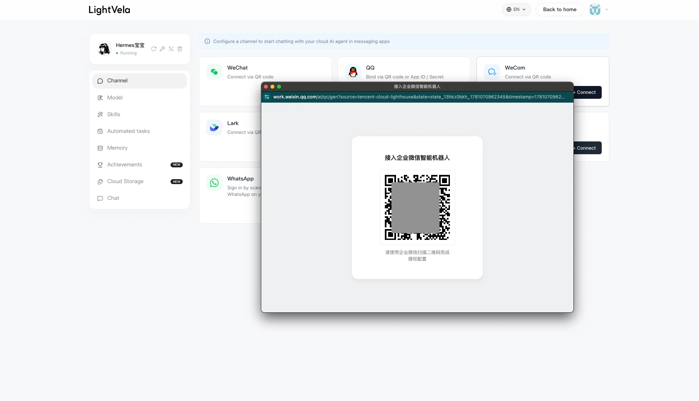
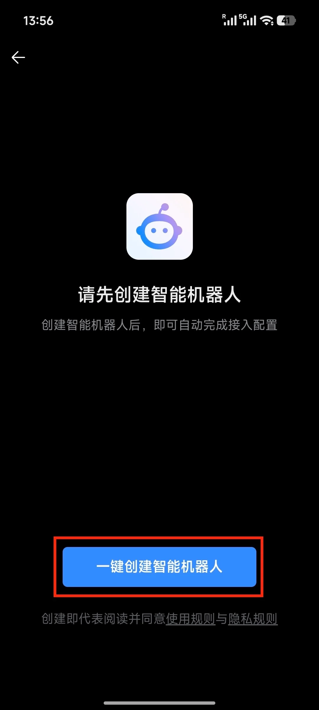
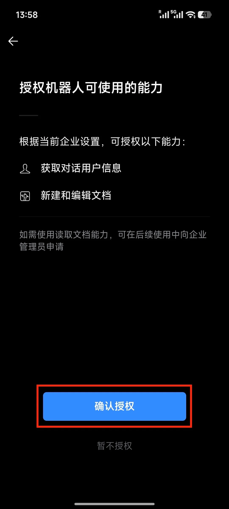
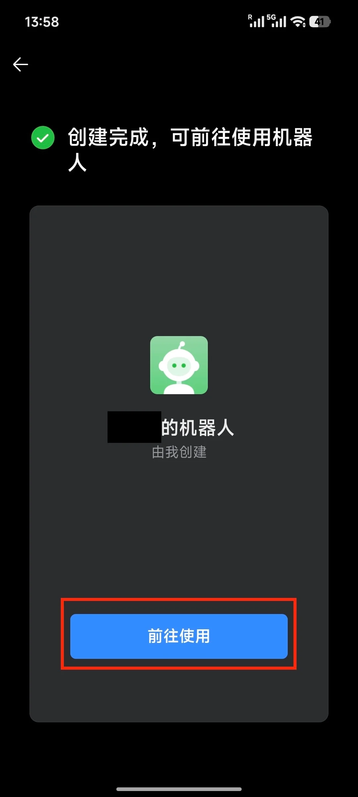
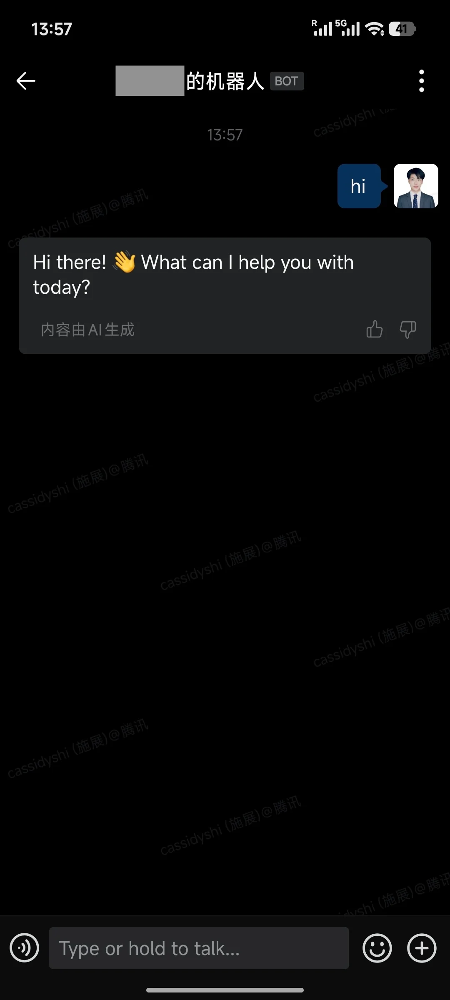

# Konfigurasi Saluran - WeCom

## Ringkasan

**Saluran WeCom bersambung melalui kod QR dan, bersama-sama WeChat, yang paling mudah untuk disediakan — sesuai untuk menggunakan Hermes Agent di tempat kerja korporat: pilih WeCom dalam bahagian Saluran konsol, klik untuk membenarkan dan menjana kod QR, kemudian imbasnya dengan WeCom pada telefon anda. Anda memerlukan telefon dengan WeCom dipasang dan model yang dikonfigurasikan (atau hanya kredit model bulanan yang disertakan dengan pelan anda). Seorang ejen boleh disambungkan ke beberapa saluran sekaligus, berkongsi persona dan ingatan jangka panjang yang sama.**

---

Saluran WeCom menggunakan akses kod QR dan merupakan saluran paling mudah untuk dikonfigurasikan.

## Halaman ini meliputi

- Menjana WeCom akses kod QR dalam LightVela

- Mengimbas kod QR dengan WeCom pada telefon anda

- Berbual dengan Hermes Agent dalam WeCom


> 💡 **Prasyarat**
>
> - Telefon dengan WeCom dipasang
>
> - Lengkapkan [konfigurasi model](./model.md) (atau gunakan 100 kredit percubaan yang disertakan dalam pelan Pelancaran)
>

---

## Langkah

### 1. Masukkan konsol

Log masuk ke LightVela, klik "Saya Hermes" di penjuru kanan sebelah atas untuk memasuki konsol dan cari butang "Saluran".

### 2. Pilih saluran WeCom

Cari modul WeCom dan klik "+ Sambung".

### 3. Klik "Izinkan Akses"

Kod QR muncul pada halaman.



> ⚠️ **Tamat tempoh kod QR**
>
> Kod QR tamat tempoh selepas beberapa minit. Jika ia tamat tempoh, tutup dialog dan klik "Izinkan Akses" sekali lagi untuk menjana kod QR baharu.

### 4. Imbas dengan WeCom pada telefon anda

1. Buka WeCom pada telefon anda

2. Ketik "+" di penjuru kanan sebelah atas → "Imbas"

3. Imbas kod QR pada skrin komputer anda




4. Ikut gesaan pada telefon anda untuk melengkapkan kebenaran





### 5. Berbual dengan bot yang dibuat

Selepas imbasan berjaya:

- Dialog ditutup secara automatik dan anda akan dibawa ke halaman bot yang dibuat

- WeCom menambah bot secara automatik pada kenalan anda


Buka tetingkap sembang bot dan hantar mesej ujian:

```
Hello
```

Anda akan menerima Hermes balasan ejen dalam beberapa saat.



---

## Keadaan kejayaan

- Entri "WeCom" muncul dalam senarai "Saluran Bersambung" konsol

- Bot boleh didapati dalam WeCom kenalan anda

- Menghantar mesej menerima Hermes balasan ejen


---

## Jenis mesej yang disokong

Selepas penyepaduan, bot WeCom menyokong lebih daripada teks asas. Senarai penuh:

| WeCom bot — jenis mesej yang disokong | Disokong |
| --- | --- |
| Terima mesej teks | ✅ Ya |
| Terima imej / video | ✅ Ya |
| Terima fail | ✅ Ya |
| Terima mesej suara | ✅ Ya |
| Balas dengan mesej teks | ✅ Ya |
| Balas dengan imej / video | ✅ Ya |
| Balas dengan fail | ✅ Ya |
| Hantar mesej secara proaktif (cth. peringatan berjadual) | ✅ Ya |

> ℹ️ **Keupayaan sebenar bergantung pada model**
>
> Jadual di atas hanya menggambarkan perkara yang boleh diterima dan dibalas oleh bot WeCom pada lapisan saluran. Sama ada tugas seperti pemprosesan imej / fail benar-benar berfungsi bergantung pada sama ada LLM asas yang disambungkan ke Hermes Agent menyokong keupayaan tersebut.

---

## Soalan Lazim

| Gejala | Kemungkinan punca | Resolusi |
| --- | --- | --- |
| WeCom menunjukkan "Kod QR tidak sah" selepas mengimbas | Kod QR telah tamat tempoh | Tutup dialog dan klik "Izinkan Akses" sekali lagi |
| Tiada respons pada desktop selepas mengimbas | Kelewatan rangkaian atau kebenaran belum selesai | Muat semula halaman konsol untuk mengesahkan status; jika tidak disambungkan, cuba semula |
| Kenalan bot tidak ditemui dalam WeCom | Mesej runtuh di bawah "Pemberitahuan Perkhidmatan" | Cari "LightVela" atau Hermes nama Ejen anda dari atas WeCom |
| Tiada balasan selepas menghantar mesej | Model tidak dikonfigurasikan atau kredit percubaan habis | Semak status "Model Semasa" pada kad "1. Model" |
| Bagaimana untuk memutuskan sambungan | — | Padamkan entri daripada senarai "Saluran Bersambung" |
| Bolehkah satu akaun WeCom bersambung ke berbilang Hermes contoh ejen | Pelan Pelancaran menghadkan anda pada 1 Hermes Agent | Tidak berkenaan |

---

## Nota saluran

- **Jenis mesej**: Teks, imej, video, fail, suara dan banyak lagi — lihat "Jenis mesej yang disokong" di atas

- **Sokongan sembang kumpulan**: Sembang kumpulan tidak disokong buat masa ini; hanya perbualan 1 dengan 1 berfungsi

- **Sambungan terputus**: Tempoh lama tidak bertindak balas biasanya bermakna kebenaran telah dibatalkan — beri kebenaran semula daripada konsol


---

## Langkah seterusnya

- [Konfigurasikan Saluran - Lark](./channel-feishu.md) — Senario pejabat dengan teks kaya dan sembang kumpulan

- [Konfigurasikan Kemahiran](./skill.md) — Lanjutkan Hermes keupayaan ejen
