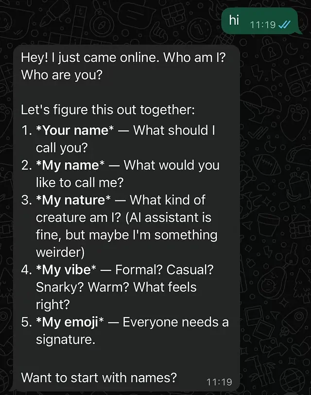

# Konfigurasikan Saluran - WhatsApp

## Ringkasan

**Saluran WhatsApp bersambung melalui kod QR, sama seperti WeChat, menjadikannya cara pantas untuk membawa Hermes Agent anda ke dalam WhatsApp perbualan: pilih WhatsApp dalam bahagian Saluran konsol, jana kod QR dan imbasnya dengan WhatsApp pada telefon anda untuk mula bercakap. Anda memerlukan telefon dengan WhatsApp dipasang dan model yang dikonfigurasikan (atau hanya kredit model bulanan yang disertakan dengan pelan anda). Seorang ejen boleh disambungkan ke beberapa saluran sekaligus, berkongsi persona dan ingatan jangka panjang yang sama.**

---

Saluran WhatsApp menggunakan akses kod QR, serupa dengan WeChat, dan sesuai untuk menyambung Hermes Agent kepada WhatsApp perbualan dengan cepat.

## Halaman ini meliputi

- Mengimbas kod QR dengan WhatsApp pada telefon anda untuk membenarkan akses

- Berbual dengan Hermes Agent di WhatsApp


> 💡 **Prasyarat**
>
> - Telefon dengan WhatsApp dipasang
>
> - Lengkapkan [konfigurasi model](./model.md) (atau gunakan 100 kredit percubaan yang disertakan dalam pelan Pelancaran)
>

---

## Langkah

### 1. Masukkan konsol

Log masuk ke LightVela, buka Ejen anda, dan pilih **Saluran** di bar sisi.

### 2. Pilih saluran WhatsApp

Cari kad WhatsApp dan klik "+ Sambung".

Dalam satu instans LightVela, WhatsApp hanya boleh disambungkan kepada satu Bot pada satu masa. Jika Bot lain sudah memilikinya, buka Bot itu dari notis dan putuskan sambungan WhatsApp sebelum menyambungkan di sini.

### 3. Imbas kod QR di WhatsApp

Gunakan WhatsApp pada telefon anda untuk mengimbas kod yang ditunjukkan oleh LightVela, kemudian ikut arahan dalam WhatsApp untuk memberi kebenaran pada sesi yang dipautkan. Jika kod QR tamat tempoh, cipta yang baru dari kad WhatsApp. Kembali ke **Saluran** dan sahkan bahawa WhatsApp menunjukkan sebagai disambungkan.

### 4. Cari diri anda dalam WhatsApp


Sembang dengan diri sendiri — itu bot anda.

Buka sembang dengan bot dan hantar mesej ujian:

```
Hi
```

Anda akan menerima Hermes balasan ejen dalam masa beberapa saat.



---

## Keadaan kejayaan

- Senarai "Saluran yang disambungkan" dalam konsol mengandungi "WhatsApp"

- Bot yang sepadan boleh didapati dalam WhatsApp kenalan

- Hermes Agent membalas selepas anda menghantar mesej


---

## Jenis mesej yang disokong

Selepas akses berjaya, bot WhatsApp boleh menerima dan membalas mesej teks asas dan menyokong lebih banyak jenis mesej seperti berikut:

| Jenis mesej disokong oleh WhatsApp bot | Disokong |
|---|---|
| Terima mesej teks | ✅ Disokong |
| Terima imej dan video | ✅ Disokong |
| Terima fail | ✅ Disokong |
| Balas dengan mesej teks | ✅ Disokong |
| Balas dengan imej dan video | ✅ Disokong |
| Balas dengan fail | ✅ Disokong |
| Hantar mesej secara proaktif (seperti peringatan berjadual) | ✅ Disokong |

> ℹ️ **Keupayaan pemprosesan sebenar bergantung pada model**
>
> Jadual di atas hanya menunjukkan jenis mesej yang disokong oleh bot WhatsApp pada lapisan saluran. Sama ada imej, fail dan tugas lain sebenarnya boleh diproses juga bergantung pada sama ada model bahasa besar yang disambungkan kepada Hermes Agent mempunyai keupayaan yang sepadan.

---

## Soalan Lazim

| Isu | Apa yang perlu diperiksa | Langkah seterusnya |
|---|---|---|
| Kod QR tidak boleh diimbas atau telah luput | Sambungan telefon dan kod QR semasa | Hasilkan kod baru dari kad WhatsApp dan ikuti arahan WhatsApp semasa. |
| Sambungan tidak muncul | Sama ada kebenaran telah selesai pada telefon | Kembali ke **Channels**, segarkan sekali, dan sambungkan semula jika masih menunjukkan tidak bersambung. |
| Tiada balasan selepas mesej | Status ejen, saluran yang disambungkan, dan kredit model | Semak **Channels** dan [Diagnostics](./diagnostics.md); semak [pilihan kredit](../credits.md) jika perlu. |
| Mesej berjadual tidak sampai | Sambungan saluran dan keputusan run tugas | Semak run terbaru tugas dalam [Scheduled Tasks](./automation.md) dan destinasi notifikasinya. |
| Bot lain sudah memiliki WhatsApp | WhatsApp terhad kepada satu Bot dalam instans ini | Putuskan sambungan dari Bot semasa sebelum menyambungkannya ke Bot lain. |

---

## Nota saluran

- **Jenis mesej**: Menyokong teks, imej, video, fail, mesej suara dan banyak lagi. Lihat "Jenis mesej yang disokong" di atas

- **Sokongan sembang kumpulan**: Sembang kumpulan tidak disokong pada masa ini; hanya 1-ke-1 perbualan disokong

- **Gangguan sambungan**: Tempoh lama tiada respons mungkin menunjukkan kebenaran telah dibatalkan. Kembali ke konsol dan benarkan akses sekali lagi

---

## Langkah seterusnya

- [Konfigurasikan Saluran - Discord](./channel-discord.md) — Operasi komuniti dan komuniti pembangun

- [Konfigurasikan Saluran - Slack](./channel-slack.md) — Kerjasama pasukan, pemberitahuan ruang kerja dan aliran kerja saluran

- [Konfigurasikan Saluran - QQ](./channel-qq.md) — Bot dibuat secara manual, disepadukan melalui AppID/AppSecret

- [Konfigurasikan Saluran - WeCom](./channel-wecom.md) — Kerjasama dalaman perusahaan dan senario pejabat

- [Konfigurasikan Kemahiran](./skill.md) — Lanjutkan Hermes keupayaan ejen
