# DeepSeek Harness

## Ringkasan

**DeepSeek Harness ialah rangka kerja ejen AI yang diutamakan pemalam yang boleh anda pasang bersama Hermes Agent dalam LightVela. Halaman Labs mengurus pemasangan, status, mulakan semula, akses WebUI, kunci pembekal model yang disokong dan profil dengan SkillHub, tanpa mengubah konfigurasi, saluran, kemahiran atau memori Hermes sedia ada anda. Untuk persediaan pembekal model yang digunakan oleh Hermes Agent, lihat [Konfigurasikan Model](./model.md).**

Notis beta: DeepSeek Harness ialah ciri Makmal akses awal. Ia mungkin menerima kemas kini yang menjejaskan keserasian apabila rangka kerja huluan dan ekosistem pemalamnya berkembang.

## Apa DeepSeek Harness Tambah

DeepSeek Harness (DSH) ialah abah-abah ejen sumber terbuka yang memberikan model AI persekitaran dan alatan yang mereka perlukan untuk menjalankan tugas sebenar.
Dalam LightVela, DSH berjalan sebagai persekitaran terurus yang berasingan bersama Hermes Agent, tempat anda boleh bekerja dengan fail projek, menggunakan alatan dan kemahiran, mengurus sesi dan berinteraksi dengan ejen melalui WebUInya.

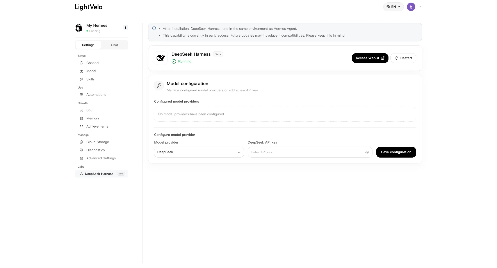

LightVela menyediakan titik masuk terurus untuk DSH.
Anda tidak perlu memasang pakej secara manual, mengkonfigurasi alamat pelayan awam, atau mengendalikan perkhidmatan DSH dari terminal.
Daripada halaman "DeepSeek Harness" dalam Makmal, anda boleh memasang masa jalan terurus, menyemak sama ada ia sihat, mengkonfigurasi pembekal model yang diluluskan, membuka WebUI khusus tika dan mulakan semula DSH apabila diperlukan.

## Pasang DeepSeek Harness

1. Buka [LightVela Ejen](https://lightvela.ai/agents/).
2. Dalam navigasi kiri, pergi di bawah Makmal dan pilih DeepSeek Harness.
3. Semak notis Beta dan pilih Pasang dan cuba sekarang.
4. Pastikan halaman terbuka semasa pemasangan berjalan.
   Pemasangan biasa biasanya mengambil masa kira-kira satu hingga tiga minit.

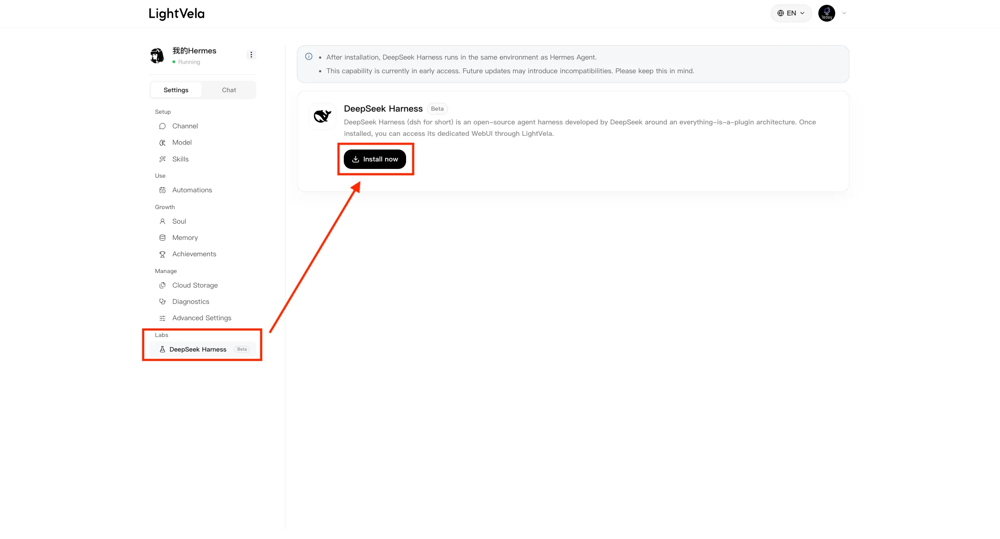

## Konfigurasikan Pembekal Model

Selepas DeepSeek Harness dipasang, kad Konfigurasi Model tersedia di bawah kad DSH utama.
Untuk tapak global, senarai pembekal semasa yang diluluskan termasuk:

- DeepSeek
- MiniMax
- MiniMax China
- Moonshot AI
- Moonshot AI China
- OpenRouter
- Anthropic
- Groq
- OpenAI

Untuk menambah pembekal:

1. Pilih pembekal daripada senarai pembekal.
2. Tampal kekunci APInya ke dalam medan Kekunci API.
3. Pilih Simpan.
4. Sahkan bahawa pembekal muncul dalam senarai pembekal yang dikonfigurasikan.

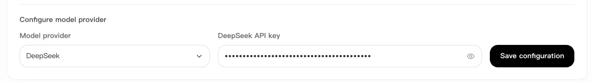

Untuk mengalih keluar pembekal, pilih tindakan pemadamannya dan sahkan pengalihan keluar.
Selepas dialih keluar, anda boleh menambah pembekal yang sama sekali lagi kemudian dengan kunci API baharu.

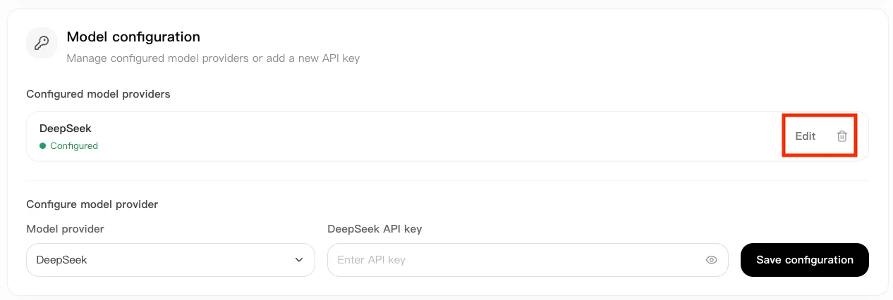

## Buka DeepSeek Harness WebUI

Apabila status perkhidmatan sedang berjalan, pilih Akses WebUI daripada kad DeepSeek Harness.

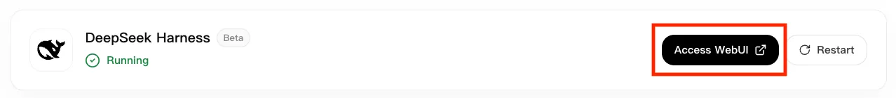

LightVela menyediakan domain akses khusus dan pengesahan identiti terbina dalam untuk DeepSeek Harness WebUI, memastikan bahawa WebUI anda hanya boleh diakses oleh anda.
Setelah disahkan, anda boleh membuka WebUI untuk contoh Ejen semasa anda dan mulakan dengan ujian mudah menggunakan pembekal yang telah anda konfigurasikan.
Jika anda perlu menguji Hermes Agent sedia ada secara berasingan, gunakan [Sembang](./agent-chat.md).

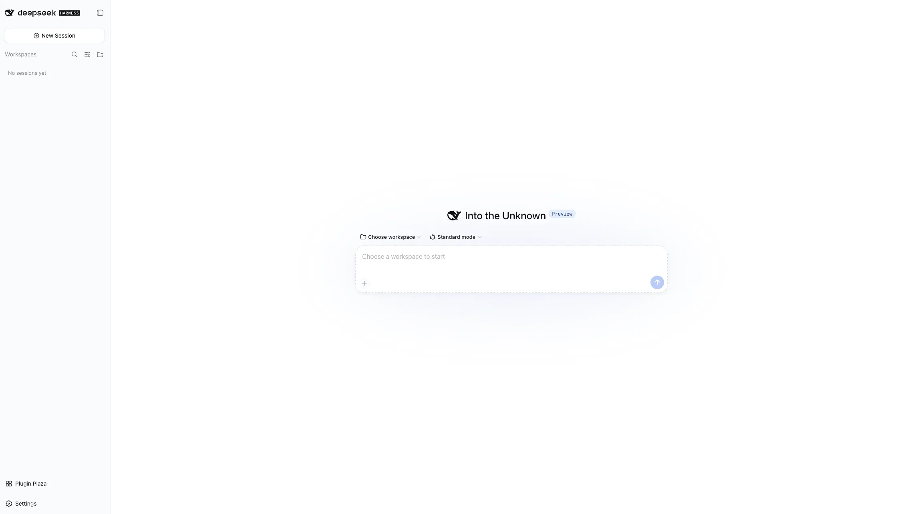

## Fahami Pemalam

DeepSeek Harness menggunakan seni bina yang mengutamakan pemalam.
Pemalam membekalkan keupayaan atau penyepaduan kepada profil DSH, seperti katalog kemahiran, penyambung pemesejan atau komponen masa jalan yang lain.
Anda boleh melawati Plugin Plaza dengan mengklik Plugin Plaza di bahagian bawah sebelah kiri halaman DSH anda.

### Memasang dan menggunakan pemalam

Daripada Plugin Plaza, anda boleh menerokai keupayaan tambahan untuk persekitaran DeepSeek Harness anda, seperti alatan penyemak imbas, memori, automasi, peningkatan UI dan penyepaduan luaran.

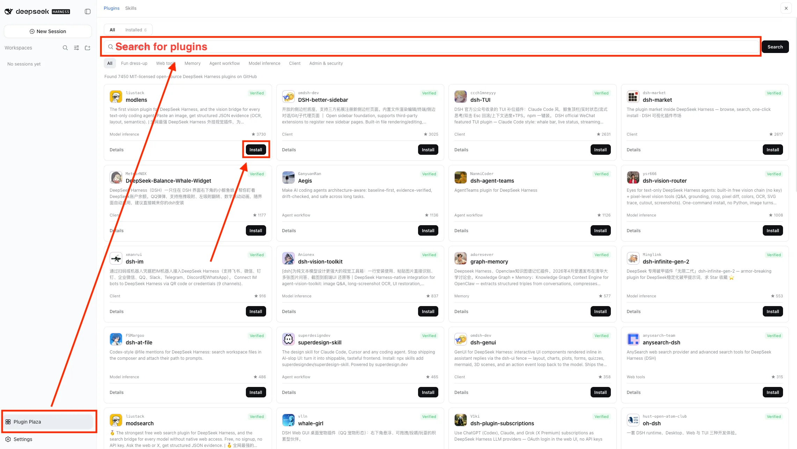

Buka pemalam untuk menyemak perkara yang ditambahkan, kemudian pasang pemalam yang ingin anda gunakan.
Selepas memasang pemalam, ia boleh digunakan terus di ruang kerja tanpa menyebutnya secara jelas.
Untuk kemahiran LightVela-terurus Hermes, lihat [Konfigurasikan Kemahiran](./skill.md).

### Menyemak imbas pemalam yang dipasang

Anda boleh melihat senarai pemalam dalam DSH WebUI > Plugin Plaza > Dipasang.

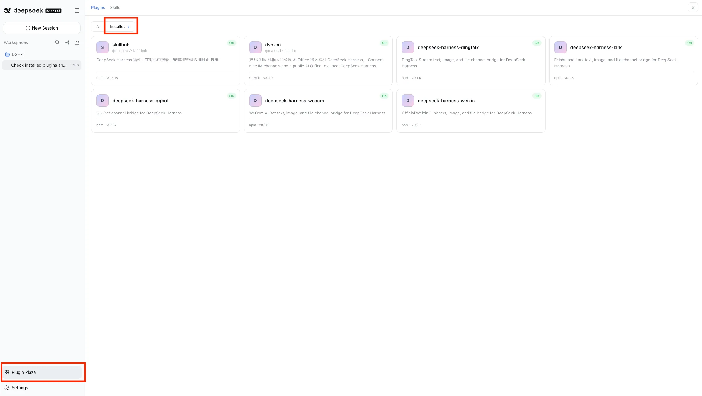

## Gunakan Ruang Kerja

Ruang Kerja ialah direktori projek yang DeepSeek Harness berfungsi semasa sesi anda.
Daripada WebUI, klik pada ikon Tambah Ruang Kerja untuk membuka direktori ruang kerja.

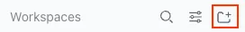

Setelah dipilih, anda boleh mencipta folder baharu atau memilih folder sedia ada daripada persekitaran DSH yang dihoskan awan anda dan menetapkannya sebagai ruang kerja untuk projek anda.
Ejen kemudiannya boleh menggunakan fail dalam ruang kerja itu untuk memahami projek anda, mengedit fail, menjalankan arahan dan menjalankan tugas dalam ruang kerja awan tersebut.

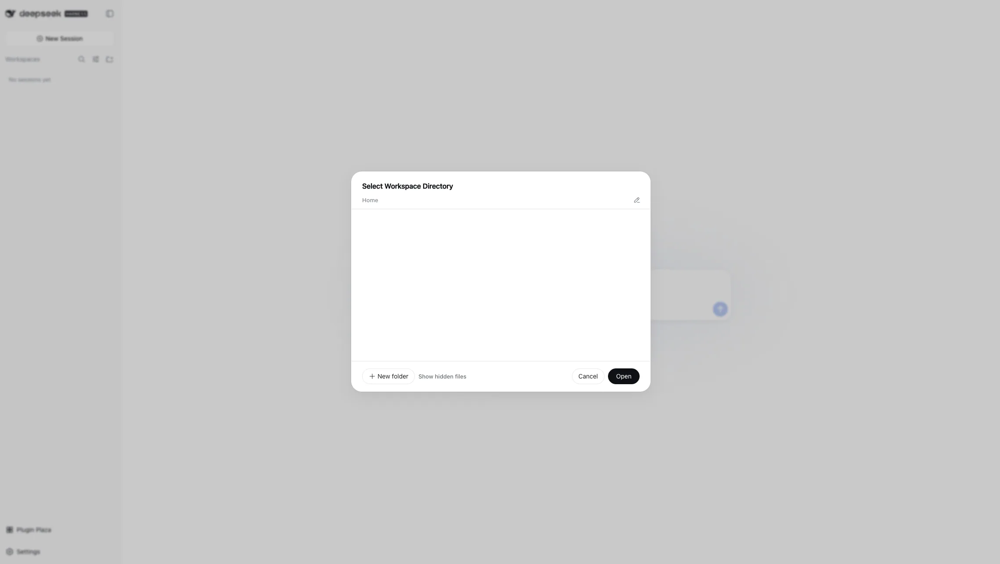

Ruang kerja juga membantu memastikan projek dan sesi mereka teratur.
Sesi yang dibuat untuk ruang kerja dikaitkan dengan direktori itu, jadi anda boleh kembali ke projek yang sama dan terus bekerja dengan sejarah sesi yang berkaitan.
Operasi yang memerlukan kebenaran tambahan masih tertakluk pada dasar kebenaran DSH yang aktif dan mungkin meminta kelulusan anda dalam WebUI.
Untuk LightVela pengurusan fail di luar DSH, lihat [Cloud Storage](./files.md).

## Mulakan semula DeepSeek Harness

Gunakan Mulakan Semula apabila DSH dipasang tetapi perlu memuat semula selepas perubahan konfigurasi atau pulih daripada keadaan tidak sihat.
Tindakan mulakan semula hanya digunakan pada perkhidmatan DeepSeek Harness.
Hermes Agent terus berjalan secara bebas.

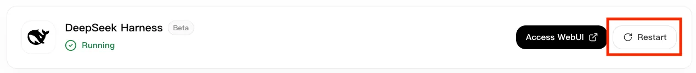

## Masalah Biasa

| Gejala | Berkemungkinan menyebabkan | Apa yang perlu dilakukan |
| --- | --- | --- |
| Pemasangan tidak selesai | Tugas pemasangan terurus tidak berjaya diselesaikan | Semak ralat pada halaman, tunggu sebentar, kemudian cuba semula dari halaman DeepSeek Harness. |
| WebUI tidak membuka | Perkhidmatan tidak sedia, atau sesi semasa tidak mempunyai akses contoh | Sahkan bahawa DSH ditunjukkan sebagai berjalan, kemudian buka semula WebUI daripada halaman Labs semasa log masuk. |
| Model tidak boleh menjawab permintaan | Tiada pembekal dikonfigurasikan, kunci tidak sah atau akaun pembekal tidak tersedia | Semak senarai pembekal yang dikonfigurasikan, kemas kini kekunci API jika perlu, dan jalankan permintaan mudah sekali lagi. |
| Kunci API yang disimpan tidak kelihatan | Ini adalah tingkah laku yang dijangka | Kekunci API adalah tulis sahaja. Biarkan medan kosong untuk menyimpan kunci yang disimpan, atau masukkan kunci baharu untuk menggantikannya. |
| Saluran tidak disambungkan | Pemalam itu wujud, tetapi konfigurasi akaunnya tidak lengkap | Konfigurasikan dan benarkan saluran dalam DSH WebUI. |
| DSH kelihatan tidak sihat selepas perubahan | Perkhidmatan mungkin perlu memuat semula | Gunakan Mulakan Semula, tunggu keadaan berjalan, kemudian sahkan WebUI dan pembekal sekali lagi. |

## Sempadan Semasa

DeepSeek Harness dalam LightVela direka bentuk sebagai keupayaan Makmal terurus.
Ia menyediakan pemasangan, status, mulakan semula, bukti kelayakan pembekal yang diluluskan dan titik masuk WebUI terkawal.

Halaman Makmal semasa tidak menyokong pemasangan pakej sewenang-wenangnya, muat naik pemalam tersuai, akses port rangkaian mentah, titik akhir pembekal tersuai, protokol pembekal tersuai atau pengeditan parameter model lanjutan.
Sempadan ini memastikan contoh terurus boleh diramal semasa ciri itu masih dalam Beta.

Gunakan DeepSeek Harness apabila anda ingin menerokai persekitaran ejen berasaskan pemalam, penyepaduan SkillHub dan komponen saluran yang disokong tanpa mengubah persediaan Hermes Agent sedia ada anda.

## Soalan Lazim

### Adakah DeepSeek Harness menggantikan Hermes Agent?

Tidak.
Ia berjalan sebagai perkhidmatan berasingan bersama Hermes.
Memori Hermes sedia ada anda, kemahiran, saluran dan konfigurasi kekal tidak berubah.

### Mengapa saya tidak dapat melihat kunci API saya yang disimpan?

Kekunci API adalah tulis sahaja.
Biarkan medan kosong untuk menyimpan kunci sedia ada, atau masukkan kunci baharu untuk menggantikannya.

### Bolehkah saya menambah mana-mana pembekal, model atau URL Pangkalan tersuai?

Halaman LightVela Labs pada masa ini hanya menyokong pembekal yang ditunjukkan dalam pemilihnya.
Untuk konfigurasi model tambahan, termasuk model tersuai atau URL Pangkalan, anda boleh mengurusnya terus daripada DeepSeek Harness WebUI.

### Adakah DeepSeek Harness kemahiran sama dengan Hermes kemahiran?

Tidak.
DeepSeek Harness dan Hermes Agent adalah persekitaran yang berasingan.
Memasang DeepSeek Harness tidak secara automatik menyalin Hermes kemahiran ke dalam DSH, dan pemalam DSH atau konfigurasi kemahiran tidak mengubah persediaan Hermes anda.

### Mengapakah DeepSeek Harness ditanda Beta?

Ia ialah ciri Makmal akses awal.
Kemas kini kepada DSH atau pemalamnya mungkin memperkenalkan perubahan keserasian, jadi sahkan aliran kerja anda selepas kemas kini.
