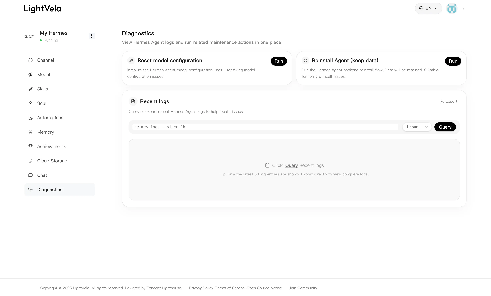
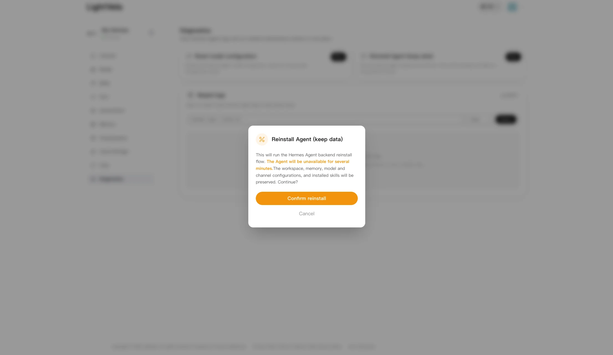

# Diagnostik

## Ringkasan

**Pusat diagnostik ialah tempat anda menyelesaikan masalah Hermes Agent yang berkelakuan buruk. Di satu tempat anda boleh melihat dan mengeksport log terbaharu, menetapkan semula konfigurasi model atau memasang semula ejen sambil menyimpan data anda. Apabila ejen berhenti membalas, membalas secara pelik atau sambungan saluran gagal, semak di sini dahulu: baca log untuk menentukan sama ada ia adalah panggilan model yang gagal, saluran yang digugurkan atau ralat kemahiran, kemudian ambil tindakan yang sepadan. Memasang semula mengekalkan data anda, jadi ingatan terkumpul tidak hilang.**

---

Diagnostik membantu anda menyiasat Ejen yang tidak berkelakuan seperti yang diharapkan. Dari satu tempat, anda boleh menyemak Hermes log Ejen baru-baru ini, mengeksportnya untuk perkongsian, menetapkan semula konfigurasi model atau memasang semula Ejen sambil menyimpan datanya.

## Halaman ini meliputi

- Melihat dan mengeksport log terkini
- Menetapkan semula konfigurasi model yang rosak
- Memasang semula Ejen sambil menyimpan datanya
- Mengetahui masa untuk menggunakan pilihan pemulihan dan bila untuk meminta bantuan

> **Gunakan Diagnostik dengan sengaja:** Mulakan dengan log dan tindakan selamat terkecil. Menetapkan semula konfigurasi atau memasang semula Ejen adalah lebih baik untuk masalah yang berterusan.

## Sebelum anda bermula

1. Buka Ejen yang mengalami masalah.
2. Perhatikan perkara yang berlaku, bila ia bermula dan sama ada ia mempengaruhi Sembang, saluran yang disambungkan atau satu tugas tertentu.
3. Jika model gagal, semak persediaan semasa dalam [Configure Models](./model.md) sebelum menetapkan semula apa-apa.

## Diagnostik Terbuka

1. Buka **Ejen** dan pilih Ejen yang terjejas.
2. Buka bahagian **Diagnostik**.
3. Pilih julat masa untuk log terkini: 1, 3, 6, 12 atau 24 jam.
4. Pilih **Refresh** untuk memuatkan log.

Mulakan dengan tempoh berguna yang paling singkat. Tetingkap log yang lebih sempit memudahkan untuk menyambungkan ralat dengan tindakan yang mencetuskannya.

## Semak dan eksport log

Gunakan output log untuk mengesahkan sama ada Ejen sedang berjalan dan untuk mengenal pasti masa kegagalan. Anda boleh mengeksport julat log semasa sebagai fail apabila anda perlu menyimpan rekod atau berkongsinya dengan kenalan sokongan anda.

Apabila melaporkan masalah, sertakan:

- anggaran masa ia berlaku;
- perkara yang anda minta Ejen lakukan;
- julat log yang dipilih; dan
- mesej ralat yang berkaitan, tanpa memasukkan rahsia atau kekunci API.

## Membaiki konfigurasi model

Jika Ejen tidak boleh menggunakan modelnya yang dikonfigurasikan dan isu itu kekal selepas menyemak pembekal, pemilihan model dan bukti kelayakan, pilih **Tetapkan semula konfigurasi model** dalam Diagnostik.

Ini hanya menetapkan semula Profil Hermes untuk Bot semasa. Ia memulihkan model terbina dalam sistem dan kelayakan, serta menghapuskan model, penyedia, dan fallback yang ditambah oleh pengguna. Bot lain dalam Ejen yang sama tidak terjejas. Selepas ia selesai:

1. Hantar mesej ujian ringkas dalam [Chat](./agent-chat.md) untuk mengesahkan bahawa model terbina dalam berfungsi.
2. Jika anda masih memerlukan model tersuai, kembali ke [Configure Models](./model.md) dan tambah atau pilihnya semula.

> **Berhati-hati:** Konfigurasi model yang ditambah oleh pengguna tidak disimpan. Ini tidak seharusnya menjadi respons pertama kepada isu penyedia sementara atau rangkaian.

## Pasang semula Ejen sambil menyimpan data

Untuk isu yang berterusan selepas menyemak log dan tetapan model, Diagnostik menawarkan **Pasang Semula Ejen (simpan data)**. Ini memulakan proses pemasangan semula Hermes Agent sambil mengekalkan datanya.

1. Baca huraian tindakan dalam Diagnostik.
2. Mulakan pemasangan semula dan pastikan halaman terbuka semasa status berubah.
3. Apabila ia selesai, muat semula konsol Ejen.
4. Uji tugas mudah dalam Sembang, kemudian semak Storan Awan dan persediaan biasa anda.

Ejen boleh tidak tersedia untuk seketika semasa penyelenggaraan. Elakkan daripada memulakan tindakan pembaikan lain semasa pemasangan semula masih dijalankan.

## Sandaran dan pemulihan, apabila tersedia

Sesetengah akaun menunjukkan panel **Sandaran & Pemulihan** dalam Diagnostik. Jika ia tersedia untuk anda, ikut arahan yang ditunjukkan dalam konsol anda untuk membuat sandaran atau memulihkan pakej sandaran Hermes yang serasi. Jangan anggap pilihan ini tersedia untuk setiap Ejen atau akaun.

Sebelum memulihkan, simpan salinan mana-mana fail yang anda tidak boleh gantikan. [Cloud Storage](./files.md) ialah tempat yang baik untuk menyemak fail semasa Ejen terlebih dahulu.

## Sahkan pembetulan

Isu ini mungkin diselesaikan apabila:

- log terkini dimuatkan tanpa kegagalan berulang;
- Ejen boleh bertindak balas kepada ujian mudah dalam Sembang; dan
- model dan fail yang anda jangkakan tersedia semula.

Jika ralat yang sama kembali, eksport log yang berkaitan dan rekod masa kejadian seterusnya sebelum meningkatkannya.

## Soalan Lazim

### Julat log manakah yang harus saya pilih?

Pilih julat terpendek yang merangkumi masalah. Gunakan julat yang lebih panjang hanya apabila isu itu bermula lebih awal atau berlaku sekejap-sekejap.

### Adakah pemasangan semula akan memadamkan data Ejen saya?

Tindakan Diagnostik dilabelkan **Pasang Semula Ejen (simpan data)** dan direka bentuk untuk mengekalkan data. Namun, elakkan daripada mengganggu proses penyelenggaraan dan sahkan Ejen selepas ia selesai.

### Perlukah saya menetapkan semula konfigurasi model untuk setiap ralat model?

Tidak. Mula-mula semak [Konfigurasikan Model](./model.md) untuk model dan bukti kelayakan yang dipilih, kemudian sahkan pembekal tersedia. Tetapkan semula hanya apabila konfigurasi itu sendiri perlu dibina semula.

## Langkah seterusnya

- Kembali ke [Sembang](./agent-chat.md) untuk menguji Ejen yang telah dibaiki.
- Semak [Konfigurasikan Model](./model.md) atau [Penukaran Model](./multiple-models.md) untuk isu berkaitan model.
- Semak [Cloud Storage](./files.md) jika tugas bergantung pada fail yang tiada atau tidak boleh diakses.
