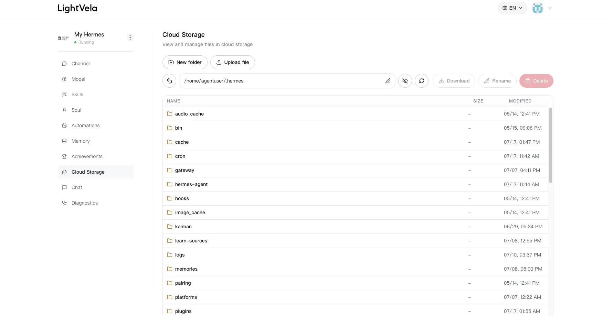

# Storan Awan

## Ringkasan

**Storan awan ialah Hermes ruang kerja fail ejen anda. Anda boleh menyimpan bahan tugasan di satu tempat, memuat naik dan menyusun fail atau memuat turun perkara yang anda perlukan secara setempat, semuanya tanpa meninggalkan LightVela. Kapasiti datang daripada pelan anda — Pelancaran termasuk 50 GB storan awan khusus dan Cruise menawarkan lebih banyak lagi. Failkan ejen membaca dan menulis semasa menjalankan tugas secara langsung di sini juga, yang menjadikannya pustaka dokumen anda dan direktori kerja ejen.**

---

Storan Awan ialah ruang kerja fail untuk Hermes Agent anda. Gunakannya untuk menyimpan fail yang diperlukan oleh ejen di satu tempat, kemudian muat naik, susun, muat turun atau alih keluarnya daripada konsol Ejen tanpa meninggalkan LightVela.

## Halaman ini meliputi

- Membuka Storan Awan Ejen anda
- Memuat naik, mencipta dan menyusun fail dan folder
- Memuat turun, menamakan semula dan memadam fail
- Memeriksa sama ada ruang kerja sedia untuk ejen anda

> **Baik untuk diketahui:** Storan Awan adalah milik Ejen yang dipilih. Buka Ejen yang sama pada bila-bila masa anda mahu mengurus fail yang boleh digunakannya.

## Bila hendak menggunakan Cloud Storage

Storan Awan berguna apabila ejen memerlukan bahan rujukan, dokumen kerja atau tempat yang kemas untuk menyimpan fail yang dibuat semasa tugasan. Sebagai contoh, anda boleh memuat naik ringkasan projek sebelum meminta ejen meringkaskannya atau mencipta folder untuk memisahkan kerja berulang.

Ia berbeza daripada konteks yang disimpan ejen. Untuk mengurus perkara yang diingati oleh ejen merentas perbualan, lihat [Memori](./memory.md).

## Sebelum anda bermula

1. Pastikan anda boleh membuka Ejen yang anda ingin bekerjasama.
2. Sediakan fail yang ingin anda tambah. Muat naik dan muat turun individu menyokong fail sehingga 1 GB.
3. Tentukan struktur folder mudah jika anda menambah beberapa fail berkaitan.

## Buka Storan Awan

1. Buka **Agents** dan pilih Ejen yang failnya ingin anda uruskan.
2. Buka bahagian **Cloud Storage** atau **Files**.
3. Tunggu senarai fail dimuatkan sebelum memulakan muat naik atau tindakan folder.

Jika senarai tidak dimuatkan, muat semula halaman dan cuba lagi. Jika isu berterusan, gunakan [Diagnostik](./diagnostics.md) untuk menyemak log terbaharu Ejen sebelum membuat perubahan yang lebih besar.

## Muat naik fail dan buat folder

### Muat naik fail

1. Pilih **Muat Naik**.
2. Pilih satu atau lebih fail daripada komputer anda.
3. Pastikan halaman terbuka sehingga muat naik selesai, kemudian sahkan bahawa fail itu muncul dalam folder semasa.

Gunakan nama yang jelas supaya anda dan ejen boleh mengenali fail itu kemudian. Jika fail terlalu besar, kurangkan ia di bawah 1 GB atau bahagikannya sebelum memuat naik.

### Buat folder atau fail

1. Dalam folder yang anda inginkan item baharu, pilih **Folder baharu** atau **Fail baharu**.
2. Masukkan nama deskriptif.
3. Sahkan tindakan, kemudian buka item baharu untuk terus bekerja.

Struktur kecil biasanya cukup: satu folder untuk bahan sumber, satu untuk kerja yang sedang dijalankan, dan satu untuk fail siap. Elakkan folder bersarang dalam melainkan ia benar-benar menjadikan projek lebih mudah untuk dinavigasi.

## Urus fail sedia ada

Pilih fail atau folder untuk menggunakan tindakan yang tersedia dalam senarai fail:

- **Buka** folder untuk menyemak imbas kandungannya.
- **Muat turun** fail apabila anda memerlukan salinan tempatan.
- **Namakan semula** item untuk menjadikan tujuannya lebih jelas.
- **Padam** fail atau folder yang anda tidak perlukan lagi.

> **Awas:** Memadamkan item akan mengalih keluarnya daripada Storan Awan Ejen ini. Muat turun apa sahaja yang anda perlukan kemudian sebelum memadamkannya.

Jika anda menggunakan alat yang mencipta fail tersembunyi, hidupkan paparan fail tersembunyi hanya apabila anda perlu memeriksanya. Mengekalkan paparan itu menjadikan pengurusan fail setiap hari lebih mudah.

## Sahkan ruang kerja

Anda bersedia untuk menggunakan Storan Awan apabila:

- fail atau folder muncul di lokasi yang dijangkakan;
- anda boleh membuka atau memuat turun fail dengan jayanya; dan
- nama folder menjelaskan bahan mana yang dimiliki oleh tugas semasa.

Anda kini boleh kembali ke [Sembang](./agent-chat.md) dan beritahu Ejen apa yang anda mahu lakukan dengan fail tersebut. Untuk kerja berulang, gabungkan arahan yang sama dengan [Tugas Berjadual](./automation.md) atau [Kemahiran](./skill.md).

## Soalan Lazim

### Mengapa saya tidak boleh memuat naik atau memuat turun fail?

Mula-mula semak bahawa fail tidak lebih besar daripada 1 GB dan sambungan anda stabil. Muat semula paparan Storan Awan, kemudian cuba semula tindakan itu. Jika masih gagal, kumpulkan maklumat terkini dalam [Diagnostik](./diagnostics.md).

### Bolehkah saya menggunakan satu fail Ejen dengan Ejen lain?

Storan Awan diurus daripada konsol Ejen yang dipilih. Buka Ejen yang anda ingin gunakan dan tambahkan fail di sana supaya ruang kerja kekal jelas dan disengajakan.

### Adakah pemadaman fail mengeluarkannya daripada komputer saya?

Tidak. Memadamkan daripada Storan Awan mengalih keluar salinan terurus untuk Ejen tersebut. Ia tidak memadamkan fail asal pada komputer anda.

## Langkah seterusnya

- Gunakan [Sembang](./agent-chat.md) untuk bekerja dengan fail yang telah anda sediakan.
- Semak [Memori](./memory.md) apabila Ejen harus mengekalkan konteks, bukan hanya fail.
- Gunakan [Diagnostik](./diagnostics.md) jika tindakan penyimpanan berulang kali gagal.
