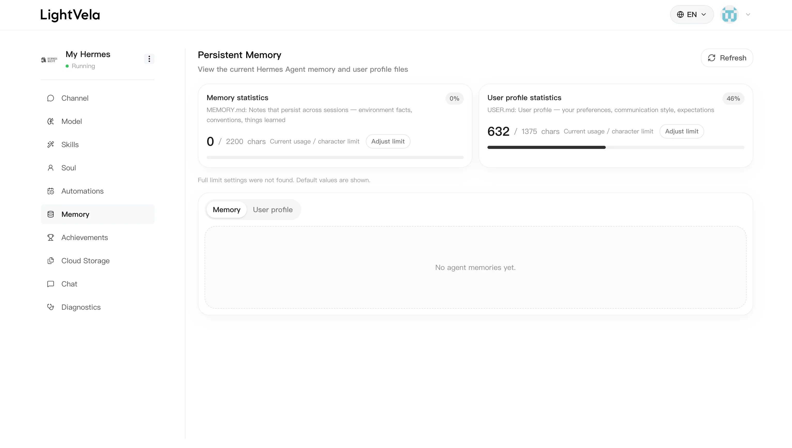

# Pengurusan Memori

## Ringkasan

**Memori adalah apa yang membolehkan Hermes mengekalkan perkara-perkara yang penting merentas perbualan dan peranti — keutamaan anda, siapa anda, apa yang sedang anda kerjakan, dan pengalaman yang diperolehnya melalui kerjasama jangka panjang. Ia adalah asas yang mengubah Hermes daripada menjawab soalan sekali-sekala menjadi pembantu yang memahami anda dengan lebih baik dari masa ke masa. Memori wujud di dalam ejen dan di luar model, jadi menukar model tidak akan membuatnya lupa. Anda boleh meninjau memori yang terkumpul dan penggunaan kapasiti di halaman memori dan profil pengguna, kemudian meminta Hermes dalam perbualan untuk mengingati atau melupakan butiran tertentu; semua saluran mesej anda berkongsi satu memori.**

---

Memori membantu Hermes mengekalkan maklumat penting merentas perbualan dan peranti—keutamaan anda, identiti, kerja yang sedang dijalankan dan pengalaman yang dibangunkannya melalui kerjasama jangka panjang. Inilah yang bertukar Hermes daripada alat menjawab soalan sekali sahaja kepada pembantu jangka panjang yang lebih memahami anda dari semasa ke semasa.



LightVela dihoskan awan, jadi kenangan ini disimpan dengan tika Hermes anda dalam awan. Ia tidak hilang apabila anda menukar peranti atau bertukar antara Telegram, WhatsApp, Discord, Slack dan WeChat. Jika anda memberitahu Hermes sesuatu dalam Telegram hari ini, ia masih boleh mengingatinya apabila anda meneruskan perbualan dalam WhatsApp esok.

## Perkara yang dilindungi oleh halaman ini

- Masalah ingatan selesai

- Dua jenis ingatan: Memori ejen dan profil pengguna

- Cara melihat memori dan penggunaan kapasiti dalam konsol

- Cara melaraskan had kapasiti memori

- Cara menambah atau mengalih keluar kenangan melalui perbualan

- Soalan lazim

> 💡 **Memori dibina secara automatik—anda tidak perlu memasukkannya secara manual**
>
> Anda tidak perlu mengisi borang ingatan. Semasa perbualan biasa, Hermes memutuskan maklumat yang cukup berguna untuk disimpan. Halaman Memori dalam konsol adalah terutamanya untuk **menyemak** perkara yang Hermes ingat dan **melaraskan kapasiti** apabila diperlukan.

---

## Mengapa ingatan penting

Tanpa ingatan, setiap perbualan dengan pembantu AI bermula dari halaman kosong. Anda perlu menjelaskan siapa anda, perkara yang anda suka dan di mana perbualan terakhir berakhir. Memori menyelesaikan masalah itu:

- **Kurangkan ulangan anda**: Beritahu Hermes sebaik sahaja anda tinggal di Singapura dan lebih suka taklimat pagi, dan anda tidak perlu menyatakannya semula setiap kali.

- **Kekal konsisten merentas saluran**: Telegram, WhatsApp, Discord, Slack dan WeChat berkongsi memori yang sama. Apabila anda menukar saluran, anda masih bercakap dengan pembantu yang sama yang memahami anda.

- **Tingkatkan melalui penggunaan berterusan**: Semasa anda bekerjasama, Hermes mengingati rutin, nama pilihan dan projek aktif anda, menjadikan responsnya semakin relevan.

Anggap ingatan sebagai buku nota jangka panjang Hermes. Ia tidak mengekalkan setiap mesej biasa; ia mengekalkan butiran yang mungkin berguna kemudian.

---

## Dua jenis ingatan

Halaman Memori dalam konsol mempunyai dua tab, setiap satu mempunyai tujuan yang berbeza:

### Ingatan

Ini mengandungi **pengalaman dan fakta** Hermes berkembang melalui kerjasama jangka panjang—keutamaan yang telah anda kongsi, cara bekerja yang dipersetujui dan keperluan yang berulang dari semasa ke semasa. Hermes mengekalkan kandungan ini secara automatik semasa perbualan, dan entri berkembang apabila anda terus menggunakannya.

### Profil Pengguna

Ini ialah rekod stabil **siapa anda**, seperti identiti, lokasi, latar belakang profesional dan pilihan jangka panjang anda. Berbanding dengan memori umum, profil pengguna berfungsi lebih seperti kad profil berterusan yang membantu Hermes memahami dengan cepat konteks asas anda dalam sebarang perbualan.

> ℹ️ **Bagaimana mereka berbeza**
>
> Ringkasnya, **profil pengguna** menjawab "Anda jenis apakah?" manakala **memori** menjawab “Apa yang telah berlaku antara kita, dan apa yang telah kita persetujui?” Bersama-sama, mereka membantu Hermes memahami kedua-dua anda dan sejarah kerjasama anda.

---

## Lihat kenangan dan penggunaan kapasiti

1. Log masuk ke LightVela dan klik “My Hermes” di penjuru kanan sebelah atas untuk membuka konsol.

2. Cari "Memori" dalam navigasi tetapan dan buka halaman Memori.

3. Di bahagian atas halaman, semak **statistik memori**: aksara yang digunakan pada masa ini, had kapasiti dan peratusan yang digunakan.

4. Beralih antara tab "Memori" dan "Profil Pengguna" untuk menyemak setiap jenis kandungan.

Jika mana-mana jenis kosong, halaman memaparkan "Tiada memori Ejen" atau "Tiada profil pengguna." Ini biasanya bermakna anda tidak bekerja dengan Hermes cukup lama untuk membina memori jenis itu. Kandungan akan terkumpul dari semasa ke semasa.

> 💡 **Maksud peratusan penggunaan**
>
> Memori mempunyai had kapasiti. Apabila penggunaan menghampiri had itu, Hermes mengutamakan maklumat yang lebih penting dan mengalih keluar masukan lapuk. Memantau peratusan membantu anda memutuskan sama ada untuk meningkatkan kapasiti atau mengalih keluar maklumat yang anda tidak perlukan lagi.

---

## Laraskan had kapasiti memori

Anda boleh meningkatkan had kapasiti apabila anda mahu Hermes untuk mengekalkan lebih banyak maklumat, atau mengurangkannya apabila sesuai.

- **Memori** boleh ditetapkan daripada 500 hingga 4,000 aksara.

- **Profil Pengguna** boleh ditetapkan daripada 500 hingga 3,000 aksara.

Had baharu berkuat kuasa selepas anda menyimpannya.

> ⚠️ **Menyimpan had baharu memulakan semula get laluan secara ringkas dan mungkin mengganggu perbualan semasa**
>
> Apabila anda menyimpan had kapasiti baharu, get laluan Hermes dimulakan semula sebentar untuk menggunakan konfigurasi. Perbualan yang sedang berjalan mungkin terganggu seketika dan akan pulih sejurus selepas itu. Buat perubahan pada masa gangguan yang singkat tidak akan menjejaskan kerja anda.

---

## Tambah atau alih keluar memori melalui perbualan

Selain menyemak kandungan dalam konsol, anda boleh meminta Hermes terus untuk mengingati atau melupakan maklumat. Ini biasanya cara paling semula jadi untuk mengekalkan ingatan semasa penggunaan seharian.

**Minta ingat:**

```
Remember that I want my daily briefing at 8:00 AM.
```

```
Remember that I prefer concise, direct answers.
```

**Minta lupa:**

```
I no longer need the daily briefing we discussed. Please forget that preference.
```

Hermes mentafsir niat anda, mengemas kini entri memori yang berkaitan dan memberitahu anda perkara yang berubah.

> ℹ️ **Kandungan memori dikekalkan pada masa ini melalui perbualan**
>
> LightVela menggunakan model awan terurus dan tidak mendedahkan operasi sistem fail yang dihadapi pengguna. Tambah atau alih keluar kandungan memori terutamanya dengan bercakap dengan Hermes; gunakan konsol untuk menyemak kandungan dan melaraskan had kapasiti.

---

## Soalan Lazim

### Mengapakah Hermes mengingati sesuatu yang saya tidak minta secara jelas untuk disimpan?

Ini dijangka. Hermes secara automatik mengenal pasti maklumat yang mungkin berguna dari semasa ke semasa, seperti keutamaan, identiti dan perjanjian kerja anda. Jika anda tidak mahu ia menyimpan sesuatu, minta ia melupakan maklumat tersebut dalam perbualan.

### Adakah memori kekal apabila saya menukar peranti atau saluran?

ya. Memori disimpan dengan contoh awan dan bebas daripada mana-mana satu peranti atau saluran. Telegram, WhatsApp, Discord, Slack dan WeChat semuanya berkongsi ingatan yang sama.

### Apakah yang berlaku apabila memori mencapai kapasiti?

Apabila penggunaan menghampiri had, Hermes mengutamakan maklumat yang lebih penting dan secara beransur-ansur mengalih keluar masukan yang lapuk atau kurang berguna. Jika anda memerlukannya untuk menyimpan lebih banyak, tingkatkan had kapasiti pada halaman Memori.

### Mengapa halaman Memori mengatakan tiada ingatan?

Memori jenis itu belum mengumpul sebarang kandungan lagi. Teruskan bekerja dengan Hermes, atau terus minta ia mengingati butiran penting, dan kandungan akan mula muncul.

### Mengapa perbualan saya dijeda selepas saya menukar had kapasiti?

Menyimpan had baharu mencetuskan permulaan semula get laluan ringkas, yang boleh mengganggu perbualan seketika. Tunggu sebentar, kemudian hantar mesej itu semula.

---

## Langkah seterusnya

Memori membantu Hermes mengingati anda. Seterusnya, berikan lebih banyak cara untuk bertindak:

- [Konfigurasikan Kemahiran](./skill.md) — Tambahkan keupayaan seperti carian cuaca, taklimat dan penyemakan imbas web

- [Tugas Berjadual](./automation.md) — Biarkan Hermes menjalankan tugas secara proaktif mengikut jadual

- [Gambaran Keseluruhan Konfigurasi](../05-configuration.md)
