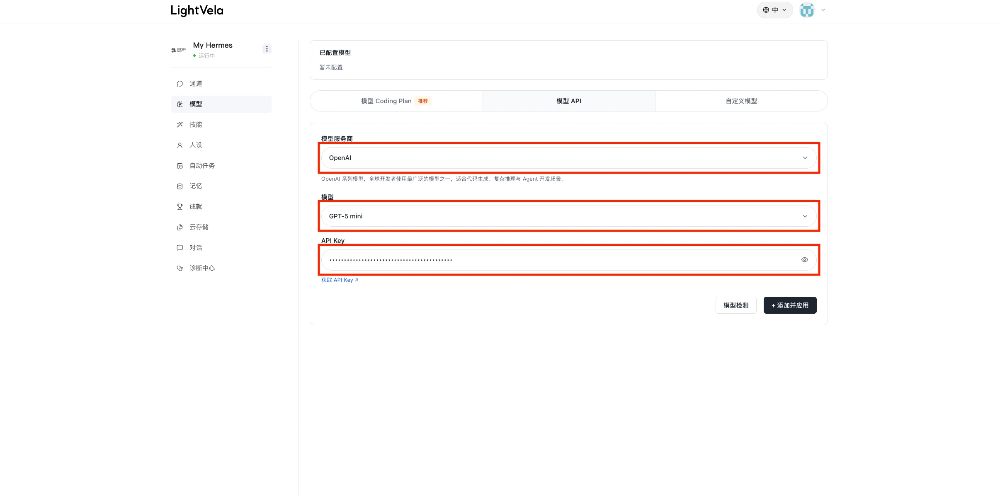

# Konfigurasi Model

## Ringkasan

**Mengkonfigurasi model adalah pilihan: pelan anda termasuk kredit model bulanan, jadi sebaik sahaja anda membuat ejen dan menyambungkan saluran, anda boleh mula bercakap serta-merta dan hanya mengkonfigurasi model selepas kredit tersebut habis. Bahagian Model pada konsol menawarkan tiga pilihan: Pelan Pengekodan Model (bulanan atau tahunan, terbaik untuk kegunaan berat), Model API (bayar semasa anda pergi, terbaik untuk kegunaan ringan atau percubaan) dan Model tersuai (sambungkan titik akhir yang serasi OpenAI). Ketiganya memerlukan kunci API anda sendiri daripada pembekal yang sepadan. Langkah-langkahnya ialah: pilih sumber, pilih model tertentu, tampal kekunci API dan tetapkannya sebagai lalai. Anda boleh menukar model kemudian tanpa kehilangan ingatan. Kekunci API ialah bukti kelayakan yang sensitif — jangan sekali-kali menyiarkannya dalam kumpulan sembang atau di halaman awam, jangan sekali-kali meletakkannya pada repositori Git dan batalkan atau putarkannya dalam konsol pembekal serta-merta jika ia bocor.**

---

Halaman ini menerangkan cara mengkonfigurasi model bahasa yang besar untuk Hermes Agent, termasuk perbezaan antara tiga kaedah konfigurasi, cara mendapatkan kunci API, langkah konfigurasi konsol, model yang disokong dan panduan pemilihan model.

> 💡 **Tatarajah adalah pilihan**
> 
> Pelan Pelancaran termasuk 100 kredit percubaan. Selepas mencipta Hermes Agent dan menyambungkan saluran, anda boleh mula bersembang secara langsung. Konfigurasikan model selepas kredit habis.

---

## Halaman ini meliputi

- Perbezaan antara tiga kaedah konfigurasi (Pelan Pengekodan / API / Model Tersuai)
    
- Bagaimana untuk mendapatkan kunci API
    
- Langkah konfigurasi konsol
    
- Penukaran model
    
- Model yang disokong
    
- Panduan pemilihan model
    

---

## Tiga kaedah konfigurasi

Menu lungsur peringkat pertama dalam kad "Model" konsol menyediakan tiga pilihan:

| Kaedah | Mod pengebilan | API Sumber utama | Kes penggunaan |
| --- | --- | --- | --- |
| Pelan Pengekodan Model | Bulanan / tahunan | Pembekal | Penggunaan frekuensi tinggi |
| Model API | Bayar semasa anda pergi | Pembekal | Penggunaan atau percubaan frekuensi rendah |
| Model tersuai | Bergantung pada titik akhir | Diberikan pengguna | Sambungkan model luar negara atau titik akhir yang serasi OpenAI |

> ⚠️ **Sediakan API Kunci anda sendiri**
> 
> Ketiga-tiga kaedah memerlukan Kunci API anda sendiri. Sila daftar dengan pembekal yang berkaitan dan buat Kunci terlebih dahulu.

---

## Proses umum untuk mendapatkan kunci API

Antara muka pembekal berbeza, tetapi prosesnya secara amnya sama:

1. **Lawati tapak web pembekal**: Selepas memilih model dalam kad model konsol, pautan "Dapatkan API KEY" muncul di bawah. Klik padanya untuk membuka tapak web pembekal
    
2. **Daftar atau log masuk**: Kebanyakan platform Cina menyokong WeChat atau log masuk nombor telefon
    
3. **Pengesahan nama sebenar lengkap**: Penyedia model Cina biasanya memerlukan pengesahan nama sebenar sebelum API panggilan dibenarkan
    
4. **Buka halaman pengurusan kunci API**: Biasanya di bawah "Konsol → API Pengurusan / Pengurusan Kunci / Bukti kelayakan"
    
5. **Buat Kunci baharu**: Namakan Kekunci (contohnya, `LightVela`) dan salinnya serta-merta selepas penciptaan. Kebanyakan platform menunjukkan Kunci lengkap sekali sahaja
    
6. **Kembali ke LightVela dan tampal Kekunci**
    

> ⚠️ **API Kunci ialah bukti kelayakan sensitif**
> 
> Jangan hantar Kunci ke kumpulan sembang, terbitkannya di halaman web atau serahkannya ke repositori Git. Jika Kunci dibocorkan, batalkan atau tetapkannya serta-merta dalam konsol pembekal.

---

## Konfigurasikan dalam konsol

Masukkan konsol dan buka butang "Model".

### Langkah konfigurasi

1. **Pilih sumber** (dropdown peringkat pertama): Model API / Pelan Pengekodan Model / Model Tersuai
    
2. **Pilih model tertentu** (dropdown peringkat kedua): Model yang tersedia ditunjukkan berdasarkan sumber yang dipilih di atas
    
3. **Masukkan API Kunci**: Tampalkan Kunci yang anda perolehi. Ikon mata di sebelah kanan menogol keterlihatan
    
4. **Klik "Tambah sebagai lalai"**
    
5. Rekod yang sepadan muncul dalam senarai "Model semasa", menunjukkan konfigurasi yang berjaya
    

### Medan tambahan untuk model tersuai

Apabila memilih "Model Tersuai", anda biasanya perlu mengisi medan berikut sebagai tambahan kepada Kekunci API:

- **URL asas**: Perkhidmatan model API alamat, contohnya `https://api.openai.com/v1`
    
- **Nama Model**: Pengecam model, contohnya `gpt-4o` atau `claude-3-5-sonnet-20241022`
    

Medan sebenar tertakluk kepada antara muka konsol.

> 💡 **Cara mengkonfigurasi model tersuai (seperti OpenAI GPT, Google Gemini, dsb.)**
> 
> Selain model biasa yang disenaraikan dalam konsol, seperti MiniMax, Kimi dan Zhipu GLM, pengguna juga boleh mengkonfigurasi OpenAI GPT, Google Gemini, Claude, atau model lain yang tidak ditunjukkan dalam senarai melalui "Model Tersuai".

---

## Tukar model

### Bagaimana untuk menukar

Jalankan langkah konfigurasi sekali lagi. Tindakan "Tambah sebagai lalai" baharu menimpa konfigurasi sebelumnya.

> ⚠️ **Hanya satu model yang aktif**
> 
> Pada masa ini, setiap Hermes Agent hanya boleh mempunyai satu model aktif. Untuk membandingkan prestasi model yang berbeza, konfigurasikan dan cuba mereka secara berasingan.

### Kesan pada ingatan

Menukar model tidak menjejaskan memori perbualan. Memori adalah milik Hermes Agent itu sendiri; model hanya bertanggungjawab untuk menjana respons.

---

## Model yang disokong

### Pelan Pengekodan Model (bulanan)

| Nama | Pembekal |
| --- | --- |
| Zhipu AI (GLM Antarabangsa - Pelan Pengekodan) | Zhipu AI |
| Pelan Pengekodan Kimi | Moonshot AI |
| Pelan Token Xiaomi | Xiaomi |
| Pelan Pengekodan Bailian | Alibaba Cloud Bailian |
| Pelan Pengekodan Ark Enjin Gunung Berapi | Enjin Gunung Berapi (ByteDance) |

### Model API (bayar semasa anda pergi)

| Nama | Pembekal |
| --- | --- |
| OpenAI | OpenAI |
| Anthropic | Anthropic |
| Google Gemini | Google |
| OpenRouter | OpenRouter |
| DeepSeek | DeepSeek |
| Bailian (Qwen) | Alibaba |
| MiniMax (Antarabangsa) | MiniMax |
| Moonshot AI (Kimi International) | Moonshot |
| Zhipu AI (GLM Antarabangsa) | Zhipu |
| Enjin Gunung Berapi (Doubao) | ByteDance |
| Xiaomi MiMo | Xiaomi |

### Model tersuai

Mana-mana titik akhir yang serasi dengan protokol OpenAI Penyelesaian Sembang boleh disambungkan, termasuk:

- Model yang dihoskan sendiri: vLLM, Ollama, LM Studio dan perkhidmatan lain yang mendedahkan titik akhir serasi OpenAI
    
- Platform pengagregatan: OpenRouter, dsb.
    

---

## Panduan pemilihan

Arahan pemilihan untuk keutamaan yang berbeza:

| Keutamaan | Arah yang dicadangkan |
| --- | --- |
| Kuota percuma | Banyak penyedia menawarkan kuota percuma untuk akaun baharu; mulakan dengan percubaan |
| Pemprosesan konteks panjang | Pilih model dengan tetingkap konteks yang lebih besar (seperti Moonshot AI) |
| Kelajuan tindak balas | Pembekal berbeza dengan ketara; bergantung pada pengalaman sebenar |
| Kefahaman Cina | Model Cina umumnya menyokong bahasa Cina lebih baik |
| Penggunaan frekuensi tinggi | Pilih Pelan Pengekodan bulanan penyedia yang sepadan |

Syor: gunakan kredit percubaan pelan Pelancaran untuk beberapa perbualan dahulu. Selepas mengesahkan bahawa Hermes Agent berfungsi seperti biasa, tentukan model yang hendak digunakan.

---

## Soalan Lazim

| Isu | Kemungkinan punca | Penyelesaian |
| --- | --- | --- |
| "Model semasa" masih kosong selepas memasukkan Kunci | Format kunci salah atau mengandungi ruang | Salin dan tampal semula; mengesahkan tiada ruang hadapan atau belakang |
| Tiada respon untuk masa yang lama selepas menghantar mesej | Baki pembekal tidak mencukupi atau Kunci dinyahdayakan | Semak baki dan status Kunci dalam konsol pembekal |
| Kandungan respons bercelaru atau tidak bermakna | Titik akhir model tersuai tidak serasi dengan protokol OpenAI | Sahkan ketersediaan titik akhir dengan pelanggan lain yang serasi OpenAI dahulu |
| "Tamat masa respons model" | Had kadar pembekal atau ketidakstabilan rangkaian | Cuba lagi kemudian atau tukar kepada pembekal lain |
| Tidak pasti tentang URL Asas model tersuai | — | Semak dokumentasi perkhidmatan API yang sepadan; ia biasanya `https://xxx.com/v1` |

### Ralat perbualan "HTTP 401:InvalidAuthentication" atau ralat 401 yang serupa

Jika `HTTP 401:InvalidAuthentication` atau ralat `401 xxx` lain muncul semasa perbualan dengan OpenClaw, ia biasanya disebabkan oleh salah satu daripada yang berikut:

1. Model API Kunci dikonfigurasikan secara tidak betul;
    
2. Pelan Pengekodan API Kunci dikelirukan dengan model biasa API Kunci;
    
3. Versi domestik atau antarabangsa pembekal model dipilih dengan tidak betul.
    

Apabila ini berlaku, semak konfigurasi model sekali lagi.

---

## Langkah seterusnya

- [Konfigurasikan Saluran - WeChat](./channel-wechat.md)

- [Konfigurasikan Saluran - Telegram](./channel-telegram.md)

- [Konfigurasikan Saluran - WhatsApp](./channel-whatsapp.md)

- [Konfigurasikan Saluran - Discord](./channel-discord.md)

- [Konfigurasikan Saluran - Slack](./channel-slack.md)

- [Konfigurasikan Saluran - QQ](./channel-qq.md)

- [Konfigurasikan Saluran - WeCom](./channel-wecom.md)

- [Konfigurasikan Saluran - Lark](./channel-feishu.md)

- [Konfigurasikan Kemahiran](./skill.md)
