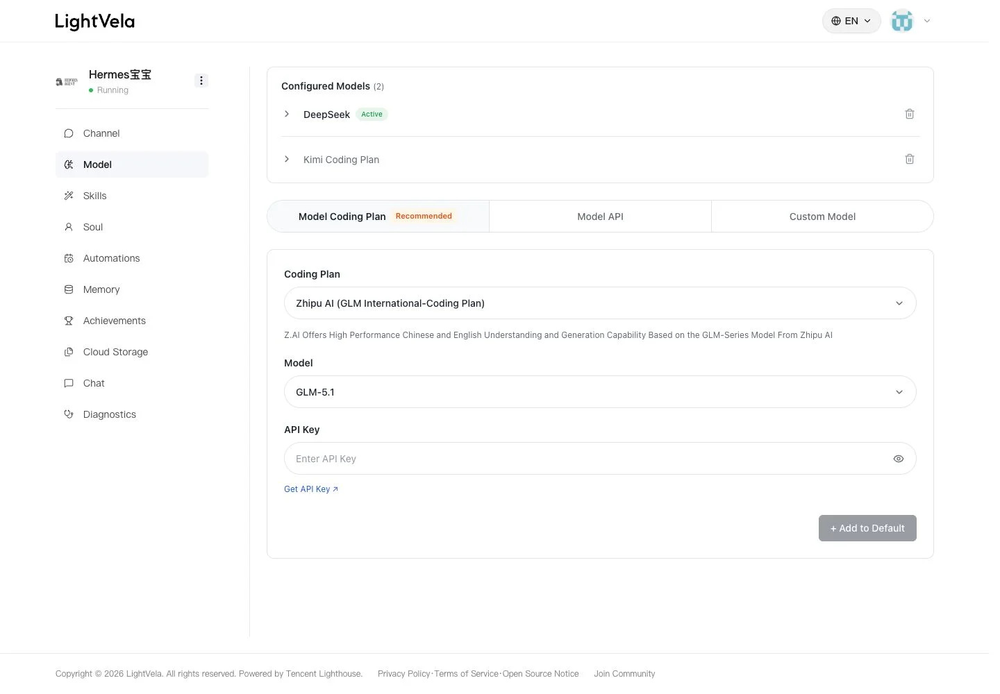

# Penukaran Model

## Ringkasan

**Penukaran model membolehkan anda memilih model terkonfigurasi anda yang sedang digunakan oleh Hermes Agent. Apabila tugas memerlukan kelajuan, keupayaan, profil kos atau ketersediaan pembekal yang berbeza, anda menukar model dan bukannya membuat ejen baharu. Ini berfungsi kerana persona, ingatan, kemahiran dan tugasan berjadual semuanya disimpan di luar model, jadi menukar model hanya menukar enjin penaakulan — tiada apa yang diambil atau dipadamkan, dan ejen masih mengingati anda. Setiap ejen mempunyai satu model aktif pada satu masa.**

---

Penukaran Model membolehkan anda memilih model terkonfigurasi yang Hermes Agent anda gunakan untuk kerja seterusnya. Beralih apabila tugas memerlukan keseimbangan kelajuan, keupayaan, kos atau ketersediaan penyedia yang berbeza—tanpa membuat Ejen baharu.

## Halaman ini meliputi

- Menyediakan lebih daripada satu model yang boleh digunakan
- Memilih model aktif untuk Ejen
- Mengesahkan perubahan dalam Sembang
- Menyelesaikan masalah model yang tidak muncul atau tidak dapat bertindak balas

> **Baik untuk diketahui:** Ejen menggunakan satu model aktif pada satu masa. Menukar model aktif tidak memadamkan memori Ejen, fail Storan Awan, kemahiran atau tugas yang dijadualkan.

## Sebelum anda bermula

1. Buka Ejen yang anda ingin kemas kini.
2. Pastikan model sasaran telah dikonfigurasikan dan tersedia untuk akaun anda. Jika tidak, ikuti [Configure Models](./model.md) dahulu.
3. Sediakan gesaan ujian mudah supaya anda boleh mengesahkan model baharu bertindak balas seperti yang diharapkan.

## Tukar model aktif

1. Buka **Agen** dan pilih Ejen.
2. Buka bahagian **Models**.
3. Pilih model yang dikonfigurasikan yang anda mahu Ejen gunakan.
4. Simpan atau gunakan perubahan, kemudian tunggu Ejen selesai mengemas kini konfigurasi aktifnya.



Jika anda memilih model buat kali pertama, gunakan [Konfigurasikan Model](./model.md) untuk menambah pembekal yang disokong atau model tersuai sebelum kembali ke sini.

## Sahkan perubahan

Buka [Sembang](./agent-chat.md) dan hantar gesaan pendek berisiko rendah, sebagai contoh:

```text
Reply with the name of the current model if it is available, then summarize this sentence in one line: Model switching is ready.
```

Sahkan bahawa Ejen bertindak balas secara normal dan model yang ditunjukkan dalam konsol Ejen ialah model yang anda pilih. Jika balasan pertama mengambil masa lebih lama semasa Ejen mengemas kini, tunggu sebentar dan cuba semula sekali sebelum membuat perubahan lain.

## Pilih masa yang sesuai untuk bertukar

| Situasi | Perkara yang perlu dipertimbangkan |
| --- | --- |
| Anda memerlukan draf pertama yang lebih pantas | Pilih model yang dikonfigurasikan yang sesuai dengan tugasan rutin yang pendek. |
| Tugas memerlukan penaakulan atau bantuan kod yang lebih kukuh | Pilih model yang telah anda konfigurasikan untuk jenis kerja tersebut. |
| Pembekal tidak tersedia atau terhad kadar | Beralih kepada model lain yang dikonfigurasikan, kemudian ujinya dalam Sembang. |
| Anda sedang membandingkan kualiti output | Jalankan gesaan kecil yang sama selepas setiap suis dan bandingkan hasilnya. |

Penukaran Model menukar enjin yang digunakan untuk respons masa hadapan. Ia tidak mengalihkan sejarah perbualan anda, menulis semula fail dalam [Cloud Storage](./files.md), atau menukar [Kemahiran](./skill.md) dan [Tugas Terjadual](./automation.md) anda.

Jika anda ingin meneroka persekitaran ejen pertama pemalam yang berasingan bersama Hermes Agent, lihat [DeepSeek Harness](./deepseek-harness.md).

## Jika suis tidak berfungsi

1. Kembali ke [Configure Models](./model.md) dan sahkan model sasaran, bukti kelayakan dan tetapan pembekal telah lengkap.
2. Sahkan bahawa model tersedia untuk akaun anda dan mempunyai kuota atau kredit pembekal yang mencukupi.
3. Pilih model berfungsi yang diketahui dan ujinya dalam Sembang.
4. Jika Ejen masih tidak dapat bertindak balas, buka [Diagnostik](./diagnostics.md) dan semak log terkini sebelum menetapkan semula konfigurasi modelnya.

> **Petua:** Tukar satu perkara pada satu masa. Ujian selepas setiap suis menjadikannya lebih mudah untuk mengetahui sama ada isunya ialah model, konfigurasinya atau tugas itu sendiri.

## Soalan Lazim

### Mengapa model yang saya mahu tidak disenaraikan?

Hanya model yang dikonfigurasikan boleh dipilih. Tambah atau lengkapkan model dalam [Configure Models](./model.md), kemudian kembali ke bahagian Models.

### Adakah menukar model mengosongkan ingatan Ejen saya?

Tidak. Model aktif berubah, sementara memori Ejen dan persediaan yang disimpan kekal di tempatnya. Anda boleh menyemak memori secara berasingan dalam [Memori](./memory.md).

### Bolehkah saya menukar semula jika saya tidak menyukai hasilnya?

ya. Pilih model lain yang dikonfigurasikan, gunakan perubahan dan uji dengan gesaan yang sama. Mengekalkan ketekalan segera memberi anda perbandingan yang lebih berguna.

## Langkah seterusnya

- Sediakan pembekal tambahan dalam [Configure Models](./model.md).
- Gunakan [Sembang](./agent-chat.md) untuk membandingkan respons model pada tugas sebenar.
- Gunakan [Diagnostik](./diagnostics.md) jika model yang dikonfigurasikan berulang kali gagal dimulakan.
