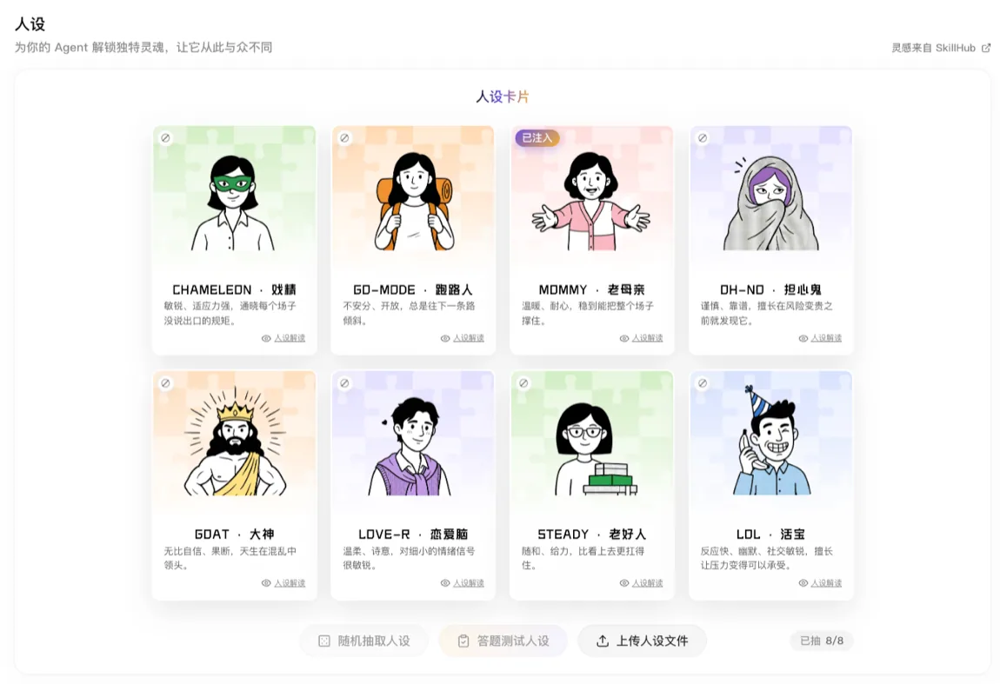
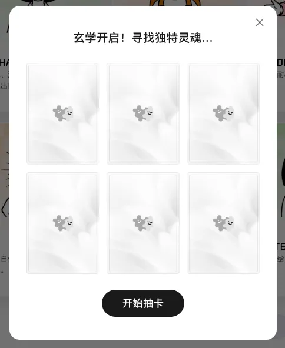
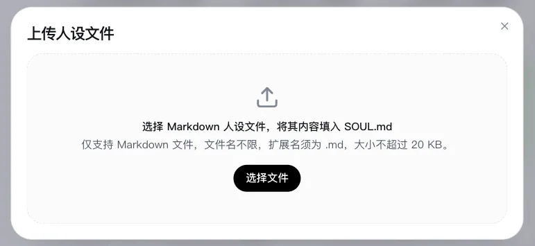

# Jiwa

## Ringkasan

**Personaliti mentakrifkan peranan yang stabil, suara, keutamaan dan sempadan tingkah laku untuk seorang Hermes Agent.**

**Pilih Jiwa daripada tetapan Personaliti Ejen, semak penerangannya dan suntikannya untuk mengemas kini `SOUL.md` Ejen.**

**Hanya satu Jiwa yang aktif untuk Ejen pada satu masa, dan anda harus memulakan perbualan baharu selepas menukarnya supaya peraturan yang dikemas kini dimuatkan.**



## Halaman ini meliputi

- Apakah Personaliti dan Jiwa yang mengawal
- Memilih dan menyuntik Jiwa
- Mengesahkan bahawa personaliti baharu itu aktif
- Mengasingkan personaliti, pilihan pengguna, ingatan dan kemahiran
- Had biasa dan langkah penyelesaian masalah

## Perkara yang dikawal oleh Personaliti

A Soul ialah persona terpilih yang LightVela menulis kepada `SOUL.md` Ejen.
Ia mentakrifkan siapa Ejen itu, cara ia biasanya berkomunikasi, perkara yang diutamakan, dan sempadan mana yang harus dihormati.

Gunakan Personaliti untuk arahan yang stabil seperti "memimpin dengan kesimpulan," "menyatakan ketidakpastian dengan jelas" atau "bertanya sebelum mengambil tindakan luaran."
Jangan gunakannya sebagai tempat untuk menukar fakta projek, permintaan sekali sahaja atau editor fail awan tujuan umum.

Personaliti adalah milik Ejen, bukan satu saluran perbualan.
Jika Ejen yang sama disambungkan ke Telegram dan WhatsApp, perbualan baharunya pada kedua-dua saluran menggunakan Jiwa aktif yang sama.

## Sebelum anda bermula

1. Buka Hermes Agent yang personalitinya ingin anda konfigurasikan.
2. Pastikan Ejen mempunyai model dan sekurang-kurangnya satu saluran perbualan yang boleh digunakan supaya anda boleh mengesahkan hasilnya.
3. Tentukan peranan, penonton, suara, keutamaan dan tindakan yang perlu sentiasa memerlukan pengesahan.

Taklimat pendek biasanya sudah memadai.
Contohnya: "Pembantu penyelidik ringkas yang memberikan kesimpulan sebelum bukti, menamakan ketidakpastian, dan bertanya sebelum menghantar apa-apa di luar perbualan."

## Konfigurasikan Jiwa

### Personaliti Terbuka

1. Buka **Ejen** dalam konsol LightVela.
2. Pilih Hermes Agent yang ingin anda konfigurasikan.
3. Buka bahagian **Personaliti** dalam tetapan Ejen tersebut.

Tetapan hanya terpakai kepada Ejen yang dipilih.
Beralih kepada Ejen lain sebelum mengkonfigurasinya jika anda mahukan peranan atau suara yang berbeza di tempat lain.

### Pilih Jiwa

Gunakan **Draw random soul** untuk meneroka gaya persona yang tersedia.
Gunakan **Ujian personaliti jiwa** apabila anda mahukan cadangan berdasarkan pilihan komunikasi dan tingkah laku anda.



Semak peranan, suara, perihalan tingkah laku dan sempadan pada setiap kad Jiwa sebelum membuat pilihan.
Pilih Jiwa yang sepadan dengan ringkas yang anda sediakan dan bukannya memilih hanya dengan nama atau nadanya.

### Menyuntik Jiwa

1. Pilih Jiwa yang anda mahu gunakan.
2. Pilih **Suntikan jiwa**.
3. Sahkan keputusan suntikan di bahagian Personaliti.
4. Kembali ke saluran perbualan yang disambungkan dan hantar `/new`.

Apabila suntikan berjaya, LightVela menulis Jiwa yang dipilih ke `SOUL.md` Ejen semasa dan menyimpan sandaran sebelum menggantikan personaliti sedia ada.
Perbualan sedia ada masih boleh mengekalkan petikan personaliti yang lebih awal, jadi `/new` memulakan perbualan yang membaca Soul yang dikemas kini.

### Muat naik Jiwa anda sendiri

Gunakan pilihan ini apabila anda sudah mempunyai Markdown Soul yang ingin anda gunakan dan bukannya memilih kad yang disyorkan.

1. Pilih sasaran Hermes Agent dalam konsol LightVela.
2. Dalam **Personaliti**, pilih **Muat naik fail personaliti**.
3. Pilih fail Markdown yang mengandungi Jiwa anda.
4. Semak atau edit kandungannya, kemudian pilih **Inject**.
5. Kalau Ejen dah ada Jiwa, confirm nak ganti.
6. Kembali ke saluran perbualan yang disambungkan dan hantar `/new`.



Nama fail tidak perlu `soul.md`, tetapi ia mesti menggunakan sambungan `.md`, dikodkan UTF-8 dan tidak lebih besar daripada 20 KB.
LightVela menunjukkan kandungan fail sebelum suntikan supaya anda boleh membuat pengeditan akhir.
Apabila anda menggantikan Jiwa yang sedia ada, LightVela menyandarkannya sebelum menulis kandungan yang dimuat naik ke `SOUL.md` Ejen yang dipilih.

Muat naik hanya tersedia apabila Ejen dipilih.
Jika anda memerlukan salinan Soul yang disyorkan yang boleh dimuat turun kerana tiada Ejen dipilih atau kotak pasir Ejen tidak boleh ditulis, gunakan fail `soul.md` sahaja sebagai sandaran setempat.
Memuat turun sandaran itu tidak mengemas kini Ejen dengan sendirinya.

## Simpan setiap jenis konteks di tempat yang betul

| Simpan dalam | Gunakannya untuk | Contoh |
| --- | --- | --- |
| Personaliti dan `SOUL.md` | Peranan yang stabil, suara, keutamaan dan sempadan tingkah laku | "Nyatakan ketidakpastian secara eksplisit dan tanya sebelum menghantar mesej luar." |
| Profil Pengguna | Identiti pengguna, lokasi, bahasa dan pilihan komunikasi | "Gunakan bahasa Inggeris secara lalai dan tunjukkan tarikh akhir dahulu." |
| Memori | Mengubah fakta, keputusan dan konteks projek jangka panjang | "Pelancaran projek semasa adalah pada hari Jumaat." |
| Kemahiran | Keupayaan dan prosedur boleh guna semula | Penyelidikan web, organisasi fail atau aliran kerja laporan harian |

Gunakan [Pengurusan Memori](./memory.md) untuk menyemak memori dan kapasiti profil pengguna.
Gunakan [Konfigurasi Kemahiran](./skill.md) apabila Ejen memerlukan keupayaan baharu dan bukannya peraturan personaliti baharu.
Untuk penjelasan lebih mendalam tentang sempadan ini, lihat [Dari Mana Hermes Personaliti Ejen Berasal](../hermes-agent/10-persona-user-memory.md).

## Sahkan bahawa Jiwa aktif

Selepas menghantar `/new`, uji Ejen dengan beberapa permintaan yang mendedahkan kelakuannya yang dikonfigurasikan.

```text
What is your current role, main job, and default voice?
```

```text
How do you respond when you are uncertain about a fact?
```

```text
If I ask you to send a message to an external service, what do you do first?
```

Jiwa baharu aktif apabila Ejen secara konsisten mengikut peranan, suara dan sempadan yang dimaksudkan dalam perbualan baharu.
Jika anda memerlukan panduan khusus saluran, lihat [Cara Menentukan Peranan, Personaliti dan Suara Ejen IM dengan SOUL.md](../use-cases/im-agent-persona-soul-md.md).

## Selesaikan masalah biasa

| Isu | Berkemungkinan menyebabkan | Apa yang perlu dilakukan |
| --- | --- | --- |
| Balasan masih menggunakan nada sebelumnya | Perbualan bermula sebelum Jiwa berubah | Hantar `/new`, kemudian uji semula tingkah laku dalam perbualan baharu. |
| Jiwa yang dipilih tidak sesuai dengan kerja sebenar Ejen | Kad Jiwa dipilih mengikut gaya dan bukannya peranan dan sempadan | Kembali ke Personaliti, semak butiran kad, dan suntikan Jiwa yang sepadan dengan ringkasan Ejen. |
| Ejen terlupa fakta projek | Fakta yang berubah diletakkan dalam Personaliti dan bukannya Memori | Simpan peraturan yang stabil dalam `SOUL.md` dan minta Hermes untuk mengingati fakta yang berubah. |
| Ejen tidak boleh melaksanakan tugas yang diperlukan | Personaliti mentakrifkan tingkah laku, bukan keupayaan | Pasang atau konfigurasikan Kemahiran yang sesuai selepas menyemak sumber dan kebenarannya. |
| Konsol memuat turun `soul.md` dan bukannya menggunakannya | Tiada Ejen dipilih atau kotak pasir Ejen tidak dapat menulis konfigurasi baharu | Pilih sasaran Ejen yang sedang berjalan dan cuba semula suntikan. Fail yang dimuat turun tidak mengubah Ejen. Hantar `/new` hanya selepas konsol mengesahkan bahawa suntikan berjaya. |
| Saya tidak boleh memuat naik Jiwa saya sendiri | Tiada Ejen dipilih atau fail itu bukan fail UTF-8 Markdown yang sah dalam lingkungan 20 KB | Pilih Ejen sasaran, kemudian muat naik fail `.md` yang memenuhi keperluan fail. |

## Soalan Lazim

### Bolehkah seorang Ejen mempunyai beberapa Jiwa yang aktif?

Tidak.
Satu Ejen mempunyai satu Jiwa aktif pada satu masa.
Cipta Ejen berasingan apabila anda memerlukan peranan yang benar-benar berbeza dan bukannya berulang kali menggantikan satu personaliti Ejen.

### Bolehkah saya mengedit awan `SOUL.md` secara manual?

Penggunaan biasa tidak memerlukan operasi sistem fail awan langsung.
Tetapan Personaliti menjana dan menyuntik Jiwa, tetapi ia bukan editor tujuan umum untuk fail awan sewenang-wenangnya.

### Bolehkah saya memuat naik `SOUL.md` sedia ada?

ya.
Gunakan **Muat naik fail personaliti** untuk memilih fail UTF-8 Markdown sehingga 20 KB, semak atau editnya dan masukkannya ke dalam Ejen yang dipilih.
Jika Ejen sudah mempunyai Jiwa, LightVela meminta pengesahan dan menyimpan sandaran sebelum menggantikannya.

### Adakah menukar Jiwa memasang keupayaan baharu?

Tidak.
A Soul mengubah cara Ejen berkelakuan, manakala Kemahiran menambah keupayaan konkrit dan prosedur boleh guna semula.

### Adakah Jiwa baharu memadamkan memori atau sejarah sembang?

Tidak.
Menyuntik Jiwa menggantikan konfigurasi personaliti semasa Ejen.
Ia tidak mengalih keluar ingatan jangka panjang atau sejarah perbualan sedia ada.
